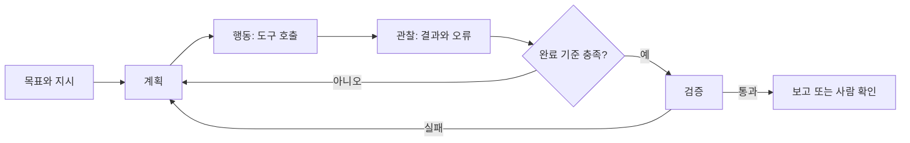

# 에이전트 개념과 구성 요소

**에이전트(Agent)**는 목표를 받아 환경을 관찰하고, 다음 행동을 결정하고, 도구로 행동하고, 결과를 다시 관찰하는 루프를 반복하는 시스템입니다. LLM 기반 에이전트는 이 루프의 "결정" 부분을 모델이 맡습니다. 모델이 직접 세상을 바꾸는 것이 아니라, 모델의 제안을 하네스가 검증해 실행합니다.

## 구성 요소

| 구성 요소 | 하는 일 | 소프트웨어 개발 작업에서의 예 |
| --- | --- | --- |
| 모델(Model) | 문맥을 읽고 다음 행동이나 답을 생성 | 실패 로그를 읽고 수정할 파일을 고름 |
| 지시(Instructions) | 역할, 규칙, 완료 조건을 정의 | "테스트를 먼저 쓰고, 커밋은 하지 마라" |
| 도구(Tools) | 환경에 작용하는 정해진 인터페이스 | 파일 읽기·수정, 셸 실행, 이슈 조회, PR 생성 |
| 메모리(Memory) | 대화를 넘어 유지되는 정보 | 프로젝트 지침 파일, 이전 결정 기록, 사용자 선호 |
| 계획(Planning) | 목표를 단계로 나누고 진행을 추적 | 작업 목록 생성, 완료 항목 표시, 막힌 단계 보고 |
| 검증(Verification) | 결과가 목표를 만족하는지 확인 | 테스트 실행, 린트, 링크 검사, 스크린샷 비교 |
| 종료 조건(Stop) | 언제 끝내거나 사람에게 넘길지 결정 | 테스트 통과, 예산 소진, 권한 필요 |

## 자율성 단계

| 단계 | 모델이 결정하는 범위 | 사람이 하는 일 | 적합한 작업 |
| --- | --- | --- | --- |
| 보조 | 제안만 생성 | 모든 적용 여부 결정 | 코드 완성, 문서 초안 |
| 승인형 | 행동을 제안하고 승인 후 실행 | 도구 호출마다 승인 | 익숙하지 않은 저장소 수정 |
| 감독형 | 정해진 범위에서 자율 실행 | 결과를 리뷰, 예외만 개입 | 테스트 수정, 리팩터링, 문서 갱신 |
| 위임형 | 목표만 받고 끝까지 수행 | 완료 보고와 PR만 확인 | 반복적인 이슈 처리, 의존성 업데이트 |

같은 에이전트라도 작업의 되돌리기 가능성에 따라 단계를 다르게 둡니다. 브랜치 안의 코드 수정은 감독형으로, 배포·삭제·외부 전송은 승인형으로 두는 식입니다.

## 워크플로와 에이전트

| 구분 | 워크플로(Workflow) | 에이전트(Agent) |
| --- | --- | --- |
| 흐름 | 코드로 미리 정한 단계와 분기 | 모델이 관찰 결과에 따라 다음 단계를 선택 |
| 예측 가능성 | 높음 | 낮음, 실행마다 경로가 달라질 수 있음 |
| 비용 | 호출 수가 고정 | 루프 길이에 따라 변동 |
| 적합한 일 | 입력·출력 형식이 정해진 반복 작업 | 탐색과 판단이 필요한 열린 작업 |
| 예 | PR 제목으로 변경 유형 분류 | 버그 재현 → 원인 추적 → 수정 → 검증 |

처음에는 워크플로로 충분한지 확인합니다. 단계가 매번 달라지고 중간 관찰에 따라 판단이 필요할 때 에이전트로 넘어갑니다.

## 기본 패턴

| 패턴 | 구조 | 쓰는 때 |
| --- | --- | --- |
| 단일 루프(ReAct 계열) | 생각 → 도구 호출 → 관찰 반복 | 대부분의 코딩 작업의 기본형 |
| 계획 후 실행(Plan-and-Execute) | 먼저 단계 목록을 만들고 순서대로 수행 | 변경 범위가 넓어 중간에 방향을 잃기 쉬운 작업 |
| 반성(Reflection) | 결과를 스스로 또는 별도 에이전트가 비평하고 수정 | 코드 리뷰, 문서 품질 개선 |
| 라우팅(Routing) | 입력 유형을 분류해 전문 처리기로 전달 | 이슈 분류, 문의 유형별 처리 |
| 오케스트레이터-워커 | 조정자가 하위 작업을 나눠 워커에 맡기고 합침 | 여러 파일·모듈에 걸친 변경, 병렬 조사 |
| 평가자-최적화기 | 생성과 평가를 다른 에이전트가 맡아 반복 | 기준이 명확한 산출물(테스트 통과, 성능 수치) |

패턴을 쌓을수록 디버깅이 어려워집니다. 단일 루프로 해결되지 않는 이유를 확인한 뒤에 다음 패턴을 더합니다.

## 도입 기준

| 조건 | 에이전트가 잘 맞음 | 다른 방법이 나음 |
| --- | --- | --- |
| 완료 기준 | 테스트, 스키마, 체크리스트로 검증 가능 | "좋아 보이면"처럼 사람의 감각에 의존 |
| 되돌리기 | 브랜치, 트랜잭션, 스테이징으로 복구 가능 | 즉시 외부에 영향(결제, 알림, 삭제) |
| 문맥 | 저장소·문서에 필요한 정보가 있음 | 담당자 머릿속에만 있음 |
| 빈도 | 비슷한 작업이 반복됨 | 일회성이고 사람이 더 빠름 |

관련: [Harness 개념과 용어](../harness/concepts.md), [실행 구조와 설계](../harness/runtime-design.md)
