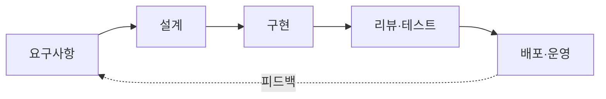

# 개발 방법론과 역할

소프트웨어 개발 과정(SDLC)의 각 단계에는 담당 역할과 산출물이 있습니다. 에이전트는 역할 전체가 아니라 **그 역할의 반복 가능한 작업**을 맡습니다. 이 문서는 단계별·역할별로 어떤 작업을 맡기고, 어떤 산출물을 기준으로 검증하며, 어디서 사람이 결정하는지 정리합니다.

## 단계별 적용



| 단계 | 에이전트에게 맡기기 좋은 작업 | 산출물 | 사람이 결정하는 것 |
| --- | --- | --- | --- |
| 요구사항 | 이슈·대화에서 요구 정리, 누락 질문 생성, 수용 기준 초안 | 사용자 스토리, 수용 기준 | 우선순위, 범위, 무엇을 만들지 않을지 |
| 설계 | 기존 코드 구조 조사, 대안 비교표, ADR 초안, 영향 범위 분석 | 설계 문서, ADR | 아키텍처 선택, 트레이드오프 수용 |
| 구현 | 스펙에 따른 코드 작성, 테스트 작성, 리팩터링, 마이그레이션 | 브랜치, PR | 스펙 승인, 병합 |
| 리뷰·테스트 | 변경 요약, 결함·보안·성능 지적, 테스트 보강, 재현 | 리뷰 코멘트, 테스트 | 지적 사항의 채택, 릴리스 판단 |
| 배포·운영 | 릴리스 노트, 변경 로그, 런북 갱신, 알림 1차 분류, 재현 스크립트 | 릴리스 노트, 인시던트 보고 초안 | 배포 승인, 롤백, 고객 커뮤니케이션 |

## 역할별 적용

### PM / 기획

| 작업 | 에이전트 활용 | 입력 | 검증 기준 |
| --- | --- | --- | --- |
| 백로그 정리 | 중복 이슈 묶기, 라벨·컴포넌트 분류, 오래된 이슈 요약 | 이슈 트래커 | 분류 규칙 문서, 샘플 검수 |
| 스토리 작성 | 대화·회의록에서 사용자 스토리와 수용 기준 초안 | 회의록, 기존 스토리 형식 | 형식 준수, 수용 기준의 검증 가능성 |
| 범위 분해 | 에픽을 구현 단위로 나누고 의존 관계 표시 | 설계 문서, 코드 구조 | 개발자 리뷰 |
| 진행 보고 | PR·이슈 상태에서 주간 요약 생성 | 저장소·트래커 API | 숫자가 원본과 일치하는지 |

PM은 "무엇을, 왜"를 결정합니다. 에이전트는 결정에 필요한 정보를 모으고 형식을 맞추는 일을 맡습니다.

### 아키텍트 / 테크리드

| 작업 | 에이전트 활용 | 검증 기준 |
| --- | --- | --- |
| 현황 조사 | 모듈 의존 그래프, 호출 경로, 중복 코드 조사 | 조사 결과를 코드로 재확인 |
| 대안 비교 | 후보 설계별 장단점·마이그레이션 비용 표 | 가정이 명시되었는지 |
| ADR 초안 | 결정·맥락·결과를 정해진 양식으로 작성 | 사람이 결정 사항을 확정 |
| 규칙 집행 | 아키텍처 규칙(계층 의존, 금지 API) 위반 탐지 | 규칙이 문서로 존재 |

### 개발자

| 작업 | 에이전트 활용 | 검증 기준 |
| --- | --- | --- |
| 구현 | 스펙·테스트에 맞춘 코드 작성, 보일러플레이트 | 테스트 통과, 린트·타입 검사 |
| 테스트 | 경계값·실패 경로 테스트 보강, 회귀 테스트 작성 | 테스트가 실제 결함을 잡는지(변이 확인) |
| 디버깅 | 재현 → 가설 → 로그·테스트로 확인 → 수정 | 재현 테스트가 수정 전 실패, 후 통과 |
| 리팩터링 | 동작 유지 조건 아래 구조 개선 | 테스트 통과, diff 범위 제한 |
| 문서 | 함수·모듈 설명, 사용 예, 변경 로그 | 코드와 일치 |

개발자는 에이전트의 결과를 **읽고 이해한 뒤** 병합합니다. 이해하지 못한 코드를 병합하지 않는 것이 가장 중요한 규칙입니다.

### 리뷰어

| 작업 | 에이전트 활용 | 사람이 하는 일 |
| --- | --- | --- |
| 1차 리뷰 | 결함, 누락 테스트, 보안·성능 문제, 스타일 위반 지적 | 지적의 타당성 판단, 설계 의도 검토 |
| 변경 요약 | PR의 목적·영향·위험을 요약 | 요약이 diff와 맞는지 |
| 체크리스트 | 팀 리뷰 체크리스트 자동 점검 | 체크리스트 유지 |

에이전트 리뷰는 사람 리뷰를 **앞당기는** 용도입니다. 자동 리뷰가 지적하지 않았다고 결함이 없는 것은 아닙니다.

### QA / 테스트

| 작업 | 에이전트 활용 | 검증 기준 |
| --- | --- | --- |
| 테스트 설계 | 수용 기준에서 테스트 케이스 표 생성 | 누락 케이스 검토 |
| 자동화 | E2E 시나리오 코드 작성, 플레이키 테스트 원인 조사 | 안정적으로 반복 통과 |
| 탐색적 테스트 | 브라우저·API를 조작하며 이상 동작 보고 | 보고가 재현 가능한지 |
| 결함 보고 | 재현 절차·기대·실제 결과를 양식으로 정리 | 개발자가 재현 가능 |

### DevOps / SRE

| 작업 | 에이전트 활용 | 사람이 결정하는 것 |
| --- | --- | --- |
| CI 유지 | 실패한 빌드 로그 분석, 설정 수정 제안 | 파이프라인 변경 승인 |
| 인시던트 | 알림을 묶어 1차 분류, 관련 변경·런북 찾기, 타임라인 초안 | 완화 조치 실행, 고객 공지 |
| 런북 | 반복 조치를 문서화, 스크립트화 | 운영 반영 |
| 비용·용량 | 사용량 보고서, 이상 변동 지적 | 예산 조정 |

운영 환경에 직접 작용하는 행동(재시작, 스케일 변경, 삭제)은 승인형으로 둡니다.

### 테크니컬 라이터

| 작업 | 에이전트 활용 |
| --- | --- |
| 변경 반영 | 코드 변경에 따라 API 문서·가이드의 오래된 부분 찾기 |
| 일관성 | 용어집 기준으로 용어 통일, 링크 검사 |
| 초안 | 코드와 테스트에서 사용 예 추출 |

## 애자일 의식과 결합

| 의식 | 에이전트가 준비하는 것 | 사람이 하는 것 |
| --- | --- | --- |
| 백로그 정제 | 중복·오래된 이슈 정리, 추정 참고 자료(비슷한 과거 작업) | 우선순위와 추정 |
| 스프린트 계획 | 후보 작업의 의존 관계와 범위 분해 | 목표와 커밋 |
| 데일리 | PR·이슈 상태 요약, 막힌 항목 표시 | 장애물 해결 |
| 리뷰 | 데모용 변경 요약, 릴리스 노트 초안 | 피드백 수집 |
| 회고 | 지표(리드타임, 리뷰 대기, 실패율) 집계, 반복된 문제 추출 | 개선 결정 |

## 역할 정의 템플릿

에이전트에게 역할을 맡길 때는 사람에게 업무를 넘기듯 적습니다.

```text
역할: 리뷰어
목표: PR의 결함과 누락 테스트를 찾아 코멘트로 남긴다
입력: diff, 변경된 파일, 테스트 결과, 팀 리뷰 체크리스트
도구: 저장소 읽기, 테스트 실행, PR 코멘트 작성 (승인·병합 권한 없음)
완료 기준: 체크리스트 항목마다 통과/지적 여부를 남김
금지: 코드 수정, 외부 서비스 호출
보고: 심각도별 지적 목록과 근거 파일:줄
```

## 사람이 결정을 유지해야 하는 지점

- 범위와 우선순위: 무엇을 만들지, 무엇을 만들지 않을지
- 되돌리기 어려운 행동: 배포, 삭제, 외부 전송, 결제
- 품질 기준의 해석: 테스트가 없는 영역의 "충분함"
- 사람 사이의 합의: 코드 소유권, 팀 규칙, 고객 커뮤니케이션

관련: [실무 워크플로](./workflows.md), [코드 리뷰](../../Quality/code-review.md), [테스트 전략](../../Quality/testing-strategy.md), [GitHub Actions](../../Infrastructure/cicd/github-action.md)
