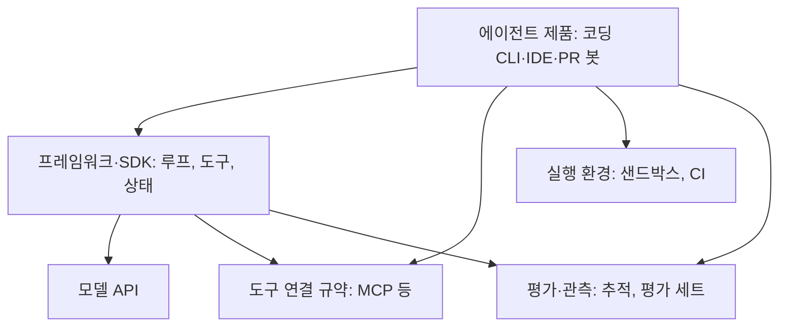

# 도구와 생태계

에이전트를 개발 과정에 쓰려면 **에이전트 제품, 에이전트를 만드는 프레임워크, 도구를 연결하는 규약, 측정 도구, 실행 환경**이 필요합니다. 제품과 버전은 빠르게 바뀌므로 이름보다 **어느 층의 도구인지**를 기준으로 봅니다. 도입 전에 공식 문서로 현재 기능을 확인합니다.

## 층별 구분

## 코딩 에이전트 제품

| 형태 | 예 | 적합한 역할 |
| --- | --- | --- |
| 터미널 CLI | Claude Code, Codex CLI, Gemini CLI, Aider | 개발자 작업 전반, 스크립트·CI 연동 |
| IDE 통합 | Cursor, Windsurf, GitHub Copilot, Cline, Claude Code IDE 확장 | 편집 중 보조, 파일 단위 수정 |
| 저장소·PR 봇 | GitHub Copilot coding agent, Claude Code GitHub Actions, Devin, OpenHands | 이슈 할당 → PR 생성, 자동 리뷰 |
| 브라우저·클라우드 세션 | 각 제품의 웹 환경 | 로컬 환경 없이 위임형 작업 |

| 선택 기준 | 확인할 것 |
| --- | --- |
| 권한 모델 | 도구 호출 승인 방식, 샌드박스, 허용·금지 목록 |
| 문맥 | 지침 파일 지원, 저장소 탐색 방식, 문맥 한도 |
| 확장 | MCP 서버, 커스텀 명령·스킬, 훅 |
| 자동화 | 비대화형 실행, CI에서 호출, 출력 형식(JSON) |
| 팀 기능 | 설정 공유, 비용 관리, 감사 로그 |

## 프레임워크와 SDK

직접 에이전트를 만들 때 씁니다. 루프, 도구 등록, 상태, 재시도 같은 공통 부분을 제공합니다.

| 종류 | 예 | 특징 |
| --- | --- | --- |
| 모델 제공사 SDK | Claude Agent SDK, OpenAI Agents SDK, Google ADK | 해당 모델·도구 생태계와 밀접. 제품과 같은 실행 루프를 코드로 사용 |
| 그래프·워크플로 | LangGraph | 상태 그래프로 분기·체크포인트를 명시. 복잡한 흐름 제어 |
| 역할 기반 멀티 에이전트 | CrewAI, AutoGen(AG2) | 역할·팀 단위 구성. 빠른 실험 |
| 기업용 통합 | Semantic Kernel | .NET·Java 환경, 기존 시스템 통합 |
| 직접 구현 | 모델 API + 수십 줄의 루프 | 의존성 없음. 작은 범위에서 가장 이해하기 쉬움 |

| 선택 기준 | 설명 |
| --- | --- |
| 제어 수준 | 프레임워크가 숨기는 부분(프롬프트, 재시도)을 바꿀 수 있는가 |
| 상태·재개 | 체크포인트, 중단 후 재개, 사람 개입 지점 |
| 관측 | 추적 내보내기(OpenTelemetry 등) |
| 잠금 | 모델·제공사를 바꾸기 쉬운가 |

간단한 작업은 직접 구현이 가장 디버깅하기 쉽습니다. 프레임워크는 분기·병렬·재개 같은 요구가 분명해진 뒤에 고릅니다.

## 도구 연결 규약

| 규약 | 역할 | 비고 |
| --- | --- | --- |
| MCP(Model Context Protocol) | 에이전트가 외부 도구·데이터(저장소, 이슈 트래커, DB, 브라우저)에 접근하는 표준 서버·클라이언트 규약 | 여러 제품이 지원. 서버 하나를 만들면 여러 에이전트에서 재사용 |
| A2A(Agent2Agent) | 서로 다른 에이전트가 작업을 주고받는 규약 | 조직 간·제품 간 에이전트 협업 |
| 함수 호출(Function/Tool calling) | 모델 API 수준의 도구 호출 형식 | 모든 상위 규약의 기반 |

MCP 서버를 도입할 때는 **어떤 권한으로 무엇을 할 수 있는지**를 먼저 봅니다. 읽기 전용 서버와 쓰기 가능한 서버를 구분하고, 쓰기는 승인형으로 둡니다.

## 평가와 관측

| 종류 | 예 | 쓰임 |
| --- | --- | --- |
| 추적·로그 | Langfuse, LangSmith, OpenTelemetry GenAI 규약 | 호출·도구·비용을 단계별로 기록, 실패 원인 추적 |
| 평가 실행 | promptfoo, Braintrust, 자체 평가 하네스 | 프롬프트·설정 변경 전후 비교, 회귀 방지 |
| 공개 벤치마크 | SWE-bench(Verified), Terminal-Bench, τ-bench | 모델·에이전트 비교 참고. 자기 작업과 다를 수 있음 |
| 코드 품질 게이트 | 테스트, 린트, 타입 검사, 보안 스캐너 | 에이전트 결과의 자동 검증 |

벤치마크 점수보다 **자기 저장소의 대표 과제 10~20개**로 만든 평가 세트가 결정에 더 유용합니다.

## 실행 환경

| 환경 | 예 | 쓰는 때 |
| --- | --- | --- |
| 로컬 + 권한 제어 | 제품의 허용 목록, 샌드박스 모드 | 개발자 작업 |
| 컨테이너 | Docker, dev container | 재현 가능한 환경, CI |
| 격리 샌드박스 서비스 | E2B, Daytona, Modal 등 | 위임형·동시 실행, 신뢰할 수 없는 코드 실행 |
| CI 러너 | GitHub Actions 등 | 이슈→PR 자동화, 정기 작업 |
| 브라우저 자동화 | Playwright, 제품 내장 브라우저 도구 | E2E 검증, 화면 확인 |

## 조합 예

| 상황 | 조합 |
| --- | --- |
| 개인 개발자 | 코딩 CLI + 지침 파일 + MCP(이슈 트래커) + 로컬 테스트 |
| 팀 저장소 | 코딩 CLI/IDE + 공유 지침 + PR 리뷰 봇 + CI 품질 게이트 + 추적 |
| 반복 자동화 | CI 러너에서 비대화형 CLI 실행 + 샌드박스 + 자체 평가 세트 |
| 자체 에이전트 제품 | 모델 SDK 또는 그래프 프레임워크 + MCP 서버 + 추적 + 평가 하네스 |

관련: [운영과 안전](./operations.md), [Harness 평가와 오류 진단](../harness/evaluation.md), [Docker](../../Infrastructure/docker/docker.md), [GitHub Actions](../../Infrastructure/cicd/github-action.md)
