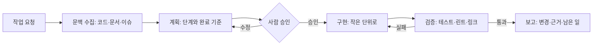
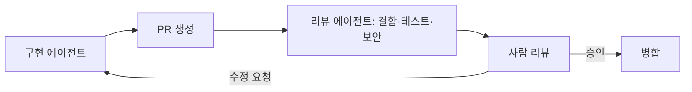

# 실무 워크플로

에이전트에게 작업을 맡기는 방식은 몇 가지 반복되는 형태로 정리됩니다. 공통점은 **먼저 합의한 기준을 두고, 그 기준으로 결과를 검증하며, 되돌릴 수 있는 단위로 진행**한다는 것입니다.

## 기본 루프: 계획 → 구현 → 검증

| 단계 | 핵심 | 흔한 실수 |
| --- | --- | --- |
| 문맥 수집 | 관련 파일, 규칙 문서, 비슷한 과거 변경을 먼저 읽음 | 요청만 보고 바로 수정 시작 |
| 계획 | 단계, 건드릴 파일, 완료 기준을 글로 적음 | 계획 없이 넓은 변경, 범위가 커지는 것을 알아채지 못함 |
| 승인 | 범위가 큰 변경은 계획 단계에서 사람이 확인 | 구현이 끝난 뒤에야 방향이 틀렸음을 발견 |
| 구현 | 한 번에 한 가지, 테스트 가능한 단위 | 여러 관심사를 한 diff에 섞음 |
| 검증 | 실제 명령을 실행하고 출력을 확인 | "통과할 것"이라는 추정으로 완료 선언 |
| 보고 | 무엇을 바꿨고, 무엇을 확인했고, 무엇을 못 했는지 | 성공만 보고하고 건너뛴 것을 숨김 |

## 스펙 주도 개발

구현 전에 스펙을 글로 확정하고, 스펙을 에이전트와 사람의 공통 기준으로 씁니다.

| 산출물 | 내용 | 담당 |
| --- | --- | --- |
| 요구 정리 | 목표, 사용자, 성공 기준, 범위 밖 | 사람이 답하고 에이전트가 정리 |
| 설계 노트 | 접근 방식, 건드릴 모듈, 대안과 이유 | 에이전트 초안, 사람 승인 |
| 구현 계획 | 순서 있는 작업 목록, 각 작업의 검증 방법 | 에이전트 작성, 사람 검토 |
| 구현 | 계획의 항목을 하나씩 | 에이전트 |
| 검증 보고 | 실행한 명령과 결과 | 에이전트 |

스펙 파일은 저장소에 남깁니다(`docs/specs/2026-10-16-feature.md` 같은 형식). 다음 작업의 문맥이 되고, 왜 그렇게 만들었는지 기록으로 남습니다.

## 테스트 주도

| 순서 | 에이전트의 행동 | 확인할 것 |
| --- | --- | --- |
| 1 | 요구를 테스트로 옮김 | 테스트가 요구를 정확히 표현하는지 |
| 2 | 테스트를 실행해 **실패**를 확인 | 실패 메시지가 기대한 이유인지 |
| 3 | 통과하는 최소 구현 | 테스트 외 범위를 건드리지 않았는지 |
| 4 | 테스트 실행해 통과 확인 | 다른 테스트가 깨지지 않았는지 |
| 5 | 리팩터링 | 테스트 유지 |

에이전트는 "테스트를 썼다"고 말하면서 실행하지 않거나, 실패를 보지 않고 구현으로 넘어가기 쉽습니다. 2단계의 실패 확인을 지시문에 명시합니다.

## 디버깅

| 단계 | 내용 |
| --- | --- |
| 재현 | 실패를 재현하는 최소 명령이나 테스트를 먼저 만듦 |
| 가설 | 원인 후보를 적고, 각각을 확인할 방법을 정함 |
| 확인 | 로그, 단정문, 임시 테스트로 가설을 하나씩 검증 |
| 수정 | 원인에 대한 수정. 증상만 가리는 수정은 표시해 둠 |
| 회귀 방지 | 재현 테스트를 남김 |

"일단 고쳐 보고 돌려 본다"를 반복하면 비용이 빠르게 늘어납니다. 가설 없이 세 번 이상 수정하면 멈추고 사람에게 상황을 보고하도록 둡니다.

## 리뷰 루프

| 구성 | 권장 |
| --- | --- |
| 리뷰 에이전트의 입력 | diff, 변경 파일 전체, 테스트 결과, 팀 체크리스트 |
| 리뷰 에이전트의 권한 | 읽기와 코멘트만. 수정·승인·병합 권한 없음 |
| 구현과 리뷰의 분리 | 같은 문맥을 공유하지 않는 별도 에이전트. 자기 코드에 관대해지는 것을 막음 |
| 지적의 형식 | 심각도, 파일:줄, 실패 시나리오, 근거 |
| 사람의 역할 | 설계 의도와 제품 판단. 자동 리뷰가 놓친 영역 |

## 이슈에서 PR까지 자동화

| 단계 | 자동화 | 게이트 |
| --- | --- | --- |
| 이슈 라벨 | 에이전트가 유형·컴포넌트 분류 | 규칙 문서 |
| 착수 | 라벨이나 멘션으로 에이전트 할당 | 사람이 할당 |
| 구현 | 격리된 브랜치·환경에서 작업 | 테스트·린트 통과 |
| PR | 변경 요약, 검증 내역, 관련 이슈 링크 | 리뷰 에이전트 + 사람 리뷰 |
| 병합 | 사람이 수행 | 보호 브랜치 규칙 |

위임형 자동화는 의존성 업데이트, 문서 링크 수정, 반복적인 보일러플레이트처럼 **실패해도 피해가 작고 검증이 자동인** 작업부터 적용합니다.

## 멀티 에이전트 구성

| 구성 | 구조 | 쓰는 때 | 주의 |
| --- | --- | --- | --- |
| 오케스트레이터-워커 | 조정자가 작업을 나눠 워커에 맡기고 결과를 합침 | 파일·모듈이 여러 개인 변경, 병렬 조사 | 워커 간 충돌(같은 파일 수정) 방지 |
| 파이프라인 | 계획 → 구현 → 리뷰처럼 순서 고정 | 단계별 책임을 분리하고 싶을 때 | 단계 사이 전달 정보 손실 |
| 병렬 팬아웃 | 독립 작업을 동시에 실행 | 조사, 여러 후보 생성 | 비용이 동시에 커짐 |
| 토론·심사 | 여러 에이전트가 답을 내고 심사자가 고름 | 정답이 하나가 아닌 설계 판단 | 심사 기준이 없으면 의미 없음 |

에이전트를 추가하면 문맥 전달과 디버깅 비용이 늘어납니다. 단일 에이전트의 문맥 한도나 역할 충돌 같은 **구체적인 문제**가 있을 때만 나눕니다. 워커에게는 전체 대화가 아니라 **작업에 필요한 문맥만** 적어서 넘기고, 보고 형식을 정해 둡니다.

## 체크포인트와 승인 게이트

| 게이트 | 위치 | 이유 |
| --- | --- | --- |
| 계획 승인 | 구현 전 | 방향 오류를 가장 싸게 잡음 |
| 범위 변경 | 계획에 없던 파일·모듈을 건드릴 때 | 조용한 범위 확장 방지 |
| 외부 영향 | 배포, 삭제, 외부 API 호출, 메시지 전송 | 되돌리기 어려움 |
| 비용 한도 | 토큰·시간·반복 횟수 초과 | 무한 루프, 정체 |
| 완료 보고 | 병합 전 | 검증 근거 확인 |

## 실패 패턴

| 패턴 | 증상 | 대응 |
| --- | --- | --- |
| 추정 완료 | 테스트를 실행하지 않고 통과했다고 보고 | 완료 조건에 실행 출력 첨부를 요구 |
| 범위 확장 | 요청 외 파일을 "개선" | 계획에 파일 목록 명시, diff 검사 |
| 정체 | 같은 수정을 반복 | 반복 횟수 한도, 가설 기록 요구 |
| 문맥 손실 | 긴 작업 후 초기 규칙을 잊음 | 규칙을 파일로 두고 다시 읽게 함, 작업 분할 |
| 과잉 확신 | 근거 없는 설명을 사실처럼 보고 | 근거(파일:줄, 명령 출력) 요구 |
| 조용한 축소 | 어려운 부분을 빼고 완료 선언 | 건너뛴 항목을 보고하도록 명시 |

관련: [개발 방법론과 역할](./sdlc-roles.md), [문맥과 지식 축적](./context-and-knowledge.md), [평가와 오류 진단](../harness/evaluation.md), [Git Rebase](../../Version%20Control%20System/git/rebase.md)
