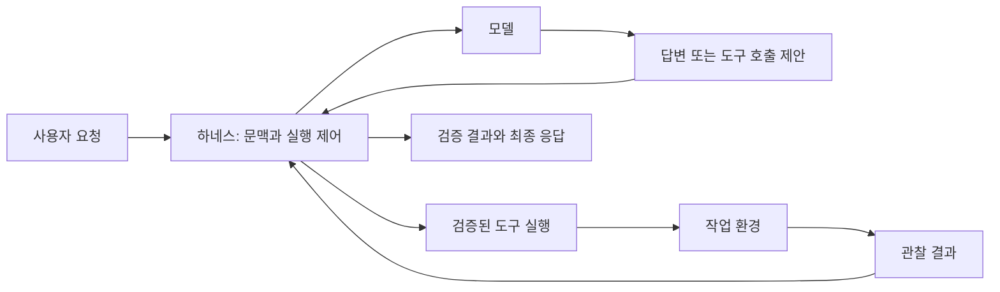

# Harness 개념과 용어

**Agent Harness**는 모델이 작업을 수행하는 데 필요한 문맥, 도구 실행, 상태, 제어 흐름을 연결하는 소프트웨어입니다. **Harness Engineering**은 이 실행 환경을 설계하고, 관찰한 실패를 바탕으로 개선하는 작업을 가리킵니다. 정해진 단일 아키텍처나 표준 구성 목록이 있는 용어는 아닙니다.

## 모델·에이전트·하네스의 관계

| 요소 | 역할 | 코드 수정 작업의 예 |
| --- | --- | --- |
| 모델(Model) | 입력을 바탕으로 텍스트나 도구 호출을 생성 | 관련 파일 검색을 제안하고 수정안을 생성 |
| 도구(Tool) | 정해진 입력으로 외부 기능을 수행 | 파일 읽기, 패치 적용, 테스트 실행 |
| 하네스(Harness) | 모델 호출과 도구 실행을 연결하고 통제 | 경로·권한 검사, 실행 결과 전달, 예산 관리 |
| 에이전트(Agent) | 목표에 맞춰 관찰과 행동을 반복하는 시스템 | 검색 → 수정 → 테스트 → 추가 수정 |
| 실행 환경(Environment) | 행동이 실제로 일어나는 대상과 자원 | 저장소, 컨테이너, 브라우저, 외부 서비스 |

실무에서는 에이전트와 하네스의 경계를 다르게 부르기도 합니다. 문서나 제품을 비교할 때는 이름보다 **누가 다음 행동을 결정하고, 누가 실행하며, 상태를 어디에 저장하는지** 확인합니다.

모델이 `run_tests` 호출을 출력했다고 해서 테스트가 실행된 것은 아닙니다. 하네스가 호출을 해석해 도구를 실행하고, 종료 코드·출력·오류를 다시 모델에 전달해야 합니다.

## 비슷한 용어와 구분

| 용어 | 다루는 범위 | 하네스와의 관계 |
| --- | --- | --- |
| 프롬프트 엔지니어링 | 지시문, 예시, 응답 형식 | 하네스가 모델에 전달할 입력의 일부를 설계 |
| 문맥 엔지니어링(Context Engineering) | 필요한 정보의 선택·검색·배치·압축 | 하네스의 문맥 구성 정책과 밀접하게 연결 |
| 에이전트 프레임워크 | 도구 등록, 실행 그래프, 상태 관리 등의 재사용 기능 | 하네스를 구현하는 수단으로 사용 가능 |
| 워크플로(Workflow) | 미리 정의한 단계와 분기 | 하네스 안에서 고정된 처리 절차를 구성 가능 |
| 샌드박스(Sandbox) | 파일·프로세스·네트워크 등의 실행 격리 | 도구 실행의 접근 범위를 강제하는 구성 요소 |
| 평가 하네스(Evaluation Harness) | 평가 실행, 채점, 집계 | 모델 또는 전체 에이전트 시스템을 측정 |

문서 검색을 붙인 RAG, 외부 도구 연결 규약, 여러 에이전트의 협업은 필요에 따라 포함할 수 있습니다. 하나의 모델과 몇 개의 도구로 구성한 단순한 실행 루프도 하네스에 해당할 수 있습니다.

## 같은 모델인데 결과가 달라지는 이유

“실패한 테스트를 고쳐줘”라는 요청을 예로 들면 다음 조건이 결과에 영향을 줍니다.

| 조건 | 부족할 때 생기는 문제 | 개선 방향 |
| --- | --- | --- |
| 저장소 문맥 | 관련 없는 파일을 수정 | 파일 검색, 프로젝트 지침, 테스트 위치 제공 |
| 도구 계약 | 수정 실패를 성공으로 오해 | 구조화한 성공·실패 결과와 오류 코드 제공 |
| 피드백 | 수정 후 실제 동작을 확인하지 못함 | 관련 테스트와 변경 내역을 관찰에 포함 |
| 실행 예산 | 탐색 중 종료되거나 같은 시도를 반복 | 시간·비용·반복 횟수 한도와 정체 감지 |
| 상태 보존 | 재시작하면 이미 수행한 작업을 반복 | 작업 상태와 검증 결과를 체크포인트로 저장 |

따라서 시스템의 성공률을 비교할 때는 모델 이름과 함께 하네스 버전, 도구, 작업 환경, 예산도 기록해야 합니다. 하네스가 좋아져도 모델의 지식·추론 한계가 모두 해결되는 것은 아닙니다.

## 언제 도입하거나 확장할까?

- 한 번의 응답으로 끝나는 요약·분류는 단일 모델 호출과 출력 검증으로 시작합니다.
- 정해진 순서가 중요한 업무는 명시적인 워크플로로 단계와 실패 처리를 구성합니다.
- 중간 결과에 따라 탐색·수정·검증 경로가 바뀌면 도구를 사용하는 에이전트 루프가 유용합니다.
- 장시간 작업, 외부 시스템 변경, 재시작 복구가 필요하면 상태·권한·관측 기능을 강화합니다.

설계 복잡도를 늘릴 때마다 실제 과제의 성공률, 비용, 지연 시간이 개선되는지 확인합니다.

추가 읽기: [Anthropic — Building effective agents](https://www.anthropic.com/engineering/building-effective-agents)

다음: [실행 구조와 설계](./runtime-design.md)
