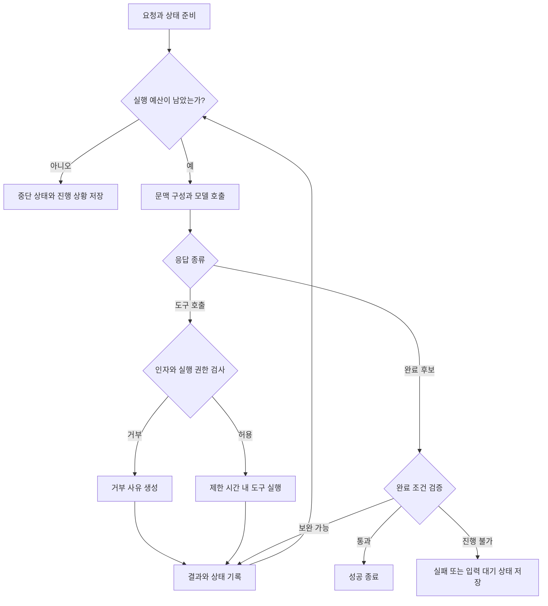

# Harness 실행 구조와 설계

하네스는 **모델의 제안 → 검증된 실행 → 관찰 → 다음 판단**을 반복합니다. 작업 상태와 실행 권한은 애플리케이션이 관리하고, 모델에는 다음 판단에 필요한 정보를 제공합니다.

## 기본 실행 루프

1. 사용자 요청, 완료 조건, 허용된 작업 범위를 받아 실행 상태를 만듭니다.
2. 지시문, 관련 자료, 이전 실행 결과로 모델 입력을 구성합니다.
3. 모델을 호출하고 응답을 해석합니다.
4. 도구 호출이 있으면 이름·인자·권한·남은 예산을 검사합니다.
5. 도구를 실행하고 결과와 변경된 상태를 기록합니다.
6. 관찰 결과를 모델에 전달해 다음 행동을 판단하게 합니다.
7. 완료 후보가 나오면 결과를 검증하고 성공·실패·중단 상태로 종료합니다.



모델 호출 오류, 해석할 수 없는 응답, 도구 실패에도 재시도 한도를 적용합니다. 검증에 실패한 뒤 같은 행동만 반복하면 무한히 이어가지 않고 실패 원인과 남은 작업을 기록합니다.

## 도구는 계약으로 설계한다

| 항목 | 설계 내용 | 예시 |
| --- | --- | --- |
| 입력 | 타입, 필수 값, 범위, 허용 경로 | `read_file(path, start_line, max_lines)` |
| 출력 | 성공 여부, 데이터, 오류, 잘림 여부 | `status`, `data`, `error_code`, `truncated` |
| 부작용 | 읽기·쓰기 구분, 변경 대상 | 파일 수정, 메시지 발송, 배포 |
| 실행 제한 | 시간, 출력 크기, 접근 가능한 자원 | 타임아웃, 출력 상한, 작업 디렉터리 |
| 재시도 | 재실행 가능 조건, 중복 실행 방지 | 읽기 재시도, 쓰기 요청의 멱등성 키 |

“파일을 찾지 못함”과 “권한이 없어 읽지 못함”은 다른 오류로 전달합니다. 긴 출력을 자를 때는 잘림을 명시하고, 나머지를 범위 조회하거나 보관된 로그에서 읽을 수 있게 합니다.

처음에는 책임이 분명한 도구를 적게 제공합니다. 범용 셸이 필요하다면 명령 문자열에 대한 간단한 검사만으로 접근을 통제하지 말고 실행 환경의 파일·프로세스·네트워크 권한도 제한합니다.

## 문맥과 상태를 구분한다

**문맥(Context)**은 이번 모델 호출에 전달하는 정보이고, **상태(State)**는 실행 사이에 보존해야 하는 사실과 진행 상황입니다. 모든 상태를 매번 문맥에 넣을 필요는 없습니다.

| 정보 | 보관·전달 방법 |
| --- | --- |
| 목표·완료 조건·사용자 제약 | 상태에 보관하고 각 단계에 필요한 내용을 전달 |
| 프로젝트 지침 | 출처와 적용 범위를 유지해 전달 |
| 큰 파일·검색 결과 | 관련 구간만 검색하고 원본 위치를 함께 전달 |
| 실행 기록 | 도구 인자·상태·시간·관찰 결과를 별도 저장 |
| 진행 요약 | 완료 작업, 실패한 시도, 다음 작업, 미해결 사항을 압축 |
| 생성물 | 파일·아티팩트 저장소에 보관하고 위치·버전을 참조 |

문맥 압축 시 경로, 변경 식별자, 검증 결과, 아직 충족하지 못한 조건을 남깁니다. 요약에 “테스트 통과”라고 적혀 있어도 이후 코드를 수정했다면 다시 검증해야 합니다. 검증 결과가 어느 버전의 생성물에 해당하는지 연결해 둡니다.

검색한 문서나 도구 출력에 포함된 지시문은 출처가 있는 작업 데이터로 취급합니다. 그 내용만으로 기존 권한 정책을 바꾸거나 도구 접근을 허용하지 않습니다.

## 권한과 실행 예산

다음은 설계 항목을 보여 주는 **예시 설정**이며 특정 프레임워크에서 바로 실행되는 형식은 아닙니다. 수치는 과제와 환경에 맞게 정합니다.

```yaml
run_policy:
  max_model_turns: 20
  max_tool_calls: 40
  max_elapsed_seconds: 300
  max_cost_usd: 1.0
  tool_timeout_seconds: 30
  retry_limit: 2
  writable_roots:
    - /workspace/task
  network: deny
  approval_required:
    - publish
    - delete_remote_data
```

한도는 모델에게 알리는 동시에 실행 코드에서 검사합니다. 한 턴에 여러 도구 호출이 나올 수 있으므로 턴 수와 도구 호출 수를 따로 셉니다. 다음 호출 전에 남은 예산을 확인하고, 호출별 시간·출력 토큰 상한도 적용합니다. 비용 집계가 지연되는 환경에서는 비용 제한이 정확한 차단선이 되기 어려우므로 여유분을 둡니다.

승인이 필요한 작업은 대상과 인자가 확정된 상태에서 대기시키고, 그 작업에 대한 승인 후 실행합니다. 재개 시 대상이나 인자가 바뀌었다면 기존 승인이 여전히 적용되는지 확인합니다.

## 재시도와 장시간 작업 복구

| 상황 | 처리 원칙 |
| --- | --- |
| 일시적인 연결 오류·요청 제한 | 제한된 횟수로 지수 백오프와 지터를 적용하고 재시도 |
| 잘못된 도구 인자 | 오류를 모델에 전달해 인자를 수정하도록 함 |
| 권한 거부 | 같은 요청을 반복하지 않고 허용된 경로나 입력 대기 상태로 전환 |
| 외부 쓰기 요청 후 타임아웃 | 성공 여부가 불명확하므로 실행 상태를 조회한 뒤 재시도 판단 |
| 프로세스 종료 후 재시작 | 체크포인트와 실제 작업 환경을 대조하고 재개 |
| 동일한 실패 반복 | 관찰 가능한 진전이 있는지 확인하고 한도 초과 시 중단 |

**멱등성(Idempotency)**은 같은 요청을 다시 보내도 의도한 효과가 중복 발생하지 않는 성질입니다. 결제·발송·배포 같은 도구는 실행 식별자나 멱등성 키를 사용하고, 원격 서비스가 중복 방지를 지원하는지 확인합니다. 로컬 기록만으로 원격 작업의 정확히 한 번 실행을 보장할 수는 없습니다.

체크포인트에는 목표, 현재 단계, 생성물 버전, 완료된 도구 호출, 미확정 부작용, 남은 예산을 기록합니다. 재시작 후에도 누적 예산을 유지하고, 실행 도중 종료된 호출을 무조건 다시 실행하지 않습니다.

여러 에이전트가 같은 파일이나 외부 자원을 수정한다면 작업 영역을 분리하거나 변경 병합 규칙을 둡니다. 병렬 실행의 속도 이점과 함께 충돌·중복 비용도 평가합니다.

## 구현 순서

1. 대표 과제 하나와 기계적으로 확인 가능한 완료 조건을 정합니다.
2. 단일 모델, 최소 도구, 제한된 실행 루프로 시작합니다.
3. 도구 계약, 실행 제한, 로그와 실패 상태를 구현합니다.
4. 실제 실패 기록을 보고 문맥 검색·압축이나 복구 기능을 추가합니다.
5. 동일한 평가 과제로 변경 전후의 성공률·비용·시간을 비교합니다.

추가 읽기: [Anthropic — Effective harnesses for long-running agents](https://www.anthropic.com/engineering/effective-harnesses-for-long-running-agents)

관련: [개념과 용어](./concepts.md), [평가와 오류 진단](./evaluation.md)
