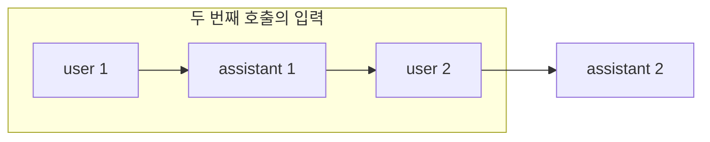

# API 호출 구조

LLM API는 공급자마다 이름이 다르지만 구조는 거의 같습니다. **역할이 붙은 메시지 목록**을 보내고, 모델이 생성한 메시지와 사용량을 돌려받습니다. 이 문서는 특정 SDK 문법보다 모든 공급자에 공통인 개념과 설계 원칙을 다룹니다.

## 요청과 응답의 구성

| 요소 | 내용 | 비고 |
| --- | --- | --- |
| 모델 | 사용할 모델 ID | 버전이 붙은 ID를 고정해 재현성 확보 |
| 시스템 프롬프트 | 역할, 규칙, 출력 형식 등 고정 지시 | 사용자 입력과 분리해 우선순위를 높임 |
| 메시지 목록 | `user`와 `assistant`가 번갈아 나오는 기록 | 모델은 무상태이므로 매번 전체를 전송 |
| 생성 설정 | `max_tokens`, `temperature`, 중단 시퀀스 | [동작 원리](./how-llms-work.md) 참고 |
| 도구 정의 | 이름, 설명, 입력 스키마 | [구조화 출력과 도구 호출](./structured-output.md) 참고 |
| 응답 | 생성된 내용, 종료 이유, 사용량 | `stop_reason`과 `usage`를 항상 기록 |

```python
response = client.messages.create(
    model="<model-id>",
    max_tokens=1024,
    system="당신은 기술 문서를 요약하는 도우미입니다. 한국어로 3문장 이내로 답합니다.",
    messages=[{"role": "user", "content": "다음 글을 요약해 주세요:\n\n" + text}],
)
print(response.content[0].text, response.usage)
```

위는 Anthropic SDK 형태이며, OpenAI 계열은 시스템 프롬프트를 메시지 목록의 첫 항목으로 넣는 식으로 다릅니다. 개념은 같으므로 호출 코드는 한 곳에 모아 두고 공급자 차이를 그 안에서 흡수합니다.

## 종료 이유(stop reason)

| 값(예) | 의미 | 처리 |
| --- | --- | --- |
| `end_turn` / `stop` | 모델이 응답을 마침 | 정상 처리 |
| `max_tokens` / `length` | 출력 상한에 걸려 잘림 | 상한을 늘리거나 이어서 생성 요청 |
| `tool_use` / `tool_calls` | 도구 호출을 요청 | 도구 실행 후 결과를 다시 전송 |
| `stop_sequence` | 중단 시퀀스에 도달 | 구분자 기준으로 파싱 |
| `refusal` 등 | 안전 정책으로 응답 거부 | 사용자에게 안내, 로그 기록 |

종료 이유를 확인하지 않으면 잘린 JSON을 파싱하다 실패하거나, 도구 호출 요청을 최종 답으로 오해하는 문제가 생깁니다.

## 멀티턴 대화 관리



| 과제 | 방법 |
| --- | --- |
| 기록 누적 | 서버가 대화 ID별로 메시지 목록을 저장하고 매 호출에 포함 |
| 길이 제한 | 오래된 턴 삭제, 앞부분 요약으로 대체, 문맥 한도 전에 자르기 |
| 비용 | 고정된 앞부분(시스템 프롬프트, 초기 문서)은 프롬프트 캐싱 대상으로 배치 |
| 일관성 | 시스템 프롬프트는 대화 중 바꾸지 않음. 바꾸면 캐시가 깨지고 행동이 달라짐 |

## 스트리밍

스트리밍은 토큰이 생성되는 대로 조각(chunk)을 받습니다. 전체 지연은 같지만 첫 토큰까지의 시간이 짧아 사용자 체감이 크게 좋아집니다.

| 고려 사항 | 내용 |
| --- | --- |
| 이벤트 종류 | 텍스트 조각, 도구 호출 입력 조각, 종료, 사용량 |
| 조립 | 텍스트는 이어 붙이고, 도구 입력 JSON은 완료 후 파싱 |
| 전달 | 웹은 SSE나 WebSocket으로 그대로 중계 |
| 오류 | 스트림 중간에 끊기면 부분 결과를 보여 줄지, 재시도할지 정책 필요 |
| 로그 | 스트림이 끝난 뒤 전체 응답과 사용량을 한 번에 기록 |

구조화 출력만 필요한 백엔드 작업에는 스트리밍이 꼭 필요하지 않습니다. 사용자가 기다리는 화면이 있을 때 사용합니다.

## 오류와 재시도

| 오류 | 원인 | 대응 |
| --- | --- | --- |
| 400 잘못된 요청 | 스키마 오류, 문맥 초과, 지원하지 않는 기능 | 재시도하지 않음. 요청 수정 |
| 401 / 403 | 키 오류, 권한 부족 | 설정 확인. 재시도 무의미 |
| 429 속도 제한 | 분당 요청·토큰 한도 초과 | 지수 백오프와 지터로 재시도, 동시성 제한 |
| 5xx / 과부하 | 공급자 측 장애 | 짧은 백오프 후 재시도, 횟수 제한 |
| 타임아웃 | 긴 생성, 네트워크 | 타임아웃을 출력 길이에 맞게 설정, 스트리밍 고려 |

재시도는 멱등한 호출에만 적용합니다. 도구 실행이 포함된 루프에서는 모델 호출만 재시도하고, 이미 실행된 부작용을 반복하지 않도록 구분합니다. 일반 원칙은 [재시도와 복구](../harness/runtime-design.md)를 참고합니다.

## 호출 래퍼 설계

LLM 호출은 애플리케이션 전체에서 한 모듈을 통해 나가도록 감쌉니다.

| 래퍼가 맡는 일 | 이유 |
| --- | --- |
| 모델 ID·설정의 중앙 관리 | 모델 교체와 실험을 한 곳에서 |
| 재시도·타임아웃·동시성 제한 | 호출마다 다르게 구현되는 것을 방지 |
| 사용량·지연·오류 로깅 | 비용 추적과 품질 분석의 기초 자료 |
| 프롬프트 버전 기록 | 어떤 프롬프트가 어떤 결과를 냈는지 추적 |
| 민감 정보 마스킹 | 로그와 외부 전송에서 개인정보 제거 |

```python
def call_llm(messages, *, system, tools=None, tag):
    started = time.monotonic()
    try:
        res = client.messages.create(model=MODEL, system=system, messages=messages,
                                     tools=tools or [], max_tokens=2048)
    except RateLimitError:
        raise Retryable()
    log(tag=tag, usage=res.usage, stop=res.stop_reason, ms=(time.monotonic() - started) * 1000)
    return res
```

관련: [JWT](../../Backend/auth/jwt.md)의 키 관리 원칙, [환경변수 관리](../../Security/env-management.md), [로깅](../../Backend/logging/logging.md)

다음: [구조화 출력과 도구 호출](./structured-output.md)
