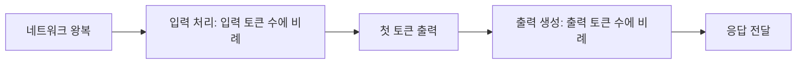
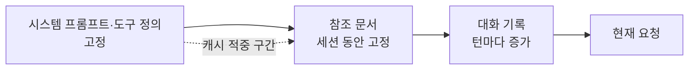

# 비용과 지연

LLM API의 비용과 지연은 둘 다 **토큰 수**에서 나옵니다. 입력 토큰은 비용에, 출력 토큰은 비용과 지연 양쪽에 크게 영향을 줍니다. 수치는 공급자와 모델마다 다르고 자주 바뀌므로, 이 문서는 구조와 계산 방법, 줄이는 순서를 다룹니다.

## 비용 구조

| 과금 항목 | 설명 | 특징 |
| --- | --- | --- |
| 입력 토큰 | 시스템 프롬프트, 대화 기록, 문서, 도구 정의, 도구 결과 | 양이 많아 총액의 대부분을 차지하기 쉬움 |
| 출력 토큰 | 모델이 생성한 텍스트, 도구 호출 인자, 추론 토큰 | 단가가 입력의 수 배 |
| 캐시 쓰기·읽기 | 프롬프트 캐싱 사용 시 별도 단가 | 읽기는 입력 단가보다 크게 저렴 |
| 배치 | 비동기 일괄 처리 | 보통 할인, 결과는 수 시간 내 |
| 추론 토큰 | 추론 모델이 답 전에 생성하는 사고 토큰 | 출력 단가로 과금되며 눈에 보이지 않을 수 있음 |

월 예상 비용은 다음 식으로 어림합니다.

```
월 비용 ≈ 호출 수 × (평균 입력 토큰 × 입력 단가 + 평균 출력 토큰 × 출력 단가)
```

대화형 서비스는 턴이 진행될수록 입력 토큰이 누적되므로 "평균 입력 토큰"을 턴 수에 따라 따로 계산합니다.

## 지연 구조



| 지표 | 의미 | 주요 결정 요인 |
| --- | --- | --- |
| TTFT(Time To First Token) | 요청 후 첫 토큰까지 | 입력 토큰 수, 캐시 적중, 모델 크기, 큐 대기 |
| 출력 속도(tokens/s) | 초당 생성 토큰 | 모델 크기, 공급자 부하 |
| 총 지연 | 전체 완료까지 | TTFT + 출력 토큰 수 ÷ 출력 속도 |
| 에이전트 지연 | 여러 호출과 도구 실행의 합 | 루프 횟수, 도구 응답 시간 |

사용자가 체감하는 것은 TTFT이므로, 긴 답변은 스트리밍으로 TTFT를 노출하고 총 지연은 출력 길이를 줄여서 다룹니다.

## 프롬프트 캐싱

같은 접두 부분(prefix)을 반복해서 보내면 공급자가 처리 결과를 재사용해 비용과 TTFT를 줄입니다.

| 조건 | 내용 |
| --- | --- |
| 접두 일치 | 요청 앞부분이 바이트 단위로 같아야 적중. 시스템 프롬프트와 도구 정의를 앞에 고정 |
| 최소 길이 | 모델별 최소 토큰 수 이상이어야 캐시 대상 |
| 유효 시간 | 일정 시간(수 분 단위가 흔함) 동안 적중. 트래픽이 뜸하면 다시 쓰기 비용 발생 |
| 배치 순서 | 변하지 않는 것 → 가끔 변하는 것 → 매번 변하는 것 순서로 배치 |



날짜나 사용자 이름을 시스템 프롬프트 맨 앞에 넣으면 캐시가 매번 깨집니다. 변하는 값은 가능한 한 뒤쪽에 둡니다.

## 비용과 지연을 줄이는 순서

| 순서 | 방법 | 효과 |
| --- | --- | --- |
| 1 | 입력 토큰 줄이기: 불필요한 문맥 제거, 도구 결과 요약, 대화 기록 정리 | 비용·TTFT 모두 개선 |
| 2 | 캐시 적중률 높이기: 접두 고정, 배치 순서 조정 | 입력 비용 대폭 절감 |
| 3 | 출력 줄이기: 형식 지정, 불필요한 설명 금지, 구조화 출력 | 비용·총 지연 개선 |
| 4 | 작은 모델로 라우팅: 쉬운 요청은 소형 모델, 어려운 요청만 상위 모델 | 비용 절감, 평가 세트 필요 |
| 5 | 배치 API: 실시간이 필요 없는 대량 작업 | 할인, 속도 제한 회피 |
| 6 | 응답 캐싱: 동일 입력의 결과를 애플리케이션에서 재사용 | 호출 자체를 제거 |
| 7 | 병렬화: 독립된 호출을 동시에 실행 | 총 지연 단축, 비용은 동일 |

품질 평가 없이 모델을 내리거나 문맥을 줄이면 비용 대신 오류 처리 비용이 늘어납니다. 변경 전후를 같은 평가 세트로 비교합니다.

## 속도 제한과 동시성

| 한도 종류 | 단위 | 대응 |
| --- | --- | --- |
| RPM | 분당 요청 수 | 클라이언트 측 동시성 제한, 큐 |
| TPM | 분당 토큰 수 | 큰 요청을 분산, 배치 API 활용 |
| 동시 요청 수 | 동시에 열린 연결 | 세마포어로 상한 고정 |
| 일일·월간 예산 | 비용 | 사용량 모니터링, 상한 도달 시 차단 또는 소형 모델 전환 |

429 응답은 지수 백오프로 재시도하되, 재시도 폭주가 한도를 더 소모하지 않도록 동시성 자체를 줄입니다. 재시도 규칙은 [Rate Limiting](../../Backend/api/rate-limiting.md)과 [API 호출 구조](./api-usage.md)를 참고합니다.

## 관측할 지표

| 지표 | 왜 보는가 |
| --- | --- |
| 호출당 입력·출력·캐시 토큰 | 비용 원인 파악, 캐시 적중률 계산 |
| TTFT와 총 지연의 분위수(p50, p95) | 평균에 가려진 느린 요청 발견 |
| 오류·재시도 비율 | 속도 제한, 장애, 잘못된 요청 구분 |
| 기능·사용자별 비용 | 예산 배분과 이상 사용 탐지 |
| 모델·프롬프트 버전별 품질 | 비용 절감 변경이 품질을 떨어뜨렸는지 확인 |

이 지표는 [API 호출 구조](./api-usage.md)의 호출 래퍼에서 한 번에 기록하는 것이 가장 쉽습니다. 에이전트 수준의 비용 통제는 [운영과 안전](../agents/operations.md)을 참고합니다.

관련: [Redis 캐싱](../../Backend/caching/redis.md), [웹 성능](../../Frontend/web-performance.md)
