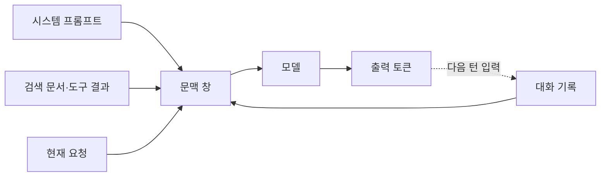

# 모델의 동작 원리

LLM은 입력 텍스트를 **토큰**으로 나누고, 지금까지의 토큰을 바탕으로 **다음 토큰의 확률 분포**를 계산해 하나를 고르는 일을 반복합니다. 이 단순한 구조가 토큰 비용, 문맥 창 한도, 출력의 비결정성, 환각 같은 실무 특성을 모두 설명합니다.

## 토큰

| 항목 | 내용 |
| --- | --- |
| 정의 | 토크나이저가 텍스트를 쪼갠 단위. 단어·부분 단어·기호·공백 조각 |
| 영어 | 대략 단어 1개가 1~1.3토큰 |
| 한국어 | 글자 단위로 쪼개지는 경우가 많아 같은 뜻의 영어보다 토큰이 1.5~3배 많음 |
| 코드·JSON | 들여쓰기, 괄호, 따옴표가 모두 토큰을 차지 |
| 확인 방법 | 공급자 SDK의 토큰 계산 API 또는 응답의 `usage` 필드 |

토큰 수는 비용과 지연의 기준이자 문맥 창 한도의 단위입니다. 한국어 프롬프트는 영어보다 비싸고 문맥을 빨리 소모한다는 점을 설계에 반영합니다.

## 문맥 창(Context Window)

| 특성 | 의미 |
| --- | --- |
| 한도 | 입력과 출력 토큰의 합이 모델별 상한을 넘을 수 없음 |
| 무상태 | 모델은 이전 호출을 기억하지 않음. 대화 기록은 매번 다시 보내야 함 |
| 위치 효과 | 긴 문맥에서는 앞·뒤에 둔 정보가 중간보다 잘 반영되는 경향이 있음 |
| 비용 | 기록이 길어질수록 매 턴의 입력 토큰이 누적되어 비용이 증가 |

문맥 창이 크다고 해서 전부 채우는 것이 좋은 것은 아닙니다. 관련 없는 내용이 많으면 품질이 떨어지고 비용만 늘어납니다. 문맥 예산을 어떻게 나누는지는 [문맥과 지식 축적](../agents/context-and-knowledge.md)을 참고합니다.

## 생성 방식과 샘플링 파라미터

모델은 매 단계에서 확률 분포를 만들고, 샘플링 설정에 따라 토큰을 고릅니다.

| 파라미터 | 역할 | 권장 |
| --- | --- | --- |
| `temperature` | 분포를 평평하게(높음) 또는 뾰족하게(낮음) 조정 | 추출·분류·코드는 0~0.3, 창작은 0.7 이상 |
| `top_p` | 누적 확률이 p가 될 때까지의 후보만 사용 | `temperature`와 둘 중 하나만 조정 |
| `max_tokens` | 출력 토큰 상한 | 기대 길이보다 여유 있게. 잘리면 `stop_reason`으로 확인 |
| `stop` 시퀀스 | 특정 문자열이 나오면 생성 중단 | 구분자 기반 출력에 사용 |
| `seed` | 지원 시 재현성 향상 | 완전한 결정성을 보장하지는 않음 |

`temperature`를 0으로 두어도 출력이 항상 같지는 않습니다. 프로그램에서 쓰는 출력은 [구조화 출력](./structured-output.md)과 검증으로 다룹니다.

## 학습 단계와 모델 종류

| 단계 | 하는 일 | 결과 |
| --- | --- | --- |
| 사전 학습(Pre-training) | 대량 텍스트로 다음 토큰 예측 | 언어·지식을 갖춘 기반 모델 |
| 지시 조정(Instruction tuning) | 지시와 응답 쌍으로 학습 | 요청을 따르는 채팅 모델 |
| 선호 정렬(RLHF 등) | 사람의 선호를 반영해 조정 | 유용하고 안전한 응답 경향 |
| 추론 강화(Reasoning) | 답 전에 긴 사고 과정을 생성하도록 학습 | 복잡한 문제에 강하지만 느리고 비쌈 |

API로 쓰는 모델은 대부분 지시 조정과 선호 정렬을 거친 채팅 모델입니다. 추론 모델은 수학·코드·다단계 계획에 유리하지만 지연과 비용이 크므로 작업별로 선택합니다.

## 한계

| 한계 | 설명 | 대응 |
| --- | --- | --- |
| 환각(Hallucination) | 그럴듯하지만 틀린 내용을 생성 | 근거 문서 제공, 출처 요구, 외부 검증 |
| 지식 컷오프 | 학습 시점 이후의 정보를 모름 | 검색·도구로 최신 정보 주입 |
| 계산·정밀 조작 | 긴 산술, 정확한 문자 수 세기에 약함 | 코드 실행이나 도구로 위임 |
| 지시 충돌 | 길고 모순된 지시를 일관되게 따르지 못함 | 지시를 짧고 우선순위가 분명하게 |
| 프롬프트 주입 | 입력에 섞인 지시를 따를 수 있음 | 신뢰 경계 구분, 출력 검증 ([운영과 안전](../agents/operations.md)) |

## 모델 선택 기준

| 기준 | 확인할 것 |
| --- | --- |
| 작업 난이도 | 단순 분류·추출은 소형 모델, 복잡한 추론은 상위·추론 모델 |
| 문맥 길이 | 입력 문서 크기와 대화 길이가 한도 안에 드는가 |
| 기능 | 도구 호출, 구조화 출력, 이미지·PDF 입력, 캐싱, 배치 지원 여부 |
| 비용·지연 | 호출 수와 토큰 수를 곱한 월 예상치, 사용자 체감 응답 시간 |
| 운영 | 데이터 보존 정책, 리전, 속도 제한, 모델 폐기 일정 |

처음에는 상위 모델로 품질 상한을 확인한 뒤, 평가 세트로 같은 품질이 나오는 더 작은 모델로 내려가는 방식이 안전합니다. 평가 방법은 [평가와 오류 진단](../harness/evaluation.md)을 참고합니다.

다음: [API 호출 구조](./api-usage.md)
