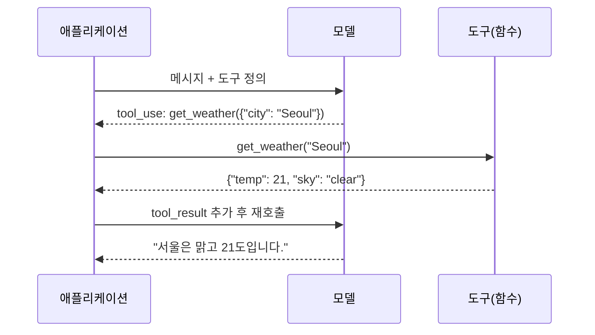

# 구조화 출력과 도구 호출

프로그램이 모델의 출력을 그대로 쓰려면 자유 텍스트가 아니라 **정해진 스키마를 따르는 데이터**가 필요합니다. 구조화 출력은 모델이 JSON 같은 형식을 내도록 만드는 방법이고, 도구 호출은 그 형식을 함수 인자로 쓰는 확장입니다.

## 구조화 출력을 얻는 방법

| 방법 | 동작 | 장점 | 한계 |
| --- | --- | --- | --- |
| 프롬프트 지시 | "JSON만 출력" + 예시 | 어떤 모델에서나 가능 | 설명 문장, 코드 펜스가 섞이거나 필드가 빠질 수 있음 |
| 스키마 제약 출력 | 요청에 JSON 스키마를 전달하면 공급자가 형식을 강제 | 파싱 실패가 거의 사라짐 | 공급자·모델별 지원 범위와 스키마 제약이 다름 |
| 도구 호출 활용 | 원하는 스키마를 도구의 입력으로 정의하고 호출을 강제 | 스키마 제약 출력이 없는 모델에서도 안정적 | 도구 호출 응답 처리가 필요 |
| 사후 파싱·복구 | 응답에서 JSON 블록 추출, 실패 시 재요청 | 간단 | 재시도 비용, 여전히 의미 오류 가능 |

스키마 제약 출력이나 도구 호출을 기본으로 쓰고, 프롬프트 지시만으로 끝내는 것은 프로토타입에 한정합니다.

```python
schema = {
    "type": "object",
    "properties": {
        "category": {"type": "string", "enum": ["bug", "feature", "question"]},
        "priority": {"type": "integer", "minimum": 1, "maximum": 5},
        "summary": {"type": "string"},
    },
    "required": ["category", "priority", "summary"],
    "additionalProperties": False,
}
```

## 형식이 맞아도 검증이 필요한 이유

| 검증 단계 | 잡는 문제 | 수단 |
| --- | --- | --- |
| 구문 | 잘린 JSON, 코드 펜스 포함 | `stop_reason` 확인, 파서 |
| 스키마 | 필드 누락, 타입 불일치, enum 밖의 값 | JSON 스키마 검사, Pydantic·zod |
| 의미 | 범위는 맞지만 내용이 틀림(없는 ID, 날짜 모순) | 도메인 규칙, DB 조회 |
| 안전 | 출력에 포함된 명령·URL·스크립트 | 허용 목록, 이스케이프 |

검증 실패는 오류 메시지를 포함해 모델에 다시 보내 한두 번 수정 기회를 주고, 그래도 실패하면 사람에게 넘기거나 기본값으로 처리합니다.

## 도구 호출(Function Calling)

모델이 도구를 직접 실행하는 것이 아닙니다. 모델은 **어떤 도구를 어떤 인자로 호출할지** 구조화해서 출력하고, 실행은 애플리케이션이 합니다.



| 단계 | 애플리케이션이 하는 일 |
| --- | --- |
| 정의 | 이름, 설명, 입력 JSON 스키마를 요청에 포함 |
| 판별 | 응답의 종료 이유가 도구 호출인지 확인 |
| 검증 | 인자를 스키마와 권한 규칙으로 검사 |
| 실행 | 함수 실행, 예외를 구조화된 오류로 변환 |
| 회신 | 도구 결과를 같은 호출 ID로 메시지에 추가하고 재호출 |
| 종료 | 도구 호출이 더 없고 최종 답이 나오면 루프 종료 |

## 도구 정의 작성 원칙

| 원칙 | 예 |
| --- | --- |
| 이름은 동사+대상 | `search_orders`, `create_ticket` |
| 설명에 언제 쓰고 언제 쓰지 않는지 명시 | "주문 ID를 알 때만 사용. 고객명 검색은 `search_customers`" |
| 인자는 적고 명확하게 | 선택 인자는 기본값을 설명에 적음 |
| 결과는 간결한 구조로 | 수천 줄 응답 대신 요약과 식별자 |
| 오류도 구조로 | `{"error": "not_found", "hint": "..."}` 형태로 모델이 다음 행동을 고를 수 있게 |
| 부작용을 구분 | 읽기 도구와 쓰기 도구를 나누고 쓰기에는 승인 단계 |

도구가 많아질수록 모델의 선택 정확도가 떨어집니다. 한 요청에 노출하는 도구는 역할에 필요한 것으로 제한합니다.

## 도구 선택 제어

| 설정 | 동작 | 쓰임 |
| --- | --- | --- |
| 자동 | 모델이 도구 사용 여부를 판단 | 일반 대화형 에이전트 |
| 강제(특정 도구) | 반드시 지정한 도구를 호출 | 구조화 출력 추출 |
| 강제(아무 도구) | 어떤 도구든 하나는 호출 | 라우팅 |
| 금지 | 도구 정의는 유지하되 호출하지 않음 | 최종 답변 단계 |

## 흔한 실패와 대응

| 실패 | 원인 | 대응 |
| --- | --- | --- |
| 도구 결과를 무시하고 지어냄 | 결과가 너무 길거나 형식이 불명확 | 결과를 요약·구조화해서 전달 |
| 같은 도구를 반복 호출 | 오류 메시지에 다음 행동 단서가 없음 | 오류에 힌트 포함, 반복 횟수 제한 |
| 잘못된 인자 | 설명 부족, 유사한 도구 혼동 | 설명 보강, 도구 수 축소, 예시 추가 |
| 잘린 JSON | `max_tokens` 부족 | 상한 상향, 큰 출력은 여러 호출로 분할 |

실행 루프, 권한, 샌드박스 같은 운영 관점은 [실행 구조와 설계](../harness/runtime-design.md)와 [운영과 안전](../agents/operations.md)에서 이어집니다.

다음: [비용과 지연](./cost-and-latency.md)
