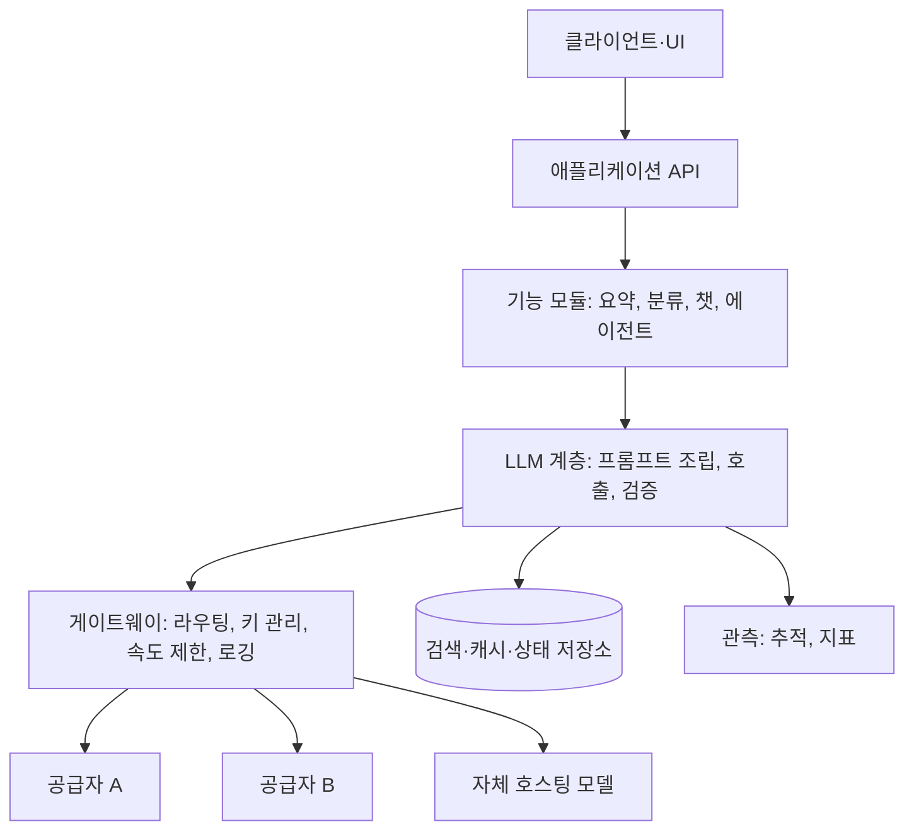

# LLM 애플리케이션 아키텍처

LLM 호출을 애플리케이션 곳곳에 흩어 두면 비용·오류·프롬프트 변경을 통제할 수 없습니다. **LLM 계층**을 분리하고 그 앞뒤에 게이트웨이와 검증을 두는 구조가 기본입니다.

## 계층 구조

| 계층 | 책임 | 두지 말아야 할 것 |
| --- | --- | --- |
| 기능 모듈 | 업무 흐름, 입력 수집, 결과 활용 | 프롬프트 문자열, 공급자 SDK 직접 호출 |
| LLM 계층 | 프롬프트 템플릿·버전, 모델 선택, 출력 검증·파싱, 재시도 | 업무 규칙 |
| 게이트웨이 | 공급자 추상화, API 키, 속도 제한, 폴백, 비용 집계 | 프롬프트 내용 |
| 저장소 | 대화 기록, 캐시, 벡터 인덱스 | - |
| 관측 | 요청 단위 추적, 지표, 평가 데이터 수집 | - |

## 게이트웨이

| 기능 | 효과 |
| --- | --- |
| 공급자 추상화 | 모델 교체·다중 공급자 폴백을 호출 코드 변경 없이 |
| 키·비밀 관리 | 애플리케이션 코드에 공급자 키 미노출 |
| 속도 제한·동시성 | 공급자 한도 초과 방지, 기능별 공정 배분 |
| 비용 집계 | 팀·기능·사용자별 토큰 집계 |
| 캐싱 | 동일 요청 응답 재사용 |
| 감사 로그 | 누가 무엇을 보냈는지 |

| 선택지 | 예 | 적합한 경우 |
| --- | --- | --- |
| 라이브러리형 | LiteLLM 등 공급자 통합 라이브러리 | 단일 서비스, 가볍게 시작 |
| 프록시형 | LiteLLM Proxy, Portkey, Kong·Cloudflare 등의 AI 게이트웨이 | 여러 서비스·팀이 공유 |
| 공급자 집계 서비스 | OpenRouter 등 | 여러 모델 실험, 결제 통합 |
| 자체 구현 | 얇은 래퍼 모듈 | 요구가 단순할 때 |

## 모델 라우팅

| 기준 | 방식 | 예 |
| --- | --- | --- |
| 작업 유형 | 기능별 고정 모델 | 분류는 소형, 작성은 상위 모델 |
| 난이도 추정 | 입력 길이·규칙·소형 모델 판단으로 분기 | 짧은 FAQ는 소형, 복잡한 질문은 상위 |
| 단계적 | 소형 모델 결과의 확신도가 낮으면 상위 모델로 | 비용 절감과 품질 유지 |
| 가용성 | 장애·한도 시 다른 공급자 | 폴백([신뢰성](./reliability.md)) |
| 데이터 정책 | 민감 데이터는 자체 호스팅 | 규제 대응 |

라우팅 규칙은 평가 세트로 검증하고, 어느 모델이 응답했는지 추적에 남깁니다.

## 동기와 비동기 처리

| 패턴 | 적합한 경우 | 구현 |
| --- | --- | --- |
| 동기 + 스트리밍 | 사용자가 기다리는 대화·작성 | SSE·WebSocket으로 토큰 중계 |
| 동기 + 타임아웃 | 짧은 분류·추출 | 수 초 타임아웃, 실패 시 기본값 |
| 비동기 작업 | 긴 문서 처리, 에이전트 작업 | 큐에 넣고 작업 ID 반환, 상태 조회·웹훅 |
| 배치 | 대량 오프라인 처리 | 공급자 배치 API, 야간 실행 |

긴 작업을 HTTP 요청 안에서 동기로 처리하면 타임아웃·재시도로 중복 실행이 생깁니다. 수십 초를 넘으면 큐 기반으로 전환합니다.

## 상태와 데이터

| 데이터 | 저장 위치 | 주의 |
| --- | --- | --- |
| 대화 기록 | DB(대화 ID 기준) | 길이 제한·요약 정책, 보존 기간 |
| 응답 캐시 | Redis 등 | 키에 프롬프트 버전·모델 포함 |
| 프롬프트 템플릿 | 코드 저장소 | [프롬프트 관리](./prompt-management.md) |
| 추적·평가 데이터 | 관측 도구·데이터 웨어하우스 | 개인정보 마스킹 |
| 벡터 인덱스 | 벡터 저장소 | [RAG 벡터 저장소](../rag/vector-stores.md) |

## 배포 단위와 환경

| 항목 | 권장 |
| --- | --- |
| 환경 분리 | 개발·스테이징·운영마다 공급자 키와 예산 분리 |
| 모델 고정 | 환경 설정에 버전 붙은 모델 ID. 공급자의 "최신" 별칭은 운영에서 사용 금지 |
| 기능 플래그 | 새 프롬프트·모델을 일부 트래픽에만 적용 |
| 비밀 | 비밀 관리자, 키 순환 절차 |
| 로컬 개발 | 기록된 응답 재생(replay) 또는 소형 모델로 비용 절감 |

관련: [API 설계](../../Backend/api/api-design.md), [메시지 큐](../../Backend/messaging/message-queue.md), [Redis 캐싱](../../Backend/caching/redis.md), [Docker Compose](../../Infrastructure/docker/docker-compose.md)

다음: [프롬프트 관리](./prompt-management.md)
