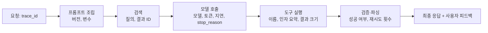

# 관측과 비용

LLM 기능은 로그만으로는 무엇이 잘못됐는지 알기 어렵습니다. 요청마다 **프롬프트, 모델, 응답, 토큰, 지연, 검증 결과**를 하나의 추적으로 묶어야 품질 문제와 비용 문제를 같은 데이터로 분석할 수 있습니다.

## 추적(Trace)



| 기록 항목 | 이유 |
| --- | --- |
| 프롬프트 버전, 모델 ID | 회귀의 원인 식별 |
| 입력·출력 본문(마스킹) | 실패 사례 재현, 평가 세트 보강 |
| 토큰(입력·출력·캐시) | 비용 계산, 캐시 적중률 |
| 지연(TTFT, 총) | 병목 파악 |
| 종료 이유, 검증 결과, 재시도 | 형식 오류·잘림 추적 |
| 도구 호출 목록 | 에이전트 루프 분석 |
| 사용자·기능·테넌트 | 비용 배분, 이상 사용 탐지 |
| 사용자 피드백 | 품질 지표의 근거 |

OpenTelemetry의 생성형 AI 의미 규약(semantic conventions)을 따르면 기존 APM과 추적을 연결할 수 있습니다.

## 지표

| 범주 | 지표 | 알림 기준 예 |
| --- | --- | --- |
| 가용성 | 오류율, 공급자별 실패율, 폴백 비율 | 오류율 5분 평균 > 기준 |
| 지연 | TTFT·총 지연 p50/p95/p99 | p95 급증 |
| 품질 | 검증 실패율, 거부율, 피드백 부정 비율, 평가 샘플 점수 | 검증 실패율 상승 |
| 비용 | 시간당 토큰·비용, 기능별·사용자별 비용 | 일 예산 80% 도달 |
| 사용 | 호출 수, 활성 사용자, 기능별 분포 | 급증(남용 의심) |
| 캐시 | 프롬프트 캐시 적중률, 응답 캐시 적중률 | 적중률 급락(접두 변경 의심) |

품질 지표는 운영 트래픽의 일부를 **샘플링해 주기적으로 채점**하는 방식으로 얻습니다. 전량 채점은 비용이 큽니다.

## 로그와 개인정보

| 원칙 | 적용 |
| --- | --- |
| 마스킹 | 이메일, 전화번호, 주민번호 등은 저장 전 치환 |
| 보존 기간 | 본문은 짧게, 집계 지표는 길게 |
| 접근 제어 | 프롬프트·응답 본문 열람 권한 분리 |
| 공급자 정책 | 공급자 측 로그 보존·학습 사용 여부 확인, 필요 시 제외 옵션 |
| 사용자 고지 | AI 처리와 데이터 사용 범위를 약관·UI에 명시 |

## 비용 배분

| 차원 | 쓰임 |
| --- | --- |
| 기능별 | 어떤 기능이 비용을 쓰는지. 최적화 우선순위 |
| 프롬프트 버전별 | 변경이 토큰을 얼마나 늘렸는지 |
| 모델별 | 라우팅 효과 측정 |
| 사용자·테넌트별 | 요금제 설계, 남용 탐지, 상한 적용 |
| 단계별(검색·생성·재시도·채점) | 숨은 비용(재시도, 평가) 파악 |

```
단위 비용 = 기간 비용 ÷ 성공 요청 수
```

단위 비용을 추적하면 "비용이 늘었다"가 "사용이 늘었다"인지 "요청당 비용이 늘었다"인지 구분됩니다.

## 예산 통제

| 장치 | 동작 |
| --- | --- |
| 공급자 콘솔 한도 | 월 상한. 최후 방어선 |
| 게이트웨이 예산 | 팀·기능·키별 일·월 예산, 초과 시 차단 또는 소형 모델 |
| 요청당 상한 | `max_tokens`, 문맥 길이 상한, 에이전트 루프 횟수 상한 |
| 사용자당 상한 | 요금제별 일일 토큰·호출 수 |
| 알림 | 예산 50·80·100% 도달, 시간당 비용 급증 |

## 도구

| 구분 | 예 | 특징 |
| --- | --- | --- |
| LLM 전용 관측 | Langfuse, LangSmith, Arize Phoenix, Braintrust, Helicone | 추적·프롬프트·평가·비용을 한 화면에 |
| 범용 APM 연동 | OpenTelemetry + 기존 APM(Datadog, Grafana 등) | 서비스 전체 추적과 통합 |
| 게이트웨이 내장 | LiteLLM Proxy, Portkey 등 | 비용·키별 집계 |
| 평가 러너 | promptfoo, DeepEval, Ragas | 샘플 채점, 회귀 비교 |

처음에는 호출 래퍼에서 구조화 로그를 남기는 것으로 시작해도 충분합니다. 트래픽과 기능이 늘면 전용 도구로 옮깁니다.

관련: [로깅](../../Backend/logging/logging.md), [비용과 지연](../llm-basics/cost-and-latency.md), [RAG 평가와 실패 진단](../rag/evaluation.md), [운영과 안전](../agents/operations.md)
