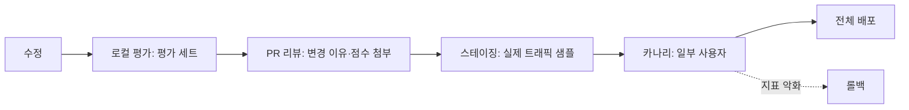

# 프롬프트 관리

프롬프트는 모델의 동작을 결정하는 **코드**입니다. 한 글자 수정이 전체 기능의 품질을 바꾸므로 버전 관리, 리뷰, 평가, 점진적 배포를 코드와 같은 수준으로 적용합니다.

## 프롬프트를 코드로 다루기

| 원칙 | 적용 |
| --- | --- |
| 저장소에 보관 | 프롬프트 파일을 코드 옆에 두고 PR로 변경 |
| 템플릿과 데이터 분리 | 고정 지시는 템플릿, 사용자 입력·문서는 변수 |
| 버전 식별 | 파일 해시 또는 명시적 버전 문자열을 모든 호출 로그에 기록 |
| 평가 후 배포 | 평가 세트 점수가 기준 이상일 때만 머지 |
| 롤백 가능 | 이전 버전으로 즉시 되돌릴 수 있는 배포 방식 |

```
prompts/
  summarize/
    v3.md            # 현재
    v2.md            # 롤백용
    evals.jsonl      # 평가 세트
    CHANGELOG.md     # 변경 이유와 평가 결과
```

## 템플릿 구성

| 구역 | 내용 | 변경 빈도 |
| --- | --- | --- |
| 역할·목표 | 무엇을 하는 도우미인지 | 낮음 |
| 규칙 | 해야 할 것·하지 말 것, 우선순위 | 낮음 |
| 출력 형식 | 스키마, 길이, 언어 | 낮음 |
| 예시 | 입력·출력 쌍 | 중간 |
| 참조 자료 | 검색 결과, 문서 | 요청마다 |
| 사용자 입력 | 질문, 데이터 | 요청마다 |

변경 빈도가 낮은 구역을 앞에 두면 프롬프트 캐싱 적중률이 높아집니다([비용과 지연](../llm-basics/cost-and-latency.md)). 변수 삽입은 명확한 구분자나 태그로 감싸 지시와 데이터를 분리합니다.

## 변경 흐름



| 단계 | 확인할 것 |
| --- | --- |
| 로컬 평가 | 기존 평가 세트 점수, 회귀 사례 |
| 리뷰 | 변경 의도, 영향 범위, 비용 변화(토큰 수) |
| 스테이징 | 실제 입력 분포에서의 출력 샘플 수동 검토 |
| 카나리 | 품질 지표, 오류율, 지연, 비용 |
| 롤백 | 버전 전환만으로 가능해야 함. 코드 배포가 필요하면 느림 |

## 평가 세트 관리

| 항목 | 내용 |
| --- | --- |
| 구성 | 대표 입력 + 기대 출력 또는 채점 기준. 50개부터 시작 |
| 출처 | 운영 로그에서 실패·불만 사례를 익명화해 추가 |
| 채점 | 정확 일치, 스키마 검증, 규칙 검사, 모델 채점(LLM-as-judge) |
| 실행 | PR마다 자동 실행(CI), 결과를 PR에 코멘트 |
| 비용 | 평가 자체의 호출 비용. 소형 모델 채점, 샘플링 |

평가 방법의 자세한 내용은 [Harness 평가와 오류 진단](../harness/evaluation.md)을 참고합니다.

## 모델 버전과 프롬프트의 결합

| 상황 | 대응 |
| --- | --- |
| 공급자가 새 모델 버전 출시 | 같은 프롬프트로 평가 세트 실행, 차이 확인 후 교체 |
| 구 모델 폐기 예고 | 폐기일 전에 새 모델에서 프롬프트 재조정 |
| 프롬프트가 특정 모델에 과적합 | 모델 교체 시 예시·규칙 재검토 |

프롬프트 버전 로그에 모델 ID를 함께 남겨야 "어떤 조합"이 좋았는지 알 수 있습니다.

## 도구

| 구분 | 예 | 역할 |
| --- | --- | --- |
| 저장소 기반 | Git + 템플릿 파일 + CI 평가 | 가장 단순, 코드와 함께 리뷰 |
| 프롬프트 관리 플랫폼 | Langfuse, Braintrust, PromptLayer, Humanloop | UI 편집, 버전, 평가, 배포 분리 |
| 평가 러너 | promptfoo, DeepEval | 평가 세트 실행과 비교 리포트 |
| 프로그램형 최적화 | DSPy | 프롬프트를 자동 탐색·최적화 |

비개발자가 프롬프트를 자주 수정해야 하면 플랫폼이 유용하지만, 평가 없이 배포되는 경로가 생기지 않도록 합니다.

관련: [프롬프팅 테스트와 반복 개선](../prompting/testing-and-iteration.md), [Git Rebase](../../Version%20Control%20System/git/rebase.md), [GitHub Actions](../../Infrastructure/cicd/github-action.md)

다음: [신뢰성](./reliability.md)
