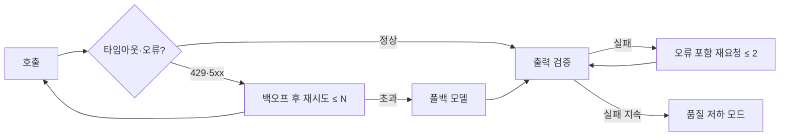

# LLM 기능의 신뢰성

LLM 기능의 장애는 공급자 장애, 속도 제한, 느린 응답, 형식이 틀린 출력, 품질 저하로 나타납니다. 각 장애 유형에 대한 대응을 미리 설계하면 대부분은 사용자에게 보이지 않게 처리할 수 있습니다.

## 장애 유형과 대응

| 유형 | 증상 | 1차 대응 | 2차 대응 |
| --- | --- | --- | --- |
| 공급자 장애 | 5xx, 연결 실패 | 짧은 백오프 재시도 | 다른 공급자·모델로 폴백 |
| 속도 제한 | 429 | 지수 백오프, 동시성 축소 | 큐 대기, 소형 모델 전환 |
| 느린 응답 | 타임아웃 | 스트리밍, 출력 길이 제한 | 비동기 전환, 부분 결과 |
| 형식 오류 | 파싱 실패 | 오류 포함 재요청 1~2회 | 기본값·사람 검토 |
| 품질 저하 | 평가 점수 하락 | 프롬프트·모델 롤백 | 카나리 중단 |
| 콘텐츠 거부 | 거부 응답 | 사용자 안내 | 입력 재구성 |

## 타임아웃과 재시도

| 설정 | 권장 |
| --- | --- |
| 연결 타임아웃 | 수 초 |
| 응답 타임아웃 | 기대 출력 길이 ÷ 생성 속도 + 여유. 스트리밍은 토큰 간 간격으로 |
| 재시도 횟수 | 2~3회. 멱등한 호출만 |
| 백오프 | 지수 + 지터. `Retry-After` 헤더 우선 |
| 재시도 예산 | 전체 요청의 일정 비율 이하로 제한해 폭주 방지 |

도구 실행이 포함된 에이전트 루프에서는 **모델 호출**만 재시도하고, 이미 실행된 부작용을 반복하지 않도록 단계를 분리합니다.

## 폴백

| 폴백 대상 | 조건 | 주의 |
| --- | --- | --- |
| 같은 공급자의 다른 모델 | 특정 모델 과부하 | 프롬프트가 두 모델에서 모두 평가됐는지 |
| 다른 공급자 | 공급자 전체 장애 | 메시지 형식·도구 정의 변환, 데이터 정책 |
| 자체 호스팅 모델 | 외부 전면 장애, 비용 상한 | 품질 차이를 사용자에게 알릴지 |
| 비LLM 경로 | 모든 모델 불가 | 규칙 기반 응답, 캐시된 결과, 기능 비활성화 |

폴백은 평소에 **주기적으로 실제 트래픽 일부에 실행**해 동작을 확인합니다. 장애 때 처음 쓰는 폴백은 대개 실패합니다.

## 회로 차단과 부하 제어

| 장치 | 동작 |
| --- | --- |
| 회로 차단기 | 오류율이 임계치를 넘으면 일정 시간 호출을 끊고 즉시 폴백 |
| 동시성 제한 | 세마포어로 공급자별 동시 호출 상한 |
| 우선순위 큐 | 사용자 대면 요청을 배치 작업보다 먼저 |
| 부하 차단 | 큐 길이 초과 시 저우선 요청 거절 |
| 비용 상한 | 일·월 예산 도달 시 소형 모델 전환 또는 차단 |

## 캐싱

| 계층 | 키 | 효과 |
| --- | --- | --- |
| 공급자 프롬프트 캐싱 | 요청 접두 | 입력 비용·TTFT 절감 |
| 응답 캐시 | 프롬프트 버전 + 모델 + 정규화된 입력 해시 | 동일 요청 호출 제거 |
| 의미 캐시 | 입력 임베딩 유사도 | 유사 질문 재사용. 오답 재사용 위험 |
| 중간 결과 캐시 | 검색 결과, 도구 결과 | 에이전트 루프 비용 절감 |

캐시 키에 프롬프트 버전과 모델을 넣지 않으면 롤백·교체 후 옛 응답이 나옵니다. 개인화된 응답은 사용자 범위로 키를 분리합니다.

## 품질 저하 모드(Graceful Degradation)

| 수준 | 동작 | 사용자 안내 |
| --- | --- | --- |
| 정상 | 상위 모델, 전체 기능 | - |
| 1단계 | 소형 모델, 짧은 출력 | 없음 또는 "간략 모드" |
| 2단계 | 캐시·규칙 기반 응답만 | "일부 기능이 제한됩니다" |
| 3단계 | 기능 비활성화 | "현재 사용할 수 없습니다" |

어느 수준에서 동작 중인지 지표로 노출하고, 자동 복귀 조건을 정합니다.

## 멱등성과 중복 실행

| 상황 | 대응 |
| --- | --- |
| 클라이언트 재시도로 같은 요청이 두 번 | 요청 ID로 중복 제거 |
| 비동기 작업 재실행 | 작업 상태를 저장하고 완료된 단계는 건너뜀 |
| 에이전트가 쓰기 도구를 반복 | 도구에 멱등 키, 실행 이력 확인 |

관련: [Rate Limiting](../../API/rate-limiting.md), [예외 처리 전략](../../Quality/exception-handling-strategy.md), [Redis 캐싱](../../Data/caching/redis.md), [트랜잭션](../../Data/database/transaction.md)

다음: [관측과 비용](./observability-and-cost.md)
