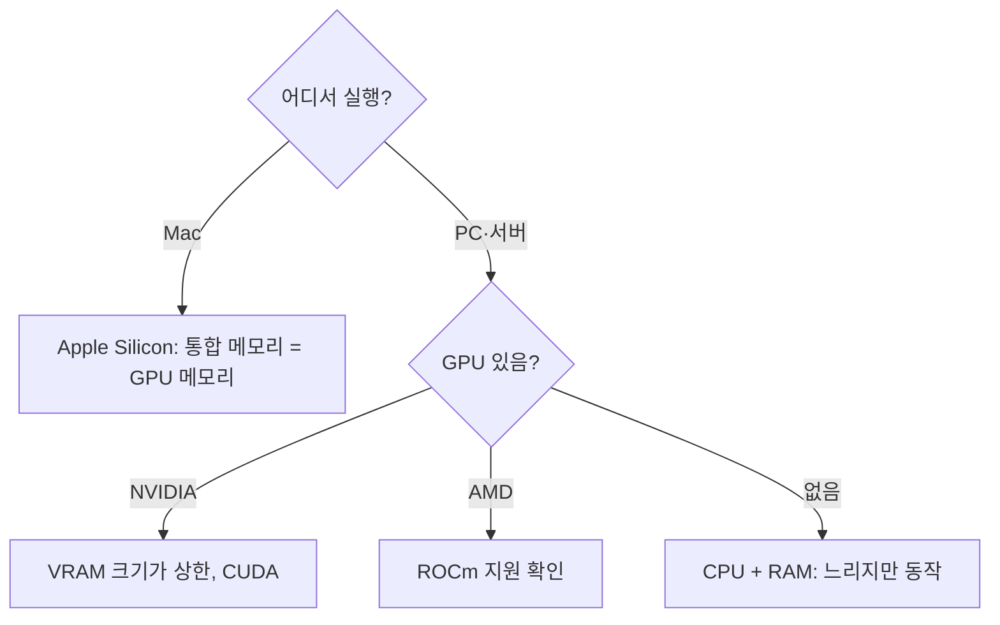

# 양자화와 하드웨어

로컬 실행의 첫 질문은 "이 모델이 내 메모리에 들어가는가"입니다. 답은 **파라미터 수 × 파라미터당 바이트 + KV 캐시**로 계산되며, 양자화가 파라미터당 바이트를 줄입니다.

## 메모리 계산

```
가중치 메모리 ≈ 파라미터 수 × 파라미터당 바이트
KV 캐시 ≈ 문맥 길이 × 레이어 수 × 히든 크기 × 2 × 바이트 (모델 구조에 따라 다름)
필요 메모리 ≈ 가중치 + KV 캐시 + 런타임 오버헤드(약 1~2GB)
```

| 정밀도 | 파라미터당 바이트 | 7B 모델 가중치 | 70B 모델 가중치 |
| --- | --- | --- | --- |
| FP16/BF16 | 2 | 약 14GB | 약 140GB |
| INT8 / Q8 | 1 | 약 7GB | 약 70GB |
| Q5 | 약 0.65 | 약 5GB | 약 45GB |
| Q4 | 약 0.55 | 약 4GB | 약 40GB |
| Q2~Q3 | 약 0.3~0.45 | 약 2.5~3GB | 약 25~30GB |

긴 문맥을 쓰면 KV 캐시가 가중치보다 커질 수 있습니다. 32K 문맥의 7B 모델은 KV 캐시만 수 GB를 쓰기도 하므로, 문맥 길이를 필요한 만큼만 설정합니다.

## 양자화

| 방식 | 특징 | 형식·도구 |
| --- | --- | --- |
| 사후 양자화(PTQ) | 학습 없이 가중치를 낮은 정밀도로 변환. 대부분의 배포본 | GGUF, AWQ, GPTQ, FP8 |
| K-양자화(GGUF Q4_K_M 등) | 레이어별 중요도에 따라 비트 수 혼합 | llama.cpp |
| AWQ | 활성화 통계로 중요한 가중치 보존 | GPU 서빙 |
| GPTQ | 레이어별 오차 최소화 | GPU 서빙 |
| FP8 | 최신 GPU의 네이티브 8비트 부동소수점 | vLLM, TensorRT-LLM |
| KV 캐시 양자화 | 캐시를 8비트·4비트로 | 긴 문맥 메모리 절감 |

| 수준 | 품질 | 권장 |
| --- | --- | --- |
| Q8 | 원본과 거의 동일 | 메모리 여유가 있을 때 |
| Q5_K_M / Q6_K | 손실 거의 체감 안 됨 | 균형 |
| Q4_K_M | 약간의 손실, 가장 널리 쓰임 | 기본 선택 |
| Q3 이하 | 손실 뚜렷, 작은 모델일수록 심함 | 메모리가 정말 부족할 때만 |

같은 메모리라면 **큰 모델의 Q4가 작은 모델의 Q8보다 나은** 경우가 많습니다. 단, 2비트 수준까지 내려가면 역전됩니다.

## 하드웨어 선택



| 플랫폼 | 메모리 | 속도 | 비고 |
| --- | --- | --- | --- |
| NVIDIA GPU | VRAM(8·12·16·24GB, 서버 48~80GB 이상) | 빠름 | 생태계 가장 넓음. VRAM을 넘는 모델은 CPU 오프로드로 급격히 느려짐 |
| Apple Silicon | 통합 메모리(16~192GB 이상) | 중간 | 큰 모델을 메모리에 올리기 쉬움. 대역폭이 상위 GPU보다 낮음 |
| AMD GPU | VRAM | 빠름 | ROCm 지원 모델·런타임 범위 확인 |
| CPU | 시스템 RAM | 느림 | 소형 모델, 배치 작업, 메모리 대역폭이 병목 |
| 다중 GPU | VRAM 합산 | 빠름 | 텐서 병렬 지원 서빙 엔진 필요 |

| 목표 | 대략적 구성 |
| --- | --- |
| 7~9B Q4 개인 사용 | 8GB VRAM 또는 16GB 통합 메모리 |
| 14B Q4 | 12~16GB VRAM 또는 24GB 통합 메모리 |
| 30B급 Q4 | 24GB VRAM 또는 32~48GB 통합 메모리 |
| 70B Q4 | 48GB VRAM(다중 GPU) 또는 64GB 이상 통합 메모리 |

## 속도에 영향을 주는 것

| 요인 | 영향 |
| --- | --- |
| 메모리 대역폭 | 토큰 생성 속도의 주요 결정 요인. 가중치를 매 토큰마다 읽음 |
| 모델 크기·양자화 | 작을수록 빠름 |
| 문맥 길이 | 입력 처리 시간과 KV 캐시 메모리 증가 |
| 배칭 | 동시 요청을 묶으면 처리량 증가(서빙 엔진) |
| CPU 오프로드 | VRAM 부족분을 RAM에 두면 수 배~수십 배 느려짐 |
| 추측 디코딩(speculative decoding) | 소형 초안 모델로 가속, 런타임 지원 필요 |

## 런타임 설정 항목

| 설정 | 의미 | 권장 |
| --- | --- | --- |
| 문맥 길이(`num_ctx` 등) | KV 캐시 크기 | 작업에 필요한 만큼. 기본값이 작은 런타임이 있음 |
| GPU 레이어 수 | 몇 개 레이어를 GPU에 올릴지 | 가능하면 전부 |
| 배치 크기 | 입력 처리 단위 | 메모리 허용 범위에서 크게 |
| 스레드 수 | CPU 추론 병렬도 | 물리 코어 수 |
| 플래시 어텐션 | 어텐션 메모리·속도 최적화 | 지원 시 활성화 |
| KV 캐시 정밀도 | 캐시 양자화 | 긴 문맥에서 메모리 부족 시 |

관련: [전기 기초](../../Hardware/basics/electrical-basics.md)의 전원 고려, [Docker](../../Infrastructure/docker/docker.md)

다음: [서빙과 연결](./serving-and-integration.md)
