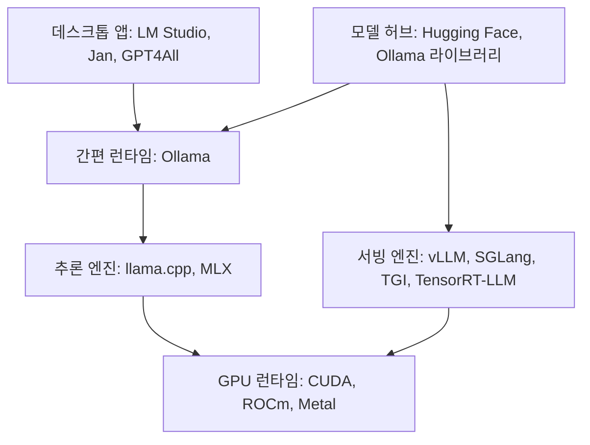

# 로컬 모델 런타임과 도구

런타임은 모델 가중치를 메모리에 올리고 토큰을 생성하며 API로 노출하는 소프트웨어입니다. 개인용 간편 도구부터 다중 사용자 서빙 엔진까지 층이 나뉩니다.

## 층별 구분



## 런타임 비교

| 런타임 | 특징 | 적합한 경우 |
| --- | --- | --- |
| Ollama | 명령 하나로 모델 받기·실행, OpenAI 호환 API, 모델 라이브러리 | 개인 개발, 프로토타입, 소규모 사내 도구 |
| llama.cpp | C/C++ 추론 엔진, GGUF 형식, CPU·GPU·Apple Silicon 지원, 서버 모드 | 세밀한 설정, 임베디드·저사양, Ollama의 기반 |
| LM Studio | GUI로 모델 검색·실행·채팅, 로컬 서버 | 비개발자 포함 개인 사용 |
| Jan, GPT4All | 오픈 소스 데스크톱 앱 | 개인 사용 |
| MLX(mlx-lm) | Apple Silicon 전용 프레임워크 | Mac에서 성능 최적화 |
| vLLM | PagedAttention, 연속 배칭, 높은 처리량, OpenAI 호환 서버 | 다중 사용자 서빙, GPU 서버 |
| SGLang | 고성능 서빙, 구조화 출력·프리픽스 캐시에 강함 | 서빙, 에이전트 워크로드 |
| TGI(Text Generation Inference) | Hugging Face의 서빙 서버 | Hugging Face 생태계 |
| TensorRT-LLM | NVIDIA 최적화 엔진 | NVIDIA GPU에서 최대 성능 |
| ExLlama 계열 | GPTQ·EXL2 양자화 GPU 추론 | 소비자 GPU에서 속도 |

| 선택 기준 | 개인 PC | 팀 서버 |
| --- | --- | --- |
| 첫 선택 | Ollama 또는 LM Studio | vLLM 또는 SGLang |
| 모델 형식 | GGUF | safetensors(원본), AWQ·GPTQ·FP8 양자화 |
| 동시 사용자 | 1명 | 수십 명 이상, 연속 배칭 필요 |
| 운영 | 설치만 | 컨테이너, GPU 드라이버, 모니터링 |

```bash
# Ollama 예
ollama pull <model>
ollama run <model>
curl http://localhost:11434/v1/chat/completions -d '{"model":"<model>","messages":[{"role":"user","content":"안녕"}]}'
```

## 모델 허브와 형식

| 항목 | 내용 |
| --- | --- |
| Hugging Face Hub | 대부분의 오픈 모델 원본·양자화본. 모델 카드에서 라이선스·평가·권장 설정 확인 |
| Ollama 라이브러리 | Ollama용으로 포장된 모델. 태그로 크기·양자화 선택 |
| safetensors | 원본 가중치 형식. 서빙 엔진이 직접 로드 |
| GGUF | llama.cpp 계열 형식. 양자화 수준이 파일명에 표시(Q4_K_M 등) |
| AWQ, GPTQ, EXL2 | GPU용 양자화 형식 |

## 모델 선택

| 분류 | 예(변동 있음) | 비고 |
| --- | --- | --- |
| 범용 소형(1~4B) | Llama, Qwen, Gemma, Phi 계열의 소형판 | 분류·추출·간단한 대화, 저사양 |
| 범용 중형(7~14B) | 같은 계열의 7~14B | 노트북·소비자 GPU의 기준점 |
| 범용 대형(30B 이상) | 같은 계열의 대형판, MoE 모델 | 서버 GPU 또는 큰 메모리의 Mac |
| 코딩 특화 | 각 계열의 Coder 모델 | 코드 완성·생성 |
| 추론 특화 | 추론 증류 모델 | 느리지만 복잡한 문제 |
| 한국어 특화 | 국내 기업·연구 그룹 공개 모델 | 한국어 평가 세트로 비교 |
| 임베딩 | BGE-M3, multilingual-e5, nomic-embed | RAG용. [RAG 도구](../rag/tools.md) |
| 멀티모달 | 이미지 입력 지원 모델 | 문서·이미지 이해 |

모델 이름과 세대는 빠르게 바뀝니다. 선택은 "자기 작업의 평가 세트에서 어느 모델이 충분한가"로 결정합니다.

## 관련 도구

| 구분 | 예 | 역할 |
| --- | --- | --- |
| 채팅 UI | Open WebUI, LibreChat | 로컬 런타임에 붙는 웹 UI, RAG·다중 사용자 |
| 양자화 도구 | llama.cpp 변환 스크립트, AutoAWQ, AutoGPTQ | 원본 → 양자화 형식 변환 |
| 파인튜닝 | Unsloth, Axolotl, Hugging Face TRL, LLaMA-Factory | LoRA 등 경량 미세 조정 |
| 평가 | lm-evaluation-harness, 자체 평가 세트 | 모델 비교 |
| 모니터링 | nvidia-smi, nvtop, 런타임 지표 | GPU 사용률·메모리 |

다음: [양자화와 하드웨어](./quantization-and-hardware.md)
