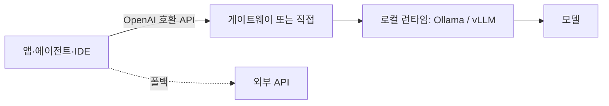

# 로컬 모델 서빙과 연결

로컬 런타임 대부분이 **OpenAI 호환 HTTP API**를 제공합니다. 덕분에 기존 호출 코드, 에이전트 프레임워크, IDE 도구를 주소만 바꿔 연결할 수 있습니다. 이 문서는 연결 방법, 팀 서빙, 운영, 그리고 API 모델과의 차이에서 오는 한계를 다룹니다.

## 연결 구조



| 클라이언트 | 연결 방법 |
| --- | --- |
| 자체 코드 | OpenAI SDK의 `base_url`을 로컬 주소로, API 키는 임의 값 |
| 에이전트 프레임워크 | 모델 공급자를 "OpenAI 호환"으로 설정 |
| 코딩 에이전트·IDE | 제품별 로컬 모델·커스텀 엔드포인트 설정 |
| 채팅 UI | Open WebUI 등에서 런타임 주소 등록 |
| RAG | 임베딩도 로컬 모델(Ollama 임베딩 등)로 교체 가능 |

```python
from openai import OpenAI
client = OpenAI(base_url="http://localhost:11434/v1", api_key="local")
res = client.chat.completions.create(model="<model>", messages=[{"role": "user", "content": "..."}])
```

공급자별 고유 기능(프롬프트 캐싱 제어, 특정 도구 형식)은 호환 API에 없을 수 있습니다. [LLM 계층](../llmops/architecture.md)에서 차이를 흡수합니다.

## 기능 지원 확인

| 기능 | 확인할 것 |
| --- | --- |
| 도구 호출 | 모델이 도구 호출 학습이 되어 있는지, 런타임이 도구 형식을 지원하는지 |
| 구조화 출력 | JSON 스키마 제약 지원 여부(llama.cpp 문법, vLLM·SGLang 가이드 디코딩) |
| 스트리밍 | 대부분 지원 |
| 긴 문맥 | 모델의 학습 문맥 길이와 런타임 설정 모두 확인 |
| 멀티모달 | 이미지 입력 지원 모델·런타임 |
| 채팅 템플릿 | 모델별 프롬프트 형식을 런타임이 올바르게 적용하는지 |

도구 호출과 구조화 출력은 소형 모델에서 실패율이 높습니다. 스키마 제약 디코딩을 켜고 검증을 반드시 둡니다.

## 개인 사용에서 팀 서빙으로

| 항목 | 개인(Ollama 등) | 팀(vLLM·SGLang 등) |
| --- | --- | --- |
| 동시성 | 순차 처리 | 연속 배칭으로 수십 요청 동시 처리 |
| 배포 | 로컬 설치 | 컨테이너 + GPU, 쿠버네티스 |
| 인증 | 없음(localhost) | 리버스 프록시·게이트웨이에서 토큰 |
| 모델 관리 | 수동 pull | 버전 고정, 교체 절차 |
| 관측 | 없음 | 요청 지표, GPU 사용률, 큐 길이 |
| 비용 | 전기 | GPU 서버 상각 vs API 비용 비교 |

```bash
# vLLM 예: OpenAI 호환 서버
docker run --gpus all -p 8000:8000 vllm/vllm-openai --model <hf-model-id> --max-model-len 16384
```

## 운영 점검

| 항목 | 내용 |
| --- | --- |
| 네트워크 노출 | 런타임을 외부에 직접 노출하지 않음. 프록시와 인증 |
| 모델 버전 | 모델 파일 해시·태그 고정. "latest" 태그 금지 |
| 메모리 | 문맥 길이와 동시 요청 수에 따른 KV 캐시 총량 계산 |
| 장애 | 프로세스 재시작, 상태 점검 엔드포인트, 외부 API 폴백 |
| 업데이트 | 런타임 업그레이드 후 평가 세트 재실행 |
| 라이선스 | 모델 라이선스의 상업 이용·배포 조건 기록 |

## API 모델과의 차이

| 항목 | 로컬 모델 | API 상위 모델 |
| --- | --- | --- |
| 품질 | 소·중형은 복잡한 추론·긴 지시 준수에서 열세 | 우수 |
| 도구 호출 신뢰성 | 모델·런타임에 따라 편차 | 안정적 |
| 문맥 길이 | 메모리에 제한 | 수십만 토큰 |
| 지연 | 하드웨어에 따라 다름, 동시성 낮음 | 공급자 인프라 |
| 데이터 | 외부 전송 없음 | 정책 의존 |
| 비용 구조 | 고정비(하드웨어) | 변동비(토큰) |

| 실무 조합 | 설명 |
| --- | --- |
| 로컬 소형 + API 상위 | 분류·추출·초안은 로컬, 어려운 요청만 API로 라우팅 |
| 로컬 임베딩 + API 생성 | 문서는 외부로 보내지 않고 질문·요약만 전송 |
| 전부 로컬 | 규제 환경. 품질 한계를 평가 세트로 확인 후 수용 |

관련: [아키텍처](../llmops/architecture.md), [신뢰성](../llmops/reliability.md), [Docker Compose](../../Infrastructure/docker/docker-compose.md), [Nginx](../../Infrastructure/nginx/nginx.md)
