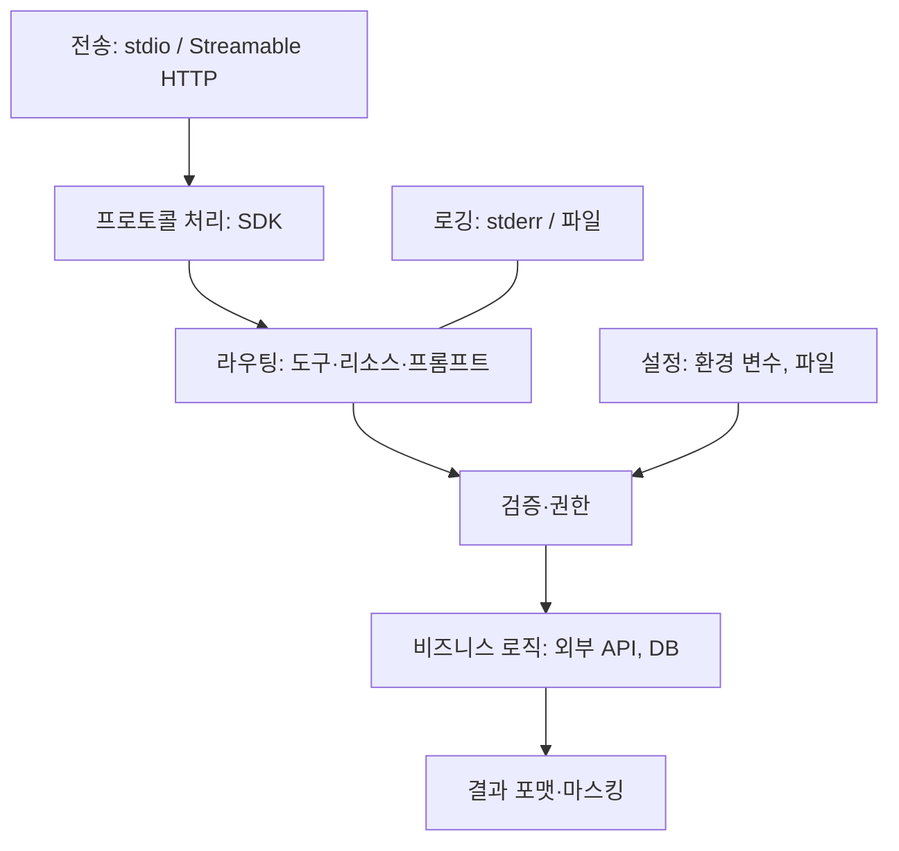

# MCP 서버 만들기

공식 SDK를 쓰면 프로토콜 처리는 SDK가 맡고, 개발자는 도구 함수와 설정만 작성합니다. 이 문서는 언어 선택부터 최소 서버, 설정·상태·인증·로깅까지의 절차를 다룹니다. 코드 예시는 공식 튜토리얼(2026-07-28 명세 기준)을 따르며, SDK API는 바뀌므로 공식 문서의 현재 예제와 대조합니다.

## SDK 선택

| 언어 | SDK | 비고 |
| --- | --- | --- |
| Python | 공식 Python SDK(`mcp` 패키지, `MCPServer` 클래스) | 데코레이터로 도구 정의. 이전 예제의 `FastMCP`는 현재 `MCPServer`로 바뀜 |
| TypeScript | 공식 TypeScript SDK v2(`@modelcontextprotocol/server`) | v1은 `@modelcontextprotocol/sdk` 패키지. npm 배포와 `npx` 실행이 편리 |
| Java(Spring AI), Kotlin, C#, Go, Rust, Ruby, Swift 등 | 공식·커뮤니티 SDK | 기존 백엔드 언어와 맞출 때 |

선택 기준은 **연결할 시스템의 클라이언트 라이브러리가 어느 언어에 있는가**입니다. 프로토콜 기능 차이보다 그쪽이 큽니다.

## 최소 서버

```python
from mcp.server import MCPServer

mcp = MCPServer("issues")

@mcp.tool()
def search_issues(query: str, state: str = "open", limit: int = 20) -> str:
    """이슈 트래커에서 제목·본문을 검색합니다. 이슈 번호를 알면 get_issue를 사용합니다."""
    rows = tracker.search(query=query, state=state, limit=min(limit, 50))
    if not rows:
        return "검색 결과 없음. 다른 검색어를 시도하거나 state='all'로 재검색."
    return "\n".join(f"#{r.id} [{r.state}] {r.title}" for r in rows)

if __name__ == "__main__":
    mcp.run(transport="stdio")
```

타입 힌트와 독스트링이 입력 스키마와 설명이 됩니다. 설명 작성 규칙은 [도구 설계](./tool-design.md)를 따릅니다. 실행은 `uv run server.py`, Inspector 연동 테스트는 `uv run mcp dev server.py`(`mcp[cli]` 추가 설치 필요)입니다.

```typescript
import { McpServer } from "@modelcontextprotocol/server";
import { serveStdio } from "@modelcontextprotocol/server/stdio";
import { z } from "zod";

function createServer() {
  const server = new McpServer({ name: "issues", version: "0.1.0" });
  server.registerTool(
    "search_issues",
    {
      description: "이슈 트래커에서 제목·본문을 검색합니다.",
      inputSchema: z.object({
        query: z.string().describe("검색어"),
        limit: z.number().int().max(50).default(20),
      }),
    },
    async ({ query, limit }) => ({ content: [{ type: "text", text: await search(query, limit) }] }),
  );
  return server;
}

serveStdio(createServer, { onerror: (e) => console.error("issues MCP error:", e) });
```

`serveStdio`는 클라이언트마다 프로토콜 버전을 협상하므로 2025년식 `initialize` 클라이언트와 최신 클라이언트를 모두 처리합니다. 팩토리 함수가 매번 새 인스턴스를 반환해야 합니다. v1 방식(`server.connect(new StdioServerTransport())`)도 컴파일되지만 2025년식 클라이언트만 지원합니다.

## 구성 요소별 설계



| 요소 | 설계 포인트 |
| --- | --- |
| 설정 | 환경 변수로 API 키·기본 URL·허용 범위를 받음. 호스트 설정 파일에서 `env`로 전달 |
| 상태 | 프로토콜이 무상태이므로 요청 간 상태는 명시적 ID로 참조. 캐시는 메모리, 영속 상태는 파일·DB |
| 외부 호출 | 타임아웃과 재시도를 도구 안에서 처리. 모델에 오류를 돌려줄 때는 구조화 |
| 결과 포맷 | 텍스트·JSON·이미지 등 콘텐츠 타입. 크기 상한 적용 |
| 동시성 | 같은 프로세스에 무관한 요청이 섞여 올 수 있음. 요청 단위로 격리 |

## 리소스와 프롬프트 추가

| 요소 | 정의 | 사용 예 |
| --- | --- | --- |
| 리소스 | URI 템플릿 + 읽기 함수(`@mcp.resource("issue://{id}")`) | 이슈 본문. 호스트가 문맥에 첨부 |
| 프롬프트 | 이름 + 인자 + 메시지 생성 함수 | `triage_issue(id)` → 분류 지시와 이슈 내용을 묶은 프롬프트 |

호스트가 리소스·프롬프트를 어떻게 노출하는지는 제품마다 다릅니다. 핵심 기능은 도구로 제공하고, 리소스·프롬프트는 보조로 둡니다.

## HTTP 전송과 인증

| 항목 | 내용 |
| --- | --- |
| 언제 | 여러 사용자가 공유, 서버가 원격에 있음, 호스트가 프로세스를 띄울 수 없음 |
| 실행 | Python: `uv run mcp run server.py --transport streamable-http` 등 SDK의 HTTP 서빙 사용 |
| 인가 | 명세의 OAuth 2.1 기반 흐름(선택 사항). 서버는 보호 리소스 메타데이터를 제공하고 Bearer 토큰을 검증 |
| 간단한 대안 | 사내 전용이면 리버스 프록시 뒤에서 헤더 토큰·네트워크 제한 |
| 배포 | 일반 웹 서비스와 동일: 컨테이너, HTTPS, 상태 점검 |

개인·로컬 용도는 stdio로 시작하고, 공유가 필요해질 때 HTTP로 옮깁니다. 도구 코드는 전송과 분리해 두면 전환이 쉽습니다.

## 로깅과 진단

| 규칙 | 이유 |
| --- | --- |
| stdio 서버는 stdout에 절대 쓰지 않음 | Python `print()`, JS `console.log()`가 기본으로 stdout에 씀. JSON-RPC가 깨짐 |
| HTTP 서버는 stdout 로깅 가능 | HTTP 응답과 간섭하지 않음 |
| 도구 호출마다 이름·인자 요약·소요 시간·성공 여부 | 오용·성능 분석 |
| 인자·결과의 민감 값 마스킹 | 로그 유출 방지 |
| 호스트의 MCP 로그 위치 확인 | 연결 실패 원인은 호스트 쪽 로그에 남는 경우가 많음 |

## 참고 자료

- [Build an MCP server](https://modelcontextprotocol.io/docs/develop/build-server) - 언어별 공식 튜토리얼
- [Python SDK](https://github.com/modelcontextprotocol/python-sdk), [TypeScript SDK](https://github.com/modelcontextprotocol/typescript-sdk)

확인일: 2026-10-16

관련: [환경변수 관리](../../Security/env-management.md), [로깅](../../Backend/logging/logging.md), [예외 처리 전략](../../Backend/exception/exception-handling-strategy.md)

다음: [테스트와 배포](./testing-and-distribution.md)
