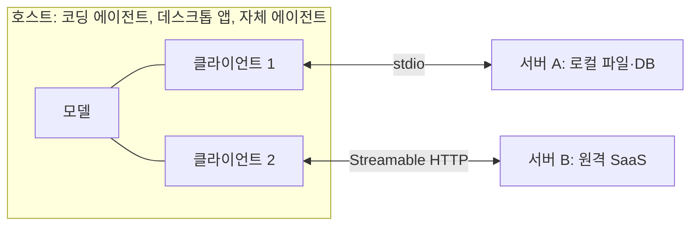
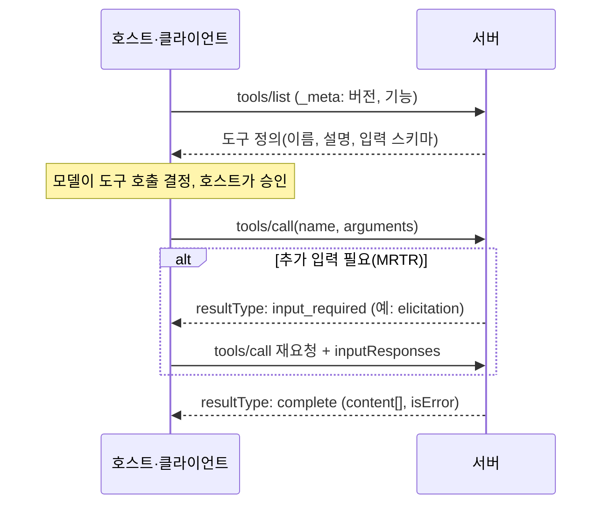

# MCP 개념과 구조

MCP는 **호스트 애플리케이션**이 **클라이언트**를 통해 **서버**와 JSON-RPC 메시지를 주고받는 구조입니다. 서버는 도구·리소스·프롬프트를 제공하고, 호스트는 이를 모델에 노출해 사용하게 합니다. 이 문서는 프로토콜 버전 2026-07-28 기준이며, 이전 버전과 달라진 점을 함께 표시합니다.

## 참여자

| 참여자 | 역할 | 예 |
| --- | --- | --- |
| 호스트(Host) | 사용자와 상호작용하고 모델을 호출, 권한 결정 | Claude Code, Claude Desktop, Cursor, 자체 에이전트 |
| 클라이언트(Client) | 호스트 안에서 서버와의 연결을 담당 | 호스트가 서버마다 생성 |
| 서버(Server) | 도구·리소스·프롬프트를 제공 | GitHub 서버, 파일시스템 서버, 사내 API 서버 |

호스트가 승인과 표시를 담당하므로 같은 서버라도 호스트에 따라 도구 승인 방식이 다릅니다.

## 서버가 제공하는 것

| 기본 요소 | 제어 주체 | 설명 | 예 |
| --- | --- | --- | --- |
| 도구(Tools) | 모델 | 모델이 호출할 수 있는 함수. 입력 스키마와 결과 | `search_issues`, `create_branch` |
| 리소스(Resources) | 애플리케이션 | URI로 식별되는 읽기 전용 데이터 | `file:///…`, `db://orders/123` |
| 프롬프트(Prompts) | 사용자 | 재사용 가능한 프롬프트 템플릿 | "PR 리뷰", "장애 보고서 작성" |

도구가 가장 널리 쓰이며, 리소스와 프롬프트는 호스트 지원 범위가 다릅니다. 서버를 만들 때 도구부터 설계합니다.

## 클라이언트가 제공하는 것

| 기능 | 상태(2026-07-28) | 설명 |
| --- | --- | --- |
| 유도(Elicitation) | 현행 | 서버가 요청 처리 중 사용자에게 추가 입력(확인, 누락 값)을 요청 |
| 샘플링(Sampling) | 폐기 예정(deprecated) | 서버가 호스트의 모델에 생성을 요청. 새 구현은 사용하지 말고 LLM API를 직접 호출 |
| 루트(Roots) | 폐기 예정(deprecated) | 호스트가 작업 디렉터리를 알림. 새 구현은 도구 인자·리소스 URI·서버 설정으로 범위 전달 |

폐기 예정 기능은 최소 12개월간 명세에 남지만, 새로 만드는 서버는 의존하지 않습니다. 호스트마다 지원 여부가 다르므로 클라이언트 기능에 의존하는 서버는 미지원 시의 동작을 정해 둡니다.

## 전송 방식

| 전송 | 동작 | 적합한 경우 |
| --- | --- | --- |
| stdio | 호스트가 서버를 자식 프로세스로 실행, 표준 입출력으로 줄 단위 JSON-RPC | 로컬 도구, 개인 개발 환경, 설치형 배포 |
| Streamable HTTP | 메시지마다 단일 MCP 엔드포인트에 HTTP POST, 응답은 JSON 또는 요청 범위의 SSE 스트림 | 원격·공유 서버, 다중 사용자, 인증 필요 |

stdio 서버는 **표준 출력에 로그를 쓰면 프로토콜이 깨집니다**. 로그는 표준 오류로 보냅니다. 이전 명세의 HTTP+SSE 전송은 Streamable HTTP로 대체되었습니다.

| 인가(Authorization) | 내용 |
| --- | --- |
| 범위 | HTTP 전송에만 적용, 선택 사항. stdio는 환경 변수 등에서 자격 증명을 얻음 |
| 기반 | OAuth 2.1 기반. 서버는 리소스 서버, 호스트는 OAuth 클라이언트 |
| 흐름 | 401 응답의 메타데이터로 인가 서버를 찾고, 토큰을 받아 `Authorization: Bearer`로 전송 |

## 메시지 흐름

2026-07-28 명세부터 프로토콜은 **무상태**입니다. 요청마다 `_meta`에 프로토콜 버전과 클라이언트 기능을 담아 보내며, 연결 시작 시의 `initialize` 핸드셰이크와 세션은 이전 버전과의 호환용으로만 남아 있습니다.

| 패턴 | 내용 |
| --- | --- |
| 요청·응답 | 클라이언트가 요청, 서버가 결과 또는 오류. 서버는 요청을 먼저 보내지 않음 |
| 다중 왕복 요청(MRTR) | 서버가 `input_required` 결과로 추가 입력을 요구하면 클라이언트가 응답을 붙여 같은 요청을 다시 보냄 |
| 구독·알림 | 클라이언트가 구독하면 서버가 변경(도구 목록 등)을 알림 스트림으로 전달 |

SDK가 버전 협상을 처리하므로, 최신 SDK로 만든 서버는 2025년식 `initialize` 클라이언트와 최신 클라이언트를 모두 상대할 수 있습니다.

## 확장(Extensions)

| 확장 | 내용 |
| --- | --- |
| Tasks | 장시간 작업의 비동기 실행, 폴링, 중간 입력 |
| Skills over MCP | 에이전트 작업용 구조화 지침을 MCP로 발견·소비 |
| MCP Apps | 대화 안에 렌더링되는 대화형 UI 요소 |

확장은 선택 사항이며 클라이언트와 서버가 모두 지원할 때만 협상됩니다.

## 자주 혼동하는 것

| 혼동 | 정리 |
| --- | --- |
| MCP = 에이전트 프레임워크 | 아님. 연결 규약이며 실행 루프는 호스트가 담당 |
| MCP 도구 = 모델 API의 도구 호출 | 호스트가 MCP 도구 정의를 모델 API의 도구 형식으로 변환해 전달 |
| 서버 = 원격 서비스 | 로컬 프로세스도 서버. 대부분의 개인용 서버는 stdio |
| A2A와의 관계 | A2A는 에이전트 간 통신 규약. MCP는 에이전트와 도구 사이 |

## 참고 자료

- [MCP 명세 2026-07-28](https://modelcontextprotocol.io/specification/2026-07-28) - 기본 프로토콜, 전송, 인가, 서버·클라이언트 기능
- [폐기 예정 기능 목록](https://modelcontextprotocol.io/specification/2026-07-28/deprecated)

확인일: 2026-10-16

다음: [도구 설계](./tool-design.md)
