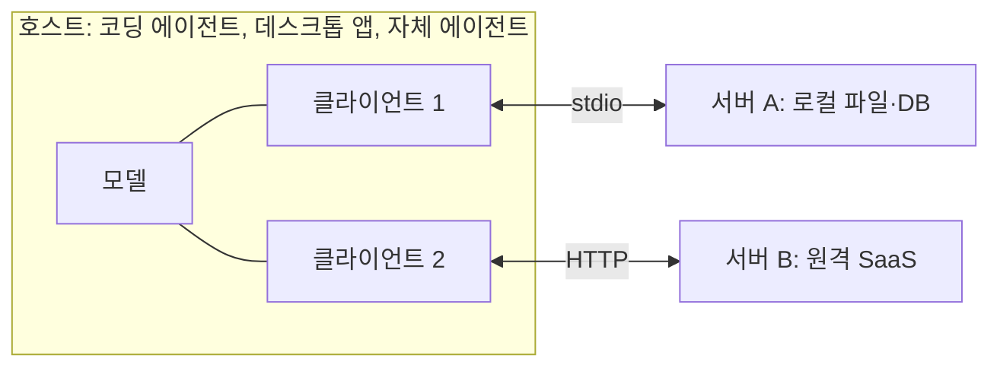
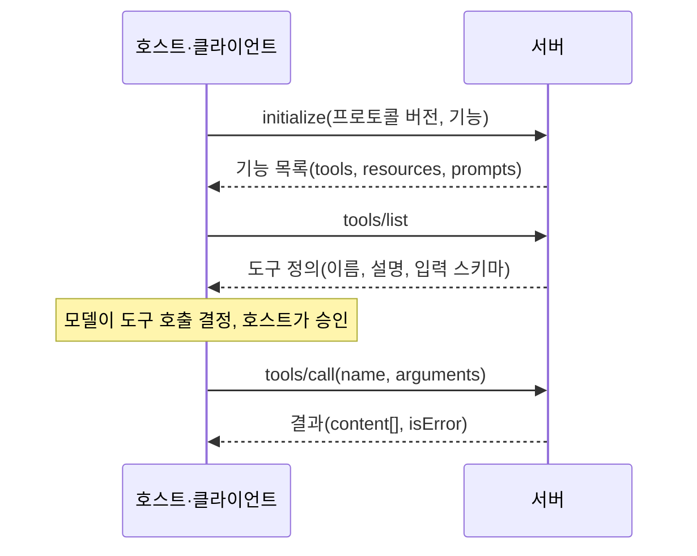

# MCP 개념과 구조

MCP는 **호스트 애플리케이션**이 **클라이언트**를 통해 **서버**와 JSON-RPC 메시지를 주고받는 구조입니다. 서버는 도구·리소스·프롬프트를 제공하고, 호스트는 이를 모델에 노출해 사용하게 합니다.

## 참여자

| 참여자 | 역할 | 예 |
| --- | --- | --- |
| 호스트(Host) | 사용자와 상호작용하고 모델을 호출, 권한 결정 | Claude Code, Claude Desktop, Cursor, 자체 에이전트 |
| 클라이언트(Client) | 호스트 안에서 서버 하나와 1:1 연결 유지 | 호스트가 서버마다 생성 |
| 서버(Server) | 도구·리소스·프롬프트를 제공 | GitHub 서버, 파일시스템 서버, 사내 API 서버 |

호스트가 승인과 표시를 담당하므로 같은 서버라도 호스트에 따라 도구 승인 방식이 다릅니다.

## 서버가 제공하는 것

| 기본 요소 | 제어 주체 | 설명 | 예 |
| --- | --- | --- | --- |
| 도구(Tools) | 모델 | 모델이 호출할 수 있는 함수. 입력 스키마와 결과 | `search_issues`, `create_branch` |
| 리소스(Resources) | 애플리케이션 | URI로 식별되는 읽기 전용 데이터 | `file:///…`, `db://orders/123` |
| 프롬프트(Prompts) | 사용자 | 재사용 가능한 프롬프트 템플릿 | "PR 리뷰", "장애 보고서 작성" |

도구가 가장 널리 쓰이며, 리소스와 프롬프트는 호스트 지원 범위가 다릅니다. 서버를 만들 때 도구부터 설계합니다.

## 클라이언트가 제공하는 것

| 기능 | 설명 | 쓰임 |
| --- | --- | --- |
| 샘플링(Sampling) | 서버가 호스트의 모델에 생성을 요청 | 서버가 자체 API 키 없이 요약·분류 수행 |
| 루트(Roots) | 호스트가 서버에 작업 범위(디렉터리 등)를 알림 | 파일 서버가 접근 범위를 제한 |
| 유도(Elicitation) | 서버가 사용자에게 추가 입력을 요청 | 확인 질문, 누락된 값 입력 |

호스트마다 지원 여부가 다르므로 이 기능에 의존하는 서버는 미지원 시의 동작을 정해 둡니다.

## 전송 방식

| 전송 | 동작 | 적합한 경우 |
| --- | --- | --- |
| stdio | 호스트가 서버를 자식 프로세스로 실행, 표준 입출력으로 통신 | 로컬 도구, 개인 개발 환경, 설치형 배포 |
| Streamable HTTP | 서버가 HTTP 엔드포인트로 동작, 스트리밍 응답 지원 | 원격·공유 서버, 다중 사용자, 인증 필요 |

stdio 서버는 **표준 출력에 로그를 쓰면 프로토콜이 깨집니다**. 로그는 표준 오류로 보냅니다. HTTP 서버는 인증(OAuth 등)과 세션 관리가 추가로 필요합니다. 이전 명세의 SSE 전송은 대체되었으므로 새로 만들 때는 공식 문서의 현재 전송을 따릅니다.

## 메시지 흐름

| 단계 | 내용 |
| --- | --- |
| 초기화 | 버전과 기능 협상. 서버가 지원하는 요소를 선언 |
| 목록 조회 | 호스트가 도구·리소스·프롬프트 목록을 받아 모델에 노출 |
| 호출 | 모델의 호출 요청을 호스트가 검증·승인 후 서버에 전달 |
| 알림 | 목록이 바뀌면 서버가 변경 알림을 보낼 수 있음 |

## 자주 혼동하는 것

| 혼동 | 정리 |
| --- | --- |
| MCP = 에이전트 프레임워크 | 아님. 연결 규약이며 실행 루프는 호스트가 담당 |
| MCP 도구 = 모델 API의 도구 호출 | 호스트가 MCP 도구 정의를 모델 API의 도구 형식으로 변환해 전달 |
| 서버 = 원격 서비스 | 로컬 프로세스도 서버. 대부분의 개인용 서버는 stdio |
| A2A와의 관계 | A2A는 에이전트 간 통신 규약. MCP는 에이전트와 도구 사이 |

다음: [도구 설계](./tool-design.md)
