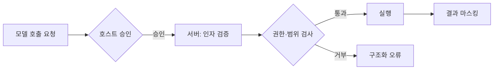

# MCP 도구 설계

도구 설계의 목표는 **모델이 올바른 도구를 올바른 인자로 고르고, 결과를 보고 다음 행동을 정할 수 있게** 하는 것입니다. 설명과 스키마는 사람이 아니라 모델이 읽는 문서라는 점을 전제로 작성합니다.

## 작업 단위로 설계하기

| 나쁜 예(API 1:1) | 좋은 예(작업 단위) | 이유 |
| --- | --- | --- |
| `get_user`, `get_user_orders`, `get_order_items` | `get_customer_overview(customer_id)` | 모델이 세 번 호출할 것을 한 번에 |
| `list_files`, `read_file` 반복 | `search_code(query, path)` | 탐색을 서버가 처리 |
| `update_issue(fields: object)` | `assign_issue`, `close_issue`, `comment_issue` | 의도가 분명한 도구가 오용이 적음 |

| 원칙 | 설명 |
| --- | --- |
| 하나의 도구는 하나의 의도 | 설명이 "또는"으로 이어지면 분리 |
| 읽기와 쓰기 분리 | 쓰기 도구는 승인 대상이 되기 쉽게 |
| 호출 횟수 최소화 | 모델의 루프 한 바퀴는 비용과 오류 기회 |
| 도구 수 제한 | 한 서버에 10개 안팎. 넘으면 서버 분리나 상위 도구로 묶기 |

## 이름과 설명

| 항목 | 규칙 | 예 |
| --- | --- | --- |
| 이름 | `동사_대상`, 소문자·밑줄, 서버 안에서 유일 | `search_issues`, `create_branch` |
| 설명 첫 문장 | 무엇을 하는지 | "이슈 트래커에서 제목·본문을 검색합니다." |
| 언제 쓰는가 | 비슷한 도구와의 구분 | "이슈 번호를 알면 `get_issue`를 사용합니다." |
| 언제 쓰지 않는가 | 오용 방지 | "PR 검색에는 사용하지 않습니다." |
| 결과 형태 | 모델이 기대할 것 | "최대 20건, 번호·제목·상태를 반환합니다." |
| 부작용 | 변경·비용·되돌리기 가능 여부 | "브랜치를 생성합니다. 되돌리려면 `delete_branch`." |

설명은 짧은 문단 하나로 충분합니다. 길어지면 모델이 중요한 부분을 놓칩니다.

## 입력 스키마

```json
{
  "type": "object",
  "properties": {
    "query": { "type": "string", "description": "검색어. 공백으로 구분된 단어를 모두 포함하는 이슈를 찾습니다." },
    "state": { "type": "string", "enum": ["open", "closed", "all"], "default": "open" },
    "limit": { "type": "integer", "minimum": 1, "maximum": 50, "default": 20 }
  },
  "required": ["query"],
  "additionalProperties": false
}
```

| 규칙 | 이유 |
| --- | --- |
| 모든 속성에 `description` | 이름만으로는 단위·형식이 전달되지 않음 |
| `enum`, 범위, 형식 제약 | 모델의 오타·범위 밖 값을 스키마 단계에서 차단 |
| 필수 인자 최소화 | 선택 인자는 기본값을 명시 |
| 평평한 구조 | 깊은 중첩 객체는 생성 오류가 늘어남 |
| 식별자는 문자열 | 큰 정수는 정밀도 문제. ID 형식을 설명에 명시 |
| 날짜·시간 형식 지정 | ISO 8601 등 하나로 고정 |

## 결과 형식

| 원칙 | 설명 |
| --- | --- |
| 간결 | 모델이 읽을 만큼만. 긴 목록은 상위 N건과 총 건수 |
| 구조화 | Markdown 표나 JSON. 자유 텍스트 덤프는 피함 |
| 식별자 포함 | 다음 호출에 쓸 ID를 항상 포함 |
| 다음 행동 단서 | "더 보려면 `page=2`", "상세는 `get_issue(id)`" |
| 크기 상한 | 결과 바이트 상한을 두고 초과 시 잘림 표시 |
| 민감 정보 제외 | 토큰, 비밀번호, 개인정보는 결과에서 마스킹 |

## 오류 처리

| 상황 | 반환 | 설명 |
| --- | --- | --- |
| 인자 검증 실패 | `isError: true` + 무엇이 틀렸는지 | 모델이 수정해 재시도 가능 |
| 대상 없음 | `isError: true` + "ID 123 없음. `search_issues`로 확인" | 다음 행동 제시 |
| 권한 없음 | `isError: true` + 필요한 권한 | 모델이 반복 시도하지 않게 |
| 외부 서비스 장애 | `isError: true` + 일시적임을 명시 | 재시도 여부 판단 근거 |
| 서버 내부 버그 | 프로토콜 오류 | 모델에 노출하지 않고 로그 기록 |

오류 메시지는 모델이 읽습니다. 스택 트레이스 대신 **원인과 다음 행동**을 적습니다.

## 권한과 안전



| 항목 | 서버가 할 일 |
| --- | --- |
| 인자 검증 | 스키마 통과 후에도 경로 탈출, 인젝션, 범위를 다시 검사 |
| 범위 제한 | 서버 설정·도구 인자로 허용된 디렉터리·프로젝트·테넌트만(루트 기능은 폐기 예정이므로 의존하지 않음) |
| 쓰기 도구 표시 | 도구 주석(annotations)으로 읽기 전용·파괴적 여부를 선언해 호스트가 승인 정책에 활용. 명세상 주석은 신뢰할 수 없는 정보이므로 호스트는 힌트로만 사용 |
| 비밀 관리 | API 키는 서버 환경 변수로. 도구 인자나 결과에 포함하지 않음 |
| 속도 제한 | 외부 API 한도와 비용 보호 |
| 감사 로그 | 누가 어떤 도구를 어떤 인자로 호출했는지 기록 |

모델이 "안전하게 쓸 것"을 기대하지 않습니다. 서버가 막지 않은 것은 언젠가 호출됩니다.

관련: [구조화 출력과 도구 호출](../llm-basics/structured-output.md), [운영과 안전](../agents/operations.md), [프롬프트 주입](../security/prompt-injection.md)

다음: [서버 만들기](./building-a-server.md)
