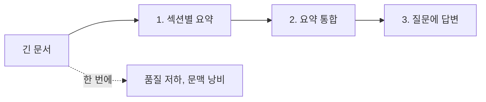

# 프롬프팅 기법과 원리

기법은 많지만 작동 원리는 몇 가지로 모입니다. **무엇을 원하는지 분명히 하기, 판단 기준을 예시로 보이기, 어려운 작업을 단계로 나누기, 결과를 스스로 검사하게 하기**입니다. 원리를 알면 상황에 맞는 기법을 고를 수 있습니다.

## 기법 한눈에 보기

| 기법 | 원리 | 효과가 큰 상황 | 비용 |
| --- | --- | --- | --- |
| 제로샷 | 지시만으로 수행 | 단순·일반적 작업 | 낮음 |
| 퓨샷(Few-shot) | 입력·출력 예시로 기준 전달 | 형식·스타일·판단 기준이 미묘할 때 | 입력 토큰 증가 |
| 단계적 사고(Chain of Thought) | 답 전에 추론 과정을 쓰게 함 | 다단계 추론, 계산, 논리 | 출력 토큰 증가 |
| 작업 분해 | 큰 작업을 여러 호출로 나눔 | 긴 문서, 복합 작업 | 호출 수 증가 |
| 역할·관점 | 전문가 역할을 지정 | 도메인 용어·기준 적용 | 낮음 |
| 자기 검증 | 결과를 기준에 따라 점검·수정하게 함 | 정확도가 중요한 출력 | 출력 토큰 증가 |
| 자기 일관성 | 여러 번 생성해 다수결 | 정답이 하나인 문제 | 호출 수 배수 |
| 구조화 출력 | 스키마·형식 강제 | 프로그램이 소비하는 출력 | 낮음 |
| 거부·불확실 표현 | 모르면 모른다고 하게 함 | 환각 감소 | 낮음 |

## 제로샷과 퓨샷

| 상황 | 선택 |
| --- | --- |
| 작업이 일반적이고 형식이 단순 | 제로샷 + 명확한 지시 |
| 형식·말투·분류 기준이 미묘 | 퓨샷 3~5개 |
| 예시가 특정 패턴에 치우침 | 모델이 그 패턴만 따라함. 다양한 예시로 균형 |
| 예시가 길어 비용 부담 | 대표 예시만 남기고 규칙으로 대체 |

```
다음 고객 문의를 분류합니다. 범주: 결제, 배송, 환불, 기타

문의: 카드 결제가 두 번 됐어요 → 결제
문의: 주문한 물건이 아직 안 왔어요 → 배송
문의: 사이즈가 안 맞아서 돌려보내고 싶어요 → 환불
문의: {{input}} →
```

## 단계적 사고

| 방법 | 설명 |
| --- | --- |
| 지시형 | "단계별로 생각한 뒤 답하세요" |
| 구조형 | "먼저 조건을 나열하고, 각 조건을 검토한 뒤, 결론을 쓰세요" |
| 추론 모델 | 모델이 내부적으로 사고. 별도 지시 불필요, 추론 예산 설정 |
| 분리 출력 | 사고 과정과 최종 답을 태그로 구분해 파싱 |

단순 작업에 단계적 사고를 강제하면 길어지기만 합니다. 추론이 필요한 작업에만 씁니다. 추론 모델에서는 "단계별로 생각하라"는 지시가 오히려 방해가 되기도 합니다.

## 작업 분해



| 패턴 | 예 |
| --- | --- |
| 순차 체인 | 추출 → 변환 → 검증 |
| 분할 후 통합(map-reduce) | 긴 문서를 나눠 처리하고 합침 |
| 라우팅 | 먼저 유형을 분류하고 유형별 프롬프트로 |
| 초안 → 비평 → 수정 | 작성 품질 향상 |

각 단계의 출력을 검증할 수 있고, 실패한 단계만 재실행할 수 있다는 점이 분해의 이점입니다. 에이전트 수준의 분해는 [실무 워크플로](../agents/workflows.md)를 참고합니다.

## 역할과 관점

| 효과 있음 | 효과 적음 |
| --- | --- |
| "보안 리뷰어로서 OWASP 기준으로 검토" 처럼 **기준을 함께** 지정 | "당신은 세계 최고의 전문가입니다" 같은 수식 |
| 독자를 지정("초등학생에게 설명") | 역할만 지정하고 작업 기준은 없음 |

역할은 기준·용어·독자를 압축해 전달하는 수단입니다. 기준을 직접 쓸 수 있으면 그편이 정확합니다.

## 자기 검증과 수정

| 방법 | 설명 |
| --- | --- |
| 점검 목록 | "답변 전에 다음을 확인: 모든 요구사항 반영? 근거 있음? 형식 준수?" |
| 별도 호출 검증 | 생성과 검증을 다른 프롬프트(또는 모델)로 분리 |
| 반례 요청 | "이 결론이 틀릴 수 있는 경우를 찾으세요" |
| 근거 인용 | 주장마다 자료 ID를 붙이게 해 검증 가능하게 |

같은 호출 안에서의 자기 검증은 효과가 제한적입니다. 중요한 출력은 별도 호출로 검증합니다.

## 환각 줄이기

| 기법 | 예 |
| --- | --- |
| 거부 허용 | "자료에 없으면 '확인할 수 없음'이라고 답합니다" |
| 근거 제한 | "제공된 자료만 근거로 합니다" |
| 확신도 표시 | "확실하지 않은 부분은 표시합니다" |
| 인용 요구 | "각 문장 뒤에 출처 ID" |
| 검색·도구 | 사실은 모델 기억이 아니라 자료·도구에서 |

## 기법 선택 기준

| 증상 | 먼저 시도 |
| --- | --- |
| 형식이 안 맞음 | 구조화 출력, 퓨샷 |
| 기준이 흔들림 | 퓨샷, 기준 명시 |
| 추론이 틀림 | 단계적 사고, 분해, 추론 모델 |
| 지어냄 | 거부 허용, 근거 제한, RAG |
| 길고 장황함 | 길이·형식 제한, 불필요한 사고 지시 제거 |
| 결과가 들쭉날쭉 | temperature 낮춤, 자기 일관성, 검증 |

관련: [모델의 동작 원리](../llm-basics/how-llms-work.md), [구조화 출력](../llm-basics/structured-output.md), [RAG](../rag/README.md)

다음: [시스템 프롬프트 설계](./system-prompts.md)
