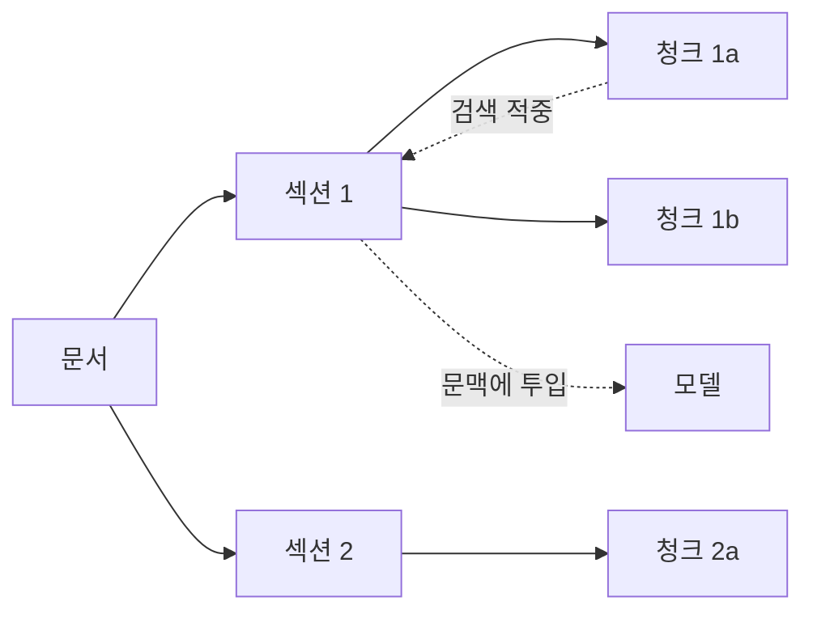

# 청킹과 임베딩

청킹은 문서를 검색 단위로 나누는 작업이고, 임베딩은 각 조각을 의미를 담은 벡터로 바꾸는 작업입니다. 둘 다 색인 시점에 결정되며, 검색 품질의 상한을 정합니다.

## 청크 크기의 트레이드오프

| 크기 | 장점 | 단점 |
| --- | --- | --- |
| 작음(100~200토큰) | 정확히 맞는 부분만 검색, 문맥 절약 | 앞뒤 맥락이 잘려 의미가 불완전 |
| 중간(300~600토큰) | 대부분의 문서에서 균형 | - |
| 큼(1000토큰 이상) | 맥락 보존 | 임베딩이 뭉개져 검색 정확도 저하, 문맥 낭비 |

하나의 청크는 "그 조각만 읽어도 무슨 말인지 알 수 있는" 단위여야 합니다. 문서 제목과 상위 섹션 제목을 청크 본문 앞에 붙이면 짧은 청크도 의미가 분명해집니다.

## 분할 전략

| 전략 | 방법 | 적합한 자료 |
| --- | --- | --- |
| 고정 길이 | N토큰마다 자르고 일부 겹침 | 구조가 없는 긴 텍스트 |
| 구조 기반 | 제목, 단락, 목록 경계에서 분할 | Markdown, HTML, 위키 |
| 문장·의미 기반 | 문장 경계, 의미 변화 지점에서 분할 | 서술형 문서 |
| 코드 전용 | 함수·클래스 단위로 분할, 파일 경로 포함 | 소스 코드 |
| 표 전용 | 표를 통째로 또는 행 단위 + 헤더 반복 | 사양서, 가격표 |
| 계층(부모·자식) | 작은 자식 청크로 검색하고 큰 부모 청크를 문맥에 투입 | 정확도와 맥락을 모두 원할 때 |



겹침(overlap)은 경계에서 잘린 문장을 보완하지만 저장량과 중복 검색을 늘립니다. 구조 기반 분할을 쓰면 겹침은 작게 두거나 없애도 됩니다.

## 메타데이터

| 필드 | 쓰임 |
| --- | --- |
| 문서 ID, 청크 순서 | 출처 표시, 인접 청크 확장 |
| 제목·섹션 경로 | 검색 결과 표시, 임베딩 입력에 포함 |
| 갱신 시각, 버전 | 최신 문서 우선, 오래된 문서 제외 |
| 문서 유형, 제품, 언어 | 필터링으로 후보 축소 |
| 접근 권한 | 사용자별 필터. 생성 전에 반드시 적용 |
| 원본 URL·경로 | 답변에서 링크 제공 |

메타데이터 필터는 벡터 유사도보다 먼저 적용되는 것이 이상적입니다. 저장소가 사전 필터를 지원하는지 확인합니다([벡터 저장소](./vector-stores.md)).

## 임베딩 모델 선택

| 기준 | 확인할 것 |
| --- | --- |
| 언어 | 한국어 성능. 영어 전용 모델은 한국어 질의에서 크게 떨어짐 |
| 도메인 | 코드, 법률, 의료 등 전용 모델의 유무 |
| 차원 | 클수록 정확하지만 저장·검색 비용 증가. 차원 축소 지원 여부 |
| 입력 길이 | 청크 크기가 모델의 최대 입력을 넘지 않는지 |
| 질의·문서 구분 | 질문과 문서에 다른 접두어나 모드를 요구하는 모델이 있음 |
| 호스팅 | API 호출 비용과 데이터 전송 vs 자체 호스팅 운영 부담 |
| 벤치마크 | MTEB 같은 공개 지표는 참고만. 자기 데이터로 평가 |

임베딩 모델을 바꾸면 기존 벡터와 호환되지 않으므로 **전체 재색인**이 필요합니다. 인덱스에 모델 이름과 버전을 기록해 둡니다.

## 임베딩 입력 구성

```
[문서 제목] > [섹션 제목]
[청크 본문]
```

| 포함할 것 | 이유 |
| --- | --- |
| 제목·섹션 경로 | 본문만으로 모호한 청크의 의미를 고정 |
| 표의 헤더 | 행 단위 청크가 무엇을 뜻하는지 유지 |
| 코드의 파일 경로와 함수명 | 심볼 검색 성능 향상 |

| 뺄 것 | 이유 |
| --- | --- |
| 내비게이션, 푸터, 광고 | 모든 청크가 비슷해져 검색 변별력 저하 |
| 긴 로그, 바이너리 덤프 | 의미가 없고 토큰만 소모 |

## 색인 갱신

| 상황 | 처리 |
| --- | --- |
| 문서 추가 | 청킹·임베딩 후 삽입 |
| 문서 수정 | 문서 ID의 기존 청크 전부 삭제 후 재삽입. 부분 갱신은 순서가 꼬이기 쉬움 |
| 문서 삭제 | 청크와 메타데이터 삭제, 캐시 무효화 |
| 모델·청킹 변경 | 새 인덱스를 따로 만들어 평가 후 교체 |
| 대량 색인 | 임베딩 API는 배치 호출, 속도 제한 고려 |

문서 내용의 해시를 저장해 두면 변경되지 않은 문서의 재임베딩을 건너뛸 수 있습니다.

관련: [DB 마이그레이션](../../Backend/database/migration.md), [메시지 큐](../../Backend/messaging/message-queue.md)

다음: [벡터 저장소](./vector-stores.md)
