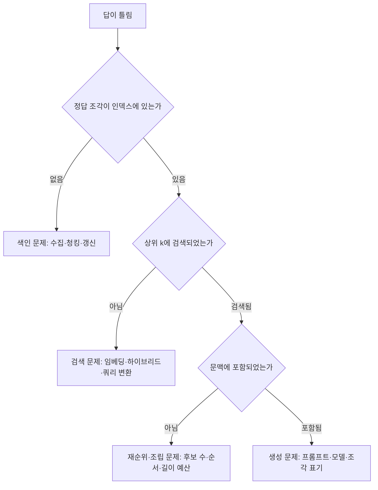

# RAG 평가와 실패 진단

RAG는 검색과 생성이 연결된 시스템이므로 **어느 단계에서 틀렸는지** 분리해서 측정해야 고칠 수 있습니다. 평가 세트 없이 프롬프트나 청크 크기를 바꾸는 것은 감으로 하는 튜닝입니다.

## 평가 세트 만들기

| 항목 | 내용 |
| --- | --- |
| 질문 | 실제 사용자 로그, 담당자가 자주 받는 질문, 문서에서 생성한 질문을 섞음 |
| 정답 조각 | 각 질문에 답하는 청크·문서 ID. 검색 평가의 기준 |
| 정답 요지 | 답변에 반드시 포함될 사실. 생성 평가의 기준 |
| 유형 태그 | 단일 문서, 다중 문서, 자료에 없는 질문, 식별자 질문 등 |
| 크기 | 50개로 시작해 실패 사례를 계속 추가 |

"자료에 없는 질문"을 반드시 포함합니다. 이 경우 정답은 "모른다"는 응답이며, 지어내는지 확인하는 유일한 수단입니다.

## 검색 지표

| 지표 | 의미 | 쓰임 |
| --- | --- | --- |
| Recall@k | 상위 k 안에 정답 조각이 포함된 비율 | 1차 검색의 핵심 지표. k는 재순위 입력 수 |
| Precision@k | 상위 k 중 관련 조각의 비율 | 문맥 낭비 정도 |
| MRR | 첫 정답 조각 순위의 역수 평균 | 정답이 얼마나 위에 오는가 |
| NDCG | 순위 가중 관련도 | 여러 정답이 있을 때 |
| 적중률(Hit rate) | 정답이 하나라도 들어간 질문의 비율 | 간단한 상한 확인 |

검색 지표는 모델 호출 없이 계산되므로 빠르고 저렴합니다. 청킹·임베딩·하이브리드 가중치·재순위 변경은 먼저 이 지표로 비교합니다.

## 생성 지표

| 지표 | 의미 | 측정 방법 |
| --- | --- | --- |
| 근거 충실도(Faithfulness) | 답변이 제공된 조각에서 벗어나지 않는가 | 모델 채점(LLM-as-judge), 샘플 수동 검토 |
| 정답성(Correctness) | 정답 요지와 일치하는가 | 정답 요지 대조, 모델 채점 |
| 관련성(Relevance) | 질문에 직접 답하는가 | 모델 채점 |
| 거부 정확도 | 자료에 없을 때 모른다고 하는가 | 해당 유형 질문의 정답률 |
| 인용 정확도 | 표시한 출처가 실제 근거인가 | 인용 ID와 조각 대조 |

모델 채점은 사람의 판단과 어느 정도 일치하는지 먼저 샘플로 확인하고 씁니다. 채점 프롬프트와 모델도 버전을 고정합니다.

## 실패 원인 추적

| 단계 | 흔한 원인 | 확인 방법 |
| --- | --- | --- |
| 색인 | PDF 표 깨짐, 문서 누락, 오래된 버전 | 정답 조각을 ID로 직접 조회 |
| 검색 | 한국어 성능 낮은 임베딩, 식별자 질문에 벡터만 사용 | 키워드·벡터 결과를 따로 출력 |
| 재순위·조립 | 후보 수 부족, 같은 문서 중복, 정답이 중간에 배치 | 최종 문맥 덤프 |
| 생성 | 조각 무시, 과도한 요약, 거부 규칙 부재 | 같은 문맥으로 프롬프트만 바꿔 재실행 |

각 단계의 입력과 출력을 요청 ID로 묶어 로그에 남겨야 이 추적이 가능합니다.

## 개선 순서

| 순서 | 시도 | 기대 효과 |
| --- | --- | --- |
| 1 | 수집·정제 품질 확인(표, 코드, 중복) | 색인 단계 실패 제거 |
| 2 | 구조 기반 청킹, 제목 포함 | 검색 재현율 향상 |
| 3 | 하이브리드 검색 | 식별자·의미 질문 모두 개선 |
| 4 | 재순위 추가 | 정밀도 향상, 문맥 축소 |
| 5 | 쿼리 재작성(대화 문맥 반영) | 후속 질문 정확도 |
| 6 | 프롬프트의 근거·거부 규칙 | 환각 감소 |
| 7 | 임베딩 모델 교체 | 재색인 필요, 마지막에 시도 |

한 번에 하나씩 바꾸고 평가 세트로 전후를 비교합니다. 두 가지를 동시에 바꾸면 어느 쪽 효과인지 알 수 없습니다.

## 운영 중 모니터링

| 지표 | 왜 보는가 |
| --- | --- |
| 검색 결과 없음 비율 | 색인 누락, 필터 과다 |
| 거부 응답 비율 | 급증하면 색인·검색 장애 의심 |
| 사용자 피드백(도움 됨/안 됨) | 평가 세트에 추가할 실패 사례 수집 |
| 단계별 지연 | 병목 파악 |
| 인용 클릭률 | 출처가 실제로 유용한지 |

관련: [평가와 오류 진단](../harness/evaluation.md), [테스트 전략](../../Backend/testing/testing-strategy.md), [로깅](../../Backend/logging/logging.md)

다음: [도구와 생태계](./tools.md)
