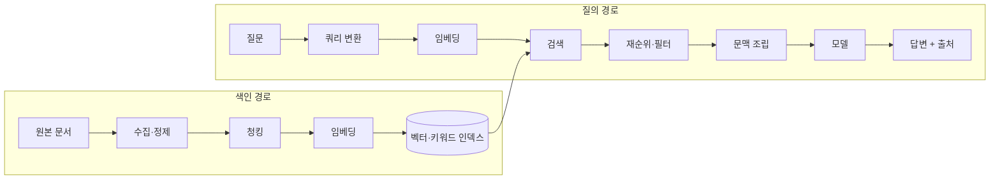

# RAG 전체 구조

RAG는 자료를 미리 준비하는 **색인 경로(offline)**와 질문에 답하는 **질의 경로(online)**로 나뉩니다. 두 경로는 실행 시점과 성능 요구가 다르므로 따로 설계하고 따로 측정합니다.

## 두 경로

| 경로 | 실행 시점 | 성능 요구 | 실패 시 영향 |
| --- | --- | --- | --- |
| 색인 | 문서 추가·변경 시, 배치 | 처리량, 비용 | 오래된 답, 누락된 문서 |
| 질의 | 사용자 요청마다 | 지연(수백 ms~수 초), 정확도 | 틀린 답, 느린 응답 |

## 구성 요소

| 구성 요소 | 하는 일 | 주요 결정 |
| --- | --- | --- |
| 수집·정제 | PDF, HTML, 위키, DB에서 텍스트 추출, 잡음 제거 | 표·코드·이미지 처리, 중복 제거, 권한 정보 보존 |
| 청킹 | 문서를 검색 단위로 분할 | 크기, 경계, 겹침, 메타데이터 ([청킹과 임베딩](./chunking-and-embedding.md)) |
| 임베딩 | 텍스트를 벡터로 변환 | 모델, 차원, 다국어 지원 |
| 저장소 | 벡터와 키워드 인덱스, 메타데이터 저장 | 제품 선택, 필터, 확장성 ([벡터 저장소](./vector-stores.md)) |
| 검색 | 질문과 관련된 조각 선별 | 하이브리드, 상위 k, 쿼리 변환 ([검색 전략](./retrieval.md)) |
| 재순위 | 후보를 정밀 모델로 다시 정렬 | 사용 여부, 후보 수, 지연 |
| 문맥 조립 | 선택된 조각을 프롬프트에 배치 | 순서, 길이 예산, 출처 표기 |
| 생성 | 근거 기반 답변 작성 | 모델, 프롬프트, 거부 규칙 |
| 평가 | 검색과 생성 품질 측정 | 평가 세트, 지표 ([평가와 실패 진단](./evaluation.md)) |

## 시작할 때의 기본 구성

| 항목 | 첫 선택 | 이유 |
| --- | --- | --- |
| 청킹 | 제목 기준 분할 + 300~500토큰, 겹침 10~15% | 대부분의 문서에서 무난 |
| 검색 | 키워드(BM25) + 벡터 하이브리드, 각 상위 20 | 고유 명사와 의미 검색을 모두 포착 |
| 재순위 | 상위 20 → 5로 축소 | 비용 대비 정확도 향상이 큼 |
| 문맥 | 조각 5개, 출처 ID 포함 | 모델이 근거를 인용 가능 |
| 저장소 | 이미 쓰는 DB의 벡터 확장(pgvector 등) | 운영 부담 최소 |
| 평가 | 질문·정답 조각 쌍 50개 | 변경 효과를 수치로 비교 |

이 구성으로 먼저 끝까지 동작하게 만든 뒤 평가 세트로 병목을 찾아 바꿉니다. 처음부터 그래프 RAG나 에이전트형 검색을 넣으면 문제의 원인을 찾기 어렵습니다.

## 변형 구조

| 구조 | 설명 | 적합한 경우 |
| --- | --- | --- |
| 단순 RAG | 검색 1회 → 생성 | 단일 문서에 답이 있는 질문 |
| 다중 질의 | 질문을 여러 개로 바꿔 검색 후 합침 | 표현이 다양한 질문, 재현율 부족 |
| 반복 검색 | 생성 중 부족한 정보를 다시 검색 | 여러 문서를 거쳐야 하는 질문 |
| 에이전트형 검색 | 모델이 검색 도구를 필요할 때 호출 | 질문 유형이 다양, 다른 도구와 결합 |
| 그래프 RAG | 개체·관계 그래프로 연결된 정보를 탐색 | 관계 질문, 요약형 질문 |
| 긴 문맥 직접 투입 | 검색 없이 전체 자료를 문맥에 넣음 | 자료가 문맥 창 안에 들어감 |

복잡한 구조일수록 지연·비용과 디버깅 난도가 올라갑니다. 단순 RAG의 평가 결과가 특정 유형에서 반복적으로 실패할 때만 변형을 도입합니다.

## 권한과 데이터 경계

| 문제 | 대응 |
| --- | --- |
| 사용자가 볼 수 없는 문서가 검색됨 | 청크 메타데이터에 권한을 저장하고 검색 시 필터. 생성 후 필터는 늦음 |
| 문서 안의 지시가 모델을 조종 | 검색 결과를 데이터로 표시하고 지시를 따르지 않도록 프롬프트 설계 |
| 개인정보가 외부 임베딩 API로 전송 | 마스킹, 자체 호스팅 모델, 공급자 데이터 정책 확인 |
| 삭제된 문서가 계속 검색됨 | 원본 삭제와 인덱스 삭제를 같은 트랜잭션 또는 작업으로 묶음 |

관련: [운영과 안전](../agents/operations.md), [OWASP Top 10](../../Security/owasp-top-10.md)

다음: [청킹과 임베딩](./chunking-and-embedding.md)
