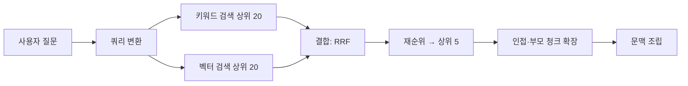

# 검색 전략

검색의 목표는 질문에 답하는 데 필요한 조각을 **놓치지 않고(재현율)**, **불필요한 조각 없이(정밀도)** 모델에 전달하는 것입니다. 한 가지 검색 방식으로는 둘을 모두 얻기 어려우므로 여러 단계를 조합합니다.

## 검색 방식 비교

| 방식 | 원리 | 강점 | 약점 |
| --- | --- | --- | --- |
| 키워드(BM25) | 단어 일치와 빈도 | 고유 명사, 오류 코드, 제품명, 정확한 문구 | 동의어·의역에 약함 |
| 벡터(밀집) | 임베딩 유사도 | 의미가 같은 다른 표현, 다국어 | 정확한 식별자, 희귀 단어에 약함 |
| 하이브리드 | 둘을 함께 실행하고 결합 | 두 강점을 모두 확보 | 결합 방식과 가중치 조정 필요 |
| 희소 학습 임베딩(SPLADE 등) | 단어 가중치를 학습한 희소 벡터 | 키워드와 의미의 중간 | 지원 저장소 제한 |

"오류 ERR_1234의 원인"은 키워드가, "결제가 안 될 때 어떻게 해야 하나"는 벡터가 유리합니다. 사용자 질문은 두 유형이 섞여 들어오므로 하이브리드를 기본으로 합니다.

## 하이브리드 결합

| 방법 | 설명 | 비고 |
| --- | --- | --- |
| RRF(Reciprocal Rank Fusion) | 각 결과의 순위 역수를 더해 정렬 | 점수 스케일이 달라도 동작, 기본 선택 |
| 가중 합 | 정규화한 점수를 가중치로 합산 | 가중치 조정이 필요, 데이터별 최적값 다름 |
| 단계적 | 키워드로 후보를 좁히고 벡터로 정렬 | 식별자 질문에 강함 |

## 질의 처리 단계



### 쿼리 변환

| 기법 | 동작 | 효과 |
| --- | --- | --- |
| 재작성 | 대화 기록을 반영해 독립적인 질문으로 바꿈 | "그건 어떻게 설정해?" → "SSO 설정 방법" |
| 다중 질의 | 질문을 여러 표현으로 확장해 각각 검색 | 재현율 향상, 비용 증가 |
| 분해 | 복합 질문을 하위 질문으로 나눔 | 여러 문서가 필요한 질문 |
| HyDE | 가상의 답변을 생성해 그 임베딩으로 검색 | 질문과 문서의 표현 차이가 클 때 |
| 필터 추출 | 질문에서 날짜·제품·유형을 뽑아 메타데이터 필터로 | 후보 축소, 정확도 향상 |

쿼리 변환은 모델 호출을 추가하므로 지연이 늘어납니다. 평가 세트에서 효과가 확인된 기법만 넣습니다.

### 재순위(Reranking)

| 항목 | 내용 |
| --- | --- |
| 원리 | 질문과 조각을 함께 입력받는 크로스 인코더가 관련도를 정밀 채점 |
| 입력 | 1차 검색 후보 20~50개 |
| 출력 | 상위 3~10개 |
| 비용 | 후보 수에 비례한 지연. 전용 모델 또는 재순위 API 사용 |
| 효과 | 1차 검색의 순서 오류를 교정, 정밀도 개선 폭이 큼 |

1차 검색은 재현율을, 재순위는 정밀도를 맡는다고 보면 역할 분담이 명확합니다.

### 결과 확장과 중복 제거

| 처리 | 이유 |
| --- | --- |
| 인접 청크 포함 | 적중 청크 앞뒤를 붙여 잘린 문맥 보완 |
| 부모 청크 치환 | 작은 청크로 찾고 큰 단위로 전달 |
| 중복 제거 | 겹침으로 생긴 유사 청크 제거, 같은 문서의 과다 선택 제한 |
| 다양성 | 서로 다른 문서에서 고르게 선택(MMR 등) |

## 문맥 조립

| 결정 | 권장 |
| --- | --- |
| 조각 수 | 3~8개. 많을수록 좋은 것이 아니라 관련 없는 조각이 답을 흐림 |
| 순서 | 가장 관련 높은 조각을 앞이나 뒤에. 중간은 반영이 약함 |
| 표기 | 각 조각에 ID, 제목, 출처를 붙여 인용 가능하게 |
| 길이 예산 | 시스템 프롬프트·대화 기록·답변 길이를 뺀 나머지 안에서 |
| 구분 | 조각을 명확한 구분자나 태그로 감싸 지시와 데이터를 분리 |

```
다음 자료만 근거로 답하고, 자료에 없으면 모른다고 답합니다. 답변에 근거 ID를 [1] 형식으로 표시합니다.

<doc id="1" title="SSO 설정 가이드" url="...">
...
</doc>
<doc id="2" ...>
```

## 지연과 비용

| 단계 | 지연 영향 | 줄이는 방법 |
| --- | --- | --- |
| 쿼리 변환 | 모델 호출 1회 | 소형 모델, 필요한 경우에만 |
| 임베딩 | 수십 ms | 질의 임베딩 캐싱 |
| 검색 | 수~수십 ms | ANN 인덱스, 필터 최적화 |
| 재순위 | 후보 수 × 수 ms | 후보 수 제한 |
| 생성 | 문맥 길이에 비례 | 조각 수 제한, 프롬프트 캐싱 |

같은 질문이 반복되면 검색 결과나 최종 답변을 캐싱합니다. 문서가 갱신될 때 캐시를 무효화하는 규칙을 함께 둡니다.

관련: [비용과 지연](../llm-basics/cost-and-latency.md), [API 설계](../../API/api-design.md)

다음: [평가와 실패 진단](./evaluation.md)
