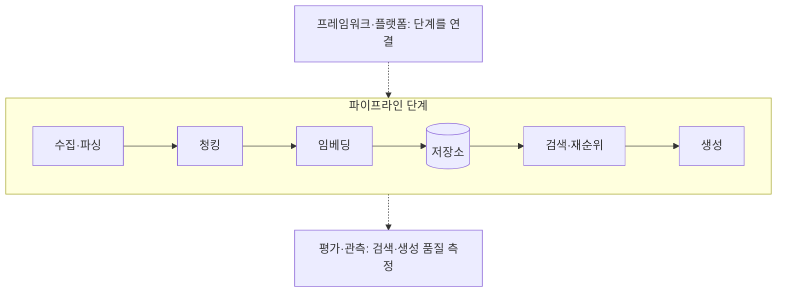

# RAG 도구와 생태계

RAG 파이프라인의 각 단계마다 전용 도구가 있습니다. 제품과 버전은 빠르게 바뀌므로 이름보다 **어느 단계의 도구인지**와 **선택 기준**을 중심으로 정리합니다. 도입 전에 공식 문서로 현재 기능, 라이선스, 가격을 확인합니다.

## 단계별 구분

## 수집·파싱

| 도구 | 유형 | 특징 |
| --- | --- | --- |
| Unstructured | 라이브러리·API | PDF, Office, HTML 등 다양한 형식을 요소 단위로 분해 |
| Docling | 라이브러리 | PDF 레이아웃·표 인식이 강함, Markdown·JSON 출력 |
| MarkItDown | 라이브러리 | Office·PDF·HTML을 Markdown으로 변환, 가볍고 단순 |
| LlamaParse | API | 복잡한 PDF·표·이미지 문서 파싱, LlamaIndex와 통합 |
| PyMuPDF, pdfplumber | 라이브러리 | PDF 텍스트·표 추출의 기본 선택지 |
| Apache Tika | 서버·라이브러리 | 수백 가지 형식의 텍스트·메타데이터 추출 |
| Firecrawl, Crawl4AI, Jina Reader | 크롤러·API | 웹 페이지를 LLM용 Markdown으로 변환 |
| trafilatura | 라이브러리 | 웹 본문 추출, 내비게이션·광고 제거 |

| 선택 기준 | 확인할 것 |
| --- | --- |
| 표·다단 레이아웃 | 표가 행·열을 유지한 채 추출되는가 |
| 스캔 문서 | OCR 내장 여부, 한국어 OCR 품질 |
| 구조 보존 | 제목 계층이 출력에 남는가(구조 기반 청킹의 전제) |
| 처리 위치 | 로컬 처리 vs API 전송(민감 문서) |

## 청킹

| 도구 | 특징 |
| --- | --- |
| LangChain text splitters | 문자·토큰·Markdown·코드 언어별 분할기, 재귀 분할 |
| LlamaIndex node parsers | 문장·의미·계층(부모·자식)·Markdown 요소 기반 분할 |
| Chonkie | 청킹 전용 경량 라이브러리, 토큰·문장·의미·코드 분할 |
| tiktoken, 각 공급자의 토큰 계산기 | 청크 크기를 토큰 단위로 측정 |

대부분의 프레임워크가 청킹을 내장하므로 별도 도구보다 **어떤 전략을 쓸지**가 중요합니다. 전략은 [청킹과 임베딩](./chunking-and-embedding.md)을 참고합니다.

## 임베딩 모델

| 구분 | 예 | 비고 |
| --- | --- | --- |
| API(상용) | OpenAI text-embedding-3, Voyage AI, Cohere Embed, Google Gemini Embedding, Jina Embeddings | 다국어 지원 범위와 가격을 비교. 코드 전용 모델(Voyage code 등)도 있음 |
| 오픈 모델(다국어) | BGE-M3, multilingual-e5, nomic-embed, Jina 오픈 모델 | 한국어 포함 다국어. 자체 호스팅 가능 |
| 오픈 모델(한국어 특화) | 국내 연구 그룹이 공개한 한국어 임베딩 모델 | 한국어 전용 벤치마크로 확인 |
| 실행 라이브러리 | sentence-transformers, Hugging Face TEI, Ollama, llama.cpp | 오픈 모델을 로컬·서버에서 서빙 |
| 벤치마크 | MTEB, BEIR | 공개 지표는 참고용. 자기 데이터 평가가 우선 |

| 선택 기준 | 확인할 것 |
| --- | --- |
| 한국어 품질 | 한국어 검색 벤치마크 또는 자체 평가 세트 점수 |
| 차원·길이 | 차원 축소 지원, 최대 입력 토큰 |
| 비용 | API 호출 단가 vs GPU 서빙 비용 |
| 데이터 정책 | API 전송 데이터의 보존·학습 사용 여부 |

## 벡터 저장소

| 유형 | 예 | 적합한 경우 |
| --- | --- | --- |
| 관계형 DB 확장 | PostgreSQL + pgvector(+ pgvectorscale) | 기존 PostgreSQL 운영, 수백만 건 이하 |
| 검색 엔진 | Elasticsearch, OpenSearch, Vespa | 키워드·벡터 하이브리드를 한 곳에서, 대규모 |
| 전용 벡터 DB(오픈) | Qdrant, Milvus, Weaviate, Chroma | 필터 결합 검색, 자체 호스팅 |
| 전용 벡터 DB(관리형) | Pinecone, 각 오픈 DB의 클라우드 | 운영 부담 최소 |
| 범용 DB 기능 | Redis(벡터 검색), MongoDB Atlas Vector Search | 이미 쓰는 저장소에 추가 |
| 내장형·로컬 | LanceDB, sqlite-vec, DuckDB VSS, Chroma | 개인 도구, 데스크톱 앱, 프로토타입 |
| 라이브러리 | FAISS, hnswlib, Annoy | 인덱스 자체만 필요, 영속성 직접 구현 |

선택 기준은 [벡터 저장소](./vector-stores.md)를 참고합니다.

## 검색과 재순위

| 구분 | 예 | 비고 |
| --- | --- | --- |
| 키워드 검색 | Elasticsearch/OpenSearch BM25, PostgreSQL 전문 검색, rank_bm25, Tantivy | 한국어는 형태소 분석기(Nori 등) 설정이 품질을 좌우 |
| 하이브리드 지원 | Elasticsearch, OpenSearch, Qdrant, Weaviate, Vespa, Milvus | RRF·가중 합을 저장소에서 지원하는지 확인 |
| 재순위 API | Cohere Rerank, Voyage Rerank, Jina Reranker | 다국어 지원, 호출당 과금 |
| 재순위 오픈 모델 | BGE Reranker, sentence-transformers 크로스 인코더 | 자체 호스팅, GPU 권장 |
| 후기 상호작용(late interaction) | ColBERT, RAGatouille | 토큰 단위 매칭으로 정밀도 높음, 저장량 큼 |
| 희소 학습 임베딩 | SPLADE | 키워드와 의미의 중간, 지원 저장소 확인 |

## 프레임워크와 플랫폼

| 구분 | 예 | 특징 |
| --- | --- | --- |
| 범용 프레임워크 | LangChain, LlamaIndex, Haystack | 로더·청킹·임베딩·저장소·검색을 공통 인터페이스로 연결. LlamaIndex는 RAG 중심, Haystack은 파이프라인 명시성 |
| 프롬프트·파이프라인 최적화 | DSPy | 검색·생성 단계를 프로그램으로 선언하고 평가 세트로 최적화 |
| 경량 통합 | txtai | 임베딩·검색·파이프라인을 하나의 패키지로 |
| 로우코드·앱 | Dify, RAGFlow, AnythingLLM, Open WebUI | UI에서 문서 업로드·검색·챗 구성. 빠른 사내 도구 |
| 관리형 RAG | OpenAI 파일 검색, AWS Bedrock Knowledge Bases, Azure AI Search, Google Vertex AI Search | 색인·검색을 공급자가 운영. 세부 제어는 제한 |

| 선택 기준 | 확인할 것 |
| --- | --- |
| 제어 범위 | 청킹·검색 단계를 직접 바꿀 수 있는가 |
| 의존성 | 프레임워크 추상화가 디버깅을 어렵게 하지 않는가 |
| 잠금 | 저장소·모델 교체가 쉬운가 |
| 규모 | 프로토타입용인지 운영 트래픽을 감당하는지 |

프레임워크 없이 임베딩 API 호출, 저장소 클라이언트, 프롬프트 조립을 수백 줄로 직접 쓰는 것도 충분히 현실적인 선택입니다. 단계가 투명해 [실패 진단](./evaluation.md)이 쉬워집니다.

## 평가와 관측

| 구분 | 예 | 측정 대상 |
| --- | --- | --- |
| RAG 평가 | Ragas, DeepEval, TruLens | 근거 충실도, 답변 관련성, 문맥 정밀도·재현율 |
| 프롬프트·회귀 평가 | promptfoo | 평가 세트 기반 전후 비교, CI 연동 |
| 추적·관측 | Langfuse, LangSmith, Arize Phoenix, Braintrust | 검색 결과·프롬프트·응답을 요청 단위로 추적 |
| 검색 벤치마크 | BEIR, MTEB, 자체 평가 세트 | 임베딩·검색 방식 비교 |

지표의 의미와 평가 세트 구성은 [평가와 실패 진단](./evaluation.md)을 참고합니다.

## 조합 예

| 상황 | 조합 |
| --- | --- |
| 개인 문서 검색 | MarkItDown/Docling + 오픈 임베딩(Ollama) + LanceDB/sqlite-vec + 직접 조립 |
| 사내 위키 Q&A | Unstructured + API 임베딩 + pgvector + BM25(PostgreSQL 전문 검색) + 재순위 API + Langfuse |
| 대규모 고객 지원 | 크롤러 + Elasticsearch/OpenSearch 하이브리드 + 재순위 + Ragas·promptfoo + 추적 |
| 코드 검색 | 함수 단위 청킹 + 코드 임베딩 + Qdrant + 심볼 키워드 검색 |
| 빠른 사내 도구 | Dify/RAGFlow/Open WebUI에 문서 업로드 |
| 운영 최소화 | 관리형 RAG(공급자 파일 검색, Bedrock Knowledge Bases 등) |

관련: [에이전트 도구와 생태계](../agents/tools.md), [Docker](../../Infrastructure/docker/docker.md), [DB 마이그레이션](../../Backend/database/migration.md)
