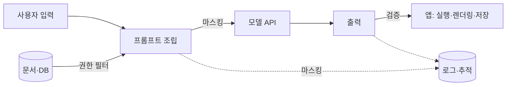

# 데이터 보호와 출력 검증

LLM 기능은 데이터가 **들어가는 길**(프롬프트, 문맥, 인덱스, 로그)과 **나오는 길**(응답, 도구 호출, 저장)에서 각각 유출·오용 위험이 있습니다. 이 문서는 입력 측의 데이터 보호와 출력 측의 검증·가드레일을 정리합니다.

## 데이터가 흐르는 경로

## 민감 정보 분류

| 등급 | 예 | 모델 전송 |
| --- | --- | --- |
| 비밀 | API 키, 비밀번호, 토큰 | 절대 금지. 프롬프트·로그에서 제외 |
| 개인정보 | 이름, 연락처, 주민번호, 계좌 | 마스킹 또는 동의·정책 범위 내 |
| 기밀 | 미공개 재무, 소스 코드, 계약 | 공급자 정책 확인, 자체 호스팅 검토 |
| 내부 | 일반 사내 문서 | 권한 필터 후 전송 |
| 공개 | 공개 문서 | 제한 없음 |

## 입력 측 보호

| 조치 | 내용 |
| --- | --- |
| 권한 필터 | 문맥·검색 결과는 요청 사용자가 볼 수 있는 것만. 생성 전에 적용 |
| 마스킹 | 개인정보를 토큰(`<EMAIL_1>`)으로 치환하고 응답에서 복원 |
| 최소 전송 | 필요한 필드만. 전체 레코드·전체 파일 덤프 금지 |
| 비밀 분리 | 비밀은 환경 변수·비밀 관리자. 모델이 비밀을 알 필요가 없게 설계 |
| 세션 격리 | 대화 기록·캐시 키에 사용자 범위 포함 |
| 길이 상한 | 입력 길이·첨부 크기 제한 |

## 공급자 데이터 정책

| 확인 항목 | 질문 |
| --- | --- |
| 학습 사용 | 전송 데이터를 모델 학습에 쓰는가, 제외 옵션이 있는가 |
| 보존 | 로그 보존 기간, 삭제 요청 가능 여부 |
| 리전 | 데이터가 처리·저장되는 지역 |
| 인증 | SOC 2, ISO 27001 등 |
| 계약 | 기업용 약관, DPA(데이터 처리 계약) |
| 서브프로세서 | 공급자가 쓰는 제3자 |

규제 대상 데이터(의료, 금융, 개인정보)는 법무·보안 검토 후 전송 범위를 정합니다. 어려우면 [로컬 모델](../local-models/README.md)을 검토합니다.

## 출력 측 검증

모델 출력은 신뢰할 수 없는 입력입니다. 용도별로 검증 방법이 다릅니다.

| 출력 용도 | 위험 | 검증 |
| --- | --- | --- |
| 화면 표시 | XSS, 피싱 링크 | HTML 이스케이프 또는 안전한 Markdown 렌더러, 링크 도메인 확인 |
| 코드 실행 | 임의 명령 실행 | 샌드박스, 허용 명령 목록, 사람 승인 |
| DB 쿼리 | 인젝션, 대량 변경 | 파라미터화, 읽기 전용 계정, 행 수 상한 |
| 외부 API 호출 | SSRF, 권한 남용 | URL 허용 목록, 인자 스키마 검증 |
| 파일 쓰기 | 경로 탈출, 덮어쓰기 | 경로 정규화, 허용 디렉터리, diff 승인 |
| 저장(기록·메모리) | 지속적 주입 | 내용 검토, 지시문 저장 금지 |
| 사용자에게 사실 제공 | 환각 | 출처 표시, 근거 없는 주장 거부 규칙 |

## 가드레일

| 종류 | 동작 | 한계 |
| --- | --- | --- |
| 입력 분류 | 주입·유해 요청 탐지 | 우회 가능, 오탐 |
| 출력 분류 | 유해·민감 내용 탐지 후 차단·수정 | 지연 추가 |
| 스키마 검증 | 구조화 출력의 형식·범위 검사 | 의미 오류는 못 잡음 |
| 규칙 검사 | 금지어, 패턴(카드 번호 등), 길이 | 단순 |
| 주제 제한 | 허용 주제 밖 요청 거부 | 경계가 모호 |
| 사람 검토 | 고위험 출력은 승인 후 전달 | 비용·지연 |

| 도구 | 예 |
| --- | --- |
| 가드레일 프레임워크 | Guardrails AI, NeMo Guardrails, Llama Guard 계열 분류 모델 |
| 개인정보 탐지 | Microsoft Presidio 등 |
| 공급자 안전 기능 | 각 공급자의 콘텐츠 분류·안전 설정 |
| 레드팀·평가 | promptfoo, garak |

가드레일은 층 중 하나이며, 권한 최소화와 출력 검증을 대체하지 않습니다.

## 사고 대응

| 단계 | 내용 |
| --- | --- |
| 탐지 | 이상 도구 호출, 유출 패턴, 비용 급증 알림 |
| 차단 | 해당 기능·키 비활성화, 회로 차단 |
| 조사 | 추적 로그로 입력·출력·도구 호출 재구성 |
| 복구 | 유출 비밀 순환, 변경 롤백 |
| 재발 방지 | 평가 세트에 사례 추가, 권한·검증 보강 |

관련: [OWASP LLM Top 10](./owasp-llm-top-10.md), [환경변수 관리](../../Security/env-management.md), [CORS](../../Security/cors.md), [관측과 비용](../llmops/observability-and-cost.md)
