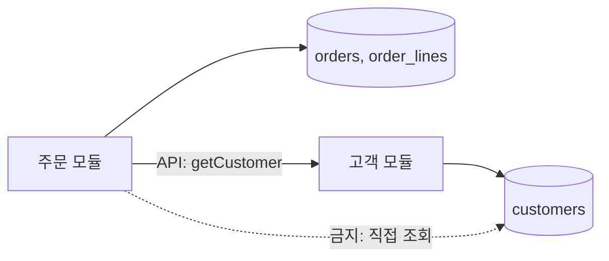

# 경계 설계

모듈 경계를 정했다면 그 경계에서 **데이터, 트랜잭션, API 계약**을 어떻게 다룰지 정해야 합니다. 경계를 넘는 모든 것은 명시적이어야 하고, 경계 안의 변경이 밖으로 새지 않아야 합니다.

## 데이터 소유권

| 원칙 | 설명 |
| --- | --- |
| 단일 소유자 | 테이블·컬렉션은 한 모듈만 쓰기 가능 |
| 조회 경로 | 다른 모듈의 데이터는 그 모듈의 API 또는 이벤트로 받은 복제본으로 |
| 공유 테이블 금지 | 두 모듈이 같은 테이블을 쓰면 스키마 변경이 둘을 동시에 깨뜨림 |
| 참조 무결성 | 모듈 간 외래 키 대신 ID 참조 + 애플리케이션 검증 |
| 보고·분석 | 운영 DB 직접 조회 대신 복제본·데이터 웨어하우스 |

모놀리스에서도 모듈별 스키마(또는 테이블 접두사)와 접근 규칙을 두면 나중에 분리할 수 있습니다.

## 트랜잭션 경계

| 규칙 | 설명 |
| --- | --- |
| 애그리거트 = 트랜잭션 단위 | 하나의 트랜잭션은 하나의 애그리거트를 변경 |
| 유스케이스가 경계 소유 | 트랜잭션 시작·커밋은 애플리케이션 계층. 도메인은 모름 |
| 짧게 | 외부 API 호출·사용자 대기는 트랜잭션 밖 |
| 모듈 간 | 분산 트랜잭션 대신 이벤트·사가·아웃박스 |
| 읽기 | 조회는 트랜잭션 없이 또는 읽기 전용 |

| 안티패턴 | 문제 |
| --- | --- |
| 요청 전체를 한 트랜잭션으로 | 잠금 장기화, 외부 호출 실패 시 롤백 불가 |
| 컨트롤러에서 트랜잭션 | 경계가 기술 계층에 묶임 |
| 여러 애그리거트 동시 변경 | 경합, 경계 붕괴 |

## 일관성 모델 선택

| 요구 | 모델 | 구현 |
| --- | --- | --- |
| 즉시 일관성 필수(잔액, 재고 차감) | 강한 일관성 | 같은 애그리거트·같은 트랜잭션 |
| 지연 허용(알림, 통계, 검색 색인) | 결과적 일관성 | 이벤트, 아웃박스 |
| 외부 시스템 포함 | 보상 가능 | 사가, 멱등 호출 |

"어디까지 즉시 일관해야 하는가"를 업무 담당자와 확인합니다. 대부분은 생각보다 넓은 지연을 허용합니다.

## API 경계와 계약

| 항목 | 내용 |
| --- | --- |
| DTO 분리 | 경계의 요청·응답 형식은 내부 모델과 별도. 내부 변경이 계약을 바꾸지 않게 |
| 계약 명세 | OpenAPI, Protobuf, 이벤트 스키마. 코드에서 생성하거나 코드를 생성 |
| 버전 관리 | 하위 호환 변경(필드 추가)은 무버전, 비호환 변경은 새 버전 + 병행 기간 |
| 오류 계약 | 오류 코드·형식을 계약에 포함 |
| 계약 테스트 | 소비자가 기대하는 계약을 제공자 CI에서 검증 |

| 호환 변경 | 비호환 변경 |
| --- | --- |
| 선택 필드 추가, 새 엔드포인트·이벤트 타입 | 필드 삭제·이름 변경·타입 변경, 필수 필드 추가, 의미 변경 |

## 경계를 넘는 호출의 처리

| 관심사 | 처리 위치 |
| --- | --- |
| 입력 검증 | 경계 진입 시(형식), 도메인(규칙) |
| 인증·인가 | 경계 진입 시. 도메인은 "누가"가 아니라 "할 수 있는가"만 |
| 타임아웃·재시도 | 나가는 어댑터 |
| 변환 | 어댑터에서 외부 형식 ↔ 내부 모델 |
| 로깅·추적 | 경계에서 요청 ID 부여·전파 |

## 공통 코드의 경계

| 공유 방식 | 적합 | 위험 |
| --- | --- | --- |
| 공유 라이브러리(유틸, 타입) | 안정적이고 업무 무관 | 업무 모델을 넣으면 모든 모듈이 결합 |
| 공유 커널(작은 도메인 모델) | 두 컨텍스트가 꼭 같은 개념 | 커지면 경계 붕괴 |
| 복제 | 작은 DTO·열거형 | 불일치 관리 |

"중복을 없애자"는 이유로 업무 모델을 공유 라이브러리에 넣는 것이 가장 흔한 경계 붕괴 원인입니다. 컨텍스트가 다르면 같은 이름이라도 따로 둡니다.

관련: [트랜잭션](../../Data/database/transaction.md), [API 설계](../../API/api-design.md), [DB 마이그레이션](../../Data/database/migration.md), [도메인 모델링](./domain-modeling.md)

다음: [안티패턴](./anti-patterns.md)
