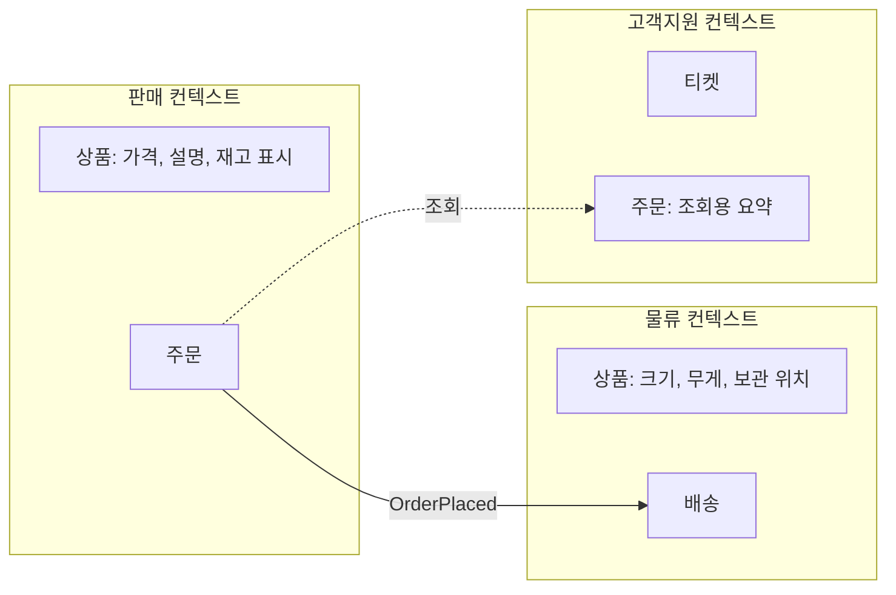

# 도메인 모델링

도메인 모델링은 업무 개념과 규칙을 코드 구조로 옮기는 일입니다. 도메인 주도 설계(DDD)의 전략적 도구(바운디드 컨텍스트, 유비쿼터스 언어)는 **경계를 정하는 데**, 전술적 도구(엔티티, 값 객체, 애그리거트)는 **경계 안을 구성하는 데** 씁니다. 전략적 도구가 더 중요하며, 전술적 도구는 규칙이 복잡한 곳에만 적용합니다.

## 유비쿼터스 언어

| 원칙 | 설명 |
| --- | --- |
| 하나의 언어 | 업무 담당자와 개발자가 같은 용어를 쓰고, 코드(클래스·메서드·이벤트 이름)에도 그대로 |
| 용어집 | 모호한 용어("고객", "계정", "주문")의 정의를 컨텍스트별로 기록 |
| 번역 금지 | 업무 용어를 기술 용어(`UserEntity`, `DataManager`)로 바꾸지 않음 |
| 언어가 바뀌면 코드도 | 용어 변경은 리팩터링 대상 |

같은 단어가 부서마다 다른 뜻이면 그 지점이 **컨텍스트 경계**입니다.

## 바운디드 컨텍스트



| 개념 | 설명 |
| --- | --- |
| 바운디드 컨텍스트 | 하나의 모델과 언어가 일관되게 적용되는 범위 |
| 같은 이름, 다른 모델 | "상품"은 판매와 물류에서 속성과 규칙이 다름. 하나로 합치지 않음 |
| 컨텍스트 매핑 | 컨텍스트 간 관계와 번역 방식을 그림으로 |
| 경계와 배포 | 컨텍스트는 모듈 경계의 후보. 서비스 경계와 일치시킬 수도, 모놀리스 안의 모듈로 둘 수도 |

| 컨텍스트 관계 | 설명 |
| --- | --- |
| 고객·공급자 | 하류가 상류에 요구 사항 전달, 상류가 반영 |
| 순응자 | 하류가 상류 모델을 그대로 수용 |
| 부패 방지 계층(ACL) | 하류가 상류 모델을 자기 모델로 번역하는 계층. 외부·레거시 연동의 기본 |
| 공개 호스트 서비스 | 상류가 안정적 공개 API·이벤트 제공 |
| 공유 커널 | 두 컨텍스트가 작은 모델을 공유. 최소화 |

## 전술적 요소

| 요소 | 정의 | 예 | 규칙 |
| --- | --- | --- | --- |
| 엔티티 | 식별자로 구분되며 상태가 변함 | 주문, 고객 | 식별자 불변, 생명주기 있음 |
| 값 객체 | 속성 값으로만 구분, 불변 | 금액, 주소, 기간 | 동등성은 값 비교, 변경은 새 객체 |
| 애그리거트 | 함께 일관성을 지켜야 하는 엔티티·값 객체 묶음 | 주문 + 주문 항목 | 루트를 통해서만 접근, 트랜잭션 단위 |
| 도메인 서비스 | 특정 엔티티에 속하지 않는 업무 규칙 | 환율 적용 이체 | 상태 없음 |
| 도메인 이벤트 | 도메인에서 일어난 사실 | `OrderPlaced` | 과거형, 불변 |
| 리포지토리 | 애그리거트 저장·조회 인터페이스 | `OrderRepository` | 애그리거트 단위, 도메인이 인터페이스 소유 |
| 팩토리 | 복잡한 생성 규칙 캡슐화 | 주문 생성 | 불변식 보장 |

## 애그리거트 설계

| 규칙 | 이유 |
| --- | --- |
| 작게 | 큰 애그리거트는 잠금 경합과 메모리 부담. 대부분은 엔티티 하나 + 값 객체 |
| 다른 애그리거트는 ID로 참조 | 객체 참조로 엮으면 경계가 사라짐 |
| 한 트랜잭션에 하나의 애그리거트 | 여러 개를 바꿔야 하면 이벤트로 결과적 일관성 |
| 불변식은 루트가 지킴 | 항목 추가·삭제는 루트 메서드를 통해 |

```
class Order:                      # 애그리거트 루트
    id: OrderId
    customer_id: CustomerId       # 다른 애그리거트는 ID로
    lines: list[OrderLine]        # 내부 엔티티
    total: Money                  # 값 객체

    def add_line(self, product_id, qty, unit_price):
        if self.status != "draft": raise OrderNotEditable()
        self.lines.append(OrderLine(product_id, qty, unit_price))
        self.total = sum(l.subtotal for l in self.lines)
```

## 빈약한 모델과 풍부한 모델

| 모델 | 특징 | 적합 |
| --- | --- | --- |
| 빈약한(anemic) | 데이터만 있고 규칙은 서비스 클래스에 | CRUD 위주, 규칙 단순 |
| 풍부한(rich) | 규칙이 엔티티·값 객체 안에 | 불변식이 많고 상태 전이가 복잡 |

규칙이 단순한 곳에 풍부한 모델을 강요하면 의례적 코드만 늘어납니다. 컨텍스트별로 다르게 선택합니다.

## 모델링 절차

| 단계 | 활동 | 산출물 |
| --- | --- | --- |
| 1 | 업무 담당자와 이벤트 스토밍: 일어나는 일(이벤트)을 시간순으로 나열 | 이벤트 흐름 |
| 2 | 이벤트를 일으키는 명령과 행위자, 관련 데이터 식별 | 명령·정책 |
| 3 | 언어가 달라지는 지점에서 컨텍스트 경계 표시 | 컨텍스트 맵 |
| 4 | 컨텍스트 안에서 함께 바뀌는 데이터를 애그리거트로 묶음 | 애그리거트 목록 |
| 5 | 코드 구조에 반영, 용어집 갱신 | 모듈·클래스 |

관련: [모듈성과 경계](../principles/modularity.md), [경계 설계](./boundaries.md), [이벤트 기반 아키텍처](../styles/event-driven.md)

다음: [경계 설계](./boundaries.md)
