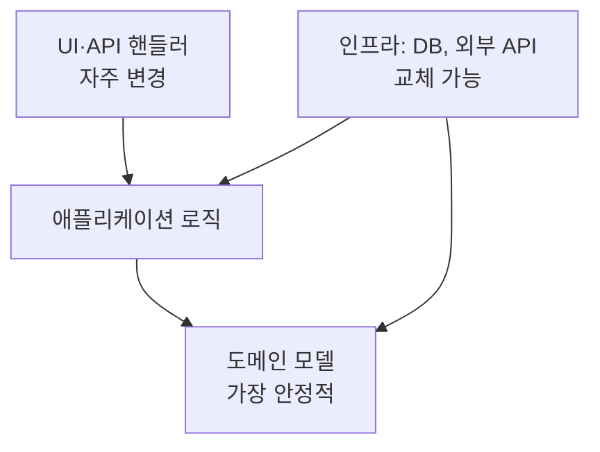

# 의존성과 추상화

의존성은 "A가 바뀌면 B도 바뀔 수 있다"는 관계입니다. 아키텍처의 많은 부분은 **의존성이 어느 방향으로 흐르게 할지**를 정하는 일입니다. 원칙은 단순합니다. 자주 바뀌는 것이 안정적인 것에 의존해야 하며, 반대는 안 됩니다.

## 의존성 방향



| 규칙 | 설명 |
| --- | --- |
| 안정적인 것을 향해 | 변경이 잦은 모듈이 안정적인 모듈에 의존. 반대면 안정적인 것이 흔들림 |
| 핵심은 바깥을 모름 | 도메인 로직은 DB·프레임워크·UI를 import하지 않음 |
| 순환 금지 | A→B→A는 두 모듈을 하나로 만든 것과 같음 |
| 명시적으로 | 의존성은 생성자·인자로 받고, 전역·숨은 import로 숨기지 않음 |

의존성 방향을 뒤집어야 할 때 **의존성 역전**(인터페이스를 안정적인 쪽에 정의하고, 구현을 바깥에서 주입)을 씁니다.

## SOLID

| 원칙 | 한 줄 | 아키텍처 수준의 의미 |
| --- | --- | --- |
| 단일 책임(SRP) | 모듈은 하나의 이유로만 바뀐다 | 변경 이유가 다른 것은 분리([모듈성](./modularity.md)) |
| 개방·폐쇄(OCP) | 확장에는 열리고 수정에는 닫힌다 | 새 종류 추가가 기존 코드 수정 없이 가능한 확장점 |
| 리스코프 치환(LSP) | 하위 타입은 상위 타입을 대체할 수 있다 | 인터페이스 계약(전제·보장)을 구현이 지킴 |
| 인터페이스 분리(ISP) | 쓰지 않는 메서드에 의존하지 않는다 | 사용자별로 작은 인터페이스 |
| 의존성 역전(DIP) | 구체가 아니라 추상에 의존한다 | 핵심 로직이 인프라 인터페이스를 소유 |

SOLID는 객체 지향 용어로 쓰였지만 모듈·서비스 수준에도 그대로 적용됩니다. 서비스 간 API가 인터페이스이고, 배포 단위가 모듈입니다.

## 의존성 역전의 실제

```
도메인 모듈(안정)
  interface OrderRepository { save(order); findById(id) }
  class PlaceOrderService(repo: OrderRepository) { ... }

인프라 모듈(교체 가능)
  class PostgresOrderRepository implements OrderRepository { ... }

조립(진입점)
  service = PlaceOrderService(PostgresOrderRepository(conn))
```

| 효과 | 설명 |
| --- | --- |
| 테스트 | 도메인 로직을 메모리 구현으로 테스트 |
| 교체 | 저장소·외부 API를 바꿔도 도메인 미수정 |
| 지연 결정 | 어떤 DB를 쓸지 나중에 정할 수 있음 |

| 비용 | 설명 |
| --- | --- |
| 간접 계층 | 코드를 따라가기 위해 한 단계 더 |
| 과잉 추상화 | 구현이 하나뿐이고 바뀔 일 없는 것에 인터페이스 |

## 추상화의 비용

| 상황 | 추상화 | 이유 |
| --- | --- | --- |
| 구현이 둘 이상이거나 교체 예정 | 함 | 변동을 가둠 |
| 테스트에서 대체 필요(외부 API, 시간, 난수) | 함 | 결정적 테스트 |
| 구현이 하나이고 바뀔 가능성 낮음 | 안 함 | 간접 계층만 추가 |
| "나중에 필요할지 몰라서" | 안 함 | 필요해질 때 추출이 더 정확 |
| 프레임워크 교체 대비 | 보통 안 함 | 실제로 교체하는 경우 드묾. 경계만 얇게 |

잘못된 추상화는 중복보다 비쌉니다. 추상화를 걷어내는 것이 유지하는 것보다 어렵기 때문입니다.

## 의존성 규칙 지키기

| 수단 | 설명 |
| --- | --- |
| 패키지·모듈 구조 | 언어의 가시성(package-private, internal, export 목록) 활용 |
| 의존성 검사 도구 | import 규칙을 테스트로(ArchUnit, dependency-cruiser, eslint-plugin-boundaries 등) |
| 빌드 분리 | 모듈별 빌드 단위로 역방향 import를 컴파일 오류로 |
| 코드 리뷰 체크 | 새 import가 규칙을 어기는지 |

규칙은 [피트니스 함수](../quality/fitness-functions.md)로 자동화합니다.

## 외부 의존성

| 원칙 | 설명 |
| --- | --- |
| 얇은 어댑터 | 외부 라이브러리·API는 한 모듈에서만 직접 사용 |
| 내부 모델로 변환 | 외부 응답 형식을 그대로 도메인에 흘리지 않음 |
| 버전 고정 | 의존성 버전과 갱신 절차 |
| 공급자 잠금 평가 | 교체 가능성과 비용을 ADR로 기록 |

관련: [모듈성과 경계](./modularity.md), [계층형과 헥사고날](../styles/layered-and-hexagonal.md), [의존성과 증분 빌드](../../Build/dependency-graph.md)

다음: [계층형과 헥사고날](../styles/layered-and-hexagonal.md)
