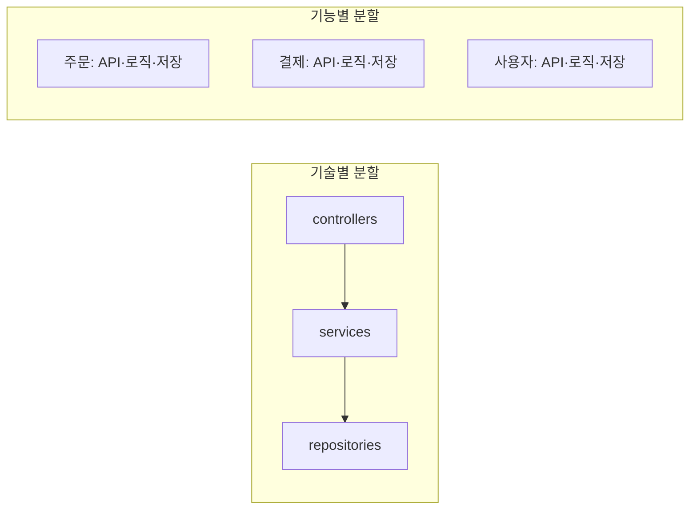

# 모듈성과 경계

모듈성은 시스템을 **독립적으로 이해하고 바꿀 수 있는 단위**로 나누는 성질입니다. 좋은 모듈은 안은 응집되어 있고 밖과는 느슨하게 연결됩니다. 경계를 어디에 긋느냐가 이후 모든 변경의 비용을 결정합니다.

## 응집도와 결합도

| 개념 | 정의 | 높을 때 | 낮을 때 |
| --- | --- | --- | --- |
| 응집도(Cohesion) | 모듈 안 요소들이 같은 목적으로 묶인 정도 | 한 가지 이유로 바뀜, 이해 쉬움 | 잡동사니 모듈, 변경 시 무관한 코드도 영향 |
| 결합도(Coupling) | 모듈이 다른 모듈의 내부에 의존하는 정도 | 한 모듈 변경이 여러 모듈로 전파 | 독립 변경·테스트·배포 가능 |

목표는 **높은 응집, 낮은 결합**입니다. 둘은 보통 함께 움직입니다. 관련 있는 것을 한곳에 모으면 모듈 간 왕래가 줄어듭니다.

## 결합의 종류

| 종류 | 설명 | 예 | 강도 |
| --- | --- | --- | --- |
| 내용 결합 | 다른 모듈의 내부 데이터·구현에 직접 접근 | 다른 모듈의 private 필드 수정, 테이블 직접 조회 | 가장 강함 |
| 공통 결합 | 전역 상태 공유 | 전역 설정 객체, 싱글턴 변경 | 강함 |
| 제어 결합 | 플래그로 상대의 동작을 지시 | `process(data, mode="fast")` | 중간 |
| 스탬프 결합 | 필요 이상의 큰 구조체 전달 | 사용자 전체 객체를 넘기고 이름만 사용 | 중간 |
| 데이터 결합 | 필요한 값만 인터페이스로 전달 | `calculate(price, rate)` | 약함 |
| 시간적 결합 | 호출 순서·시점에 의존 | `init()` 후에만 `run()` 가능 | 숨어 있음 |
| 배포 결합 | 함께 배포해야 동작 | 공유 라이브러리 버전 동기화 | 분산 시스템에서 중요 |

결합을 없앨 수는 없습니다. 강한 결합을 약한 결합으로 바꾸고, 결합이 **명시적**으로 드러나게 합니다.

## 경계를 긋는 기준

| 기준 | 설명 | 효과 |
| --- | --- | --- |
| 변경 이유 | 같은 이유로 함께 바뀌는 것을 묶음 | 변경이 한 모듈에 머묾 |
| 업무 개념 | 주문, 결제, 재고처럼 도메인 단위 | 업무 언어와 코드 구조 일치 |
| 팀 | 한 팀이 소유할 수 있는 크기 | 소유권·책임 명확 |
| 변경 빈도 | 자주 바뀌는 것과 안정적인 것 분리 | 안정적 핵심이 흔들리지 않음 |
| 기술 종류 | 컨트롤러·서비스·저장소 | 모듈 안의 내부 구조로는 유용, 최상위 경계로는 부적합 |

기능 하나를 추가할 때 수정하는 파일이 여러 최상위 폴더에 흩어지면 경계가 변경 단위와 어긋난 신호입니다.

## 인터페이스 설계

| 원칙 | 설명 |
| --- | --- |
| 작고 안정적으로 | 공개 API는 최소한으로. 한 번 공개하면 바꾸기 어려움 |
| 구현을 숨김 | 저장 방식, 내부 자료구조, 외부 서비스 사용 여부를 노출하지 않음 |
| 의도를 드러냄 | `updateStatus(id, "paid")`보다 `markAsPaid(orderId)` |
| 계약을 명시 | 입력 조건, 출력 보장, 오류 종류, 멱등성 |
| 데이터 형식 분리 | 모듈 내부 모델과 경계의 DTO를 분리해 내부 변경이 밖으로 새지 않게 |

## 모듈 크기

| 신호 | 너무 큼 | 너무 작음 |
| --- | --- | --- |
| 이해 | 한 사람이 전체를 파악 못 함 | 모듈 간 호출을 따라가야 흐름이 보임 |
| 변경 | 작은 기능에도 광범위한 영향 | 작은 기능에 여러 모듈 동시 수정 |
| 테스트 | 설정이 복잡, 느림 | 모킹이 대부분 |
| 팀 | 여러 팀이 한 모듈에서 충돌 | 소유자가 불명확 |

정답 크기는 없습니다. "한 기능의 변경이 한 모듈 안에서 끝나는가"를 반복해서 확인합니다.

## 정보 은닉

모듈의 핵심은 **바뀔 가능성이 있는 결정을 숨기는 것**입니다(Parnas). 저장소 종류, 외부 API, 계산 방식처럼 바뀔 수 있는 것을 모듈 안에 가두면 변경이 밖으로 번지지 않습니다.

| 숨길 것 | 노출할 것 |
| --- | --- |
| 테이블 구조, ORM 엔티티 | 조회·변경 작업 |
| 외부 서비스 클라이언트 | 업무 의미의 결과 |
| 알고리즘 선택 | 입력과 출력의 계약 |
| 캐시·재시도 전략 | 성능 특성(문서로) |

관련: [의존성과 추상화](./dependencies.md), [도메인 모델링](../patterns/domain-modeling.md), [API 설계](../../Backend/api/api-design.md)

다음: [의존성과 추상화](./dependencies.md)
