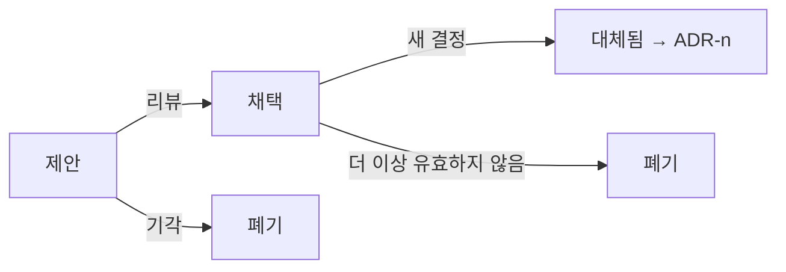

# ADR(Architecture Decision Record)

ADR은 **중요한 설계 결정 하나를 문맥, 결정, 결과와 함께 짧게 기록한 문서**입니다. 몇 달 뒤 "왜 이렇게 했지?"에 답할 수 있게 하고, 같은 논의를 반복하지 않게 하며, 새 팀원과 AI 에이전트에게 설계 의도를 전달합니다.

## 무엇을 기록하는가

| 기록 | 기록하지 않음 |
| --- | --- |
| 바꾸기 어려운 선택(저장소, 통신 방식, 모듈 경계, 인증 방식) | 쉽게 바꾸는 라이브러리 선택 |
| 대안이 있었고 트레이드오프가 있던 결정 | 선택지가 하나뿐인 것 |
| 팀 규칙(의존성 방향, API 버전 정책) | 코드 스타일(린터 설정으로) |
| 기존 결정을 뒤집는 결정 | 구현 세부 |

"이 결정을 모르면 코드가 이상해 보이는가"가 기준입니다.

## 형식

```markdown
# ADR-0007: 주문과 결제 모듈 간 통신을 이벤트로 전환

- 상태: 채택 (2026-03-10)
- 결정자: 백엔드 팀
- 관련: ADR-0003(모듈러 모놀리스 채택)

## 문맥
결제 모듈의 외부 PG 호출 지연이 주문 API 응답 시간에 그대로 더해지고 있다(p95 1.8초).
PG 장애 시 주문 생성까지 실패한다. 주문 확정 후 결제 결과를 수 초 뒤에 반영해도
업무상 문제가 없음을 운영팀과 확인했다.

## 검토한 대안
1. 동기 호출 유지 + 타임아웃 단축: 지연은 줄지만 장애 결합은 그대로
2. 결제 모듈을 별도 서비스로 분리: 운영 비용 대비 효과 불확실
3. 인프로세스 이벤트 + 아웃박스: 모듈 경계 유지, 장애 격리

## 결정
3을 채택한다. 주문 모듈은 `OrderPlaced` 이벤트를 아웃박스 테이블에 기록하고,
결제 모듈이 구독해 처리한다. 결제 결과는 `PaymentCompleted`/`PaymentFailed` 이벤트로 돌려준다.

## 결과
- 좋음: 주문 API p95 목표 500ms 달성 가능, PG 장애가 주문 생성을 막지 않음
- 나쁨: 주문 상태에 "결제 대기"가 추가되어 UI·CS 안내 변경 필요, 이벤트 처리 모니터링 필요
- 후속: 아웃박스 릴레이 구현(ADR-0008), 멱등 처리 규칙 문서화
```

| 섹션 | 내용 |
| --- | --- |
| 제목 | 번호 + 결정을 한 문장으로 |
| 상태 | 제안 / 채택 / 폐기 / 대체됨(→ ADR-n) |
| 문맥 | 결정을 필요하게 만든 사실·제약·측정값. 의견 아닌 사실 |
| 대안 | 검토한 선택지와 각각의 트레이드오프 |
| 결정 | 무엇을 하기로 했는가. 능동형 한 문단 |
| 결과 | 좋은 점, 나쁜 점, 후속 작업. 나쁜 점을 반드시 적음 |

## 운영

| 항목 | 권장 |
| --- | --- |
| 위치 | 저장소 안 `docs/adr/` 또는 `docs/decisions/`. 코드와 함께 버전 관리 |
| 파일명 | `0007-order-payment-events.md`처럼 번호 + 슬러그 |
| 길이 | 1~2페이지. 길어지면 결정이 여러 개 |
| 작성 시점 | 결정 직후. 구현 끝나고 쓰면 대안이 기억나지 않음 |
| 리뷰 | PR로 제안, 팀 리뷰 후 "채택" |
| 변경 | ADR은 수정하지 않고 새 ADR로 대체. 이력이 남음 |
| 목록 | `README.md`에 번호·제목·상태 표 |



## 흔한 문제

| 문제 | 대응 |
| --- | --- |
| 아무도 쓰지 않음 | 설계 논의가 있는 PR에 ADR 링크를 요구. 템플릿 제공 |
| 결정만 있고 이유 없음 | 문맥·대안 섹션 필수 |
| 너무 많음 | 기준 재확인: 바꾸기 어려운가, 대안이 있었는가 |
| 오래되어 틀림 | 상태를 "폐기"로 바꾸고 새 ADR. 삭제하지 않음 |
| 결정이 코드와 다름 | 피트니스 함수로 ADR의 규칙을 검사 |

## AI 에이전트와 ADR

ADR은 에이전트가 저장소를 이해하는 데 가장 효율적인 문서입니다. 지침 파일에서 ADR 목록을 가리키고, 설계 변경 작업에는 관련 ADR을 문맥으로 제공합니다. 에이전트가 새 결정을 제안할 때도 같은 형식으로 쓰게 하면 리뷰가 쉬워집니다. 자세한 내용은 [문맥과 지식 축적](../../AI/agents/context-and-knowledge.md)을 참고합니다.

관련: [품질 속성과 트레이드오프](../quality/quality-attributes.md), [코드 리뷰](../../Quality/code-review.md)

다음: [다이어그램](./diagrams.md)
