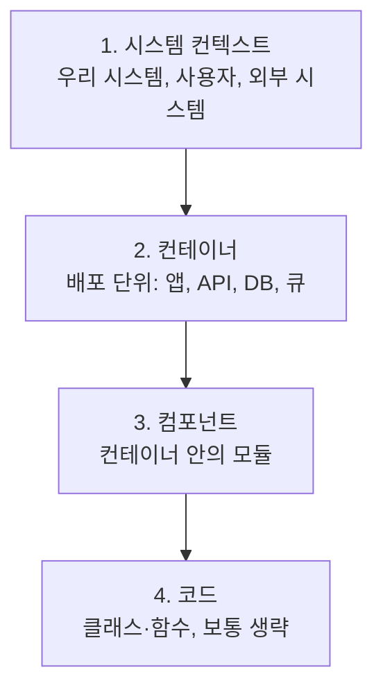
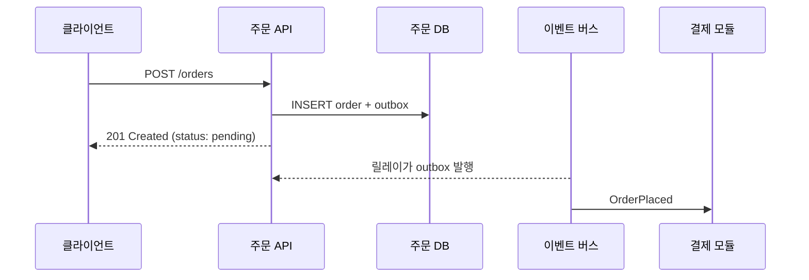

# 아키텍처 다이어그램

다이어그램의 목적은 **특정 질문에 답하는 것**입니다. "시스템이 외부와 어떻게 연결되는가", "이 요청은 어떤 경로를 지나는가"처럼 질문이 정해져야 어떤 그림을 그릴지 정해집니다. 모든 것을 한 장에 담은 그림은 아무 질문에도 답하지 못합니다.

## C4 모델

줌 수준을 4단계로 나눠 독자에 맞는 추상화 수준을 고릅니다.

| 수준 | 독자 | 보여 주는 것 | 갱신 빈도 |
| --- | --- | --- | --- |
| 컨텍스트 | 모든 이해관계자 | 시스템 하나를 상자로, 사용자와 외부 시스템과의 관계 | 낮음 |
| 컨테이너 | 개발자, 운영 | 독립 실행·배포 단위와 통신 방식(HTTP, 큐, DB 접속) | 중간 |
| 컴포넌트 | 해당 컨테이너 개발자 | 모듈·주요 인터페이스와 의존 | 높음(코드에서 생성 권장) |
| 코드 | 필요 시 | 클래스 다이어그램 | IDE에서 생성 |

컨텍스트와 컨테이너 두 장이면 대부분의 설명이 끝납니다. 컴포넌트 수준은 손으로 그리면 금방 낡으므로 도구로 생성하거나 생략합니다.

## 질문별 다이어그램

| 질문 | 다이어그램 | 비고 |
| --- | --- | --- |
| 시스템이 무엇과 연결되는가 | C4 컨텍스트 | 한 장 |
| 무엇을 어디에 배포하는가 | C4 컨테이너, 배포 다이어그램 | 환경별 |
| 요청이 어떤 순서로 처리되는가 | 시퀀스 다이어그램 | 유스케이스 하나씩 |
| 상태가 어떻게 바뀌는가 | 상태 다이어그램 | 주문·결제 같은 생명주기 |
| 데이터가 어디서 어디로 흐르는가 | 데이터 흐름도 | 보안·개인정보 검토 |
| 모듈이 무엇에 의존하는가 | 의존성 그래프 | 도구로 생성 |
| 업무 개념이 어떻게 나뉘는가 | 컨텍스트 맵 | [도메인 모델링](../patterns/domain-modeling.md) |
| 장애 시 무엇이 영향받는가 | 의존성 그래프 + 장애 도메인 표시 | 가용성 검토 |

## 코드로 그리기

| 도구 | 특징 | 적합 |
| --- | --- | --- |
| Mermaid | Markdown에 포함, GitHub·대부분의 뷰어 렌더링 | 문서 안의 흐름도·시퀀스·상태·C4(실험적) |
| PlantUML | 표현력 넓음, C4 확장 | 상세 UML, C4 |
| Structurizr DSL | C4 전용, 모델 하나에서 여러 뷰 생성 | C4를 체계적으로 유지 |
| D2, Graphviz | 레이아웃 자동 | 의존성 그래프 |
| 생성 도구 | dependency-cruiser, madge, pyreverse 등 | 코드에서 의존성·클래스 추출 |

텍스트 다이어그램은 코드와 함께 리뷰·버전 관리되고, 뷰어에서 바로 렌더링됩니다. 이 저장소의 문서도 Mermaid를 씁니다.

## 그리는 규칙

| 규칙 | 이유 |
| --- | --- |
| 제목에 질문·범위 | "결제 흐름(정상 경로)"처럼 무엇을 보여 주는지 |
| 범례 | 화살표 의미(호출·이벤트·데이터), 상자 종류 |
| 한 장에 한 수준 | 컨테이너와 클래스를 섞지 않음 |
| 요소 수 제한 | 15개 안팎. 넘으면 분리 |
| 화살표에 라벨 | "HTTP/JSON", "OrderPlaced 이벤트" |
| 기술 이름 포함 | 컨테이너 수준에서는 "PostgreSQL", "Kafka" |
| 날짜·버전 | 언제 기준인지 |

## 유지 관리

| 문제 | 대응 |
| --- | --- |
| 그림이 코드와 다름 | 컴포넌트 이하는 생성, 상위는 ADR 변경 시 갱신 규칙 |
| 어디 있는지 모름 | `docs/architecture/` 한곳, README에서 링크 |
| 도구가 제각각 | 팀 표준 하나(Mermaid 권장), 이미지 원본 파일도 저장 |
| 너무 많음 | 질문에 답하지 않는 그림은 삭제 |

관련: [ADR](./adr.md), [모듈성과 경계](../principles/modularity.md)

다음: [마이그레이션과 기술 부채](./migration-and-debt.md)
