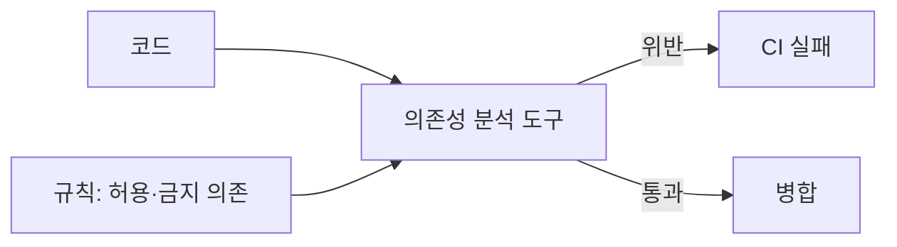

# 아키텍처 피트니스 함수

피트니스 함수는 **아키텍처가 지켜야 할 성질을 자동으로 측정·검증하는 테스트**입니다. 문서에 적힌 규칙은 잊히지만, CI에서 실패하는 규칙은 지켜집니다. 의존성 방향, 성능 예산, 보안 기준, 코드 구조 규칙을 코드로 표현합니다.

## 종류

| 분류 | 설명 | 예 |
| --- | --- | --- |
| 원자적 / 전체적 | 하나의 속성 / 여러 속성의 조합 | 의존 규칙 / 부하 시 응답 시간과 오류율 |
| 트리거 / 지속 | CI에서 실행 / 운영 중 상시 측정 | 아키텍처 테스트 / 지연 p95 알림 |
| 정적 / 동적 | 코드 분석 / 실행 결과 | import 검사 / 부하 테스트 |
| 자동 / 수동 | 도구 / 사람 검토 | 린트 / 아키텍처 리뷰 |

## 구조 규칙 검사



| 규칙 예 | 도구 |
| --- | --- |
| 도메인 패키지는 인프라·프레임워크를 import하지 않음 | ArchUnit(JVM), dependency-cruiser·eslint-plugin-boundaries(JS/TS), import-linter(Python), NetArchTest(.NET) |
| 모듈 간 순환 의존 금지 | 위 도구, madge |
| 모듈 내부 패키지는 외부에서 접근 금지 | 언어 가시성 + 도구 |
| 컨트롤러는 리포지토리를 직접 호출하지 않음 | ArchUnit 등 |
| 특정 라이브러리는 어댑터 모듈에서만 사용 | import 규칙 |

```javascript
// dependency-cruiser 예
module.exports = {
  forbidden: [
    { name: "domain-no-infra", from: { path: "^src/.+/domain" }, to: { path: "^src/.+/adapters" } },
    { name: "no-circular", from: {}, to: { circular: true } },
  ],
};
```

## 품질 속성 검사

| 속성 | 피트니스 함수 | 실행 시점 |
| --- | --- | --- |
| 성능 | 핵심 API 부하 테스트, p95 예산 초과 시 실패 | 야간·릴리스 전 |
| 성능(프런트) | 번들 크기 예산, Lighthouse 점수 | PR |
| 가용성 | 카오스 실험(인스턴스 종료 시 복구 시간) | 주기적 |
| 보안 | 의존성 취약점 스캔, 비밀 커밋 검사, SAST | PR |
| 변경 용이성 | 모듈 간 변경 결합 지표, 파일 크기 상한 | 주기적 리포트 |
| 운영성 | 모든 엔드포인트에 요청 ID·로그 존재 검사 | PR |
| 테스트 용이성 | 커버리지 하한(핵심 모듈), 테스트 시간 상한 | PR |
| 데이터 | 마이그레이션 역방향 가능 검사 | PR |

## 운영 중 지속 측정

| 지표 | 기준 | 대응 |
| --- | --- | --- |
| 지연 p95·p99 | 시나리오의 목표 | 초과 시 알림, 릴리스 롤백 검토 |
| 오류율 | SLO | 오류 예산 소진 시 기능 개발 중단·안정화 |
| 배포 빈도·리드 타임·복구 시간·변경 실패율 | 팀 목표 | 추세 악화 시 원인 분석 |
| 비용 | 요청당 비용 | 급증 시 조사 |

## 도입 절차

| 단계 | 내용 |
| --- | --- |
| 1 | 가장 자주 깨지는 규칙 하나 선정(보통 의존성 방향) |
| 2 | 현재 위반 목록 추출, 기존 위반은 예외 목록으로 허용 |
| 3 | 새 위반만 CI 실패로. 예외 목록은 점진적으로 축소 |
| 4 | 규칙을 README·ADR에 기록하고 실패 메시지에 링크 |
| 5 | 품질 속성 시나리오마다 측정 가능한 함수 추가 |

처음부터 모든 위반을 막으면 CI가 항상 빨갛고 아무도 보지 않습니다. 추세를 내리는 것이 목표입니다.

## 주의

| 함정 | 대응 |
| --- | --- |
| 규칙이 너무 많아 개발 속도 저하 | 핵심 경계만. 스타일은 린터에 |
| 측정값은 있는데 기준이 없음 | 시나리오에서 기준 도출 |
| 깨지면 규칙을 끔 | 끄는 대신 ADR로 규칙 변경 결정 |
| 테스트가 느려 무시됨 | 정적 검사는 PR, 느린 검사는 야간 |

관련: [품질 속성과 트레이드오프](./quality-attributes.md), [GitHub Actions](../../Infrastructure/cicd/github-action.md), [Husky](../../Utility/huskey.md), [테스트 전략](../../Backend/testing/testing-strategy.md)

다음: [ADR](../process/adr.md)
