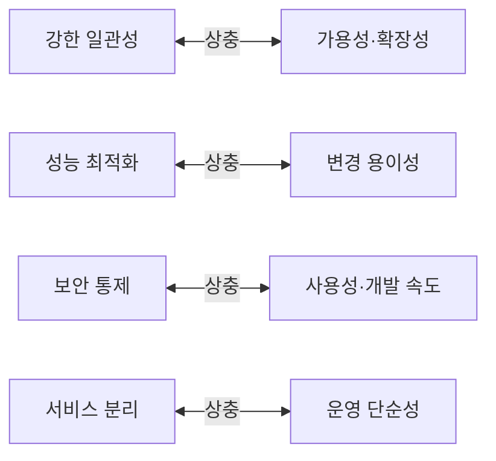

# 품질 속성과 트레이드오프

품질 속성(비기능 요구)은 "무엇을 하는가"가 아니라 **"얼마나 빠르게, 얼마나 안정적으로, 얼마나 쉽게 바꿀 수 있는가"**입니다. 아키텍처 결정은 대부분 품질 속성 사이의 트레이드오프이므로, 어떤 속성을 우선할지 먼저 정해야 결정을 평가할 수 있습니다.

## 주요 품질 속성

| 속성 | 질문 | 대표 전술 |
| --- | --- | --- |
| 성능 | 응답 시간, 처리량은 어느 정도인가 | 캐싱, 비동기, 인덱스, 연결 풀 |
| 확장성 | 부하가 10배가 되면 어떻게 대응하는가 | 수평 확장, 무상태, 파티셔닝 |
| 가용성 | 장애 시 얼마나 빨리 복구되는가 | 중복, 헬스 체크, 회로 차단, 무중단 배포 |
| 신뢰성 | 결과가 올바르고 데이터가 유실되지 않는가 | 트랜잭션, 멱등성, 재시도, 백업 |
| 보안 | 누가 무엇을 할 수 있는가, 데이터는 보호되는가 | 인증·인가, 암호화, 최소 권한, 감사 |
| 변경 용이성 | 새 요구를 얼마나 싸게 반영하는가 | 모듈화, 느슨한 결합, 테스트 |
| 테스트 용이성 | 결함을 얼마나 쉽게 찾는가 | 의존성 주입, 결정적 동작, 관측 가능성 |
| 운영성 | 배포·모니터링·진단이 쉬운가 | 로그·지표·추적, 설정 외부화, 자동화 |
| 배포 용이성 | 얼마나 자주·안전하게 배포하는가 | CI/CD, 기능 플래그, 롤백 |
| 상호운용성 | 다른 시스템과 쉽게 연동되는가 | 표준 프로토콜, 명세 |

## 대표적 트레이드오프

| 선택 | 얻는 것 | 잃는 것 |
| --- | --- | --- |
| 캐싱 | 성능 | 일관성, 복잡도 |
| 마이크로서비스 | 독립 배포, 팀 자율성 | 운영 비용, 일관성, 지연 |
| 동기 호출 | 단순, 즉시 일관성 | 가용성(연쇄 장애), 결합 |
| 강한 타입·계약 | 안전성 | 유연성, 변경 비용 |
| 추상화 계층 | 교체 가능성, 테스트 | 간접성, 코드량 |
| 다중 리전 | 가용성 | 비용, 데이터 일관성 |

트레이드오프가 없는 결정은 대개 아키텍처 결정이 아닙니다.

## 품질 속성 시나리오

"빨라야 한다"는 평가할 수 없습니다. 시나리오로 구체화합니다.

| 요소 | 내용 | 예 |
| --- | --- | --- |
| 자극 | 무슨 일이 일어나는가 | 피크 시간에 초당 500건 주문 요청 |
| 자극원 | 누가·무엇이 | 일반 사용자 |
| 환경 | 어떤 상태에서 | 정상 운영, DB 복제 지연 1초 |
| 대상 | 시스템의 어느 부분 | 주문 API |
| 응답 | 시스템이 어떻게 반응 | 요청 처리, 오류 없이 |
| 측정 | 기준 | p95 응답 500ms 이하, 오류율 0.1% 이하 |

| 속성 | 시나리오 예 |
| --- | --- |
| 가용성 | DB 주 노드 장애 시 30초 안에 복제본으로 전환, 쓰기 손실 0 |
| 변경 용이성 | 새 결제 수단 추가가 결제 모듈 안에서 2일 이내, 다른 모듈 수정 없음 |
| 보안 | 인증 토큰 탈취 시 15분 안에 만료, 감사 로그로 추적 가능 |
| 운영성 | 특정 사용자의 요청 실패 원인을 요청 ID로 5분 안에 추적 |

시나리오는 ADR의 근거이자 [피트니스 함수](./fitness-functions.md)의 기준이 됩니다.

## 우선순위 정하기

| 방법 | 설명 |
| --- | --- |
| 이해관계자 워크숍 | 각자 중요한 시나리오를 제시하고 투표 |
| 상위 N개 | 모든 속성을 최대화할 수 없음. 3~5개 핵심 시나리오 선정 |
| 제약 분리 | 협상 불가(규제, 예산, 기한)와 선호를 구분 |
| 재검토 주기 | 제품 단계(초기·성장·성숙)에 따라 우선순위 변화 |

| 제품 단계 | 보통 우선 |
| --- | --- |
| 초기(검증) | 변경 용이성, 배포 속도 |
| 성장 | 확장성, 가용성, 운영성 |
| 성숙·규제 | 보안, 신뢰성, 감사 |

## 결정 평가

| 질문 | 확인 |
| --- | --- |
| 이 결정이 상위 시나리오를 만족하는가 | 시나리오별 ○/△/× |
| 어떤 속성을 희생하는가 | 명시적으로 기록 |
| 되돌리는 비용은 | 낮으면 빨리 결정, 높으면 더 조사 |
| 측정 가능한가 | 아니면 시나리오를 다시 씀 |

관련: [웹 성능](../../Web/web-performance.md), [Rate Limiting](../../API/rate-limiting.md), [OWASP Top 10](../../Security/owasp-top-10.md), [신뢰성](../../AI/llmops/reliability.md)

다음: [피트니스 함수](./fitness-functions.md)
