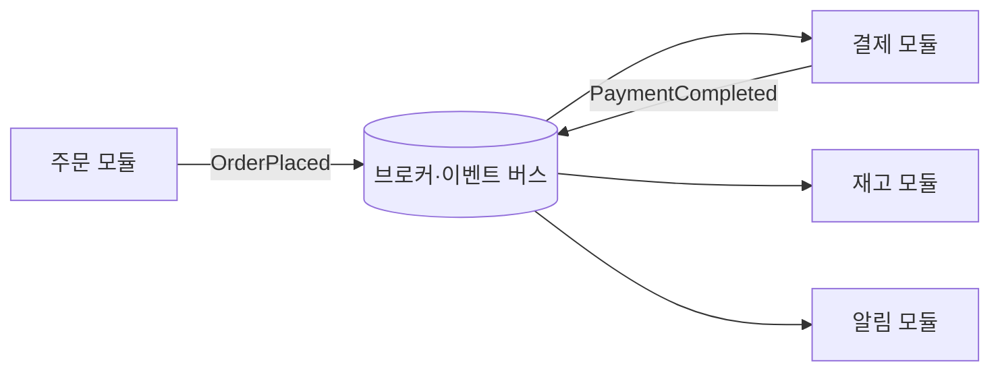

# 이벤트 기반 아키텍처

이벤트 기반 아키텍처는 **"무슨 일이 일어났다"는 사실을 발행하고, 관심 있는 쪽이 구독해 반응**하는 구조입니다. 발행자는 구독자를 모르므로 결합이 느슨해지지만, 흐름이 눈에 보이지 않고 일관성이 즉시 보장되지 않는다는 비용이 따릅니다.

## 명령, 이벤트, 쿼리

| 종류 | 의미 | 방향 | 예 |
| --- | --- | --- | --- |
| 명령(Command) | 무언가를 하라는 요청. 거부될 수 있음 | 1:1, 보내는 쪽이 수신자를 앎 | `PlaceOrder` |
| 이벤트(Event) | 이미 일어난 사실. 되돌릴 수 없음 | 1:N, 발행자는 구독자를 모름 | `OrderPlaced` |
| 쿼리(Query) | 상태 조회. 부작용 없음 | 1:1 | `GetOrder` |

이벤트 이름은 과거형으로 씁니다. "주문 생성 요청"이 아니라 "주문이 생성됨"입니다.

## 기본 구조

| 구성 요소 | 선택지 |
| --- | --- |
| 인프로세스 이벤트 | 모듈러 모놀리스 안의 이벤트 버스. 같은 트랜잭션 또는 커밋 후 발행 |
| 메시지 브로커 | Kafka, RabbitMQ, 클라우드 큐·토픽. 서비스 간 비동기 |
| 이벤트 스키마 | 버전 필드, 호환 규칙(필드 추가만 허용 등) |

## 이벤트 설계

| 유형 | 내용 | 장단점 |
| --- | --- | --- |
| 알림 이벤트 | ID만 포함, 구독자가 조회 | 작음, 결합 적음 / 조회 부하 |
| 상태 전달 이벤트 | 필요한 데이터 포함 | 구독자가 독립 / 크기·스키마 결합 |
| 도메인 이벤트 | 업무 의미 단위(`OrderPlaced`) | 의미 명확 |
| 변경 데이터 캡처(CDC) | 테이블 변경 그대로 | 구현 쉬움 / 내부 스키마 노출 |

구독자가 발행자의 내부 테이블 구조에 의존하게 되는 CDC 직접 노출은 피하고, 도메인 이벤트로 변환해 발행합니다.

## 신뢰성 보장

| 문제 | 해법 |
| --- | --- |
| DB 커밋과 이벤트 발행의 원자성 | 트랜잭셔널 아웃박스: 같은 트랜잭션에 이벤트를 테이블에 저장, 별도 프로세스가 발행 |
| 중복 전달 | 구독자 멱등성: 이벤트 ID 기록, 처리 여부 확인 |
| 순서 | 파티션 키(같은 주문은 같은 파티션), 순서 의존 최소화 |
| 처리 실패 | 재시도 + 지연, 한도 초과 시 데드레터 큐 |
| 유실 | 브로커 영속화, ack 후 삭제 |
| 스키마 변경 | 하위 호환 변경만, 버전 필드, 스키마 레지스트리 |

"정확히 한 번"은 보통 "최소 한 번 전달 + 멱등 처리"로 구현합니다.

## 결과적 일관성

이벤트로 연결된 모듈은 잠시 서로 다른 상태를 가집니다. 이를 받아들일 수 있는지가 이벤트 기반 도입의 전제입니다.

| 질문 | 예 |
| --- | --- |
| 지연을 사용자가 허용하는가 | 주문 후 알림이 수 초 늦어도 됨 / 잔액 차감은 즉시여야 함 |
| 불일치 상태를 UI가 표현할 수 있는가 | "처리 중" 상태 |
| 보상 작업이 정의되는가 | 결제 실패 시 주문 취소 |

## 사가(Saga)

여러 모듈에 걸친 작업을 분산 트랜잭션 없이 처리하는 패턴입니다. 각 단계는 로컬 트랜잭션이고, 실패하면 **보상 작업**으로 이전 단계를 되돌립니다.

| 방식 | 동작 | 장단점 |
| --- | --- | --- |
| 코레오그래피 | 각 모듈이 이벤트를 듣고 다음 단계를 수행 | 중앙 없음 / 전체 흐름 파악 어려움 |
| 오케스트레이션 | 사가 조정자가 각 단계를 명령으로 호출 | 흐름이 한곳에 / 조정자가 결합점 |

단계가 3개를 넘거나 보상 로직이 복잡하면 오케스트레이션이 추적하기 쉽습니다.

## CQRS와 이벤트 소싱

| 패턴 | 내용 | 언제 |
| --- | --- | --- |
| CQRS | 쓰기 모델과 읽기 모델을 분리. 읽기는 이벤트로 갱신되는 뷰 | 읽기·쓰기 요구가 크게 다름, 복잡한 조회 |
| 이벤트 소싱 | 상태 대신 이벤트 목록을 저장하고 재생해 상태 복원 | 감사 이력 필수, 시점 조회 |

둘 다 복잡도가 크게 늘어납니다. CQRS는 "읽기 전용 뷰 테이블" 수준의 가벼운 적용으로 시작할 수 있고, 이벤트 소싱은 특정 애그리거트에만 제한적으로 적용합니다.

## 도입 신호와 주의

| 도입 신호 | 주의 신호 |
| --- | --- |
| 한 변경에 반응하는 후속 처리가 여럿 | 모든 호출을 이벤트로 바꾸려 함 |
| 후속 처리의 실패가 원 작업을 막으면 안 됨 | 즉시 일관성이 필요한 곳에 적용 |
| 모듈 간 결합을 줄여야 함 | 흐름 추적·디버깅 도구 없이 도입 |

관련: [메시지 큐](../../Backend/messaging/message-queue.md), [트랜잭션](../../Backend/database/transaction.md), [경계 설계](../patterns/boundaries.md)

다음: [도메인 모델링](../patterns/domain-modeling.md)
