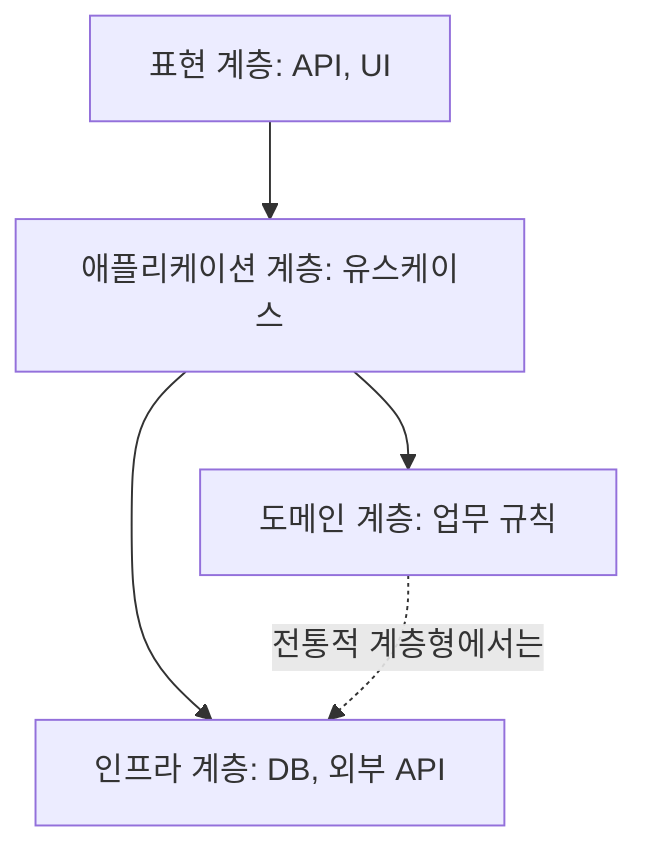
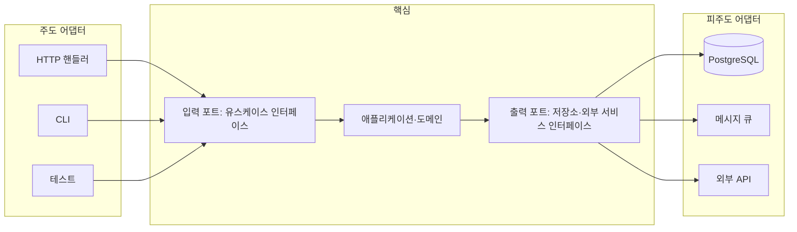

# 계층형과 헥사고날 아키텍처

두 스타일 모두 **업무 로직을 기술 세부 사항에서 분리**하려는 목적은 같습니다. 차이는 의존성 방향과 경계의 모양입니다. 계층형은 위에서 아래로 흐르고, 헥사고날은 안에서 밖으로 인터페이스를 내밉니다.

## 계층형(Layered)



| 계층 | 책임 | 두지 말 것 |
| --- | --- | --- |
| 표현 | 요청 파싱, 인증, 응답 변환 | 업무 규칙 |
| 애플리케이션 | 유스케이스 조율, 트랜잭션 경계 | 도메인 규칙의 세부, SQL |
| 도메인 | 엔티티, 값 객체, 업무 규칙 | 프레임워크, DB 접근 |
| 인프라 | 저장소 구현, 외부 API 클라이언트, 메시징 | 업무 규칙 |

| 규칙 | 설명 |
| --- | --- |
| 아래로만 의존 | 위 계층이 아래 계층을 호출. 역방향 금지 |
| 건너뛰기 | 엄격한 계층형은 바로 아래만, 완화형은 건너뛰기 허용 |
| 도메인의 인프라 의존 | 전통적 계층형의 약점. 의존성 역전으로 끊음(→ 헥사고날) |

| 장점 | 단점 |
| --- | --- |
| 이해 쉬움, 널리 알려짐 | 기능 하나가 모든 계층을 관통 |
| 프레임워크 기본 구조와 일치 | 도메인이 인프라에 끌려가기 쉬움 |
| 작은 서비스에 충분 | 계층이 의례적으로 되어 단순 위임만 남는 "빈 계층" |

## 헥사고날(포트와 어댑터)



| 요소 | 설명 |
| --- | --- |
| 핵심(Core) | 도메인과 유스케이스. 바깥을 모름 |
| 포트(Port) | 핵심이 정의하는 인터페이스. 입력(핵심을 호출) / 출력(핵심이 호출) |
| 어댑터(Adapter) | 포트를 특정 기술로 구현. HTTP, DB, 큐, 테스트 더블 |
| 주도/피주도 | 핵심을 호출하는 쪽(driving) / 핵심이 호출하는 쪽(driven) |

| 장점 | 단점 |
| --- | --- |
| 핵심을 기술 없이 테스트 | 인터페이스·DTO 변환 코드 증가 |
| 어댑터 교체·추가 쉬움 | 작은 서비스에서는 과함 |
| 의존성 방향이 항상 안쪽 | 프레임워크 기능(ORM 지연 로딩 등) 활용이 제한됨 |

## 클린 아키텍처·어니언 아키텍처

헥사고날과 같은 원칙(의존성은 안쪽으로)을 동심원으로 표현한 변형입니다. 엔티티 → 유스케이스 → 인터페이스 어댑터 → 프레임워크 순서로 바깥쪽이 안쪽에 의존합니다. 이름과 그림이 다를 뿐 실무 적용은 헥사고날과 거의 같습니다.

## 폴더 구조 예

```
src/
  order/                      # 기능(바운디드 컨텍스트) 단위
    domain/                   # 엔티티, 값 객체, 도메인 서비스, 출력 포트 인터페이스
    application/              # 유스케이스, 입력 포트
    adapters/
      in/http/                # 컨트롤러, 요청·응답 DTO
      out/persistence/        # 리포지토리 구현, ORM 매핑
      out/payment/            # 외부 결제 API 클라이언트
  shared/                     # 공통 커널(최소화)
  main.ts                     # 조립(의존성 주입)
```

최상위는 기능으로 나누고, 기능 안에서 계층·포트·어댑터로 나눕니다. 최상위를 계층으로 나누면 기능 변경이 폴더 전체로 흩어집니다.

## 선택 기준

| 상황 | 권장 |
| --- | --- |
| CRUD 위주, 규칙 단순 | 완화된 계층형. 도메인 계층을 억지로 두지 않음 |
| 업무 규칙이 복잡, 오래 유지 | 헥사고날. 핵심을 테스트로 보호 |
| 외부 연동이 많고 교체 가능성 | 헥사고날. 어댑터로 격리 |
| 팀이 작고 빠른 프로토타입 | 계층형으로 시작, 규칙이 늘면 포트 추출 |
| 프레임워크 의존이 강한 생태계 | 계층형 + 도메인에서만 프레임워크 배제 |

어느 쪽이든 **도메인 로직이 DB·HTTP를 직접 알지 않게** 하는 것이 핵심이며, 나머지는 정도의 차이입니다.

관련: [의존성과 추상화](../principles/dependencies.md), [도메인 모델링](../patterns/domain-modeling.md), [테스트 전략](../../Quality/testing-strategy.md)

다음: [모놀리스와 마이크로서비스](./monolith-vs-microservices.md)
