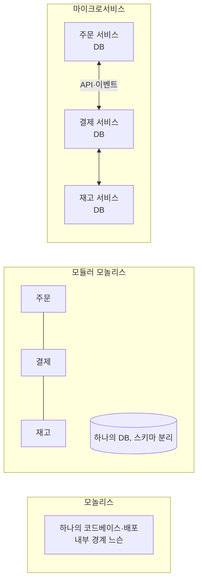

# 모놀리스와 마이크로서비스

배포 단위를 하나로 둘지 여럿으로 나눌지는 가장 비용이 큰 아키텍처 결정 중 하나입니다. 분산은 조직·운영·데이터 일관성에 큰 비용을 요구하므로, **잘 모듈화된 모놀리스**를 기본으로 두고 측정된 이유가 있을 때 분리합니다.

## 세 가지 형태

| 형태 | 배포 단위 | 모듈 경계 | 데이터 | 적합한 경우 |
| --- | --- | --- | --- | --- |
| 모놀리스 | 1 | 느슨하거나 없음 | 공유 DB | 초기, 소규모 팀 |
| 모듈러 모놀리스 | 1 | 명시적 모듈, 의존 규칙 강제 | 하나의 DB, 모듈별 스키마·소유권 | 대부분의 중규모 제품 |
| 마이크로서비스 | 여러 개 | 네트워크 경계 | 서비스별 DB | 팀·규모·배포 독립이 필요할 때 |

## 모듈러 모놀리스

| 규칙 | 설명 |
| --- | --- |
| 모듈 공개 API | 모듈은 공개 인터페이스로만 호출. 내부 클래스·테이블 직접 접근 금지 |
| 데이터 소유권 | 테이블은 한 모듈이 소유. 다른 모듈은 API로 조회 |
| 의존 규칙 자동 검사 | 빌드·테스트에서 역방향·내부 접근 차단([피트니스 함수](../quality/fitness-functions.md)) |
| 모듈 간 통신 | 동기 호출(인터페이스) 또는 인프로세스 이벤트 |
| 트랜잭션 | 모듈 안에서 완결. 모듈 간은 이벤트로 결과적 일관성 |

이 규칙을 지킨 모듈러 모놀리스는 필요한 모듈만 서비스로 떼어낼 수 있습니다. 규칙 없이 서비스로 쪼개면 **분산 모놀리스**(네트워크 호출로 이어진 강결합)가 됩니다.

## 마이크로서비스의 비용

| 영역 | 추가되는 비용 |
| --- | --- |
| 데이터 | 조인 불가, 분산 트랜잭션 없음, 결과적 일관성 설계 |
| 통신 | 네트워크 지연·실패, 재시도·타임아웃·회로 차단, 계약 버전 관리 |
| 운영 | 서비스별 배포·모니터링·로그·추적, 인프라 자동화 필수 |
| 테스트 | 통합·계약 테스트, 로컬 환경 구성 |
| 조직 | 서비스별 소유 팀, 온콜 |
| 보안 | 서비스 간 인증·인가, 네트워크 정책 |

이 비용을 감당할 팀 규모와 플랫폼(CI/CD, 관측, 컨테이너 오케스트레이션)이 없으면 분리하지 않습니다.

## 분리할 이유와 아닌 이유

| 분리할 이유 | 분리가 아닌 해법 |
| --- | --- |
| 팀이 여럿이고 배포 충돌이 잦음 | 팀이 하나면 모듈 경계로 충분 |
| 특정 모듈만 다른 확장·자원 요구(GPU, 메모리) | 전체 수평 확장으로 해결되면 불필요 |
| 다른 언어·런타임이 꼭 필요 | 라이브러리로 해결 가능한지 먼저 |
| 장애 격리가 규제·SLA상 필수 | 프로세스 격리·벌크헤드로 가능한지 |
| 변경 주기가 크게 다른 부분 | 모듈별 릴리스 관리로 가능 |
| "마이크로서비스가 현대적" | 이유가 아님 |

## 분리 단위 정하기

| 기준 | 설명 |
| --- | --- |
| 바운디드 컨텍스트 | 업무 언어와 모델이 달라지는 경계([도메인 모델링](../patterns/domain-modeling.md)) |
| 데이터 소유권 | 서비스가 자기 데이터를 완전히 소유할 수 있는가 |
| 호출 빈도 | 경계를 넘는 호출이 잦으면 잘못된 경계 |
| 팀 경계 | 한 팀이 하나 이상의 서비스를 소유. 한 서비스를 여러 팀이 공유하지 않음 |
| 변경 응집 | 기능 하나가 여러 서비스 수정을 요구하면 경계 재검토 |

## 서비스 간 통신

| 방식 | 장점 | 단점 | 적합 |
| --- | --- | --- | --- |
| 동기 REST/gRPC | 단순, 즉시 응답 | 연쇄 장애, 지연 누적 | 조회, 즉시 결과 필요 |
| 비동기 메시지·이벤트 | 느슨한 결합, 장애 격리 | 결과적 일관성, 디버깅 어려움 | 상태 변경 전파, 후속 처리 |
| API 게이트웨이·BFF | 클라이언트 단순화 | 추가 홉 | 외부 노출 |

동기 호출 체인이 길어지면 가용성이 곱셈으로 떨어집니다(각 99.9%인 서비스 5개 체인 ≈ 99.5%). 상태 변경은 이벤트로, 조회는 필요한 데이터를 로컬에 복제하는 방식을 검토합니다.

## 전환 경로

| 단계 | 내용 |
| --- | --- |
| 1 | 모놀리스 안에서 모듈 경계와 의존 규칙 정립 |
| 2 | 모듈별 데이터 소유권 분리(스키마, 접근 경로) |
| 3 | 모듈 간 통신을 인터페이스·이벤트로 제한 |
| 4 | 분리 이유가 분명한 모듈 하나를 서비스로 추출([마이그레이션](../process/migration-and-debt.md)) |
| 5 | 운영 비용 측정 후 다음 추출 여부 결정 |

관련: [메시지 큐](../../Backend/messaging/message-queue.md), [Docker Compose](../../Infrastructure/docker/docker-compose.md), [이벤트 기반 아키텍처](./event-driven.md)

다음: [이벤트 기반 아키텍처](./event-driven.md)
