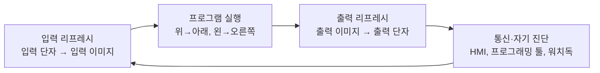

# 스캔 사이클과 응답 시간

PLC는 프로그램을 한 번 실행하고 끝내지 않습니다. **입력을 읽고 → 프로그램을 실행하고 → 출력을 내보내는** 과정을 전원이 켜져 있는 동안 계속 반복합니다. 이 한 바퀴를 스캔(scan) 또는 사이클(cycle)이라고 합니다. 래더가 "위에서 아래로, 왼쪽에서 오른쪽으로" 실행된다는 말과 듀얼 코일 금지 규칙은 모두 이 실행 모델에서 나옵니다.

먼저 알면 좋은 개념: [PLC 구조와 형태](./plc-architecture.md), [시간과 상태 관리](../../Hardware/firmware/timing-and-state.md)

## 기본 스캔 사이클



| 단계 | 하는 일 |
| --- | --- |
| 입력 리프레시 | 모든 입력 단자 상태를 한꺼번에 읽어 입력 이미지(**PII**)에 복사 |
| 프로그램 실행 | 입력 이미지와 내부 변수를 읽고 계산해 출력 이미지(**PIQ**)에 기록. 이 동안 실제 출력 단자는 바뀌지 않음 |
| 출력 리프레시 | 출력 이미지를 출력 단자에 한꺼번에 반영 |
| 통신·진단 | HMI·상위 시스템 통신, 프로그래밍 툴 모니터링, 메모리·모듈 진단 |

교과서의 순서는 위와 같지만 실제 순서는 제조사·기종마다 다릅니다. 예를 들어 Siemens S7-1500은 사이클 제어점 이후 **출력 이미지를 먼저 쓰고, 입력을 읽은 다음** 프로그램을 실행합니다. 통신도 별도 우선순위(15)의 태스크로 사이클 중간에 끼어들 수 있습니다. 계산 결과는 같지만, 통신 부하가 사이클 시간을 늘린다는 점은 기억해야 합니다.

## 프로세스 이미지

프로세스 이미지는 **한 스캔 동안 입력 값을 고정**하는 장치입니다.

```text
스캔 중간에 센서가 바뀌어도

입력 단자  X0: 0 0 0 1 1 1 1 1 1 ...
                  ↑ 실제 변화
입력 이미지 X0: 0 0 0 0 0 0 1 1 1 ...
                        ↑ 다음 입력 리프레시에서 반영

→ 한 스캔 안에서는 프로그램 위쪽과 아래쪽이 같은 X0 값을 봅니다.
```

이미지 덕분에 프로그램 중간에 입력이 바뀌어 위쪽 회로와 아래쪽 회로가 서로 다른 값을 보는 문제가 사라집니다.

**예외: 비동기 I/O 갱신**. Rockwell Logix 5000 계열은 I/O 값이 프로그램 실행과 **비동기로**, I/O 구성에서 정한 주기(RPI)마다 갱신됩니다. 그래서 태스크 앞부분과 뒷부분에서 같은 입력 태그가 다른 값을 가질 수 있습니다. Rockwell은 로직 앞에서 입력을 버퍼 태그로 복사하거나, `CPS`(동기 복사) 명령을 쓰라고 안내합니다. 사용하는 PLC가 동기식 이미지인지 비동기 갱신인지 먼저 확인합니다.

## 스캔 타임

스캔 타임(사이클 타임)은 한 바퀴에 걸리는 시간입니다. 프로그램 길이, 명령 종류, 통신량, 인터럽트 수에 따라 매 스캔 달라집니다.

| 용어 | 의미 |
| --- | --- |
| 현재·최소·최대 스캔 타임 | 대부분의 도구가 온라인 모니터링으로 보여줍니다. 설계에는 **최대값**을 씁니다 |
| 고정 주기(최소 사이클 타임) | 스캔이 빨리 끝나도 정해진 시간까지 기다려 주기를 일정하게 만듭니다 |
| 통신 부하 | Siemens S7-1500은 통신에 쓸 수 있는 비율을 설정하며 기본값은 50%입니다. 기본값을 다 쓰면 실제 사이클 타임이 통신 없을 때의 최대 2배까지 늘 수 있다고 매뉴얼에 적혀 있습니다 |

## 응답 시간 계산

입력이 바뀐 순간부터 출력 단자가 바뀔 때까지 걸리는 시간입니다. 입력이 스캔의 어느 시점에 바뀌느냐에 따라 1–2스캔 사이에서 흔들립니다.

```text
최선: 입력 리프레시 직전에 변화
  [입력읽기][프로그램][출력쓰기]
   ↑변화                     ↑출력 변화        ≈ 1 스캔

최악: 입력 리프레시 직후에 변화
  [입력읽기][프로그램][출력쓰기][입력읽기][프로그램][출력쓰기]
       ↑변화(놓침)                ↑여기서 읽힘                 ↑출력 변화   ≈ 2 스캔
```

```text
최악 응답 시간 ≈ 입력 필터(입력 모듈 지연)
              + 2 × 스캔 타임
              + 출력 모듈 지연
              (+ 원격 I/O라면 네트워크 갱신 주기 × 2)
              (+ 센서 응답 시간, 액추에이터 동작 시간)
```

Siemens S7-1500 매뉴얼도 가장 긴 응답 시간을 "사이클 타임 2배 + 입출력 지연"으로, 원격 I/O를 쓰면 PROFINET 갱신 시간 2배를 더하라고 설명합니다.

### 계산 예시

| 항목 | 값 | 근거 |
| --- | --- | --- |
| 입력 필터 | 3 ms | 예: 필터 3.0 ms 입력 단자 |
| 최대 스캔 타임 | 10 ms | 온라인 모니터링 최대값 |
| 출력 지연 | 10 ms | 예: Mitsubishi FX5UJ 릴레이 출력 약 10 ms |
| **최악 응답 시간** | 3 + 2×10 + 10 = **33 ms** | 센서·액추에이터 시간 별도 |

트랜지스터 출력(예: 0.2 ms 이하)으로 바꾸면 약 23 ms가 됩니다. 응답 시간이 부족하면 스캔을 줄이기보다 아래의 주기·인터럽트 태스크나 고속 카운터 같은 전용 기능을 먼저 검토합니다(경험칙).

### 놓치는 펄스

입력 이미지는 스캔마다 한 번만 찍히므로, 펄스 폭이 **입력 필터 + 1 스캔**보다 짧으면 놓칠 수 있습니다.

| 신호 | 대응 |
| --- | --- |
| 짧은 펄스(근접센서가 빠르게 지나가는 물체) | 입력 필터를 줄이고, 펄스 캐치·인터럽트 입력 사용 |
| 엔코더처럼 kHz 단위 펄스 | 스캔으로 세지 않고 고속 카운터(HSC) 사용 |
| 노이즈성 짧은 펄스 | 반대로 필터를 늘려 무시 |

## 워치독(사이클 감시)

워치독은 스캔이 너무 오래 걸리면(무한 루프, 과도한 반복문) PLC를 정지시키거나 오류 처리로 넘기는 감시 타이머입니다. 출력이 마지막 상태로 굳은 채 설비가 계속 움직이는 상황을 막습니다.

| 제조사 예 | 기본값 | 초과 시 |
| --- | --- | --- |
| Siemens S7-1500 (비이중화 CPU) | 최대 사이클 타임 150 ms (1–6000 ms 설정) | 시간 오류 OB(OB 80) 호출. OB 80이 없으면 STOP. 있으면 RUN을 유지하지만 같은 사이클에서 다시 초과하면 STOP |
| Rockwell Logix 5000 | 태스크별 워치독 500 ms (1–2,000,000 ms 설정) | 실행 중이던 프로그램의 폴트 루틴 실행 |

PLC가 정지할 때 출력이 어떻게 되는지(모두 OFF, 마지막 값 유지, 지정값)는 출력 모듈 설정에 따라 다릅니다. 기계가 안전한 쪽으로 멈추는지 시운전 때 확인합니다. 단, 워치독은 안전 기능이 아닙니다. 비상정지는 [비상정지와 인터록](../safety/emergency-stop-and-interlock.md)처럼 별도 안전 회로로 구현합니다.

## 태스크 종류

| 태스크 | 실행 시점 | 용도 | 예 |
| --- | --- | --- | --- |
| 연속·사이클 태스크 | 끝나면 곧바로 다시 시작 | 일반 시퀀스 로직 | Siemens OB 1, Logix 연속 태스크 |
| 주기 태스크 | 정해진 간격(예: 10 ms) | PID 제어, 일정 간격 계산 | Siemens 주기 인터럽트 OB, Logix 주기 태스크 |
| 이벤트 태스크 | 특정 조건·신호 발생 시 | 통신 수신, 모션 이벤트 | Logix 이벤트 태스크 |
| 하드웨어 인터럽트 | 입력 에지 등 하드웨어 신호 | 빠른 응답이 필요한 입력 | Siemens 하드웨어 인터럽트 OB |
| 시작·오류 처리 | 기동 시, 오류 발생 시 | 초기화, 고장 기록 | 시작 OB, 폴트 루틴 |

우선순위가 높은 태스크는 낮은 태스크를 중간에 멈추고 실행됩니다. 그래서 **두 태스크가 같은 변수를 쓰면** 낮은 태스크가 계산하는 도중에 값이 바뀔 수 있습니다. 공유 변수는 한 태스크만 쓰게 하거나, 복사본을 만들어 씁니다.

```text
주기 태스크(10ms, 높은 우선순위):  카운트 = 카운트 + 1
사이클 태스크(낮은 우선순위):
    a = 카운트          ← 여기서 읽고
    ...  (이 사이에 주기 태스크가 끼어들어 카운트 변경)
    b = 카운트          ← 다른 값을 읽음
    a와 b가 같다고 가정한 로직이 깨짐
```

## 직접 I/O 접근

일부 PLC는 프로세스 이미지를 거치지 않고 입출력 단자를 즉시 읽고 쓰는 방법을 제공합니다. Siemens S7-1200/1500은 주소나 태그 뒤에 `:P`를 붙이면 이미지를 거치지 않고 단자에 직접 접근합니다(예: `I0.3:P`, `Start:P`). S7-1500은 태스크(OB)별로 이미지를 따로 갱신하는 **프로세스 이미지 파티션**(0–31)도 제공합니다. 다른 제조사는 즉시 갱신 명령(예: 즉시 입력·출력 명령)을 씁니다.

| 장점 | 단점 |
| --- | --- |
| 응답 시간 단축 | 같은 스캔 안에서 값이 바뀌어 이미지의 일관성이 깨짐 |
| 인터럽트 태스크와 조합해 빠른 처리 | 백플레인·네트워크 접근이 늘어 스캔이 길어질 수 있음 |

Siemens 매뉴얼은 빠른 인터럽트 응답이 필요하면 하드웨어 인터럽트 OB에 이미지 파티션을 할당하지 말고 직접 접근을 쓰라고 안내합니다. 일반 로직에서는 이미지를 쓰고, 꼭 필요한 곳에서만 직접 접근을 씁니다(경험칙).

## 실행 순서로 인한 흔한 버그

### 듀얼 코일(이중 코일)

같은 출력을 두 군데 이상에서 코일로 쓰면 **마지막에 쓴 결과만** 출력 리프레시에 반영됩니다.

```text
렁 1:  ──[ 시작 ]────────( Y0 )     ← Y0 = 1 로 기록
렁 5:  ──[ 수동 ]────────( Y0 )     ← 수동=0 이면 Y0 = 0 으로 덮어씀

결과: 시작 버튼을 눌러도 Y0가 켜지지 않음
      (모니터링 화면에서 렁 1은 ON으로 보여서 더 헷갈림)
```

해결: 조건을 한 렁에 OR로 모읍니다.

```text
──┬─[ 시작 ]─┬────( Y0 )
  └─[ 수동 ]─┘
```

모드별로 출력을 다르게 해야 하면 내부 비트(자동요청, 수동요청)를 만든 뒤 마지막 한 렁에서 출력합니다. 정역 운전 같은 인터록 패턴은 [래더 기초](../programming/ladder-basics.md)에서 다룹니다.

### 그 밖의 순서 버그

| 버그 | 원인 | 대책 |
| --- | --- | --- |
| 한 스캔 늦게 반응 | 렁 B의 결과를 렁 A가 쓰는데 A가 B보다 위에 있음 | 데이터 흐름 순서대로 렁 배치 |
| 에지(상승 펄스)가 동작하지 않음 | 같은 에지 메모리 비트를 여러 곳에서 공유 | 에지 검출마다 별도 메모리 비트 |
| 조건부 호출 블록의 출력이 굳음 | 블록 호출이 멈추면 내부 출력은 마지막 값 유지 | 호출하지 않을 때의 출력 상태를 명시적으로 리셋 |
| 타이머가 멈추거나 리셋되지 않음 | 타이머를 조건부로 호출하는 블록 안에 둠 | 타이머는 매 스캔 호출되는 위치에 둠 |
| HMI 버튼이 가끔 무시됨 | HMI가 비트를 켰다가 곧바로 끄는데 그 사이 스캔이 지나지 않음 | PLC가 처리 후 직접 리셋하는 방식(핸드셰이크) |
| 비동기 I/O에서 조건이 엇갈림 | Logix처럼 스캔 중 입력 태그 변경 | 로직 앞에서 입력 버퍼링 |

## 점검표

| 질문 |
| --- |
| 사용하는 PLC가 동기식 프로세스 이미지인지, 비동기 I/O 갱신인지 알고 있는가 |
| 최대 스캔 타임을 측정하고, 응답 시간 요구와 비교했는가 |
| 입력 필터·출력 지연을 응답 시간 계산에 넣었는가 |
| 필요한 최소 펄스 폭보다 필터 + 1 스캔이 짧은가 |
| 워치독 값이 실제 최대 스캔보다 충분히 크고, 초과 시 동작을 확인했는가 |
| 같은 출력을 두 곳 이상에서 코일로 쓰지 않는가 |
| 여러 태스크가 같은 변수를 쓰지 않는가 |

## 참고 자료

- [Siemens - S7-1500 Cycle and response times, Function Manual (11/2024)](https://support.industry.siemens.com/cs/attachments/59193558/s71500_cycle_and_reaction_times_function_manual_en-US_en-US.pdf) - 사이클 단계 순서, 최대 사이클 타임 150 ms, OB 80 동작, 통신 부하 기본 50%, 최단·최장 응답 시간, 직접 접근 권고, 통신 우선순위 15
- [Rockwell - Studio 5000 Logix Designer: Tasks](https://www.rockwellautomation.com/en-ua/docs/studio-5000-logix-designer/38-00/contents-ditamap/studio-5000-logix-designer/tasks--programs--and-routines/tasks.html) - 태스크 워치독 기본 500 ms, 범위
- [Rockwell - Logix 5000 Controllers I/O and Tag Data (1756-PM004)](https://literature.rockwellautomation.com/idc/groups/literature/documents/pm/1756-pm004_-en-p.pdf) - I/O 비동기 갱신, 버퍼링, CPS
- [Siemens - S7-1200 Getting Started](https://cache.industry.siemens.com/dl/files/875/39644875/att_76194/v1/s71200_getting_started_en-US_en-US.pdf) - `:P` 직접 접근
- [Mitsubishi - FX5UJ 사양서(L08877ENG)](https://www.mitsubishielectric.co.jp/fa/document/nproduct/plcf/l08877eng/l08877eng-a.pdf) - 릴레이 출력 약 10 ms, 트랜지스터 출력 0.2 ms 이하(Y3 이후)
- [Beckhoff - Application Note DK9222-0909-0008](https://download.beckhoff.com/download/document/application_notes/DK9222-0909-0008.pdf) - 입력 필터 3.0 ms·10 µs 단자 예

확인일: 2026-10-21 (제조사별 수치·동작을 확인. 스캔 개념, 듀얼 코일, 순서 버그는 일반 개념)

관련: [PLC 구조와 형태](./plc-architecture.md), [I/O 결선](./io-wiring.md), [시퀀스 패턴](../programming/sequence-patterns.md)

다음: [I/O 결선과 신호](./io-wiring.md)
