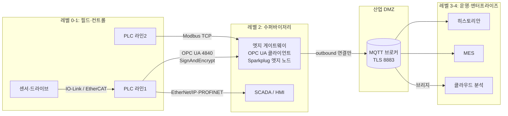

# OPC UA와 MQTT

제어망 안의 실시간 통신(필드버스·산업 이더넷)과 달리, OPC UA와 MQTT는 **PLC 데이터를 SCADA·MES·클라우드 같은 상위 시스템으로 올리는 통신**에 주로 씁니다. OPC UA는 "데이터에 의미(모델)를 붙여 안전하게 묻고 답하는" 방식이고, MQTT는 "브로커를 거쳐 가볍게 뿌리는" 방식입니다. 둘은 경쟁 관계라기보다 함께 쓰는 경우가 많습니다.

## OPC UA

OPC UA(Unified Architecture)는 OPC Foundation이 만든 플랫폼 독립 통신 규격이며 IEC 62541로 표준화되어 있습니다. Windows COM/DCOM에 묶여 있던 OPC Classic(DA·HDA·A&E)을 대체합니다.

| 항목 | 내용 |
| --- | --- |
| 주관·표준 | OPC Foundation, IEC 62541(OPC 10000 시리즈) |
| 기본 포트 | TCP 4840(IANA `opcua-tcp`, URL `opc.tcp://host:4840`). 4843은 `opcua-tls`로 등록 |
| 통신 모델 | 클라이언트·서버(요청-응답 + 구독), PubSub(Part 14) |
| 핵심 | 정보 모델(타입·관계가 있는 주소 공간), 내장 보안, 메서드 호출, 이력·알람 |
| 산업별 모델 | Companion Specification 150개 이상(공작기계, 로봇, 패키징, PackML 등) |

### 주소 공간과 노드

OPC UA 서버는 데이터를 평평한 태그 목록이 아니라 **노드(Node)와 참조(Reference)로 된 그래프**로 보여 줍니다.

```text
Objects
└─ Line1                     (Object, 타입: ConveyorType)
   ├─ Motor1                 (Object, 타입: MotorType)
   │  ├─ Speed     = 1450.0  (Variable, 단위 rpm, 범위 0~1800)
   │  ├─ Running   = true    (Variable)
   │  └─ Start()             (Method)
   └─ Motor2                 (MotorType의 같은 구조)
```

| 개념 | 설명 |
| --- | --- |
| NodeId | 노드의 고유 식별자. 예: `ns=2;s=Line1.Motor1.Speed` (네임스페이스 + 식별자) |
| NodeClass | Object, Variable, Method, ObjectType, VariableType, ReferenceType, DataType, View |
| 참조 | `HasComponent`, `HasProperty`, `HasTypeDefinition` 등 노드 사이 관계 |
| 타입 | `MotorType`을 한 번 정의하면 모든 모터가 같은 구조를 가짐. 클라이언트가 타입으로 탐색 가능 |
| 구독 | 클라이언트가 MonitoredItem을 등록하면 서버가 값이 바뀔 때만 알림. 샘플링·퍼블리싱 간격 설정 |

태그 값만 필요하면 Modbus로도 충분하지만, **단위·범위·구조·타입까지 함께 전달**해야 하는 상위 연동에서 OPC UA가 강합니다.

### 보안

| 항목 | 내용 |
| --- | --- |
| 보안 모드 | `None`(보안 없음), `Sign`(서명만), `SignAndEncrypt`(서명 + 암호화) |
| 보안 정책 | 현재 많이 쓰는 것: `Basic256Sha256`, `Aes128_Sha256_RsaOaep`, `Aes256_Sha256_RsaPss` |
| 폐기(deprecated) | `Basic128Rsa15`, `Basic256` (SHA-1 의존) |
| 애플리케이션 인증 | X.509 애플리케이션 인스턴스 인증서. 서로의 인증서를 신뢰 목록에 등록해야 연결 |
| 사용자 인증 | 익명, 사용자 이름·비밀번호, 인증서, 토큰 |

운영 시스템에서는 `None` 엔드포인트와 익명 로그인을 끄고 `SignAndEncrypt`만 남깁니다. 시운전 때 "일단 None으로 붙여 보고" 그대로 운영에 들어가는 경우가 흔한 사고 원인입니다(경험칙). 인증서 만료일도 관리 대상입니다.

### PubSub

클라이언트·서버는 1:1 세션이라 구독자가 많아지면 서버 부담이 커집니다. PubSub(Part 14)은 발행자가 구독자를 모른 채 메시지를 내보내는 방식입니다.

| 구분 | 1.05.06 기준 |
| --- | --- |
| 메시지 인코딩 | UADP(최적화된 바이너리, 메시지 보안 포함), JSON |
| 전송 매핑(규범) | OPC UA UDP, OPC UA Ethernet, MQTT |
| 참고(부속서) | AMQP, Kafka는 정보성 부속서에 있음 |

UDP·Ethernet 매핑은 제어망 안의 주기 통신(TSN 포함)에, MQTT 매핑은 브로커를 통한 상위 전송에 씁니다.

### OPC UA FX(Field eXchange)

OPC Foundation의 Field Level Communications(FLC) 이니셔티브가 OPC UA를 컨트롤러·필드 장치 사이 실시간 통신까지 확장하는 규격입니다.

| 항목 | 현황(2026-10 기준) |
| --- | --- |
| 구성 | Part 80(개요), 81(정보 모델·연결), 82(네트워킹), 83(오프라인 엔지니어링), 84(프로파일) |
| 버전 | Part 80 1.00.03(2025-07) |
| 범위 | 컨트롤러 간(C2C) 명세 완료 |
| 진행 중 | 컨트롤러-장치(C2D) 확장 릴리스 후보 준비 중(2026-06 발표), 최종 발행일은 미정 |

FX는 아직 제품이 적습니다. 신규 설계에서 FX를 전제로 하지 말고, 지원 제품과 인증 현황을 확인한 뒤 검토합니다.

## MQTT

MQTT는 브로커를 중심으로 한 경량 발행-구독(publish-subscribe) 프로토콜입니다. 장치는 브로커에만 연결하고, 서로를 알 필요가 없습니다.

```text
PLC 게이트웨이 ──publish──▶ [브로커] ──▶ SCADA (subscribe)
                                  ├──▶ 히스토리안
                                  └──▶ 클라우드
```

| 항목 | 내용 |
| --- | --- |
| 표준 | MQTT 3.1.1(OASIS, ISO/IEC 20922:2016), MQTT 5.0(OASIS Standard, 2019-03-07) |
| 포트 | TCP 1883(`mqtt`), TLS 8883(`secure-mqtt`) |
| 토픽 | `plant1/line1/motor1/speed`처럼 `/`로 구분. 구독 시 `+`(한 단계), `#`(하위 전체) 와일드카드 |
| 연결 방향 | 클라이언트가 브로커로 **나가는 연결**만 만들면 됨. OT에서 인바운드 포트를 열지 않아도 됨 |

### QoS, retained, LWT

| 기능 | 의미 | 산업 현장 쓰임 |
| --- | --- | --- |
| QoS 0 | 최대 한 번(At most once). 유실 가능 | 자주 갱신되는 측정값 |
| QoS 1 | 최소 한 번(At least once). 중복 가능 | 상태 변경, 명령(수신 측에서 중복 처리) |
| QoS 2 | 정확히 한 번(Exactly once). 오버헤드 큼 | 생산 수량 집계처럼 중복이 치명적인 경우 |
| Retained | 브로커가 토픽의 마지막 메시지를 보관했다가 새 구독자에게 즉시 전달 | 현재 상태·설정값 |
| LWT(Last Will) | 클라이언트가 비정상 종료하면 브로커가 대신 발행하는 메시지 | 게이트웨이 오프라인 감지 |

QoS는 **클라이언트와 브로커 사이 한 구간**의 보장입니다. 발행자 → 브로커 → 구독자 전체 경로의 보장은 양쪽 QoS 중 낮은 쪽을 따릅니다.

### MQTT 5에서 추가된 것

| 기능 | 쓰임 |
| --- | --- |
| Session Expiry Interval | 끊긴 뒤 세션 상태를 얼마나 보관할지 |
| Message Expiry Interval | 오래된 명령이 늦게 전달되지 않도록 메시지 수명 지정 |
| Reason Code | CONNACK·PUBACK·DISCONNECT 등에 실패 이유 코드 |
| Shared Subscription | 여러 구독자가 메시지를 나눠 받음(부하 분산) |
| Topic Alias | 긴 토픽 이름을 숫자로 대체해 패킷 축소 |
| User Property | 메시지에 이름-값 메타데이터 추가 |
| Request/Response | Response Topic, Correlation Data로 요청-응답 패턴 |
| Will Delay Interval | 짧은 재연결에는 LWT를 늦춰 오탐 방지 |

## Sparkplug B

순수 MQTT는 토픽 구조와 페이로드 형식을 정하지 않아, 회사마다 제각각인 JSON이 생깁니다. **Eclipse Sparkplug**는 산업용 MQTT의 토픽·페이로드·상태 관리 규칙을 정한 명세입니다.

| 항목 | 내용 |
| --- | --- |
| 주관 | Eclipse Foundation(Sparkplug Working Group) |
| 버전 | Sparkplug 3.0(2022). ISO/IEC 20237:2023으로 국제 표준화(2023년 11월 발표) |
| MQTT | MQTT 3.1.1 또는 5.0 |
| 페이로드 | Google Protocol Buffers(Sparkplug B 형식). 호스트 STATE 메시지만 JSON |
| 순서 번호 | `seq` 0~255 순환, 끊김 감지 / `bdSeq`로 birth·death 짝 맞춤 |

### 토픽 구조

```text
spBv1.0/{group_id}/{message_type}/{edge_node_id}/[{device_id}]
spBv1.0/STATE/{sparkplug_host_id}            ← 호스트 애플리케이션 상태(3.0)

예: spBv1.0/Plant1/DDATA/Gateway01/PLC_Line1
```

| 메시지 | 의미 | MQTT 설정 |
| --- | --- | --- |
| NBIRTH / DBIRTH | 엣지 노드 / 장치가 온라인. **모든 메트릭 이름·타입·현재값**을 한 번에 보냄 | QoS 0, retain false |
| NDATA / DDATA | 바뀐 값만 보냄(Report by Exception) | QoS 0, retain false |
| NDEATH | 엣지 노드 오프라인. CONNECT 시 MQTT Will로 등록 | QoS 1, retain false |
| DDEATH | 장치 오프라인(엣지 노드가 발행) | QoS 0, retain false |
| NCMD / DCMD | 상위에서 노드 / 장치로 명령 | QoS 0, retain false |
| STATE | Primary Host(SCADA 등) 온라인·오프라인 | QoS 1, retain true, JSON |

**birth/death 구조의 효과**: 구독자는 BIRTH로 전체 메트릭 목록과 현재값을 받고, 이후 DATA는 변경분만 받습니다. 게이트웨이가 끊기면 브로커가 NDEATH(Will)를 발행하므로 SCADA가 해당 값들을 즉시 "통신 불량(stale)"으로 표시할 수 있습니다. 엣지 노드는 Primary Host의 STATE가 오프라인인 동안 데이터를 엣지에 저장했다가 복구 후 보낼 수 있습니다(명세상 선택 사항, Store and Forward).

## Unified Namespace(UNS)

UNS는 **표준이 아니라 산업 IoT 커뮤니티에서 퍼진 아키텍처 개념**입니다. 공장 전체의 현재 상태를 하나의 브로커(또는 브로커 묶음)에 계층형 토픽으로 모아 두고, 모든 시스템이 점대점 연결 대신 그곳에 발행·구독하게 하자는 생각입니다.

```text
점대점 연결: SCADA↔PLC, MES↔PLC, MES↔ERP, 클라우드↔PLC ... (시스템 수의 제곱으로 증가)
UNS:        모든 시스템 ──▶ [브로커: acme/seoul/assembly/line1/robot2/...] ◀── 모든 시스템
```

| 원칙(경험칙) | 설명 |
| --- | --- |
| ISA-95 계층으로 토픽 설계 | 기업/사이트/구역/라인/셀 순서. 이름 규칙을 문서로 고정 |
| 현재 상태의 단일 출처 | 이력은 히스토리안·데이터 레이크가 UNS를 구독해 저장 |
| 엣지에서 발행 | 데이터가 생기는 곳에서 바로 발행(Report by Exception) |
| 느슨한 결합 | 새 시스템은 브로커에만 연결 |

주의할 점: Sparkplug의 토픽은 `group/edge/device` 3단계로 고정되어 있어 ISA-95식 깊은 계층과 그대로 맞지 않습니다. 그래서 "Sparkplug로 수집하고, 계층형 일반 MQTT 토픽으로 재발행"하거나 그룹·장치 이름에 계층을 녹이는 등 구현 방식이 다양합니다. 정답이 정해진 영역이 아니므로 팀 안에서 규칙을 정하고 문서화합니다(경험칙).

## IT/OT 연결 아키텍처 예시



- PLC와 직접 대화하는 것은 레벨 2의 게이트웨이·SCADA뿐입니다. 상위 시스템은 브로커만 봅니다.
- OT 쪽에서 DMZ 브로커로 **나가는 연결**만 허용하고, IT에서 OT로 들어오는 연결은 막는 구성이 일반적입니다(경험칙).
- 명령(쓰기)은 별도 승인 경로를 두거나 막습니다. 읽기 경로와 쓰기 경로의 보안 수준을 같게 보지 않습니다.

## OPC UA vs MQTT 선택

| 기준 | OPC UA(클라이언트·서버) | MQTT(+ Sparkplug) |
| --- | --- | --- |
| 통신 모델 | 클라이언트가 서버에 연결해 탐색·읽기·쓰기·구독 | 브로커 경유 발행·구독 |
| 데이터 의미 | 타입·단위·구조가 주소 공간에 포함 | 순수 MQTT는 없음. Sparkplug는 메트릭 이름·타입, 그 이상은 별도 규칙 |
| 연결 방향 | 클라이언트 → 서버(PLC). 방화벽 인바운드 필요 | 모두 브로커로 아웃바운드 |
| 확장성 | 서버당 세션 수 한계 | 구독자 추가가 쉬움 |
| 메서드·명령 | 메서드 호출, 쓰기 권한 세분화 | CMD 메시지, 응답 패턴은 직접 설계 |
| PLC 내장 지원 | 많은 최신 PLC가 OPC UA 서버 내장 | 일부 PLC·게이트웨이가 지원 |
| 잘 맞는 곳 | SCADA·MES의 구조화된 연동, 장비 간 표준 모델(Companion Spec) | 다수 사이트·클라우드 수집, UNS, 대역폭 제한 구간 |

실무에서는 **PLC ↔ 게이트웨이는 OPC UA, 게이트웨이 ↔ 상위는 MQTT**(Sparkplug)로 나누는 조합이 흔합니다(경험칙). OPC UA PubSub over MQTT로 둘을 합치는 방법도 있습니다.

## 보안 주의점

| 항목 | OPC UA | MQTT |
| --- | --- | --- |
| 전송 암호화 | `SignAndEncrypt`, 폐기 정책(`Basic128Rsa15`, `Basic256`) 비활성화 | TLS(8883). 평문 1883은 테스트 외 사용 금지 |
| 인증 | 애플리케이션 인증서 + 사용자 인증. 신뢰 목록 관리 | 클라이언트 인증서 또는 사용자·비밀번호, 클라이언트 ID 규칙 |
| 권한 | 노드별 읽기·쓰기 권한, 역할 | 브로커 ACL로 토픽별 발행·구독 권한 분리 |
| 운영 | 인증서 만료·폐기 목록, 익명 로그인 끄기 | 와일드카드 `#` 구독 권한 제한, 브로커 이중화 |
| 공통 | 제어망과 정보망 사이에 DMZ, 쓰기 경로 최소화, 감사 로그 |

자세한 영역·통로 설계는 [OT 보안](../safety/ot-security.md)을 참고합니다.

## 흔한 실수

| 실수 | 문제 | 대응 |
| --- | --- | --- |
| OPC UA `None` + 익명으로 운영 | 누구나 읽고 쓸 수 있음 | `SignAndEncrypt`만 허용, 사용자 인증 |
| 인증서 신뢰를 "모두 자동 수락"으로 설정 | 중간자 공격에 무방비 | 신뢰 목록을 수동 승인 |
| MQTT 토픽 이름을 사람마다 다르게 작성 | 구독 규칙이 깨지고 UNS가 무너짐 | 토픽 규칙 문서화, 게이트웨이에서 강제 |
| 모든 값을 고정 주기로 QoS 1·retain 발행 | 브로커·네트워크 부하 | 변경 시 발행, 측정값은 QoS 0 |
| LWT·death 처리 없음 | 게이트웨이가 죽어도 마지막 값이 정상처럼 보임 | LWT/NDEATH로 stale 표시 |
| MQTT로 인터록·안전 신호 전달 | 결정성·안전 등급 없음 | 제어·안전은 제어망·안전 프로토콜로 |

## 점검표

| 질문 |
| --- |
| OPC UA 엔드포인트에서 `None`·폐기 보안 정책·익명 로그인을 껐는가 |
| 인증서 신뢰 목록과 만료일을 관리하는 담당과 절차가 있는가 |
| MQTT 브로커가 TLS만 받고, 토픽별 ACL이 있는가 |
| OT에서 IT 방향 아웃바운드 연결만 열려 있는가 |
| 토픽·네임스페이스 이름 규칙을 문서로 정했는가 |
| 게이트웨이·장치 오프라인을 상위에서 즉시 알 수 있는가(LWT, NDEATH, 품질 코드) |
| 쓰기(명령) 경로를 읽기 경로와 분리해 통제하는가 |

## 참고 자료

- [OPC Foundation - OPC UA](https://opcfoundation.org/about/opc-technologies/opc-ua/) - 플랫폼 독립, 정보 모델, PubSub, 보안, Companion Specification 150개 이상
- [OPC 10000-4 MessageSecurityMode](https://reference.opcfoundation.org/Core/Part4/v105/docs/7.20) - None, Sign, SignAndEncrypt
- [IEC 62541-7:2020](https://webstore.iec.ch/publication/61116) - Basic128Rsa15·Basic256 폐기, Aes128-Sha256-RsaOaep·Aes256-Sha256-RsaPss 추가
- [Beckhoff TwinCAT OPC UA Server - 보안 정책](https://infosys.beckhoff.com/content/1033/ts6100_tc2_opcua_server/15563159819.html) - 폐기 정책 기본 비활성화 예
- [OPC 10000-14 PubSub 1.05.06](https://reference.opcfoundation.org/Core/Part14/v105/docs/7) - UADP·JSON, UDP·Ethernet·MQTT 매핑, AMQP·Kafka는 부속서
- [OPC 10000-80 UAFX](https://reference.opcfoundation.org/specs/OPC-10000-80) - 1.00.03(2025-07-17)
- [OPC Foundation - UAFX Specifications Released](https://opcconnect.opcfoundation.org/?p=3956) - Part 80/81/82/84 최초 공개(2022-12)
- [Field Level Communications Corner, June 2026](https://opcconnect.opcfoundation.org/2026/06/field-level-communications-corner-june-2026/) - C2C 완료, C2D 릴리스 후보 준비
- [IANA - opc](https://www.iana.org/assignments/service-names-port-numbers/service-names-port-numbers.xhtml?search=opc), [mqtt](https://www.iana.org/assignments/service-names-port-numbers/service-names-port-numbers.xhtml?search=mqtt) - 4840, 4843, 1883, 8883
- [MQTT Version 5.0 (OASIS)](https://docs.oasis-open.org/mqtt/mqtt/v5.0/mqtt-v5.0.html) - 2019-03-07, QoS, Will, MQTT 5 신규 기능
- [ISO/IEC 20922:2016](https://www.iso.org/standard/69466.html) - MQTT 3.1.1
- [Eclipse Sparkplug Specification](https://sparkplug.eclipse.org/specification/) - 3.0, [3.0.0 PDF](https://sparkplug.eclipse.org/specification/version/3.0/documents/sparkplug-specification-3.0.0.pdf) - 토픽, 메시지 유형별 QoS·retain, STATE JSON, seq 0~255, MQTT 3.1.1/5.0
- [Eclipse Foundation - Sparkplug as an International Standard](https://newsroom.eclipse.org/node/39754) - ISO/IEC 20237:2023

확인일: 2026-10-21 (포트·표준 번호·보안 모드·정책 폐기 여부·PubSub 매핑·UAFX 현황·Sparkplug 규칙을 확인. Basic256Sha256의 현재 상태는 벤더 문서로만 확인. UNS와 아키텍처·선택 기준은 경험칙)

관련: [산업 이더넷](./industrial-ethernet.md), [메시지 큐](../../Backend/messaging/message-queue.md), [태그와 SCADA 구조](../hmi-scada/tags-and-architecture.md), [OT 보안](../safety/ot-security.md)

다음: [HMI·SCADA](../hmi-scada/README.md)
