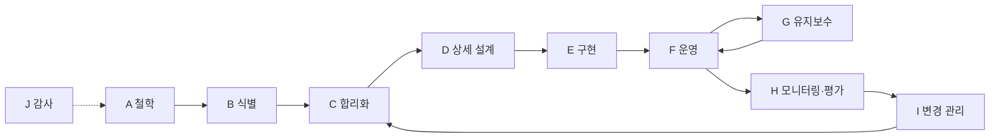
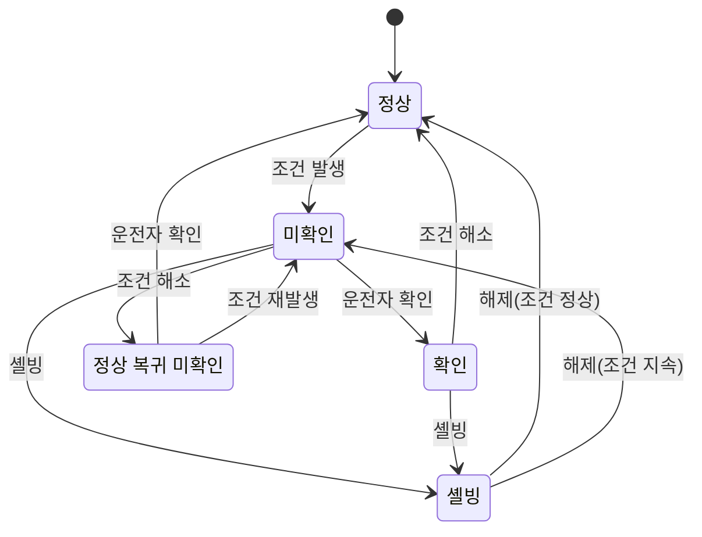

# 알람 관리

알람은 **운전자에게 제때 조치가 필요한 비정상 상태를 알리는 수단**입니다. 알람이 너무 많으면 운전자는 중요한 알람을 놓치고, 결국 모든 알람을 습관적으로 확인만 누르게 됩니다. 알람 관리는 "무엇을 알람으로 만들지"부터 "운영 중 지표를 보고 고치기"까지의 생애주기 활동입니다.

## 관련 표준

| 표준 | 내용 | 확인 시점 상태 |
| --- | --- | --- |
| ANSI/ISA-18.2-2016 | 공정 산업 알람 시스템 관리. 2009년 초판을 대체 | ISA 페이지에 2016판 게시 |
| IEC 62682:2022 (2판) | ISA-18.2와 같은 계열의 국제 표준. 2014년 1판을 대체 | 유럽판 EN IEC 62682:2023 |
| EEMUA 191 4판(2024) | 알람 시스템 설계·관리·구매 지침. 원격 사이트 내용 추가 | 2013년 3판을 대체 |
| ISA-TR18.2.1~TR18.2.8 | 철학, 식별·합리화, 기본 설계, 고급 기법, 모니터링, 배치·이산 공정, 패키지 설비, 비알람 알림 | 기술 보고서 |

표준은 유료입니다. 아래 수치는 표준을 요약한 공개 자료에서 가져왔고, 각 항목에 출처를 적었습니다.

## 알람의 정의

ISA-18.2의 알람은 설비 고장, 공정 이탈, 비정상 상태를 운전자에게 알리며 **시기적절한 대응이 필요한 것**입니다. 이 정의에서 나오는 실무 규칙은 다음과 같습니다.

| 질문 | 아니면 |
| --- | --- |
| 운전자가 할 수 있는 조치가 있는가 | 알람이 아님. 이벤트·로그로 |
| 그 조치가 지금(정해진 시간 안에) 필요한가 | 정비 알림·보고서로 |
| 다른 알람이 이미 같은 상황을 알리고 있지 않은가 | 중복. 대표 알람 하나로 |
| 정상 운전 중에도 늘 울리지 않는가 | 한계값·설계 재검토 |

"모터 기동됨", "배치 완료" 같은 상태 변화는 알람이 아니라 이벤트입니다. ISA-TR18.2.8(비알람 알림 지침)이 이 구분을 다룹니다.

## 생애주기

ISA-18.2는 알람 관리를 A~J의 10단계 생애주기로 봅니다.



| 단계 | 하는 일 |
| --- | --- |
| A 철학(Philosophy) | 알람의 정의, 우선순위 기준, 색·소리, 역할과 책임, 성능 목표를 문서화 |
| B 식별(Identification) | 위험성 평가(HAZOP 등), 사고 조사, 운전 경험에서 알람 후보 수집 |
| C 합리화(Rationalization) | 후보마다 필요성·원인·결과·조치·대응 시간·우선순위·한계값을 검토해 확정 |
| D 상세 설계 | 데드밴드·지연·억제 로직, HMI 표시 설계 |
| E 구현 | 설정·시험·교육 |
| F 운영 | 운전자 대응, 셸빙 사용 |
| G 유지보수 | 계기 고장·정비 중 서비스 제외 관리 |
| H 모니터링·평가 | 지표 측정, 나쁜 알람(잦은·채터링·장기 활성) 찾기 |
| I 변경 관리(MOC) | 알람 추가·삭제·한계 변경을 승인 절차로 |
| J 감사 | 철학과 실제 운영이 맞는지 주기적으로 점검 |

## 알람 철학 문서

| 목차 | 내용 예 |
| --- | --- |
| 목적·범위 | 대상 시스템(PLC, DCS, 패키지 설비, SIS 알람 표시) |
| 알람 정의 | "운전자 조치가 필요한 것만" 원칙, 이벤트·알림과의 구분 |
| 우선순위 | 3~4단계, 결과 심각도 × 허용 대응 시간 매트릭스 |
| 표시 | 우선순위별 색·아이콘·소리, 미확인 깜박임 규칙 |
| 셸빙·억제 | 누가, 얼마 동안, 어떤 승인으로 |
| 성능 목표 | 운전자당 알람 수, 홍수 기준, 장기 활성 알람 수 |
| 역할 | 운전자, 운전 책임자, 엔지니어, 정비의 권한 |
| 변경 관리 | 알람 추가·변경 승인 절차, 문서(마스터 알람 DB) 갱신 |
| 교육·감사 | 신규 운전자 교육, 감사 주기 |

## 우선순위

우선순위는 **결과의 심각도**와 **운전자가 대응할 수 있는 시간**으로 정합니다. 매트릭스의 세부 값은 사업장 철학 문서에서 정합니다(아래는 예).

| 허용 대응 시간 \ 결과 심각도 | 경미 | 중대 | 심각 |
| --- | --- | --- | --- |
| 30분 초과 | 알람 아님(재검토) | 알람 아님(재검토) | 알람 아님(재검토) |
| 10~30분 | 낮음 | 낮음 | 중간 |
| 3~10분 | 낮음 | 중간 | 높음 |
| 3분 미만 | 중간 | 높음 | 높음 |

| 우선순위 분포 목표 | 3단계 | 4단계 |
| --- | --- | --- |
| 낮음 | 약 80% | 약 80% |
| 중간 | 약 15% | 약 15% |
| 높음 | 약 5% | 약 5% |
| 최상위 | - | 1% 미만 |

분포 목표는 ISA-18.2(2009판) 성능 지표 표를 인용한 Siemens 기사 기준입니다. "높음"이 많으면 우선순위가 의미를 잃습니다.

## 성능 지표

아래는 ISA-18.2(2009판)의 성능 지표 표를 인용한 공개 자료 값입니다. 최소 30일 데이터를 기준으로 운전자 한 명(운전 위치 하나)에 대해 측정합니다.

| 지표 | 목표 |
| --- | --- |
| 하루 알람 수 | 약 150 (수용 가능성 높음), 약 300 (관리 가능한 최대) |
| 시간당 평균 알람 수 | 약 6 / 최대 약 12 |
| 10분당 평균 알람 수 | 약 1 / 최대 약 2 |
| 알람이 30개를 넘은 시간(hour) 비율 | 1% 미만 |
| 알람이 10개를 넘은 10분 구간 비율 | 1% 미만 |
| 10분 구간 최대 알람 수 | 10 이하 |
| 홍수(flood) 상태 시간 비율 | 1% 미만 |
| 상위 10개 잦은 알람이 전체에서 차지하는 비율 | 최대 1~5%, 초과 시 조치 계획 |
| 채터링·순간(fleeting) 알람 | 0, 발생 시 조치 계획 |
| 장기 활성(stale) 알람 | 하루 5개 미만, 조치 계획 |
| 승인 절차 밖 억제 | 0 |
| 변경 관리 밖 알람 속성 변경 | 0 |

| 용어 | 뜻 |
| --- | --- |
| 홍수(flood) | 운전자가 처리할 수 있는 수준을 넘는 알람 폭주. 위 지표는 10분에 10개 초과로 측정 |
| 채터링(chattering) | 짧은 시간에 알람·정상을 반복. 실무 판정 예: 60초 안에 3회 이상(경험칙, 출처마다 다름) |
| 순간(fleeting) 알람 | 매우 짧게 울렸다가 사라지는 알람. 운전자가 조치할 시간이 없음 |
| 장기 활성(stale) 알람 | 24시간 넘게 계속 활성인 알람 |
| 상시(standing) 알람 | 특정 시점에 활성 상태로 남아 있는 알람. 개수 목표는 철학 문서에서 정함 |

공개 자료에 따르면 많은 제어실이 분당 약 1개의 알람을 겪고, 전체 알람의 최대 80%가 10~20개 태그에서 나오기도 합니다. 그래서 **상위 잦은 알람(bad actor) 목록을 매주 보고 위에서부터 고치는 것**이 가장 효과가 큽니다(경험칙).

## 알람 상태

ISA-18.2 상태도의 상태와 의미입니다(공개된 구현 자료 기준 요약).

| 상태 | 공정 조건 | 확인 여부 | 표시 예 |
| --- | --- | --- | --- |
| 정상(Normal) | 정상 | - | 표시 없음 |
| 미확인(Unacknowledged) | 비정상 | 미확인 | 깜박임 + 소리 |
| 확인(Acknowledged) | 비정상 | 확인 | 정지된 알람 색 |
| 정상 복귀 미확인(RTN Unacknowledged) | 정상 | 미확인 | 별도 표시 또는 자동 소거(철학에 따라) |
| 래치(Latched) | 조건이 정상으로 돌아와도 리셋 전까지 유지 | 미확인·확인 | 리셋 필요 표시 |
| 셸빙(Shelved) | 운전자가 통제된 방법으로 일시 숨김 | - | 셸빙 목록에 표시 |
| 설계상 억제(Suppressed by Design) | 운전 모드·설비 상태 로직이 억제 | - | 억제 목록에 표시 |
| 서비스 제외(Out of Service) | 정비가 서비스에서 제외 | - | 서비스 제외 목록에 표시 |

아래 그림은 주요 전이만 남긴 단순화 버전입니다. 래치·설계상 억제·서비스 제외는 생략했습니다.



셸빙·설계상 억제·서비스 제외는 **통제 주체**가 다릅니다.

| 구분 | 통제 주체 | 예 | 안전장치 |
| --- | --- | --- | --- |
| 셸빙 | 운전자 | 고장 난 계기의 알람을 교대 근무 동안 숨김 | 시간 제한(자동 해제), 셸빙 목록, 책임자 승인 |
| 설계상 억제 | 로직 | 설비 정지 중 저유량 알람 억제, 상위 알람 발생 시 하위 알람 억제 | 억제 조건 문서화, 억제 목록 표시 |
| 서비스 제외 | 정비 | 계기 교체 중 | 작업 허가와 연계, 복귀 확인 |

OPC UA Alarms & Conditions(Part 9)도 셸빙·억제·서비스 제외 상태를 정의합니다. 이 상태의 알람은 비활성화(Disabled)와 달리 계속 평가되고, 클라이언트에 알림으로 전달될 수 있습니다. OPC UA는 [OPC UA와 MQTT](../communication/opc-ua-and-mqtt.md)를 참고합니다.

## 알람 합리화

합리화는 알람 후보 하나하나를 운전·공정·안전 담당자가 함께 검토하는 작업입니다. 결과는 **마스터 알람 데이터베이스**에 남깁니다.

| 항목 | 예 |
| --- | --- |
| 태그·알람 유형 | LT-201 / PVHI |
| 원인 | 출구 밸브 막힘, 유입 증가 |
| 결과(조치 안 할 때) | 탱크 넘침, 환경 사고 |
| 운전자 조치 | 유입 펌프 감속, 출구 밸브 확인 |
| 허용 대응 시간 | 10분 |
| 우선순위 | 중간 |
| 한계값·데드밴드·지연 | 85%, 2%, 5초 |
| 근거 | HAZOP 항목 번호 |
| 억제 조건 | 탱크 정비 모드일 때 |

합리화 중에 원인·결과·조치를 적지 못하는 알람은 삭제 후보입니다.

## PLC 측 구현 팁

알람 대부분은 PLC 또는 SCADA 서버에서 만들어집니다. 생성 단계에서 잡음을 줄이는 것이 가장 효과적입니다.

| 기법 | 목적 | 메모 |
| --- | --- | --- |
| 데드밴드(히스테리시스) | 한계값 근처 잡음으로 인한 채터링 방지 | 알람은 85%에서 발생, 83%로 내려가야 해제 |
| 발생 지연(on-delay) | 짧은 튐으로 인한 순간 알람 방지 | 조건이 N초 지속될 때만 발생 |
| 해제 지연(off-delay) | 빠른 반복 해제·재발생 방지 | 정상이 N초 지속될 때만 해제 |
| 상태 기반 억제 | 정지·기동·세척 모드에서 무의미한 알람 차단 | 모드 태그를 조건으로 사용 |
| 1차 원인(first-out) | 트립 시 최초 원인 하나만 표시 | 연쇄 알람 중 첫 번째를 래치 |
| 계기 고장 분리 | 신호 이상(단선·범위 밖)은 공정 알람과 구분 | 4-20 mA 범위 밖 → 계기 고장 알람 |
| 알람 그룹화 | 같은 원인의 여러 알람을 대표 알람 하나로 | 하위 알람은 상세 화면에서 |

신호 종류별 데드밴드 시작값으로는 EEMUA 191을 인용한 다음 값이 자주 쓰입니다(exida 인용). 공정 특성에 맞게 조정하는 출발점입니다.

| 신호 | 데드밴드(측정 범위 대비) |
| --- | --- |
| 유량 | 5% |
| 레벨 | 2% |
| 압력 | 2% |
| 온도 | 1% |
| 성분 | 1% |

지연 시간의 표준 시작값은 공개 자료마다 달라 여기서는 제시하지 않습니다(미확인). 신호 응답 속도와 허용 대응 시간을 보고 정합니다.

```text
// 구조화 텍스트(ST) 예: 데드밴드 + 발생 지연 + 해제 지연
// tonOn, tonOff: TON 타이머 인스턴스
tonOn(IN := (Level >= HiLimit) AND NOT AlmHi, PT := T#5S);
tonOff(IN := (Level < HiLimit - Deadband) AND AlmHi, PT := T#3S);

IF tonOn.Q THEN
    AlmHi := TRUE;
ELSIF tonOff.Q THEN
    AlmHi := FALSE;
END_IF;

// 정비 모드에서는 설계상 억제
AlmHiAnnunciate := AlmHi AND NOT MaintMode;
```

```text
// 1차 원인(first-out) 래치 예
IF NOT TripActive THEN
    FirstOut := 0;
ELSIF FirstOut = 0 THEN
    IF    HighPress THEN FirstOut := 1;
    ELSIF LowFlow   THEN FirstOut := 2;
    ELSIF HighTemp  THEN FirstOut := 3;
    END_IF;
END_IF;
```

같은 스캔에 여러 조건이 동시에 들어오면 위 코드는 IF 순서가 우선순위가 됩니다. 정확한 순서가 중요하면 입력 모듈의 타임스탬프(SOE, Sequence of Events) 기능을 씁니다. 스캔 주기와 타이밍은 [스캔 사이클](../basics/scan-cycle.md), ST 문법은 [IEC 61131-3](../programming/iec-61131-3.md)을 참고합니다.

## HMI 표시

| 요소 | 규칙 |
| --- | --- |
| 알람 배너 | 모든 화면 상단·하단 고정. 최신·최고 우선순위 알람 |
| 알람 목록 | 우선순위·시간 정렬, 필터, 해당 화면으로 이동 |
| 색 | 우선순위별 고유 색. 이 색을 다른 용도에 쓰지 않음 |
| 모양 | 우선순위별 아이콘 모양을 다르게(색각 이상 대비) |
| 소리 | 우선순위별 다른 소리. 확인 또는 소음(silence)으로 정지 |
| 깜박임 | 미확인일 때만 |
| 셸빙·억제 목록 | 별도 화면에서 항상 조회 가능. 숨긴 알람이 잊히지 않게 |

화면 설계 전반은 [HMI 화면 설계](./hmi-design.md)를 참고합니다.

## 흔한 실수

| 실수 | 결과 | 대응 |
| --- | --- | --- |
| 모든 상태 변화를 알람으로 | 알람 홍수, 습관적 확인 | 이벤트·로그와 분리 |
| 계기 하나에 HH·H·L·LL 기본 생성 | 쓸모없는 알람 대량 생성 | 합리화로 필요한 것만 |
| 셸빙에 시간 제한이 없음 | 숨긴 알람이 영구히 잊힘 | 자동 해제, 교대 인수인계 항목 |
| 우선순위 "높음" 남발 | 우선순위 무의미 | 분포 지표 모니터링 |
| 데드밴드·지연 0 | 채터링 | 신호 종류별 기본값 |
| 알람 한계를 운전자가 임의 변경 | 근거 없는 한계, 사고 위험 | 권한 분리, 변경 관리 |
| 알람 이력을 남기지 않음 | 지표 측정 불가 | 알람·이벤트 DB에 저장 |

## 점검표

| 질문 |
| --- |
| 알람 철학 문서가 있고, 우선순위 기준과 성능 목표가 적혀 있는가 |
| 모든 알람에 원인·결과·운전자 조치·대응 시간이 기록되어 있는가 |
| 운전자당 하루·10분당 알람 수와 홍수 시간 비율을 주기적으로 측정하는가 |
| 상위 잦은 알람, 채터링, 장기 활성 알람 목록을 보고 고치는 담당자가 있는가 |
| 셸빙에 시간 제한과 목록 화면이 있는가 |
| 정지·정비 모드에서 무의미한 알람이 억제되는가 |
| 알람 추가·한계 변경이 변경 관리 절차를 거치는가 |
| 우선순위가 색과 모양 두 가지로 구분되는가 |

## 참고 자료

- [ISA-18 Series of Standards](https://www.isa.org/standards-and-publications/isa-standards/isa-18-series-of-standards) - ANSI/ISA-18.2-2016, TR18.2.1~TR18.2.8 목록과 연도
- [IEC 62682:2022](https://webstore.iec.ch/publication/65543) - 2판, 적용 범위
- [IEC 62682:2022 CMV](https://webstore.iec.ch/publication/80816) - 2014년 1판 대비 해설판
- [EEMUA releases guidance on industrial alarm systems (2024-12-10)](https://operationsengineer.org.uk/plant-engineer-news/eemua-releases-guidance-on-industrial-alarm-systems/254082) - EEMUA 191 4판 발행, 원격 사이트 내용 추가
- [Improving alarm management with ISA-18.2: Part 2 (Process Online, Siemens, 2014)](https://www.processonline.com.au/content/software-it/article/improving-alarm-management-with-isa-18-2-part-2-1141142642) - ISA-18.2(2009판) 성능 지표 표, 우선순위 분포, 장기 활성 정의
- [Implementing Alarm Management per the ANSI/ISA-18.2 Standard (Yokogawa, Control Engineering 2013 재게재)](https://www.yokogawa.com/de/library/resources/media-publications/implementing-alarm-management-per-the-ansi-isa-182-standard-control-engineering/) - 하루·시간·10분당 알람 목표, 생애주기 A~J
- [Why Should I Use an Alarm Deadband? (exida, 2020)](https://www.exida.com/Blog/why-should-i-use-an-alarm-deadband) - EEMUA 191 인용 신호별 데드밴드
- [OPC 10000-9 Alarms and Conditions 4.8](https://reference.opcfoundation.org/Core/Part9/4.8) - 셸빙·억제·서비스 제외와 Disabled의 차이, 래치
- [ISA 18.2 Alarm State Transition Diagram (ICONICS)](https://documentation.iconics.com/v10.97.3/Content/Alarming/Alarm%20Server/Alarm%20References/alarm-state-transition-diagram.htm) - ISA-18.2 상태 목록 구현 예

확인일: 2026-10-21 (표준 판·연도, 성능 지표·우선순위 분포·데드밴드 값과 그 출처, 알람 상태 목록 확인. 성능 지표는 2009판 표를 인용한 2차 자료이며 2016판 원문과 대조하지 못함. 우선순위 매트릭스 값, 채터링 판정 기준, ST 예시는 예시·경험칙)

관련: [HMI 화면 설계](./hmi-design.md), [태그와 SCADA 구성](./tags-and-architecture.md), [기능 안전](../safety/functional-safety.md), [로깅](../../Backend/logging/logging.md)

다음: [태그와 SCADA 구성](./tags-and-architecture.md)
