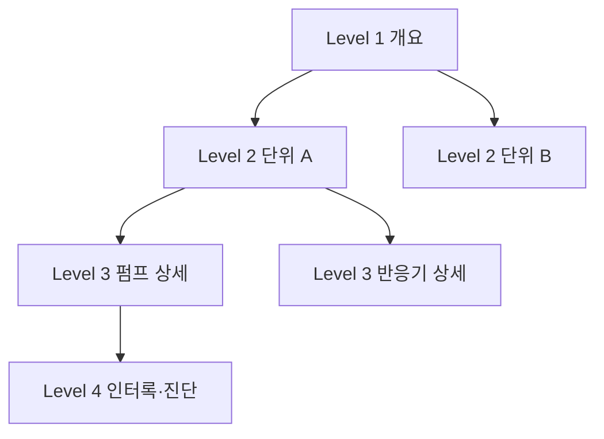

# HMI 화면 설계

HMI(Human-Machine Interface)는 운전자가 설비 상태를 보고 조작하는 화면입니다. 좋은 HMI는 **정상일 때는 조용하고, 이상이 생기면 바로 눈에 띄며, 실수로 잘못 누르기 어렵습니다.** 이 문서는 HMI·SCADA·MES의 구분, ISA-101 계열 표준과 고성능(High Performance) HMI 원칙, 운전자 조작 설계, 흔한 안티패턴을 정리합니다.

## HMI·SCADA·MES 구분

| 구분 | 주 역할 | 범위 | 시간 단위 | 예 |
| --- | --- | --- | --- | --- |
| HMI | 설비 한 대·한 라인의 감시와 조작 | 패널 PC·터치 패널, 기계 옆 | 초 이하 | 기계 조작반, 로컬 패널 |
| SCADA | 여러 PLC·현장을 모아 감시·제어, 알람·이력 저장 | 공장·원격 사이트 전체 | 초~분 | 정수장 중앙 감시, 공장 중앙 제어실 |
| MES | 생산 지시·실적·품질·추적 관리 | 공장 운영 | 분~교대 | 작업 지시, LOT 추적, OEE |

ISA-95(IEC 62264)는 제조 시스템을 계층으로 나눕니다. Level 0은 물리 공정, Level 1은 센서·액추에이터, Level 2는 감시·제어, Level 3은 제조 운영 관리(MES), Level 4는 ERP 같은 사업 계획입니다. SCADA는 흔히 Level 2로 설명하지만, ISA의 ISA-95 소개 페이지는 Level 3 예시에 MES와 함께 SCADA를 올려 둡니다. 경계는 조직마다 다르므로 "어느 시스템이 무엇을 책임지는가"를 문서로 정해 두는 것이 더 중요합니다.

```text
Level 4  ERP (사업 계획·물류)
Level 3  MES · 히스토리안 · (SCADA)
Level 2  SCADA · HMI · PLC/DCS 감시 제어
Level 1  센서 · 밸브 · 드라이브
Level 0  물리 공정
```

PLC 쪽 구조는 [PLC 구조](../basics/plc-architecture.md), 통신 계층은 [OPC UA와 MQTT](../communication/opc-ua-and-mqtt.md)를 참고합니다.

## 관련 표준

| 표준 | 내용 | 확인 시점 상태 |
| --- | --- | --- |
| ANSI/ISA-101.01-2015 | 공정 자동화용 HMI 표준. 철학·설계·구현·운영·유지보수 생애주기 | ISA 페이지에 2015판만 게시 |
| ISA-TR101.01-2022 | HMI 철학(Philosophy) 작성 지침 | 기술 보고서 |
| ISA-TR101.02-2019 | HMI 사용성과 성능 | 기술 보고서 |
| IEC 63303:2024 | ISA-101을 바탕으로 한 국제 표준. HMI 구조·기능, 생애주기 단계별 요구사항 | 2024-08 1판 발행 |
| ANSI/ISA-18.2-2016, IEC 62682:2022 | 알람 관리. HMI의 알람 표시와 직결 | [알람 관리](./alarm-management.md) 참고 |
| ISO 11064 | 제어실·콘솔 인간공학 | 화면 밖 물리 환경 |

ISA-101은 **무엇을 해야 하는지**(철학 문서, 스타일 가이드, 생애주기)를 정하고, **어떻게**는 기술 보고서로 넘겼습니다. 표준 자체가 "배경은 회색, 색은 몇 개" 같은 구체 값을 정하는 것은 아닙니다. 아래 원칙은 표준의 요구사항이라기보다 고성능 HMI 실무(The High Performance HMI Handbook, ASM Consortium 지침 등)에서 정착한 관행입니다.

## HMI 생애주기와 문서 3종


| 문서 | 담는 것 | 예 |
| --- | --- | --- |
| HMI 철학 | 원칙과 이유. 사업장 전체에 공통 | "색은 비정상 상태에만", 화면 계층, 권한 원칙 |
| 스타일 가이드 | 철학을 특정 플랫폼에 적용한 규칙 | 색 팔레트 값, 글꼴, 아이콘, 화면 크기, 내비게이션 위치 |
| 툴킷 | 재사용 객체 라이브러리 | 밸브·모터·아날로그 표시기 심볼, 페이스플레이트, 템플릿 |

툴킷은 [태그와 SCADA 구성](./tags-and-architecture.md)의 UDT(사용자 정의 데이터 타입)와 짝을 이룹니다. UX 쪽 개념으로는 [디자인 시스템](../../UX/systems/design-system.md)과 같습니다.

## 고성능 HMI 원칙

고성능 HMI의 목표는 **원시 데이터가 아니라 정보**를 보여 주는 것입니다. 숫자를 읽고 머릿속에서 비교하게 하지 말고, 정상 범위 대비 위치를 그림으로 보여 줍니다.

| 원칙 | 하는 것 | 하지 않는 것 |
| --- | --- | --- |
| 차분한 배경 | 채도 낮은 밝은 회색 계열 배경, 정적 배관·설비는 진회색 | 검정 배경, 사진·그라데이션 배경 |
| 색은 의미에만 | 알람·비정상 상태에만 눈에 띄는 색. 알람 색은 다른 곳에 쓰지 않음 | 장식용 색, 정상 운전 중 펌프를 초록으로 가득 칠하기 |
| 아날로그 표시 | 정상·경고 범위를 띠로 표시한 막대·게이지, 범위 이탈 시 강조 | 숫자만 나열 |
| 추세 내장 | 핵심 변수 옆에 짧은 추세(스파크라인) | 추세를 별도 화면에만 둠 |
| 낮은 잡음 | 필요한 정보만, 같은 정보 반복 금지 | 모든 계기·배관을 그대로 표시 |
| 일관성 | 같은 객체는 어디서나 같은 모양·위치·동작 | 화면마다 다른 버튼 위치 |

"고성능 HMI = 모든 색을 빼고 흑백으로"라는 이해는 오해입니다. Control Engineering 원탁 토론에서 Bill Hollifield(The High Performance HMI Handbook 공저자)는 색을 없애는 것이 아니라 효과적으로 쓰는 것이라고 설명합니다. 주변 조명에서 충분한 대비를 확보한 뒤 색으로 의미와 강조를 더하는 것이 핵심입니다.

### 아날로그 표시기 예

```text
반응기 온도  TI-101
  [■■■■■■■■■|□□□□□□] 182.4 °C
   ↑LL  ↑L  [정상 범위]  ↑H  ↑HH

정상: 회색 막대 + 회색 숫자
H 초과: 막대 끝과 숫자에 알람 색 + 알람 우선순위 아이콘
```

| 표시 방법 | 장점 | 쓸 곳 |
| --- | --- | --- |
| 막대·게이지 + 범위 띠 | 정상 여부를 한눈에 판단 | 레벨·온도·압력 등 핵심 변수 |
| 스파크라인(짧은 추세) | 방향과 속도를 보여 줌 | 천천히 변하는 공정 변수 |
| 숫자 | 정확한 값 | 설정값 입력, 상세 화면 |
| 상태 텍스트 + 아이콘 | 색 없이도 상태 구분 | 모터·밸브 운전 상태 |

## 화면 계층(Level 1~4)

ISA-101 해설 자료와 고성능 HMI 실무에서 쓰는 4단계 계층입니다. 이름은 자료마다 조금씩 다르고, 모든 설비가 4단계를 다 필요로 하지는 않습니다.

| 레벨 | 이름 | 목적 | 조작 |
| --- | --- | --- | --- |
| 1 | 개요(Overview) | 운전자 담당 영역 전체의 상황 인식. KPI, 영역별 알람 수 | 보통 조작하지 않음 |
| 2 | 공정 단위(Process Unit) | 한 공정 단위의 주 운전 화면 | 대부분의 일상 조작 |
| 3 | 단위 상세(Unit Detail) | 설비·제어 루프 상세 진단. 계기 전체, 인터록 상태 | 상세 조작 |
| 4 | 지원·진단(Support/Diagnostic) | 개별 센서·구성품, 인터록 로직, 페이스플레이트, 도움말 | 점검·정비 |



## 내비게이션

| 규칙 | 설명 |
| --- | --- |
| 고정 영역 | 상단 또는 하단에 알람 배너, 현재 위치(브레드크럼), 사용자·시간을 항상 표시 |
| 3클릭 이내(경험칙) | 어떤 운전 화면이든 개요에서 몇 번 안에 도달 |
| 알람에서 화면으로 | 알람 목록에서 해당 설비 화면으로 바로 이동 |
| 뒤로·홈 | 이전 화면, Level 1로 한 번에 복귀 |
| 팝업 남용 금지 | 페이스플레이트 팝업은 한두 개까지. 겹친 팝업이 공정을 가리지 않게 |

정보 구조 설계 일반은 [정보 구조](../../UX/foundations/information-architecture.md)를 참고합니다.

## 운전자 조작 설계

화면 조작은 실제 설비를 움직입니다. "잘못 누르기 어렵게"가 기본입니다.

| 조작 유형 | 권장 방식 |
| --- | --- |
| 일상 조작(설정값 변경) | 입력 범위 제한(엔지니어링 한계), 변경 전·후 값 표시, 확인 |
| 중요 조작(기동·정지, 모드 전환) | 2단계 조작: 대상 선택 → 동작 버튼, 또는 선택 → 실행 |
| 위험 조작(바이패스, 강제) | 확인 대화상자 + 사유 입력 + 권한 확인, 감사 로그 기록 |
| 연속 조작(조그, 수동 밸브 개도) | 누르는 동안만 동작(모멘터리), 손을 떼면 정지 |

| 확인 대화상자 규칙 | 이유 |
| --- | --- |
| 무엇을 어떻게 바꾸는지 구체적으로 표시 ("P-101 펌프 정지") | "계속하시겠습니까?"는 습관적으로 누름 |
| 기본 포커스는 취소 쪽 | 연타 실수 방지 |
| 자주 쓰는 일상 조작에는 쓰지 않음 | 대화상자 피로 → 위험 조작에서도 무시 |

### 권한

| 역할 | 예 |
| --- | --- |
| 조회 | 화면 보기, 추세 보기 |
| 운전자 | 기동·정지, 설정값 변경, 알람 확인 |
| 운전 책임자 | 알람 셸빙 승인, 모드 전환 |
| 엔지니어 | 알람 한계·튜닝 값 변경, 화면 수정 |
| 정비 | 바이패스·강제, 알람 서비스 제외 |

- 공용 계정 하나로 모두 로그인하는 구성을 피합니다. 누가 무엇을 바꿨는지 감사 로그에 남아야 합니다.
- **HMI 조작은 안전 기능을 대신하지 않습니다.** 비상정지와 안전 인터록은 하드와이어 또는 안전 PLC로 구현합니다. 자세한 내용은 [비상정지와 인터록](../safety/emergency-stop-and-interlock.md)을 참고합니다.
- 원격 접속과 계정 관리는 [OT 보안](../safety/ot-security.md)을 참고합니다.

## 터치 패널과 현장 환경

| 고려 사항 | 설계 |
| --- | --- |
| 장갑 | 버튼을 크게, 간격을 넓게. 작업 장갑 기준으로 손가락 끝보다 넉넉하게(경험칙: 최소 15~20 mm 이상) |
| 터치 방식 | 정전식(PCAP)은 장갑·물기에서 오동작할 수 있어 장갑 모드 지원 여부 확인. 저항막은 장갑에 강하지만 멀티터치·내구성 제약 |
| 거리 | 서서 보는 거리, 위에서 내려다보는 각도에서 글자 크기 확인 |
| 조명 | 직사광선·어두운 제어실 모두에서 대비 확인. 햇빛 아래 패널은 고휘도 제품 |
| 진동·오조작 | 화면 가장자리에 위험 버튼을 두지 않음. 드래그·스와이프 조작은 피함 |
| 호버 없음 | 터치에는 마우스 오버가 없음. 툴팁에만 정보를 숨기지 않음 |

## 색각 이상과 색 외 수단

미국 국립안과연구소(NEI)에 따르면 남성 약 12명 중 1명이 색각 이상입니다. 교대 근무 운전자 중 누군가는 빨강·초록을 구분하지 못한다고 가정합니다.

| 상태 | 색 외 수단 |
| --- | --- |
| 알람 우선순위 | 우선순위마다 다른 모양 아이콘(예: 삼각형·사각형·원) + 숫자·문자 |
| 모터 운전·정지 | 채움/비움, "RUN"/"STOP" 텍스트 |
| 밸브 열림·닫힘 | 심볼 모양 변화, 개도 % 표시 |
| 미확인 알람 | 깜박임(확인 전까지만) + 아이콘 |

웹 UI의 대비 기준과 색 토큰은 [색상](../../UX/visual/color.md), 상태 표현 일반은 [피드백과 상태](../../UX/components/feedback-and-states.md)를 참고합니다.

## 다국어

| 항목 | 설계 |
| --- | --- |
| 텍스트 길이 | 영어 대비 독일어 등은 길어짐. 라벨 영역에 여유 |
| 태그명 | 태그·계기 번호는 번역하지 않음 |
| 알람 메시지 | 메시지 ID + 언어별 문자열 테이블. 알람 이력에는 ID도 저장 |
| 단위·숫자 형식 | 소수점·천 단위 구분 기호, 단위 표기 통일 |
| 운전 중 언어 전환 | 운전자별 언어 설정 지원 여부 확인 |

번역 관리 일반은 [번역](../../I18N/translation.md)을 참고합니다.

## 흔한 안티패턴

| 안티패턴 | 문제 | 대안 |
| --- | --- | --- |
| P&ID를 그대로 화면에 그리기 | 정보가 여러 페이지에 흩어지고 숫자만 가득. 간단한 조작에도 화면을 여러 번 이동 | 운전 과업 분석으로 필요한 정보를 묶어 배치 |
| 3D 탱크·그라데이션 배관 | 시선을 끌지만 정보가 없음. 알람 색과 경쟁 | 평면 심볼, 레벨은 막대로 |
| 무지개 색 | 색마다 의미가 달라 알람이 묻힘 | 회색 기반 + 알람·비정상에만 색 |
| 정상 운전을 초록으로 칠하기 | 화면 전체가 색으로 차서 이상이 안 보임 | 정상은 무채색 |
| 움직이는 애니메이션(회전하는 펌프 등) | 주의 분산 | 정적 상태 표시 |
| 숫자만 나열 | 정상 범위 판단을 운전자 머릿속에 맡김 | 아날로그 표시기 + 범위 |
| 화면마다 다른 버튼 위치 | 오조작 | 스타일 가이드·툴킷으로 통일 |
| 알람 색을 장식에 사용 | 빨간 로고, 빨간 제목 바가 알람처럼 보임 | 알람 색은 알람 전용 |

## 점검표

| 질문 |
| --- |
| HMI 철학과 스타일 가이드가 문서로 있고, 새 화면이 이를 따르는가 |
| 정상 운전 화면에 알람 색이 하나도 보이지 않는가 |
| 핵심 변수에 정상 범위가 보이는 아날로그 표시나 추세가 있는가 |
| Level 1~4(또는 사업장에 맞는 계층)로 화면이 나뉘고, 알람에서 해당 화면으로 바로 가는가 |
| 기동·정지·바이패스 같은 조작에 2단계 조작·확인·권한이 걸려 있는가 |
| 색을 빼고 흑백으로 봐도 상태와 알람 우선순위를 구분할 수 있는가 |
| 현장 장갑을 낀 채로 버튼을 정확히 누를 수 있는가 |
| 안전 기능을 HMI 버튼에만 의존하지 않는가 |

## 참고 자료

- [ISA-101 Series of Standards](https://www.isa.org/standards-and-publications/isa-standards/isa-101-standards) - ANSI/ISA-101.01-2015, ISA-TR101.01-2022, ISA-TR101.02-2019
- [ISA-101.01 Human Machine Interfaces for Process Automation Systems (InTech, 2020)](https://www.isa.org/intech/2020/september-october/isa-101-01-human-machine-interfaces-for-process-au) - "무엇"과 "어떻게"의 분리, IEC 제출 계획
- [IEC 63303:2024](https://webstore.iec.ch/publication/94498) - Human machine interfaces for process automation systems, 1판
- [ISA-95 Standard](https://www.isa.org/standards-and-publications/isa-standards/isa-95-standard) - Level 0~4, IEC 62264
- [Human Machine Interface: Best Practices in High-Performance HMI Design (Control Global, 2012)](https://www.controlglobal.com/visualize/hmi/article/11380465/human-machine-interface-best-practices-in-high-performance-hmi-design) - P&ID식 화면 비판, Overview/Unit/Detail/Diagnostic 계층, 아날로그 표시
- [High-performance HMIs: Designs to improve operator effectiveness (Control Engineering)](https://www.controleng.com/high-performance-hmis-designs-to-improve-operator-effectiveness/) - "색을 빼는 것이 아니다" 원탁 토론
- [Color Blindness (National Eye Institute)](https://www.nei.nih.gov/learn-about-eye-health/eye-conditions-and-diseases/color-blindness) - 남성 약 12명 중 1명

확인일: 2026-10-21 (표준 번호·판·연도, 화면 계층 이름, 색각 이상 비율 확인. 고성능 HMI 원칙·조작 설계는 일반 실무 개념, 터치 버튼 크기는 경험칙)

관련: [알람 관리](./alarm-management.md), [색상](../../UX/visual/color.md), [레이아웃과 간격](../../UX/visual/layout-and-spacing.md), [피드백과 상태](../../UX/components/feedback-and-states.md)

다음: [알람 관리](./alarm-management.md)
