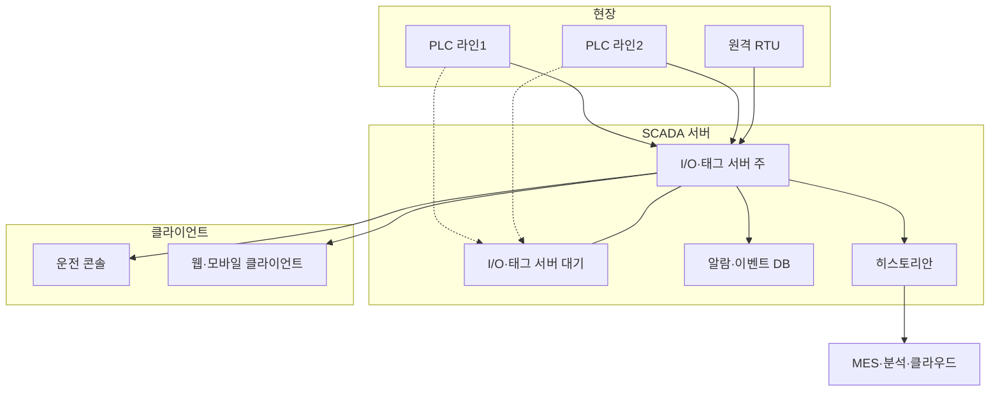

# 태그와 SCADA 구성

SCADA와 HMI는 **태그(tag)** 를 중심으로 움직입니다. 태그는 PLC 주소·OPC UA 노드 같은 데이터 원천에 이름, 단위, 스케일, 알람, 이력 설정을 붙인 것입니다. 태그 이름과 구조를 처음에 잘 정하면 화면·알람·히스토리안·상위 시스템 연동이 모두 쉬워집니다. 이 문서는 태그 설계, SCADA 서버 구성, 히스토리안, 플랫폼 선택을 정리합니다.

## 태그 개념

```text
PLC 주소/노드        태그                         사용처
DB10.DBD4    ─┐   Line1/Tank201/Level           ─┬─ 화면 막대 표시
ns=3;s=LT201 ─┴─→   값: 72.4  단위: %             ├─ 알람 (H 85%)
                    품질: Good  시각: 10:21:03   ├─ 히스토리안 기록
                    스케일: 4-20 mA → 0-100 %    └─ MES·클라우드 전송
```

| 속성 | 설명 |
| --- | --- |
| 이름(경로) | 사람이 읽고 검색하는 식별자 |
| 데이터 원천 | PLC 주소, OPC UA NodeId, MQTT 토픽, 계산식 |
| 데이터 타입 | BOOL, INT, REAL, STRING 등 |
| 값·품질·시각 | 세 가지가 항상 같이 다님. 품질 없는 값은 믿을 수 없음 |
| 스케일·단위 | 원시값 → 공학 단위 변환, 단위 표기 |
| 알람 | 한계값, 우선순위, 데드밴드, 지연 |
| 이력 | 기록 여부, 데드밴드, 최대 기록 간격 |
| 보안 | 읽기·쓰기 권한 |

## 명명 규칙

명명 방식은 크게 두 가지입니다. 둘을 섞어 쓰는 경우가 많습니다.

| 방식 | 예 | 장점 | 단점 |
| --- | --- | --- | --- |
| ISA-5.1 계기 태그 | `FIC-101`, `LT-201`, `TT-305A` | P&ID·계기 리스트와 1:1, 공정 엔지니어에게 익숙 | 위치·설비 문맥이 이름에 없음, 공장 간 중복 |
| 계층형(ISA-95·UNS) | `Acme/Seoul/Packing/Line1/Filler/Speed` | 위치 문맥이 경로에 있음, 여러 공장 통합·검색 쉬움 | 길어짐, 설비 이동 시 경로 변경 |

### ISA-5.1 계기 태그 읽기

ANSI/ISA-5.1은 2024년 개정에서 제목이 *Instrumentation and Control Symbols and Identification*으로 바뀌었습니다. 계기 태그는 첫 글자가 측정 변수, 뒤 글자가 기능입니다.

| 태그 | 첫 글자(측정 변수) | 뒤 글자(기능) | 뜻 |
| --- | --- | --- | --- |
| `FIC-101` | F 유량 | I 지시, C 제어 | 유량 지시 조절계 |
| `LT-201` | L 레벨 | T 전송 | 레벨 전송기 |
| `PSHH-110` | P 압력 | S 스위치, HH 매우 높음 | 압력 매우 높음 스위치 |
| `TV-305` | T 온도 | V 밸브 | 온도 조절 밸브 |

### 계층형과 UNS

UNS(Unified Namespace)는 공장 데이터를 **하나의 계층형 이름 공간**에 모아, 각 시스템이 서로 직접 연결하지 않고 그 이름 공간을 구독·발행하게 하는 구조를 가리키는 업계 용어입니다. 보통 ISA-95 계층(기업/사이트/영역/라인/셀)을 경로로 쓰고, MQTT 브로커 위에 구현합니다. MQTT로 산업 데이터를 표준화하는 사양으로 Eclipse Sparkplug가 있고, Sparkplug 3.0은 ISO/IEC 20237:2023으로 발행되었습니다. 프로토콜 자세한 내용은 [OPC UA와 MQTT](../communication/opc-ua-and-mqtt.md)를 참고합니다.

```text
acme/                          ← 기업
  seoul/                       ← 사이트
    packing/                   ← 영역
      line1/                   ← 라인
        filler/                ← 셀·설비
          speed         120.0  bpm
          state         RUNNING
          LT-201/level  72.4   %   ← 계기 태그를 잎(leaf)에 유지
```

### 명명 규칙 정하기

| 규칙 | 예 |
| --- | --- |
| 구분자 하나로 통일 | `/` 또는 `.` 중 하나. 공백·한글·특수문자 금지(플랫폼·프로토콜 호환) |
| 대소문자 규칙 | 전부 소문자 또는 PascalCase 중 하나 |
| 약어 사전 | `Spd`/`Speed` 혼용 금지. 약어 목록을 문서로 |
| 상태·명령·설정 접미사 | `_Sts`(상태), `_Cmd`(명령), `_Sp`(설정값), `_Pv`(현재값) 같은 규칙 |
| 계기 태그 보존 | 계층 경로 끝에 P&ID 태그를 남겨 계기 리스트와 추적 가능하게 |

## UDT와 템플릿

같은 종류 설비마다 태그를 하나씩 만들지 않습니다. **UDT(User-Defined Type)** 로 구조를 정의하고 인스턴스를 만듭니다. PLC 쪽 구조체와 SCADA 쪽 UDT·화면 심볼을 맞추면 설비 하나를 추가할 때 세 곳이 함께 생깁니다.

```text
UDT Motor
├── Cmd_Start      BOOL   (쓰기)
├── Cmd_Stop       BOOL   (쓰기)
├── Sts_Running    BOOL
├── Sts_Fault      BOOL
├── Pv_Current     REAL   A
├── Pv_Speed       REAL   rpm
├── Alm_Overload   (알람: 우선순위 중간, 지연 2s)
└── Mode           INT    (0 자동, 1 수동, 2 정비)

인스턴스: Line1/Conveyor/M101, Line1/Conveyor/M102 ...
화면 심볼: MotorSymbol(경로 매개변수 = 인스턴스 경로)
```

| 이점 | 설명 |
| --- | --- |
| 일관성 | 모든 모터가 같은 태그·알람·화면 동작 |
| 변경 한 번 | UDT에 태그를 추가하면 모든 인스턴스에 반영 |
| 화면 재사용 | 심볼·페이스플레이트가 인스턴스 경로만 받음 |

PLC 쪽 데이터 구조와 라이브러리 관리는 [현대적 PLC 개발 관행](../programming/modern-practices.md)을 참고합니다.

## 스케일링과 단위

| 단계 | 예 |
| --- | --- |
| 아날로그 입력 원시값 | 4~20 mA → AI 모듈 정수값(범위는 제조사·모듈마다 다름) |
| 공학 단위 변환 | 원시 최소–최대 → 0.0–100.0 % 선형 변환 |
| 범위 밖 처리 | 4 mA 미만·20 mA 초과는 단선·단락 의심 → 품질 Bad 또는 계기 고장 알람 |

```text
EU = EU_min + (Raw - Raw_min) × (EU_max - EU_min) / (Raw_max - Raw_min)
```

| 규칙 | 이유 |
| --- | --- |
| 스케일링은 한 곳에서만(PLC 또는 SCADA) | 이중 스케일링 버그 방지 |
| 단위를 태그 속성에 저장 | 화면·리포트·외부 연동에서 단위 누락 방지 |
| 단위 표기 통일 | `°C`/`degC`/`C` 혼용 금지 |
| 공학 한계 저장 | 설정값 입력 제한, 막대 표시 범위에 재사용 |

배선과 아날로그 신호는 [입출력 배선](../basics/io-wiring.md)을 참고합니다.

## 품질 코드

값만 보고 판단하면 통신이 끊긴 마지막 값을 정상으로 착각합니다. **값·품질·시각**을 항상 함께 다룹니다.

OPC UA StatusCode는 32비트 값이고, 최상위 2비트가 심각도입니다.

| 상위 2비트 | 심각도 | 뜻 | 화면 처리 예 |
| --- | --- | --- | --- |
| 00 | Good | 값을 사용해도 됨 | 일반 표시 |
| 01 | Uncertain | 일부만 성공. 용도에 따라 부적합할 수 있음 | 값 옆에 "?" 표시, 흐리게 |
| 10 | Bad | 실패. 값을 사용하면 안 됨 | 값 대신 "---" 또는 해칭, 계기 고장 표시 |
| 11 | (예약) | 클라이언트는 Bad로 취급 | Bad와 동일 |

StatusCode에는 이 밖에 원인을 나타내는 SubCode(예: `Bad_CommunicationError`)와, 값이 한계에 걸렸는지 나타내는 Limit 비트(Low/High/Constant)도 있습니다.

| 규칙 | 설명 |
| --- | --- |
| Bad 품질 값으로 알람 판정 금지 | 통신 끊김을 공정 알람으로 오인 |
| 품질도 히스토리안에 기록 | 나중에 "그때 값이 진짜였나"를 판단 |
| 시각은 원천 시각 우선 | 서버 수신 시각과 원천(소스) 시각을 구분 |
| 품질을 화면에 색 외 수단으로 | 색만 바꾸지 말고 기호·텍스트 병행 |

## SCADA 구성



| 구성 요소 | 역할 | 설계 포인트 |
| --- | --- | --- |
| I/O·태그 서버 | PLC 통신, 태그 값 유지, 스크립트 | 통신 주기와 PLC 부하, 드라이버 수 |
| 클라이언트 | 화면 표시와 조작 | 설치형 vs 웹, 동시 접속 수 |
| 알람·이벤트 DB | 알람 발생·확인·셸빙, 운전자 조작 이력 | 알람 지표 계산의 원천. 보존 기간 |
| 히스토리안 | 시계열 저장·조회 | 압축 설정, 저장 용량, 조회 성능 |
| 이중화 | 서버 고장 시 대기 서버로 전환 | 전환 시간, 이력 공백 처리, 라이선스(노드마다 필요한 경우가 많음) |

### 이중화 방식

| 방식 | 동작 | 고려 사항 |
| --- | --- | --- |
| 주·대기(Hot standby) | 대기 서버가 상태를 동기화하며 대기, 주 장애 시 전환 | 가장 흔함. 두 서버가 동시에 PLC에 쓰지 않게 |
| 콜드 스탠바이 | 장애 시 수동으로 대기 서버 기동 | 저렴하지만 공백 발생 |
| 히스토리안 저장 후 전송(store-and-forward) | 상위 연결이 끊기면 로컬 버퍼에 쌓았다가 복구 후 전송 | 엣지·원격 사이트 필수 |
| 네트워크 이중화 | 링 토폴로지, 이중 NIC | 스위치 단일 장애점 제거 |

산업용 네트워크 구성은 [산업용 이더넷](../communication/industrial-ethernet.md)을 참고합니다.

## 히스토리안과 압축

공정 데이터는 초 단위로 쌓이면 금방 커집니다. 히스토리안은 **의미 있는 변화만 저장**해서 용량을 줄입니다. AVEVA PI System 기준으로 두 단계를 거칩니다.

| 단계 | 방법 | PI 설정 이름 예 |
| --- | --- | --- |
| 예외 검사(exception) | 직전 보고값 대비 데드밴드 안의 변화는 버림. 수집 인터페이스가 수행하며 지원 여부는 인터페이스마다 다름 | ExcDev, ExcDevPercent, ExcMax |
| 압축(compression) | 스윙잉 도어(swinging door) 알고리즘. 저장된 점들 사이를 직선 보간해 원래 신호를 허용 오차 안에서 복원할 수 있으면 중간 점을 버림 | CompDev, CompMin, CompMax |

```text
스윙잉 도어 개념
값
 │      ●  ← 새 점이 '문' 밖으로 나가면 직전 점을 저장하고 새 문을 시작
 │    ╱ ╲
 │  ●───●───●   ← 허용 오차(CompDev) 안의 점은 버림
 │ ╱
 ●──────────────── 시간
 마지막 저장점에서 위·아래로 CompDev만큼 벌린 두 '문'이
 점이 들어올 때마다 좁아지고, 문이 닫히면(교차하면) 저장
```

| 설정 | 너무 작으면 | 너무 크면 |
| --- | --- | --- |
| 압축 데드밴드 | 저장량 증가, 압축 효과 없음 | 짧은 변동·피크 손실, 분석·사고 조사 불가 |
| 최대 간격(CompMax 등) | 의미 없는 점 증가 | 오래 변하지 않는 값이 기록에 안 보임 |

| 규칙 | 설명 |
| --- | --- |
| 데드밴드는 계기 정밀도 근처에서 시작 | AVEVA는 ExcDev를 계기 정밀도보다 약간 작게, Rockwell은 CompDev를 데이터 원천 정밀도 수준으로 권장 |
| 이산 신호(on/off)는 변화 시 기록 | 압축 대상 아님 |
| 품질 변화도 기록 | Good → Bad 전환은 꼭 남김 |
| 원본이 꼭 필요한 신호는 압축 해제 | 품질·규제 대상 데이터 |

Ignition 8.3은 QuestDB 기반 Core Historian을 새로 넣었고, 기존 Internal Historian은 Legacy로 남겨 두었습니다. 범용 시계열 DB를 히스토리안으로 쓰는 흐름이 늘고 있습니다.

## 웹 기반 HMI

| 구분 | 설치형 클라이언트 | 웹(HTML5) 클라이언트 |
| --- | --- | --- |
| 배포 | 단말마다 설치·업데이트 | 브라우저로 접속 |
| 단말 | Windows PC 위주 | PC·태블릿·스마트폰 |
| 반응형 | 고정 해상도 화면 | 화면 크기별 레이아웃 가능 |
| 보안 | 내부망 전제가 많음 | 인증·TLS·접속 경로 설계 필수 |
| 예 | Ignition Vision, 전통적 WinCC·InTouch 클라이언트 | Ignition Perspective, WinCC Unified 웹 클라이언트, FactoryTalk Optix 웹 클라이언트 |

- 웹 HMI라도 운전 콘솔은 전용 단말·고정 레이아웃으로 두고, 모바일은 조회와 알림 위주로 권한을 줄이는 구성이 흔합니다(경험칙).
- 인터넷에 직접 노출하지 않습니다. 원격 접속은 VPN·DMZ·원격 접속 게이트웨이를 거치게 합니다. 자세한 내용은 [OT 보안](../safety/ot-security.md)을 참고합니다.
- 반응형 레이아웃 일반은 [반응형과 모션](../../UX/systems/responsive-and-motion.md)을 참고합니다.

## 주요 플랫폼 현황

버전·라이선스 정보는 2026-10-21 기준입니다. 가격과 라이선스 조건은 대리점·지역마다 다르므로 견적으로 확인합니다.

| 플랫폼 | 제조사 | 확인 시점 현황 | 라이선스 모델 |
| --- | --- | --- | --- |
| Ignition | Inductive Automation | 8.3 출시(2025-09-16). 8.3이 8.x 마지막이며 이후 연도 기반 버전, 다음 메이저는 Ignition 2027(2027년 2월 예정) | 서버 단위. 클라이언트·태그·프로젝트 무제한, 모듈별 구매. 표준판은 영구 라이선스, Cloud Edition은 사용량 기반 |
| Ignition Edge | Inductive Automation | 엣지 장치용 축소판 | 영구. 프로젝트 1개, 동시 클라이언트 2개 등 제한 |
| WinCC Unified | Siemens | TIA Portal V21(2025-11 발표). V21에서 SCADA 서버 이중화, 여러 PC 런타임을 모으는 Data Hub 추가 | 엔지니어링 + 런타임. PC 런타임은 태그(PowerTags) 수 단위 |
| FactoryTalk Optix | Rockwell Automation | 1.x 버전대(확인 시점 문서 사이트에 1.10 문서 존재) | Studio Standard 무료, Studio Pro 유료(웹 편집·원격 저장소·동시 편집). 런타임은 기능 토큰 단위, 구독 또는 영구 |
| InTouch HMI, System Platform | AVEVA | InTouch HMI Unlimited(2023년부터 안내): 태그·클라이언트 수를 세지 않는 패키지 | 영구 라이선스와 AVEVA Flex 구독 병행. HMI·SCADA·히스토리안을 묶은 AVEVA Operations Control 구독 |
| FUXA | frangoteam(오픈소스) | v1.3.5(2026-10-19). Node.js + Angular·SVG 웹 편집기, Modbus·S7·OPC UA·MQTT 등 | MIT |
| Node-RED Dashboard 2.0 | FlowFuse(오픈소스) | `@flowfuse/node-red-dashboard` v1.33.0(2026-10-06). 기존 `node-red-dashboard`는 2024-06-27부터 폐기(deprecated) | Apache-2.0 |

| 메모 | 설명 |
| --- | --- |
| 오픈소스 HMI | 소규모·사내 모니터링·시제품에 적합. 이중화·알람 관리·감사 로그·장기 지원은 직접 책임져야 함 |
| 상용 SCADA | 이중화·드라이버·알람·히스토리안이 통합. 라이선스 비용과 벤더 종속 |
| 제조사 HMI | PLC와 같은 엔지니어링 도구에서 통합 설정. 다른 제조사 PLC 연동은 제약 |

PLC 제조사별 비교는 [제조사 비교](../vendors/vendor-comparison.md)를 참고합니다.

## 클라우드·엣지 동향

| 동향 | 설명 |
| --- | --- |
| 엣지 게이트웨이 | 현장에서 수집·버퍼링·전처리 후 상위로 전송. 연결이 끊겨도 저장 후 전송 |
| MQTT·UNS | 점대점 연결 대신 브로커 중심 발행·구독. Sparkplug로 페이로드·상태 관리 표준화 |
| 클라우드 SCADA | 클라우드 마켓플레이스 사용량 과금 배포(예: AWS·Azure의 Ignition Cloud Edition). 설정·백업·업그레이드는 사용자 몫이고 PLC 직접 수집에는 맞지 않음 |
| 중앙 데이터 허브 | 여러 런타임·라인 데이터를 한곳에 모음(예: WinCC Unified Data Hub) |
| 클라우드 연동 기능 | HMI 제품에 클라우드 커넥터·MQTT 기본 탑재 |
| Git 기반 변경 관리 | 화면·프로젝트를 텍스트로 내보내 버전 관리(TIA Portal V21은 PLC 블록 Git 연동용 내보내기 형식 추가) |

제어 루프와 안전 기능은 현장(PLC·안전 PLC)에 두고, 클라우드는 감시·분석·이력 위주로 쓰는 것이 기본입니다. 클라우드 연결이 끊겨도 현장 운전은 계속되어야 합니다.

## 선택 기준표

| 기준 | 질문 |
| --- | --- |
| 규모 | 태그 수, 클라이언트 수, 사이트 수가 몇 년 뒤 얼마나 늘어나는가 |
| 라이선스 | 태그·클라이언트 수 과금인가 서버 단위인가. 이중화 노드도 라이선스가 필요한가 |
| PLC 연동 | 쓰는 PLC의 드라이버가 기본 제공되는가, OPC UA 서버를 거쳐야 하는가 |
| 이중화 | 서버·네트워크 이중화, 전환 시간 요구가 있는가 |
| 알람 | ISA-18.2 상태(셸빙·억제), 알람 지표 리포트를 지원하는가 |
| 히스토리안 | 내장인가 별도 제품인가, 압축·보존 정책, 외부 DB 연동 |
| 웹·모바일 | HTML5 클라이언트, 반응형, 모바일 앱 |
| 개발 방식 | 템플릿·UDT, 스크립트 언어, 텍스트 내보내기·Git 연동 |
| 보안 | 사용자·역할, AD 연동, 감사 로그, TLS |
| 지원 | 국내 대리점·시스템 통합사(SI), 장기 지원(LTS) 정책 |
| 인력 | 사내·협력사가 이미 아는 플랫폼인가 |

## 흔한 실수

| 실수 | 결과 | 대응 |
| --- | --- | --- |
| 명명 규칙 없이 시작 | 같은 의미 태그가 여러 이름, 검색·연동 불가 | 착수 전에 규칙 문서화 |
| PLC 주소를 태그 이름으로 | 주소가 바뀌면 모든 화면 수정 | 의미 있는 이름 + 주소는 속성 |
| 품질 무시 | 통신 끊긴 마지막 값을 정상으로 표시 | 품질 기반 표시·알람 차단 |
| 모든 태그를 1초 주기로 무압축 저장 | 저장소 폭증, 조회 지연 | 신호별 데드밴드·주기 |
| 이중화를 서버만 | 스위치·전원 단일 장애점 | 네트워크·전원까지 |
| 화면마다 태그를 직접 바인딩 | 설비 추가 때마다 화면 복사 | UDT + 매개변수 심볼 |

## 점검표

| 질문 |
| --- |
| 태그 명명 규칙과 약어 사전이 문서로 있는가 |
| 계층 경로에서 P&ID 계기 태그를 추적할 수 있는가 |
| 반복 설비가 UDT·템플릿·매개변수 심볼로 만들어졌는가 |
| 스케일링이 한 곳에서만 이뤄지고 단위가 태그 속성에 있는가 |
| 화면·알람·히스토리안이 품질 코드를 처리하는가 |
| 히스토리안 압축 설정이 신호 종류별로 정해져 있는가 |
| 서버·네트워크 이중화와 저장 후 전송이 요구 수준에 맞는가 |
| 웹·원격 접속이 인터넷에 직접 노출되지 않는가 |

## 참고 자료

- [ISA Updates Engineering Symbols and Drawings Standard ISA-5.1 (2024-10-10)](https://www.isa.org/news-press-releases/2024/october/widely-used-engineering-symbols-and-drawings-stand) - ANSI/ISA-5.1-2024, 제목 변경
- [The Eclipse Foundation Announces Sparkplug as an International Standard](https://newsroom.eclipse.org/node/39754) - Sparkplug 3.0 = ISO/IEC 20237:2023
- [OPC 10000-4 7.38.1 StatusCode](https://reference.opcfoundation.org/Core/Part4/v105/docs/7.38.1) - Severity 비트, SubCode, Limit 비트
- [PI Data Archive: Compression (AVEVA)](https://docs.aveva.com/bundle/pi-server-da-admin/page/1021696.html) - 스윙잉 도어, CompDev·CompMin·CompMax
- [Exception and Compression and their Impacts on PI System Performance (AVEVA 2023)](https://cdn.osisoft.com/osi/presentations/2023-AVEVA-San-Francisco/UC23NA-3PGK04-AVEVA_Bregenzer_Brent-Exception-Compression-and-their-Impacts-On-PI-System-Performance.pdf) - 예외 검사 설정
- [Introducing Ignition (8.3 문서)](https://docs.inductiveautomation.com/docs/8.3/getting-started/introducing-ignition.md) - 서버 단위 라이선스, 무제한 클라이언트·태그·프로젝트, Core Historian(QuestDB)
- [Ignition Pricing](https://inductiveautomation.com/pricing/ignition) - 서버 단위, Edge 제한, Cloud Edition 사용량 기반
- [Ignition's New Release Cadence (2025-10-22)](https://inductiveautomation.com/blog/node/4368) - 8.3이 마지막 8.x, Ignition 2027, LTS 정책
- [Ignition Perspective Module](https://inductiveautomation.com/ignition/modules/perspective) - HTML5·CSS3, 플러그인 불필요
- [TIA Portal V21 press release (Siemens, 2025-11-11)](https://press.siemens.com/global/en/pressrelease/tia-portal-v21-combines-engineering-efficiency-higher-plant-availability) - WinCC Unified 이중화, Data Hub, Git 연동 내보내기
- [SIMATIC WinCC Unified PC](https://www.siemens.com/us/en/products/automation/simatic-hmi/wincc-unified/wincc-unified-pc.html) - 웹 클라이언트, 이중화 옵션
- [FactoryTalk Optix Licenses (1.10 문서)](https://www.rockwellautomation.com/en-hu/docs/factorytalk-optix/1-10/contents-ditamap/getting-started/introduction/licenses.html) - Studio Standard/Pro, 런타임 데모 2시간
- [FactoryTalk Optix Runtime Entitlement Sizing Guide](https://www.rockwellautomation.com/en-fi/docs/factorytalk-optix/current/technical-content/optix-at001/web_optix-at001-ditamap/supported-feature-tokens.html) - 기능 토큰
- [Introducing AVEVA InTouch HMI Unlimited](https://www.aveva.com/en/perspectives/blog/introducing-aveva-intouch-hmi-unlimited/) - 태그·클라이언트 무제한 패키지
- [AVEVA Flex subscription program (datasheet)](https://www.aveva.com/content/dam/aveva/documents/datasheets/Datasheet_AVEVA_FlexSubscription_22-09.pdf.coredownload.inline.pdf) - Flex 구독
- [PI point columns (AVEVA)](https://docs.aveva.com/bundle/pi-server-l-builder/page/1020111.html) - ExcDev·ExcMax·CompDev 속성
- [Ignition Cloud Edition (8.3 문서)](https://docs.inductiveautomation.com/docs/8.3/other-editions/ignition-cloud-edition) - 마켓플레이스 배포, 라이선스 키 불필요
- [frangoteam/FUXA](https://github.com/frangoteam/FUXA) - MIT, 릴리스
- [FlowFuse/node-red-dashboard](https://github.com/FlowFuse/node-red-dashboard) - Dashboard 2.0, Apache-2.0
- [node-red/node-red-dashboard](https://github.com/node-red/node-red-dashboard) - 2024-06-27 폐기 공지

확인일: 2026-10-21 (ISA-5.1 판, Sparkplug ISO 번호, OPC UA StatusCode 비트, PI 압축 설정 이름, 플랫폼 버전·라이선스 모델 확인. WinCC Unified의 PowerTags 단위는 주문 번호·대리점 표기 기준, FactoryTalk Optix 최신 버전 번호는 문서 경로 기준. UNS는 표준이 아닌 업계 용어. 명명 접미사·히스토리안 데드밴드 시작값은 경험칙)

관련: [알람 관리](./alarm-management.md), [OPC UA와 MQTT](../communication/opc-ua-and-mqtt.md), [메시지 큐](../../Backend/messaging/message-queue.md), [이벤트 기반 아키텍처](../../Architecture/styles/event-driven.md)

다음: [기능 안전](../safety/functional-safety.md)
