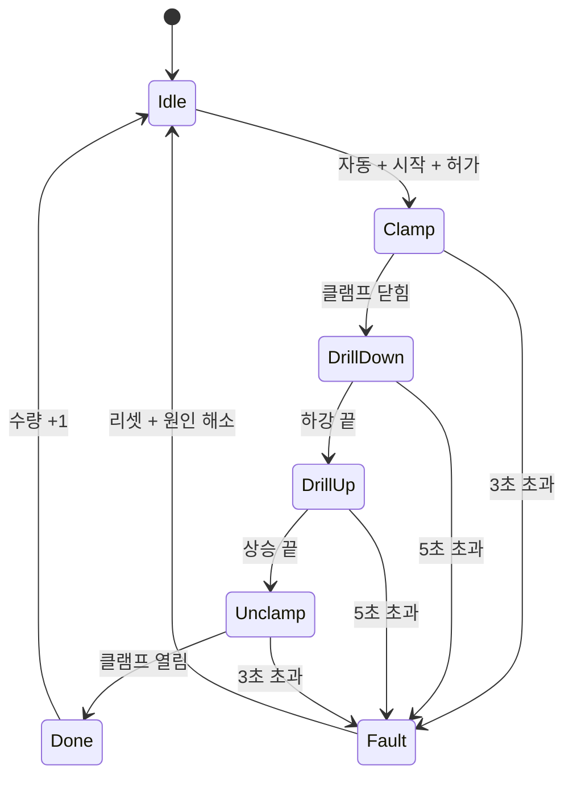
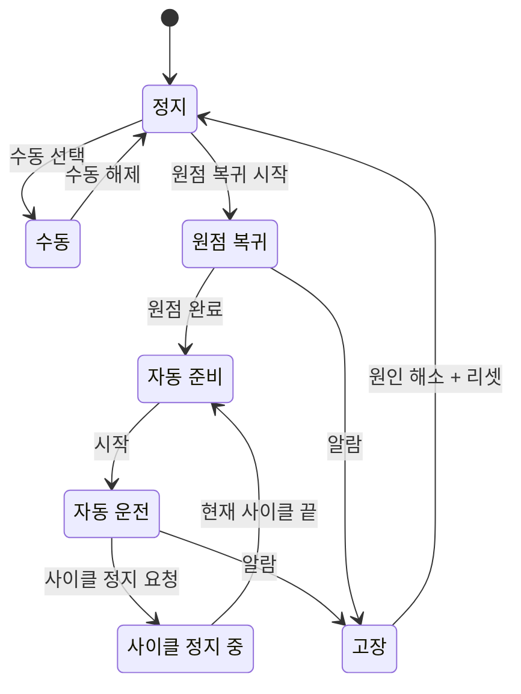
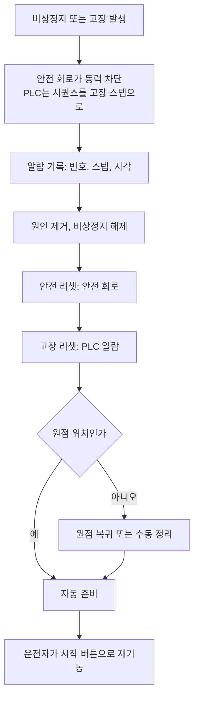
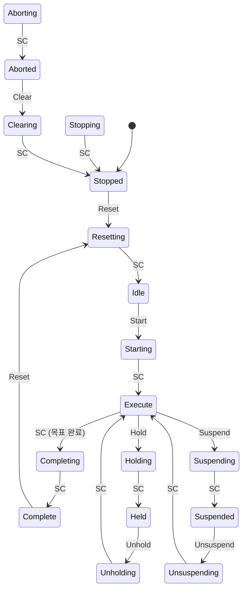

# 시퀀스 패턴

대부분의 설비 제어는 "클램프 → 가공 → 언클램프"처럼 순서가 있는 동작입니다. 순서를 자기유지 회로와 플래그 비트로 엮으면 금방 읽을 수 없게 됩니다. 현재 단계를 **하나의 변수**로 관리하고, 단계마다 전이 조건과 타임아웃을 두는 것이 기본 패턴입니다.

먼저 알면 좋은 개념: [래더 기초](./ladder-basics.md), [펌웨어의 시간과 상태 관리](../../Hardware/firmware/timing-and-state.md)

## 스텝 시퀀스: 정수 스텝 번호

현재 단계를 정수 하나(`nStep`)로 표현합니다.

| 스텝 | 동작(출력) | 다음 스텝으로 가는 조건 | 타임아웃 |
| --- | --- | --- | --- |
| 0 | 대기 | 자동 모드 + 시작 + 허가 조건 | - |
| 10 | 클램프 닫기 | 클램프 닫힘 센서 | 3초 |
| 20 | 드릴 하강 | 하강 끝 센서 | 5초 |
| 30 | 드릴 상승 | 상승 끝 센서 | 5초 |
| 40 | 클램프 열기 | 클램프 열림 센서 | 3초 |
| 50 | 완료, 수량 +1 | 즉시 | - |
| 900 | 고장 | 리셋 + 원인 해소 | - |

- 스텝 번호를 10 단위로 띄우면 나중에 사이에 스텝(15, 25)을 끼워 넣기 쉽습니다(경험칙).
- 한 번에 하나의 스텝만 활성입니다. 여러 플래그 비트를 동시에 켜는 방식보다 "지금 어디인가"가 분명합니다.
- HMI에 현재 스텝 번호와 설명, 스텝 경과 시간을 표시하면 현장에서 멈춘 위치를 바로 압니다.

## 상태 머신: ST `CASE` 문

ST에서는 열거형과 `CASE` 문으로 위 표를 그대로 옮깁니다.

```text
TYPE E_Step : (
    S_IDLE     := 0,
    S_CLAMP    := 10,
    S_DRILL_DN := 20,
    S_DRILL_UP := 30,
    S_UNCLAMP  := 40,
    S_DONE     := 50,
    S_FAULT    := 900
); END_TYPE

VAR
    eStep, eStepPrev : E_Step := S_IDLE;
    xEntry  : BOOL;           (* 스텝에 들어온 첫 스캔 *)
    tonStep : TON;            (* 스텝 경과 시간 *)
    rtStart, rtReset : R_TRIG;
    nAlarm  : INT;            (* 0 = 알람 없음 *)
    udiCount : UDINT;
END_VAR

rtStart(CLK := xStartPb);
rtReset(CLK := xResetPb);

(* 스텝이 바뀐 첫 스캔에 타이머 리셋 *)
xEntry    := (eStep <> eStepPrev);
eStepPrev := eStep;
tonStep(IN := NOT xEntry, PT := T#1H);

(* 인터록: 어느 스텝에서든 깨지면 고장으로 *)
IF NOT xSafetyOk AND eStep <> S_FAULT THEN
    nAlarm := 1;  eStep := S_FAULT;
END_IF;

CASE eStep OF
S_IDLE:
    IF xAutoMode AND rtStart.Q AND xPermissive THEN
        eStep := S_CLAMP;
    END_IF;

S_CLAMP:
    IF xClampClosed THEN
        eStep := S_DRILL_DN;
    ELSIF tonStep.ET > T#3S THEN
        nAlarm := 10;  eStep := S_FAULT;      (* 클램프 닫힘 타임아웃 *)
    END_IF;

S_DRILL_DN:
    IF xDrillDown THEN
        eStep := S_DRILL_UP;
    ELSIF tonStep.ET > T#5S THEN
        nAlarm := 20;  eStep := S_FAULT;
    END_IF;

S_DRILL_UP:
    IF xDrillUp THEN
        eStep := S_UNCLAMP;
    ELSIF tonStep.ET > T#5S THEN
        nAlarm := 30;  eStep := S_FAULT;
    END_IF;

S_UNCLAMP:
    IF xClampOpen THEN
        eStep := S_DONE;
    ELSIF tonStep.ET > T#3S THEN
        nAlarm := 40;  eStep := S_FAULT;
    END_IF;

S_DONE:
    udiCount := udiCount + 1;
    eStep := S_IDLE;

S_FAULT:
    (* 출력은 아래 출력부에서 모두 꺼짐. 리셋은 원인이 사라진 뒤에만 *)
    IF rtReset.Q AND xSafetyOk THEN
        nAlarm := 0;
        eStep := S_IDLE;      (* 원점이 아니면 원점 복귀 모드를 요구하도록 확장 *)
    END_IF;
END_CASE;

(* 출력부: 스텝에서 출력을 결정. 출력 쓰기는 이곳 한 곳에서만 *)
yClampClose := (eStep = S_CLAMP) OR (eStep = S_DRILL_DN) OR (eStep = S_DRILL_UP);
yDrillDown  := (eStep = S_DRILL_DN);
yAlarmLamp  := (nAlarm <> 0);
```

| 구조 원칙 | 이유 |
| --- | --- |
| 스텝 전이는 `CASE` 안에서만 | 상태가 바뀌는 곳을 한 곳으로 모음 |
| 출력은 `CASE` 밖 출력부에서 스텝으로 계산 | 듀얼 코일 방지, 고장 스텝에서 출력이 자동으로 꺼짐 |
| 모든 대기 스텝에 타임아웃 | 센서 고장 시 영원히 멈추지 않고 어디서 멈췄는지 알람으로 알림 |
| 알람 번호는 스텝과 연결 | 알람 10 = "스텝 10에서 클램프 닫힘 확인 실패"처럼 원인이 바로 보임 |
| 고장 리셋은 상승 엣지 + 원인 해소 확인 | 리셋 버튼을 누른 채로 두거나 원인이 남은 상태에서 재기동 방지 |

같은 구조를 래더로 쓸 때는 스텝 번호 비교(`EQ nStep 10`)를 각 출력 렁의 조건으로 둡니다.



## SFC 개념

SFC(Sequential Function Chart)는 위 상태 머신을 그림으로 그리는 IEC 61131-3의 구조 언어입니다.

```text
      ||  S0 대기 (초기 스텝, 이중선)
      ||
       +  T: xAutoMode AND xStart AND xPermissive
       |
      [S10 클램프]---[N  yClampClose]
       |
       +  T: xClampClosed
       |
      [S20 드릴 하강]---[N  yDrillDown]
       |
       +  T: xDrillDown
       ...
```

| 요소 | 의미 |
| --- | --- |
| 스텝(Step) | 상태. 활성일 때 연결된 액션 실행. 초기 스텝은 하나 |
| 전이(Transition) | 앞 스텝이 활성이고 전이 조건이 참이면 다음 스텝으로 이동 |
| 액션(Action) | 스텝 활성 중 실행할 동작. 한정자(qualifier)로 방식 지정 |
| 선택 분기 | 여러 전이 중 하나만 진행(조건 분기) |
| 병렬 분기 | 여러 스텝을 동시에 활성화하고 모두 끝나면 합류 |

주요 액션 한정자: `N`(스텝 활성 동안), `S`(셋, 다른 곳에서 `R`로 리셋할 때까지 유지), `R`(리셋), `P`(진입 시 1회), `L`(시간 제한), `D`(지연 후 실행). 도구마다 지원하는 한정자와 스텝 플래그(`Step.X`, `Step.T`) 이름이 조금씩 다릅니다.

SFC는 병렬 공정이 많은 설비에서 진행 상황을 보여 주기 좋지만, 도구 간 이식성이 낮고 텍스트 diff가 어렵습니다. 단순한 직렬 순서는 `CASE` 상태 머신으로도 충분합니다(경험칙).

## 전이 조건과 타임아웃

| 원칙 | 설명 |
| --- | --- |
| 명령이 아니라 결과로 전이 | "밸브 열기 출력을 냈다"가 아니라 "열림 센서가 들어왔다"로 다음 스텝 진행 |
| 감시 타임아웃 | 정상 동작 시간의 1.5~2배 정도로 설정(경험칙). 너무 짧으면 오알람, 너무 길면 고장 발견이 늦음 |
| 최소 시간 | 너무 빨리 끝나도 이상일 수 있음(센서 고착). 필요하면 최소 시간도 확인 |
| 센서 안정화 | 떨림이 있는 센서는 `TON`으로 짧게 안정화한 뒤 전이 조건으로 사용 |
| 전이 1회 | 한 스캔에 한 스텝만 진행하면 디버깅이 쉬움. 여러 스텝을 한 스캔에 넘기려면 의도를 문서화 |

## 인터록과 허가 조건

| 구분 | 확인 시점 | 깨지면 | 예 |
| --- | --- | --- | --- |
| 허가 조건(permissive) | 시작할 때 | 시작하지 않음. 운전 중에는 설계에 따라 사이클 끝까지 진행하거나 정지 | 원점 위치, 공기압 정상, 소재 있음, 도어 닫힘 |
| 인터록(interlock) | 항상 | 즉시 해당 동작 금지·정지 | 정·역 출력 상호 배제, 탱크 하한에서 펌프 정지, 과부하 |
| 안전 기능 | 항상, 안전 회로·안전 PLC가 담당 | 안전 상태로 정지 | 비상정지, 안전 도어, 라이트 커튼 |

- 허가 조건과 인터록은 이름을 붙인 비트로 만들고 HMI에 "왜 시작할 수 없는지"를 표시합니다. 운전자가 원인을 찾는 시간이 크게 줄어듭니다.
- 인터록 바이패스(무시)가 필요하면 권한, 기록, 자동 해제 시간을 둡니다.
- 일반 PLC 로직의 인터록은 안전 기능을 대신하지 않습니다. 사람을 보호하는 기능은 [기능 안전](../safety/functional-safety.md)과 [비상정지와 인터록](../safety/emergency-stop-and-interlock.md)을 따릅니다.

## 수동·자동·원점 복귀 모드

| 모드 | 동작 | 유지해야 할 것 |
| --- | --- | --- |
| 수동(Manual) | HMI·버튼으로 실린더·모터를 개별 동작(조그) | 인터록은 계속 유효. 누르는 동안만 동작(유지형 금지)이 일반적 |
| 원점 복귀(Homing) | 정해진 순서로 모든 축·실린더를 기준 위치로 | 충돌하지 않는 순서(예: Z축 상승 → X축 후퇴 → 클램프 열기) |
| 자동(Auto) | 시퀀스를 연속 또는 1사이클 실행 | 원점·허가 조건 확인 후에만 시작 |



- 모드 전환은 정지 상태 또는 사이클 끝에서만 허용합니다. 자동 운전 중 수동으로 바로 넘어가면 시퀀스가 중간 상태로 남습니다.
- "정지"를 즉시 정지와 사이클 끝 정지로 나누면 운전자가 공작물을 버리지 않고 멈출 수 있습니다.

## 알람과 비상정지 후 복구 흐름



- 비상정지 해제나 리셋만으로 설비가 다시 움직이면 안 됩니다. 재기동은 항상 별도의 명시적 시작 조작으로 합니다.
- 복구 시 "이어서 진행"과 "원점부터 다시"를 스텝마다 정해 둡니다. 가공 중 멈춘 공작물은 대부분 이어서 진행하면 불량이 됩니다(경험칙).
- 고장 스텝에서 출력이 모두 꺼지는 구조라도, 실린더처럼 출력을 끄면 움직이는 장치(스프링 복귀 밸브)는 고장 시 동작을 따로 검토합니다.
- 알람 설계(우선순위, 래치, 확인)는 [알람 관리](../hmi-scada/alarm-management.md)를 참고합니다.

## ISA-88: 배치 제어 모델

ISA-88(국제판 IEC 61512)은 배치 공정(식품, 제약, 화학)의 모델과 용어 표준입니다. 레시피(무엇을 만들지)와 설비 제어(어떻게 움직일지)를 분리하는 것이 핵심입니다.

| 부 | 제목 |
| --- | --- |
| ISA-88.00.01-2010 | Part 1: Models and Terminology |
| ISA-88.00.02-2001 | Part 2: Data Structures and Guidelines for Languages |
| ISA-88.00.03-2003 | Part 3: General and Site Recipe Models and Representation |
| ISA-88.00.04-2006 | Part 4: Batch Production Records |

| 모델 | 계층 |
| --- | --- |
| 물리 모델 | 기업 → 사이트 → 영역 → 공정 셀 → 유닛 → 장비 모듈 → 제어 모듈 |
| 절차 모델 | 프로시저 → 유닛 프로시저 → 오퍼레이션 → 페이즈 |

PLC 프로그래머 입장에서는 **제어 모듈**(밸브·모터 FB)과 **장비 모듈·페이즈**(투입, 가열, 교반 같은 재사용 단위)로 코드를 나누는 데 쓸 수 있습니다. 배치 공정이 아니어도 이 계층 구분은 코드 구조화에 도움이 됩니다(경험칙).

## PackML: 기계 상태 모델

PackML은 OMAC이 만들고 ISA가 기술 보고서 ISA-TR88.00.02로 채택한 기계 상태·모드·태그 표준입니다. 포장 기계에서 시작했지만 다른 개별 생산 설비에도 쓰입니다. 기계마다 상태 이름과 의미를 통일하면 라인 통합, HMI, OEE 수집이 쉬워집니다. ISA가 현재 판으로 안내하는 것은 ISA-TR88.00.02-2022이고, OPC UA for PackML(OPC 30050 v1.01)은 2015판을 참조합니다.

상태는 17개입니다.

| 분류 | 상태 |
| --- | --- |
| 정상 생산 흐름 | Stopped, Resetting, Idle, Starting, Execute, Completing, Complete |
| 일시 정지(내부 원인) | Holding, Held, Unholding |
| 일시 정지(외부 원인, 상·하류 설비) | Suspending, Suspended, Unsuspending |
| 정지 | Stopping |
| 비상 정지·복구 | Aborting, Aborted, Clearing |

`~ing` 상태는 동작 중인 **액팅(acting) 상태**로, 동작이 끝나면 상태 완료(SC, State Complete)로 다음 상태로 넘어갑니다. Stopped·Idle·Held·Suspended·Complete·Aborted는 명령을 기다리는 **대기 상태**입니다. Execute는 생산 동작을 하면서 명령을 기다리는 특별한 상태로 취급합니다.



- **Stop 명령**: Stopped·Stopping·Clearing·Aborting·Aborted를 제외한 12개 상태(Resetting부터 Complete, Hold·Suspend 계열까지)에서 Stopping으로 갑니다. 그림에서는 화살표를 생략했습니다.
- **Abort 명령·기계 고장**: Aborting·Aborted를 제외한 모든 상태에서 Aborting으로 갑니다. Aborted에서는 명시적인 Clear 명령 후에만 빠져나옵니다.
- **모드**: 생산(Production), 정비(Maintenance), 수동(Manual) 등. 모드마다 쓸 수 있는 상태가 다릅니다. 예를 들어 Suspended와 Complete는 정비 모드에 없습니다.
- **PackTags**: 명령(Command), 상태(Status), 관리(Admin) 태그 묶음으로 상위 시스템과 상태·카운트·알람을 주고받습니다.

PackML을 도입하지 않더라도, 우리 설비의 상태를 이 목록에 대응시켜 보면 빠진 상태(예: Hold와 Suspend 구분, Abort 후 Clear 절차)를 찾을 수 있습니다.

## 점검표

| 질문 |
| --- |
| 현재 스텝(상태)이 변수 하나로 표현되고 HMI에 보이는가 |
| 모든 대기 스텝에 타임아웃과 고유 알람 번호가 있는가 |
| 출력은 스텝에서 계산되고 한 곳에서만 쓰이는가 |
| 허가 조건과 인터록이 구분되어 있고, 시작 불가 이유가 표시되는가 |
| 비상정지 해제나 리셋만으로 재기동하지 않는가 |
| 복구 시 이어서 진행할지 원점부터 할지 스텝별로 정했는가 |
| 자동↔수동 전환 조건이 정해져 있는가 |

## 참고 자료

- [ISA-88 Standards (ISA)](https://www.isa.org/standards-and-publications/isa-standards/isa-88-standards) - Part 1~4 번호·제목, ISA-TR88.00.02-2022
- [OMAC PackML](https://www.omac.org/packml) - PackML과 ISA-TR88.00.02 관계
- [OPC 30050 PackML 4.2.4 Standard Modes](https://reference.opcfoundation.org/specs/OPC-30050/4.2.4) - 모드별 상태 차이(Suspended·Complete)
- [OPC 30050 PackML 6.3.6 PackMLBaseStateMachineType](https://reference.opcfoundation.org/specs/OPC-30050/6.3.6) - Aborting·Aborted·Clear
- [OPC 30050 PackML 6.3.7 PackMLMachineStateMachineType](https://reference.opcfoundation.org/specs/OPC-30050/6.3.7) - Stopped·Stopping·Clearing
- [OPC 30050 PackML 6.3.8 PackMLExecuteStateMachineType](https://reference.opcfoundation.org/specs/OPC-30050/6.3.8) - 실행 상태와 전이

확인일: 2026-10-21 (ISA-88 부 번호, PackML 상태 목록·전이·모드 확인. PackML 2022판 원문의 변경점은 미확인. 스텝 시퀀스·SFC·모드 설계는 일반 개념)

관련: [IEC 61131-3 개요](./iec-61131-3.md), [알람 관리](../hmi-scada/alarm-management.md), [비상정지와 인터록](../safety/emergency-stop-and-interlock.md)

다음: [최신 실무: 버전 관리·테스트·AI](./modern-practices.md)
