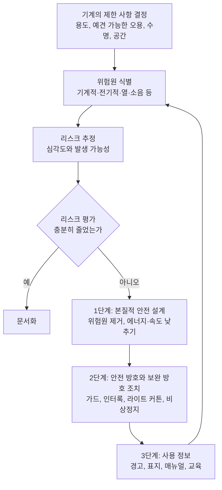

# 기능 안전 기초

기능 안전(functional safety)은 **제어 시스템이 올바르게 동작해서 위험을 줄이는 것**을 다룹니다. 가드, 비상정지, 라이트 커튼 신호를 받아 기계를 멈추는 회로나 프로그램이 여기에 속합니다. 이 문서는 ISO 12100 리스크 평가에서 시작해 ISO 13849-1(PL), IEC 62061(SIL)의 핵심 개념과 안전 PLC를 쓸 때 주의할 점, EU 기계 규정 같은 최신 동향을 정리합니다.

> **면책**: 이 문서는 학습용 정리입니다. 표준 원문, 적용 법령, 자격을 갖춘 안전 기술자의 검토를 대신하지 않습니다. 한국에서는 산업안전보건법과 하위 규칙(산업안전보건기준에 관한 규칙 등)을 따르고, 프레스·크레인 같은 안전인증대상기계등은 고용노동부 안전인증(KCs)을 받아야 합니다(산업안전보건법 제84조). 자율안전확인 신고 대상인지도 따로 확인합니다. 표의 수치는 개념 이해용이며 설계 계산에는 표준 원문과 제조사 데이터를 씁니다.

## 1. 기본 개념

| 용어 | 뜻 |
| --- | --- |
| 리스크 | 상해의 심각도와 발생 가능성을 조합한 것 |
| 위험 감소 | 리스크를 허용 가능한 수준까지 낮추는 활동. 제어 시스템은 그 수단 중 하나 |
| 안전 기능 | 고장 나면 리스크가 즉시 커지는 기능. 예: 가드가 열리면 모터 정지, 비상정지, 안전 속도 제한 |
| SRP/CS | Safety-Related Parts of Control Systems. 안전 기능 하나를 입력(센서)부터 출력(동력 차단 소자)까지 수행하는 제어 시스템 부분 |
| 서브시스템 | SRP/CS를 입력·로직·출력으로 나눈 단위. ISO 13849-1:2023은 SRP/CS(전체 안전 기능)와 서브시스템(하위 기능)을 명확히 구분합니다 |
| PL / SIL | 안전 기능이 위험한 고장 없이 동작할 능력의 등급. PL은 ISO 13849-1, SIL은 IEC 61508 계열 |

안전 기능은 "센서 → 로직 → 출력" 체인 전체로 봅니다. 안전 릴레이 하나가 PL e 인증이어도 센서가 단일 채널 리밋 스위치이고 출력이 일반 접촉기 한 개라면, 체인 전체의 PL은 낮아집니다.

```text
[입력 서브시스템]        [로직 서브시스템]         [출력 서브시스템]
 도어 스위치 2채널  →   안전 릴레이 / 안전 PLC  →   접촉기 2개 + 피드백(EDM)
                                                    또는 드라이브 STO
└──────────────────── SRP/CS = 안전 기능 하나 ─────────────────────┘
```

## 2. 리스크 평가: ISO 12100 흐름

ISO 12100은 기계 안전의 기본(type-A) 표준이며, 현행판은 **ISO 12100:2010**입니다. ISO는 2023-12부터 개정을 진행하고 있고 확인 시점에 후속안(ISO/DIS 12100)이 투표 단계에 있습니다.



- 순서가 중요합니다. 설계로 없앨 수 있는 위험을 가드나 경고문으로 때우지 않습니다.
- 기능 안전 표준(ISO 13849-1, IEC 62061)은 **2단계(방호 조치)** 안에서 제어 시스템이 맡는 위험 감소를 다룹니다. ISO 13849-1:2023도 자신을 ISO 12100 위험 감소의 2단계로 설명합니다.
- 비상정지는 보완 방호 조치이며 가드나 안전 기능을 대신하지 않습니다. [비상정지와 인터록](./emergency-stop-and-interlock.md)에서 자세히 다룹니다.

## 3. 표준 지도와 선택

| 표준 | 분야 | 등급 | 현행판(확인 시점) |
| --- | --- | --- | --- |
| IEC 61508 | 모든 E/E/PE(전기·전자·프로그래머블 전자) 안전 시스템의 기본 표준. 부문 표준의 모(母) 표준 | SIL 1~4 | IEC 61508-1:2010 (2판) |
| IEC 62061 | 기계. IEC 61508의 기계 부문 적용. 2021판에서 비전기 기술까지 범위 확장 | SIL 1~3 | IEC 62061:2021 (2판) + AMD1:2024 + AMD2:2026 |
| ISO 13849-1 | 기계. 전기·유압·공압·기계식 SRP/CS | PL a~e | ISO 13849-1:2023 (4판) |
| IEC 61511 | 공정 산업의 안전 계장 시스템(SIS). IEC 61508의 공정 부문 적용 | SIL 1~4 | IEC 61511-1:2016 + AMD1:2017 |

선택 기준:

- **기계(공장 설비, 로봇 셀, 포장기)** → ISO 13849-1 또는 IEC 62061. 둘 다 EU 기계 지침에서 조화 표준으로 쓰이며, 해당 기계의 C형(제품) 표준이 지정하면 그것을 따릅니다.
  - 공압·유압이 섞인 일반 기계, 카테고리 기반 간이 계산 → ISO 13849-1을 많이 씁니다(경험칙).
  - 복잡한 전자·프로그래머블 시스템, IEC 61508 기반 부품 조합 → IEC 62061을 고려합니다(경험칙).
- **공정 플랜트(화학, 정유)의 저빈도 요구 안전 계장** → IEC 61511. ISO 13849-1은 요구가 **연 1회보다 잦은**(high demand / continuous) 안전 기능만 다루고, 저빈도 요구는 IEC 61508 계열로 안내합니다.
- **안전 부품을 만드는 제조사** → IEC 61508 및 제품 표준(예: 드라이브는 IEC 61800-5-2).

ISO/TR 23849(두 기계 표준의 적용 지침)는 2020년에 폐지됐고, 내용은 두 표준의 현행판에 들어갔습니다.

## 4. ISO 13849-1 핵심

### 4.1 PLr 결정: 위험 그래프

PLr(required PL)은 안전 기능에 **요구되는** PL입니다. C형 표준이 정하지 않았으면 부속서 A의 위험 그래프로 정합니다.

| 파라미터 | 1 | 2 |
| --- | --- | --- |
| S 상해 심각도 | S1 경미(보통 회복 가능) | S2 중대(보통 회복 불가, 사망 포함) |
| F 위험 노출 빈도·시간 | F1 드물게, 노출 시간 짧음 | F2 잦게 ~ 연속, 노출 시간 김 |
| P 회피·피해 제한 가능성 | P1 특정 조건에서 가능 | P2 거의 불가능 |

```text
S1 ─┬─ F1 ─┬─ P1 → PLr a
    │      └─ P2 → PLr b
    └─ F2 ─┬─ P1 → PLr b
           └─ P2 → PLr c
S2 ─┬─ F1 ─┬─ P1 → PLr c
    │      └─ P2 → PLr d
    └─ F2 ─┬─ P1 → PLr d
           └─ P2 → PLr e
```

- 위 그래프는 널리 쓰이는 형태를 옮긴 것이며 2023판 원문 그림과 직접 대조하지 못했습니다(미확인). 실제 판정에는 원문 부속서 A를 씁니다.
- 2015판은 F를 고를 때 "15분에 1회보다 잦으면 F2", "총 노출 시간이 운전 시간의 1/20 이하이고 15분에 1회 이하이면 F1 가능" 같은 기준을 덧붙였습니다(2015판 해설 기준).
- **2023판 변경(부속서 A)**
  - "위험 사건 발생 확률"을 P에서 분리했습니다. 기본은 높음(100%)으로 보고, 낮다고 판단할 근거가 있을 때만 PLr을 **한 단계** 낮출 수 있으며 그 판단은 근거와 함께 문서화해야 합니다.
  - P를 다섯 요소로 판단합니다. **위험 상황이 생기는 속도, 공간적으로 피할 수 있는지, 위험을 인지할 수 있는지** 세 가지는 하나만 불리해도 P2입니다. **숙련자가 쓰는지, 조작이 복잡한지**는 다른 불리한 요소와 겹칠 때만 P2 근거가 됩니다.

### 4.2 달성 PL을 구성하는 요소

달성 PL은 **카테고리(구조) + MTTFD + DCavg + CCF**(그리고 소프트웨어·체계적 고장 대책)로 정합니다.

| 카테고리 | 구조 | 핵심 요구 | 최대 PL |
| --- | --- | --- | --- |
| B | 단일 채널 | 기본 안전 원칙. 결함 하나로 안전 기능 상실 가능 | b |
| 1 | 단일 채널 | 검증된(well-tried) 부품과 원칙, MTTFD 높음. 복잡한 부품은 검증된 부품이 될 수 없음 | c |
| 2 | 단일 채널 + 시험 채널 | 기능 채널의 결함 검출. 시험 빈도는 요구 빈도의 100배 이상(또는 요구 시 즉시 시험), 시험 채널 MTTFD는 기능 채널의 절반 초과 | d |
| 3 | 이중 채널 | 단일 결함으로 안전 기능을 잃지 않음, 가능한 범위에서 결함 검출 | e |
| 4 | 이중 채널 | 단일 결함 검출, 검출 못한 결함이 쌓여도 안전 기능 유지, MTTFD 높음, DCavg 높음 | e |

| 요소 | 등급과 범위 |
| --- | --- |
| MTTFD (채널당 평균 위험 고장 시간) | 낮음 3–10년, 중간 10–30년, 높음 30–100년 |
| DCavg (평균 진단 범위) | 없음 < 60%, 낮음 60–90%, 중간 90–99%, 높음 ≥ 99% |
| CCF (공통 원인 고장) | 부속서 F 점수표 **65점 이상** (카테고리 2·3·4) |

| PL | 시간당 평균 위험 고장 빈도 PFH (1/h) |
| --- | --- |
| a | 10⁻⁵ 이상 ~ 10⁻⁴ 미만 |
| b | 3×10⁻⁶ 이상 ~ 10⁻⁵ 미만 |
| c | 10⁻⁶ 이상 ~ 3×10⁻⁶ 미만 |
| d | 10⁻⁷ 이상 ~ 10⁻⁶ 미만 |
| e | 10⁻⁸ 이상 ~ 10⁻⁷ 미만 |

2023판의 다른 주요 변경(IFA 해설 기준):

- PFHD를 IEC 표준과 같은 **PFH**(average frequency of a dangerous failure per hour)로 바꿨습니다. 기술적 변화는 없습니다.
- 안전 요구사항 명세(SRS)를 요구합니다. 안전 기능마다 트리거 이벤트, 안전 상태, PLr, 허용 응답 시간, 활성 운전 모드, 에너지 상실 시 동작, 재기동 조건 등을 적고, 설계 전에 검토합니다.
- 수동 리셋은 **신호 변화(상승·하강 에지)** 를 감시해야 합니다. 버튼을 테이프로 눌러 둔 채 리셋되는 오용을 막기 위해서입니다.
- 안전 기능을 무력화할 **동기를 최소화**하도록 설계하고(5.2.3), 원격 접속은 위험 구역에 사람이 있는 줄 모르고 위험 상황을 만들 수 없게 제한합니다(5.2.4).
- PL e 서브시스템은 결함 배제만으로 달성할 수 없습니다.
- 소프트웨어 요구사항을 7절로 분리했습니다. IEC 61131-3의 LD·FBD·SFC는 제한 가변 언어(LVL)로 보고, 검증된 기능 블록을 쓰는 응용 프로그램(SRASW)에는 단순화한 V 모델을 허용합니다. 7절에 **AI 소프트웨어에 대한 별도 요구사항은 없다**고 명시합니다.
- ISO 13849-2에 있던 확인(validation) 요구를 1부 10절로 옮겼습니다. 카테고리와 상관없이 분석 외에 최소한 안전 기능 기능 시험이 필요합니다.
- IT 보안은 다루지 않지만 보안 문제가 안전 기능에 영향을 줄 수 있다고 적고 ISO/TR 22100-2, IEC TS 63074를 안내합니다. 보안은 [OT 보안](./ot-security.md)을 참고합니다.

EU에서는 EN ISO 13849-1:2023이 2024-05 관보에 등재됐고, 2015판은 2027-05-15까지 전환 기간이 있다고 안내됩니다(벤더 해설 기준, 관보 원문 미확인).

## 5. SIL과 PL 대응

ISO 13849-1:2023 표 4(높은 요구·연속 모드)는 다음 대응을 보여 줍니다. **환산 규칙이 아니라 대응 관계**입니다. PL은 구조·진단·체계적 대책까지 포함하므로 PFH 숫자만 같다고 같은 등급이 되지 않습니다.

| PL | SIL (IEC 61508 / IEC 62061) | PFH (1/h) |
| --- | --- | --- |
| a | 대응 없음 | 10⁻⁵ ~ 10⁻⁴ |
| b | SIL 1 | 3×10⁻⁶ ~ 10⁻⁵ |
| c | SIL 1 | 10⁻⁶ ~ 3×10⁻⁶ |
| d | SIL 2 | 10⁻⁷ ~ 10⁻⁶ |
| e | SIL 3 | 10⁻⁸ ~ 10⁻⁷ |

- ISO 13849-1은 SIL 1~3만 다룹니다. SIL 4는 기계 분야에서 쓰지 않습니다.
- IEC 61508/62061로 개발된 서브시스템(예: SIL 3 안전 PLC)을 ISO 13849-1 설계에 넣을 수 있습니다. 2023판은 높은 요구 모드용, IEC 61508-2의 Route 1H로 설계된 서브시스템의 통합을 다룹니다.
- 라이트 커튼 같은 전자 감응 보호 장치(ESPE)는 IEC 61496의 **타입**(2, 3, 4)도 함께 봅니다. IFA 정리에 따르면 타입 2 ↔ SIL 1/PL c, 타입 3 ↔ SIL 2/PL d, 타입 4 ↔ SIL 3/PL e입니다.

## 6. 검증과 문서화 도구

| 도구 | 내용 |
| --- | --- |
| IFA SISTEMA | 독일 IFA(DGUV)가 무료로 배포하는 ISO 13849-1 계산 도구. 확인 시점 최신은 **3.0.4 Build 5**(2025-10-31 갱신)이고, 3.x는 ISO 13849-1:2023 기준입니다. 2.x는 2015판 기준이며, 2.x 프로젝트를 3.0에서 열면 파일 형식이 바뀌어 되돌릴 수 없습니다 |
| 제조사 라이브러리 | 부품 MTTFD·B10D·PFH 값을 VDMA 66413 형식 등으로 제공. SISTEMA에 불러 씁니다 |
| 제조사 계산 도구 | 안전 릴레이·안전 PLC 제조사가 자사 부품용 계산·문서 도구를 제공합니다 |

문서로 남길 것:

1. 리스크 평가(ISO 12100) 결과와 안전 기능 목록
2. 안전 기능별 SRS(PLr, 응답 시간, 안전 상태, 리셋·재기동 조건)
3. 서브시스템 구조, 부품 데이터 출처, PL 계산(SISTEMA 파일)
4. 소프트웨어 명세, 검증 기록, 안전 프로그램 서명값
5. 확인(validation) 계획과 시험 기록: 각 안전 기능을 실제로 동작시키고, 결함 주입(배선 단선, 단락, 접점 용착)에 대한 반응 확인

## 7. 안전 PLC를 쓸 때 주의점

안전 PLC는 이중화 CPU, 자기 진단, 인증된 런타임을 갖춘 PLC입니다. 안전 PLC를 쓴다고 PL이 자동으로 정해지지는 않습니다.

| 원칙 | 실무 |
| --- | --- |
| 제조사 안전 매뉴얼 준수 | 인증서의 조건(허용 구조, 응답 시간 계산, 진단 설정, 사용 가능한 I/O)을 지킵니다. 인증은 매뉴얼대로 쓸 때만 유효합니다 |
| 인증된 안전 명령·기능 블록 | 비상정지, 도어 감시, 양수 조작, 뮤팅 등은 제조사의 인증(TÜV 등) 안전 라이브러리를 씁니다. 직접 만든 블록은 그만큼 검증 부담이 늘어납니다 |
| 표준 로직과 분리 | 안전 프로그램은 안전 태스크·안전 영역에만 둡니다. 표준 로직이 안전 데이터를 쓰지 못하게 하고, 표준 → 안전 방향 신호(예: HMI 리셋 요청)는 안전 로직에서 다시 검증합니다 |
| 서명(CRC)으로 변경 추적 | 안전 프로그램은 서명값으로 상태를 식별합니다. 예: Rockwell GuardLogix의 safety signature와 safety lock, Siemens SIMATIC Safety의 collective F-signature. 서명이 바뀌면 안전 프로그램을 다시 검증·승인해야 합니다 |
| 강제(force)·우회 금지 | 안전 I/O 강제, 안전 입력 점퍼, 시뮬레이션 모드는 운전 중 금지하고 사용 시 절차·기록을 남깁니다 |
| 안전 비밀번호 분리 | 표준 프로그램과 안전 프로그램의 접근 권한을 나누고, 안전 변경 권한은 소수에게만 줍니다 |
| 변경 관리 | 변경 요청 → 영향 분석 → 수정 → 서명 확인 → 해당 안전 기능 재확인 → 기록. [현대적 PLC 개발 관행](../programming/modern-practices.md)의 버전 관리를 함께 씁니다 |

## 8. 최신 동향

### EU 기계 규정 (Regulation (EU) 2023/1230)

- 기계 지침 2006/42/EC를 대체하는 **규정**이며 회원국에 직접 적용됩니다. **2027-01-20부터 적용**합니다. 관보 원문은 "2027-01-14"였으나 2023-07-04 정오표(OJ L 169)로 20일로 고쳐졌습니다. 인증기관(notified body) 관련 조항 등은 더 일찍 적용됐습니다.
- **부속서 I Part A(제3자 적합성 평가 대상)** 에 "머신러닝을 사용하는 완전·부분 자기 진화(self-evolving) 동작으로 안전 기능을 보장하는 안전 부품"과 "그런 시스템을 내장한 기계(그 시스템에 한해)"가 들어갔습니다. 학습·진화하지 않고 정해진 자동 기능만 하는 소프트웨어는 해당하지 않습니다(전문 55).
- **부속서 III 1.1.9 손상(corruption)에 대한 보호**: 다른 장치나 원격 장치 연결이 위험 상황을 만들지 않아야 하고, 적합성에 중요한 소프트웨어·데이터를 식별해 우발적·고의적 손상에서 보호하며, 정당·부당한 개입이나 소프트웨어·설정 변경의 **증거를 수집**해야 합니다. 사실상 사이버 보안 요구입니다.
- **부속서 III 1.2.1 제어 시스템의 안전성과 신뢰성**: 예견 가능한 악의적 시도에도 견뎌야 하고, 출시 후 올린 **안전 소프트웨어 버전과 개입 데이터의 추적 로그를 업로드 후 5년간** 남길 수 있어야 합니다. 자기 진화 동작을 하는 제어 시스템은 정해진 작업·동작 공간을 넘지 않아야 하고, 안전 관련 의사결정 데이터를 **수집 후 1년간** 보관하며, 언제든 사람이 바로잡을 수 있어야 합니다.
- 조화 표준은 CEN/CENELEC이 준비 중이며, 확인 시점 기준으로 규정용 조화 표준 목록은 아직 정리 중입니다.

### AI 법과의 관계

EU AI 법(AI Act)을 고치는 디지털 옴니버스(AI)가 2026-07-24 관보에 실렸고 2026-07-27 발효됐습니다. 법률사무소 해설에 따르면 기계 규정이 적용되는 제품에 내장된 AI는 AI 법의 고위험 규정 직접 적용에서 빠지고, 대신 기계 규정의 위임 법령으로 AI 안전 요구를 정하는 구조가 됩니다. 세부 범위는 원문을 확인해야 합니다(미확인).

### 표준 개정

- IEC 62061:2021은 AMD1(2024), AMD2(2026-03-20)가 나와 통합판이 IEC 62061:2021+AMD1:2024+AMD2:2026입니다.
- ISO 12100은 개정 진행 중입니다. ISO 13849-2는 표와 부속서 예시를 고친 뒤 장기적으로 1부에 통합할 계획입니다(IFA 해설).

## 흔한 실수

| 실수 | 바로잡기 |
| --- | --- |
| 안전 릴레이·안전 PLC의 PL e 인증만 보고 체인 전체를 PL e로 적음 | 센서·로직·출력 서브시스템을 모두 계산하고, 가장 약한 부분과 PFH 합을 봅니다 |
| PLr을 정하지 않고 부품부터 고름 | 리스크 평가 → 안전 기능 → PLr → 구조 순서로 갑니다 |
| 접촉기 하나로 출력 구성, 용착 감시 없음 | 카테고리 3 이상이면 접촉기 2개와 강제 가이드 보조 접점 피드백(EDM)을 씁니다 |
| PFH 숫자만 맞추고 CCF·체계적 고장 대책 누락 | CCF 65점, 소프트웨어 V 모델, 변경 관리를 함께 문서화합니다 |
| 안전 프로그램을 수정하고 재확인 생략 | 서명이 바뀌면 해당 안전 기능을 다시 시험하고 기록합니다 |
| 2023판 개정 사항 무시 | SRS, 수동 리셋 에지 감시, P 판단 기준을 새 판 기준으로 다시 봅니다 |

## 점검표

| 질문 |
| --- |
| ISO 12100 흐름으로 리스크 평가를 하고 결과를 문서로 남겼는가 |
| 안전 기능마다 SRS(트리거, 안전 상태, PLr, 응답 시간, 재기동 조건)가 있는가 |
| PLr을 C형 표준 또는 위험 그래프로 정했고, 2023판의 P 판단 기준을 적용했는가 |
| 달성 PL을 카테고리·MTTFD·DCavg·CCF로 계산했고 계산 파일(SISTEMA 등)이 있는가 |
| 안전 PLC를 제조사 안전 매뉴얼과 인증 라이브러리대로 썼는가 |
| 안전 프로그램 서명값을 기록하고, 서명 변경 시 재확인 절차가 있는가 |
| 각 안전 기능을 결함 주입까지 포함해 실제로 시험했는가 |
| 국내 법령(산업안전보건법, 안전인증·자율안전확인)과 수출 대상 규정(EU 기계 규정 등)을 확인했는가 |

## 참고 자료

- [DGUV/IFA - Fourth edition of EN ISO 13849-1 - new features (PDF)](https://publikationen.dguv.de/widgets/pdf/download/article/4894) - 2023판 변경 사항(부속서 A의 P 5요소·발생 확률 분리, 카테고리 2 조건, SRS, 수동 리셋, LVL, 확인 절 이동, PFH 명칭, AI 요구 없음)
- [ISO 13849-1:2023 미리보기(PDF)](https://www.studiobarbaracalvi.com/wp-content/uploads/2023/09/ISO-13849-1_2023-Preview.pdf) - 용어 정의, "SIL 1~3만 고려" 주석
- [Keyence - ISO 13849-1 파라미터](https://www.keyence.com/ss/products/safetyknowledge/performance/parameter/) - MTTFD·DC 범위, CCF 65점
- [Wikipedia - ISO 13849](https://en.wikipedia.org/wiki/ISO_13849) - 카테고리별 구조와 최대 PL(2015판 기준)
- [TI SPRAD98 - PL and SIL relation](https://ti.com/document-viewer/lit/html/SPRAD98/GUID-F01D5CF4-AE27-4378-934B-348A22079A31) - PL별 PFH 범위와 SIL 대응
- [UTEC - ISO 13849-1:2023 vs IEC 62061](https://resources.utec.co/mh-machine-safety/iso-13849-1-2023-vs-iec-62061-performance-levels-sil/) - ISO 13849-1:2023 표 4 PL-SIL 대응, IEC 62061 2021판 범위 확장
- [IFA - Relationship between the type of an ESPE and the SIL/PL (PDF)](https://dguv.de/medien/ifa/en/pra/bws/info_bws_sil_pl_en.pdf) - ESPE 타입과 SIL/PL 대응
- [IEC 62061:2021](https://webstore.iec.ch/en/publication/59927), [IEC 62061:2021+AMD1+AMD2 CSV](https://webstore.iec.ch/en/publication/92835) - 2판, 2021-03-22, AMD2 2026-03-20
- [IEC 61508-1:2010](https://webstore.iec.ch/en/publication/5515), [IEC 61511-1:2016+AMD1:2017](https://webstore.iec.ch/en/publication/61289)
- [ISO 12100:2010](https://www.iso.org/standard/51528.html), [ISO/DIS 12100](https://www.iso.org/standard/88578.html) - 현행판과 개정 단계
- [IFA - SISTEMA](https://www.dguv.de/ifa/praxishilfen/practical-solutions-machine-safety/software-sistema/index.jsp) - 3.0.4 Build 5, 무료, 3.x = ISO 13849-1:2023, [SISTEMA 뉴스레터 01/2025](https://dguv.de/ifa/praxishilfen/praxishilfen-maschinenschutz/software-sistema/newsletter/2025/quartal_2/index.jsp) - 2.x 프로젝트 호환
- [Rockwell - Access the Safety object](https://www.rockwellautomation.com/en-ca/docs/studio-5000-logix-designer/37-00/contents-ditamap/instruction-set/input-output-instructions/access-the-safety-object.html) - safety signature, safety lock
- [Siemens - Programming Guideline Safety for S7-1200/1500 (PDF)](https://cache.industry.siemens.com/dl/files/255/109750255/att_1132641/v1/109750255_Programming-Guideline-Safety_DOC_V1_3_en.pdf) - collective F-signature와 재승인
- [Regulation (EU) 2023/1230 (EUR-Lex)](https://eur-lex.europa.eu/eli/reg/2023/1230/oj/eng) - 제54조, 부속서 I Part A 5·6, 부속서 III 1.1.9·1.2.1, 전문 55, [정오표 2023-07-04](https://eur-lex.europa.eu/eli/reg/2023/1230/corrigendum/2023-07-04/oj/eng) - 적용일 20일로 정정
- [EU-OSHA - Regulation 2023/1230/EU](https://osha.europa.eu/en/legislation/directive/regulation-20231230eu-machinery) - 적용일, 디지털 설명서, AI 모듈
- [Lewis Silkin - The Digital Omnibus on AI enters into force](https://www.lewissilkin.com/insights/2026/07/27/the-digital-omnibus-on-ai-enters-into-force-today-102nedo) - 관보 게재·발효일, 기계 내장 AI 처리(법률사무소 해설)
- [국가법령정보센터 - 산업안전보건법](https://www.law.go.kr/법령/산업안전보건법) - 제84조 안전인증

확인일: 2026-10-21 (표준 판·개정 현황, 2023판 변경 사항, MTTFD·DC·CCF·PFH·PL-SIL 수치(벤더·IFA 정리 기준), SISTEMA 버전, EU 기계 규정 조문·적용일, 안전 PLC 서명 용어. 위험 그래프 분기값, EN ISO 13849-1:2015 전환 기한, 디지털 옴니버스 세부 범위는 미확인)

관련: [비상정지와 인터록](./emergency-stop-and-interlock.md), [OT 보안](./ot-security.md), [액추에이터 기초](../../Hardware/modules/actuator-basics.md)

다음: [비상정지와 인터록](./emergency-stop-and-interlock.md)
