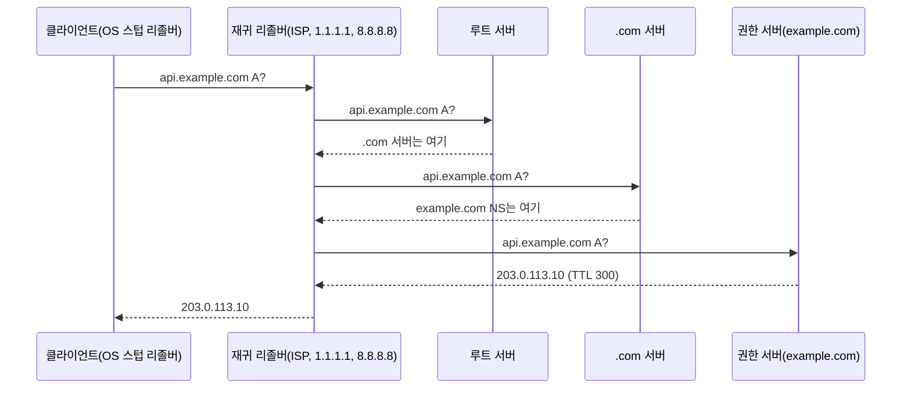

# DNS 실무

> 도메인 이름이 IP 주소가 되기까지, 그리고 레코드를 바꿀 때 실수하지 않는 법

기본 레코드 몇 개는 [Network Protocols](./protocol.md#3-dns-domain-name-system-실무-팁)에 짧게 정리되어 있습니다. 이 문서는 조회 과정, 레코드 전체, 변경 절차를 다룹니다.

---

## 조회 과정



| 용어 | 의미 |
| --- | --- |
| 재귀 리졸버 | 대신 끝까지 찾아 주고 결과를 TTL 동안 캐시 |
| 권한(authoritative) 서버 | 해당 존(zone)의 원본 레코드를 가진 서버. 도메인 등록처 또는 Route 53·Cloudflare 등 |
| 존 | 한 권한 서버가 관리하는 이름 범위. `example.com`과 하위 이름 |
| TTL | 캐시 유지 시간(초). 변경이 퍼지는 최대 지연 |

캐시는 여러 겹입니다: 브라우저 → OS → 재귀 리졸버. "DNS 전파"는 실제로는 이 캐시들이 TTL에 따라 만료되는 과정입니다.

---

## 레코드 종류

| 레코드 | 용도 | 예 |
| --- | --- | --- |
| `A` | 이름 → IPv4 | `api  A  203.0.113.10` |
| `AAAA` | 이름 → IPv6 | `api  AAAA  2001:db8::10` |
| `CNAME` | 이름 → 다른 이름(별칭) | `www  CNAME  myapp.vercel.app.` |
| `MX` | 메일 서버(우선순위 포함) | `@  MX  10 mail.example.com.` |
| `TXT` | 임의 텍스트. 도메인 소유 확인, SPF·DKIM·DMARC | `@  TXT  "v=spf1 include:_spf.google.com ~all"` |
| `NS` | 이 존의 권한 서버 | `@  NS  ns1.provider.net.` |
| `SOA` | 존 메타데이터(일련번호, 부정 응답 캐시 시간 등) | 존마다 하나 |
| `CAA` | 이 도메인에 인증서를 발급할 수 있는 CA 제한 | `@  CAA  0 issue "letsencrypt.org"` |
| `SRV` | 서비스의 호스트·포트 | `_sip._tcp  SRV  10 5 5060 sip.example.com.` |
| `HTTPS` / `SVCB` | HTTP/3 지원, 대체 엔드포인트 등 연결 정보를 미리 알림 | `@  HTTPS  1 . alpn="h3,h2"` |

### CNAME 규칙

- CNAME이 있는 이름에는 **다른 레코드를 함께 둘 수 없습니다**. 그래서 루트 도메인(`example.com`, `@`)에는 보통 CNAME을 쓰지 못합니다(루트에는 NS·SOA가 반드시 있으므로).
- 루트를 외부 서비스로 보내야 하면 DNS 업체의 `ALIAS`/`ANAME`/CNAME flattening 기능을 씁니다. 표준 레코드가 아니라 업체가 A 레코드로 바꿔 응답하는 기능입니다.
- 레코드 값 끝의 `.`은 "완전한 이름"이라는 뜻입니다. 빠뜨리면 일부 존 파일 형식에서 `myapp.vercel.app.example.com`처럼 존 이름이 붙습니다.

---

## 레코드 변경 절차 (서버 이전 등)

```
D-2일  기존 레코드 TTL을 300(5분) 이하로 낮춤
       └ 기존 TTL(예: 86400)만큼 기다려야 낮은 TTL이 모든 캐시에 반영됨
D-day  레코드 값을 새 IP로 변경
       └ 구 서버는 최소 이전 TTL 동안 계속 살려 둠
D+1일  문제 없으면 TTL을 다시 3600 등으로 올림
```

- **부정 캐시**: 존재하지 않는 이름(NXDOMAIN)도 캐시됩니다. 시간은 SOA 레코드의 값으로 정해집니다. 레코드를 만들기 전에 조회해 보면, 만든 뒤에도 한동안 "없음"이 나올 수 있습니다.
- **내 PC 캐시 비우기 (macOS)**: `sudo dscacheutil -flushcache; sudo killall -HUP mDNSResponder`

---

## 조회 명령 (`dig`)

```bash
dig example.com                 # A 레코드, 전체 응답
dig +short example.com          # 값만
dig example.com AAAA
dig example.com MX +short
dig @1.1.1.1 example.com        # 특정 리졸버에 질의
dig @ns1.provider.net example.com   # 권한 서버에 직접 질의 (캐시 우회)
dig +trace example.com          # 루트부터 위임 경로 추적
dig -x 203.0.113.10             # 역방향(PTR) 조회
dig example.com TYPE65          # HTTPS 레코드 (구버전 dig은 HTTPS 타입 이름을 모름)
```

| 확인 상황 | 명령 |
| --- | --- |
| 바꿨는데 반영이 안 됨 | 권한 서버 직접 질의 → 맞으면 캐시 문제, TTL 대기 |
| 도메인 연결 자체가 안 됨 | `dig +trace`로 NS 위임 확인 (등록처의 네임서버 설정) |
| 인증서 발급 실패 | `dig CAA example.com`으로 CA 제한 확인 |

---

## 이메일 인증 레코드

| 레코드 | 위치 | 역할 |
| --- | --- | --- |
| SPF | `@ TXT "v=spf1 ..."` | 이 도메인으로 메일을 보낼 수 있는 서버 목록 |
| DKIM | `<selector>._domainkey TXT` | 메일 서명 검증용 공개키 |
| DMARC | `_dmarc TXT "v=DMARC1; p=none; rua=mailto:..."` | SPF·DKIM 실패 시 처리 정책과 보고 주소 |

> 메일 발송 서비스(SES, SendGrid 등)를 붙이면 이 세 가지를 모두 요구합니다. DMARC는 `p=none`으로 보고서를 받아 본 뒤 `quarantine` → `reject`로 올립니다.

---

## 🎯 체크리스트

- [ ] 이전·변경 전에 TTL을 미리 낮춤
- [ ] 루트 도메인에 CNAME 대신 ALIAS/flattening
- [ ] `CAA`로 사용하는 CA만 허용
- [ ] 메일 쓰는 도메인은 SPF·DKIM·DMARC
- [ ] 메일 안 쓰는 도메인은 `v=spf1 -all`, DMARC `p=reject`로 사칭 방지
- [ ] 레코드 확인은 권한 서버 직접 질의로

## 참고 자료

- [RFC 1034 Domain Names - Concepts and Facilities](https://www.rfc-editor.org/rfc/rfc1034.html) - CNAME과 다른 데이터의 공존 금지
- [RFC 2308 Negative Caching of DNS Queries](https://www.rfc-editor.org/rfc/rfc2308.html) - SOA 기반 부정 캐시
- [RFC 8659 CAA Resource Record](https://www.rfc-editor.org/rfc/rfc8659.html)
- [RFC 9460 SVCB and HTTPS Resource Records](https://www.rfc-editor.org/rfc/rfc9460.html)

확인일: 2026-10-22 (RFC 번호와 제목, `dig` 명령은 macOS의 DiG 9.10.6에서 실행 확인. SPF·DKIM·DMARC 레코드 형식과 macOS 캐시 비우기 명령은 미확인)
