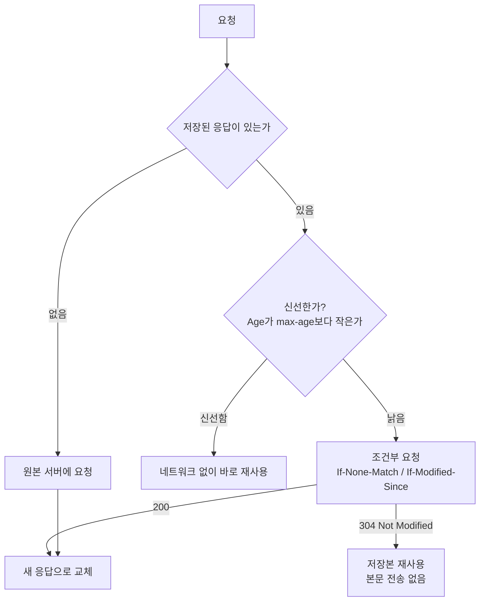

# HTTP 캐싱

> 같은 응답을 다시 받지 않도록 **어디서, 얼마나 오래, 어떻게 확인하며** 재사용할지 정하는 규칙

성능 지표는 [Web Performance](../Web/web-performance.md), 서비스 워커의 캐시는 [PWA](../Web/pwa.md#캐싱-전략), 조건부 요청의 API 쪽 활용은 [API 설계: ETag](../API/api-design.md#동시-수정-충돌-조건부-요청etag-if-match)를 참고합니다.

---

## 개념: 캐시는 두 가지 질문에 답한다

캐시가 저장된 응답을 만나면 먼저 **"이 응답이 아직 신선한가?"**를 판단하고, 아니면 **"원본에 물어서 아직 쓸 수 있는지 확인"**합니다.



| 단계 | 하는 일 | 비용 |
| --- | --- | --- |
| **신선도(freshness)** | 유효 기간 안이면 **서버에 묻지 않고** 재사용 | 거의 0 |
| **검증(validation)** | 낡았으면 "바뀌었나?"만 묻고, 같으면 **304와 빈 본문** | 왕복 1회, 본문 전송 없음 |

### 캐시는 한 곳이 아니다

| 종류 | 예 | 특징 |
| --- | --- | --- |
| **사설(private) 캐시** | 브라우저 | 한 사용자만 씀 |
| **공유(shared) 캐시** | CDN, 리버스 프록시, 회사 프록시 | **여러 사용자가 공유**하므로 개인화된 응답을 저장하면 안 됨 |

공유 캐시를 거치는 응답에 사용자별 내용(주문 내역, 프로필)이 `public`으로 저장되면 **다른 사용자에게 노출**되는 사고가 됩니다. 이 구분이 아래 `private`/`public`/`s-maxage`의 이유입니다.

---

## 신선도: `Cache-Control` 응답 지시어

RFC 9111(HTTP Caching) 기준입니다.

| 지시어 | 의미 |
| --- | --- |
| `max-age=N` | 응답이 만들어진 지 **N초가 지나면 낡은(stale) 것**으로 봄 |
| `s-maxage=N` | **공유 캐시에서만** `max-age`와 `Expires`를 덮어씀 |
| `no-cache` | 저장은 해도 되지만 **재사용 전에 반드시 원본에 검증**해야 함 |
| `no-store` | **저장 자체를 금지** (요청과 응답 어느 부분도 저장하지 않음) |
| `private` | **공유 캐시는 저장 금지**. 사설 캐시(브라우저)만 저장 가능 |
| `public` | 공유 캐시도 저장 가능 (명시적으로 캐시 가능함을 표시) |
| `must-revalidate` | 낡은 뒤에는 **검증에 성공하기 전까지 재사용 금지**. 연결이 끊겨도 낡은 응답을 쓰지 않고 오류를 반환 |
| `immutable` | 신선한 기간 안에는 **바뀌지 않는다**고 약속 → 새로고침 시에도 조건부 요청을 보내지 말 것 (RFC 8246) |
| `stale-while-revalidate=N` | 낡은 뒤 **N초 동안은 낡은 응답을 먼저 주고** 뒤에서 검증 (RFC 5861) |

### 가장 흔한 오해: `no-cache`는 "캐시하지 않음"이 아니다

| | 저장 | 재사용 |
| --- | --- | --- |
| `no-cache` | **한다** | **검증 후에만** (변경 없으면 304로 빠르게 재사용) |
| `no-store` | **안 한다** | 안 한다 |

- 항상 최신이어야 하지만 대용량 전송은 줄이고 싶으면 `no-cache` + `ETag`가 맞습니다.
- `no-store`는 저장을 막지만 RFC도 **개인정보 보호를 위한 신뢰할 수 있는 수단은 아니라고** 못 박습니다(악의적이거나 손상된 캐시는 무시할 수 있고, 네트워크는 도청될 수 있음). 민감한 데이터는 HTTPS와 접근 통제가 우선입니다.

### 헤더가 없으면: 휴리스틱 신선도

`Cache-Control`이나 `Expires`가 없어도 캐시는 **추정한 유효 기간**으로 재사용할 수 있습니다. RFC는 `Last-Modified`가 있으면 "마지막 수정 이후 경과 시간의 일정 비율(전형적으로 10%)" 이하로 정하도록 권합니다. 또 이 추정은 `200`, `203`, `204`, `206`, `300`, `301`, `308`, `404`, `405`, `410`, `414`, `501`처럼 **휴리스틱으로 캐시 가능한 상태 코드**에만 쓸 수 있습니다.

```
HTTP/1.1 200 OK
Last-Modified: Mon, 01 Jan 2024 00:00:00 GMT       ← Cache-Control 없음 (실행해서 확인한 로컬 응답)
```

의도하지 않은 캐싱을 막으려면 **항상 `Cache-Control`을 명시**합니다.

### `Age`: 이 응답이 얼마나 오래됐나

`Age` 응답 헤더는 응답이 원본에서 만들어지거나 검증된 뒤 지난 시간의 추정치입니다. CDN을 거치면 이 값이 보입니다. 실제 CDN 자산(cdnjs의 React 18.3.1)의 응답입니다.

```
cache-control: no-transform, public, s-maxage=30672000, max-age=30672000, immutable
age: 2542556
vary: Accept-Encoding
```

355일(30,672,000초) 동안 신선하고 `immutable`이며, 이미 약 29일(2,542,556초) 동안 캐시에 있었다는 뜻입니다.

---

## 검증: `ETag`와 `Last-Modified`, 304

낡은 응답을 버리지 않고 **"그대로인지"만 묻는** 방법입니다.

| 응답 헤더 | 조건부 요청 헤더 | 설명 |
| --- | --- | --- |
| `ETag: "4af9a96c"` | `If-None-Match: "4af9a96c"` | 내용의 식별자. 내용 해시 등으로 만듦 |
| `Last-Modified: <날짜>` | `If-Modified-Since: <날짜>` | 마지막 수정 시각 |

로컬 서버에서 실행한 결과입니다.

```
# 1) 첫 요청
HTTP/1.1 200 OK
Cache-Control: no-cache
ETag: "4af9a96c"

# 2) 같은 ETag로 재검증
GET /api/users   If-None-Match: "4af9a96c"
HTTP/1.1 304 Not Modified          ← 본문 0바이트
```

- 304는 **본문이 없어** 전송량이 줄고, 서버는 변경 여부만 판단하면 됩니다(서버가 데이터를 매번 만들어야 한다면 서버 비용은 그대로일 수 있음).
- 서버가 여러 대일 때 **서버마다 ETag가 다르게 계산**되면(파일 inode·수정 시각 기반 등) 검증이 계속 실패해 304 대신 200이 됩니다. 내용 해시로 ETag를 만들면 서버 간에 일관됩니다(일반 경험).

---

## 무엇에 어떤 헤더를 쓸까

| 대상 | 권장 헤더 | 이유 |
| --- | --- | --- |
| **해시가 붙은 정적 파일** (`app.3f9c2a.js`) | `public, max-age=31536000, immutable` | 내용이 바뀌면 **파일 이름이 바뀌므로** 오래 캐시해도 안전 |
| **HTML 문서** | `no-cache` (+ `ETag`) | 배포 시 새 해시 파일 이름을 담은 HTML을 **즉시** 받아야 함 |
| **공개 API (모두 같은 응답)** | `public, max-age=60` 등 짧게 | 서버 부하 감소, 짧은 지연 허용 |
| **사용자별 응답** | `private` 또는 `no-store` | 공유 캐시 저장 방지 |
| **해시 없는 정적 파일** (`logo.png`) | `max-age` 짧게 + `ETag`, 또는 `no-cache` | 바뀌어도 URL이 같으므로 긴 캐시는 낡은 파일을 오래 보여 줌 |

### 핵심 전략: "URL을 바꿔서 캐시를 무효화한다"

캐시된 응답은 **만료 전에 지울 방법이 없습니다.** 그래서 파일에 내용 해시를 붙여(`app.3f9c2a.js`) 내용이 바뀌면 URL을 바꾸고, 그 URL을 가리키는 HTML만 짧게(또는 검증하며) 캐시합니다.

```
index.html  (no-cache)  →  <script src="/app.3f9c2a.js">   (1년, immutable)
배포 후:    index.html  →  <script src="/app.8b41d0.js">   (새 URL이므로 즉시 새로 받음)
```

[PWA의 서비스 워커 캐시](../Web/pwa.md#캐시-무효화는-직접-해야-한다)와 같은 이유로 **HTML은 오래 캐시하지 않습니다.**

---

## `Vary`: 같은 URL이라도 요청에 따라 응답이 다를 때

캐시는 보통 URL로 응답을 찾지만, 응답이 **요청 헤더에 따라 달라지면** `Vary`로 어떤 헤더를 키에 포함할지 알려야 합니다. RFC 9111은 저장된 응답에 `Vary`가 있으면, **Vary가 지목한 요청 헤더들이 모두 일치할 때만** 재검증 없이 쓸 수 있다고 정합니다.

| `Vary` 값 | 의미 | 주의 |
| --- | --- | --- |
| `Accept-Encoding` | gzip/br 등 압축 방식별로 따로 저장 | 거의 항상 필요 (cdnjs 응답에도 있음) |
| `Origin` | CORS에서 출처별로 헤더가 달라질 때 | [CORS의 `Vary: Origin`](../Security/cors.md#출처를-동적으로-허용할-때-vary-origin) |
| `Cookie` | 쿠키마다 응답이 다름 | 사용자마다 따로 저장되어 **공유 캐시 적중률이 사실상 0**이 됨. 가급적 피함 |

`Vary`를 빠뜨리면 압축본을 압축 미지원 클라이언트에 주거나, A 출처용 CORS 응답을 B 출처에 내주는 문제가 생깁니다.

---

## CDN과 공유 캐시

- `s-maxage`로 **CDN에서의 유효 기간을 브라우저와 다르게** 줄 수 있습니다(예: 브라우저는 `max-age=60`, CDN은 `s-maxage=3600`).
- 긴 `s-maxage`를 쓰면 **CDN에서 즉시 지우는 기능**(퍼지, 무효화)을 제공하는지 확인합니다. 브라우저 캐시에는 퍼지가 없으므로, 오래 저장될 응답은 처음부터 URL로 버전을 관리합니다.
- 인증이 필요한 응답이 CDN에 저장되지 않는지 확인합니다. `private`/`no-store`를 쓰거나 CDN 설정으로 쿠키·`Authorization`이 있는 요청을 캐시에서 제외합니다.

---

## 서버에서 설정하기

**Node.js (표준 `http`, 위 결과를 낸 코드의 요지)**

```javascript
// 해시가 붙은 정적 파일
res.setHeader("Cache-Control", "public, max-age=31536000, immutable");

// 항상 검증하는 API/HTML
res.setHeader("Cache-Control", "no-cache");
res.setHeader("ETag", etag);
if (req.headers["if-none-match"] === etag) {
  res.statusCode = 304;
  return res.end();
}
```

**Nginx의 `expires`**

```nginx
location ~* \.(js|css|png|jpg|svg|woff2)$ {
    expires 1y;                                    # Expires + Cache-Control: max-age=31536000
    add_header Cache-Control "public, immutable";  # 하나 더 추가됨
}
```

- `expires`는 **양수 시간이면 `Cache-Control: max-age=<초>`와 `Expires`를 함께 추가**하고, 음수면 `Cache-Control: no-cache`를 추가합니다. `epoch`는 과거 시각과 `no-cache`, `max`는 10년입니다. 이 헤더는 `200`, `201`, `204`, `206`, `301`, `302`, `303`, `304`, `307`, `308` 응답에만 붙습니다.
- 위처럼 `add_header Cache-Control`을 더하면 `Cache-Control` 헤더가 **두 줄**이 되고, 두 줄은 하나로 합쳐 해석됩니다(HTTP 헤더 결합 규칙, 이 동작을 실제 nginx에서 실행해 확인하지는 못함).
- `add_header`의 상속 규칙은 [웹 공격과 방어](../Security/web-attacks.md#nginx-예시)를 참고합니다.

---

## 확인하는 방법

```bash
# 응답 헤더 보기
curl -sI https://example.com/app.js

# 조건부 요청이 304로 돌아오는지
curl -sI -H 'If-None-Match: "4af9a96c"' https://example.com/api/users
```

- 브라우저 개발자 도구 Network 탭에서 **Size 열**을 봅니다. 메모리/디스크 캐시에서 온 것은 그렇게 표시되고, 304는 크기가 매우 작습니다. 캐시 없이 확인하려면 "Disable cache"를 켭니다.
- 새로고침과 강력 새로고침, 주소창 입력은 **브라우저마다 캐시를 다르게 다룹니다.** 캐시 동작을 확인할 때는 `curl`처럼 브라우저 정책이 끼지 않는 도구를 먼저 씁니다.

---

## 🎯 체크리스트

- [ ] 모든 응답에 `Cache-Control`을 **명시** (휴리스틱 캐싱에 맡기지 않기)
- [ ] 정적 파일은 **내용 해시를 파일명에** 넣고 `max-age=31536000, immutable`
- [ ] HTML은 `no-cache` + `ETag` (또는 짧은 `max-age`)
- [ ] 사용자별 응답은 `private` 또는 `no-store`, CDN에 저장되지 않는지 확인
- [ ] 응답이 요청 헤더에 따라 달라지면 `Vary` 지정, `Vary: Cookie`는 피함
- [ ] 서버가 여러 대면 `ETag` 계산이 서버 간 일관적인지 확인
- [ ] 긴 `s-maxage`를 쓰면 CDN 퍼지 방법 확보

## 참고 자료

- [RFC 9111 HTTP Caching](https://www.rfc-editor.org/rfc/rfc9111.html) - 지시어(`max-age`, `s-maxage`, `no-cache`, `no-store`, `private`, `must-revalidate`), 휴리스틱 신선도, `Vary`와 캐시 키, `Age`
- [RFC 9110 HTTP Semantics](https://www.rfc-editor.org/rfc/rfc9110.html) - 휴리스틱으로 캐시 가능한 상태 코드(§15.1), 조건부 요청
- [RFC 8246 HTTP Immutable Responses](https://www.rfc-editor.org/rfc/rfc8246.html) - `immutable`
- [RFC 5861 HTTP Cache-Control Extensions for Stale Content](https://www.rfc-editor.org/rfc/rfc5861.html) - `stale-while-revalidate`
- [Nginx: headers 모듈 `expires`](https://nginx.org/en/docs/http/ngx_http_headers_module.html#expires) - `expires`가 설정하는 헤더, 값의 의미, 적용 상태 코드

확인일: 2026-10-23 (RFC 9111·9110·8246·5861 본문과 Nginx 문서에서 확인한 정의. `no-cache`와 `ETag` 재검증이 304·본문 0바이트로 동작하는 것, 해시 파일의 `immutable` 응답, `Last-Modified`만 있는 응답은 Node 24로 만든 로컬 서버에 `curl`로 직접 실행해 확인. cdnjs의 `Cache-Control`·`Age`·`Vary`는 실제 응답을 `curl -I`로 확인한 시점의 값이며 변할 수 있음. 파일별 헤더 권장 표, 서버 간 ETag 불일치, 공유 캐시의 개인정보 노출 사고 설명, 브라우저별 새로고침 동작은 일반 개념·경험칙이고 브라우저 동작은 확인하지 못함. Nginx에서 `expires`와 `add_header`를 함께 쓴 실제 응답은 nginx가 없어 확인하지 못함)
