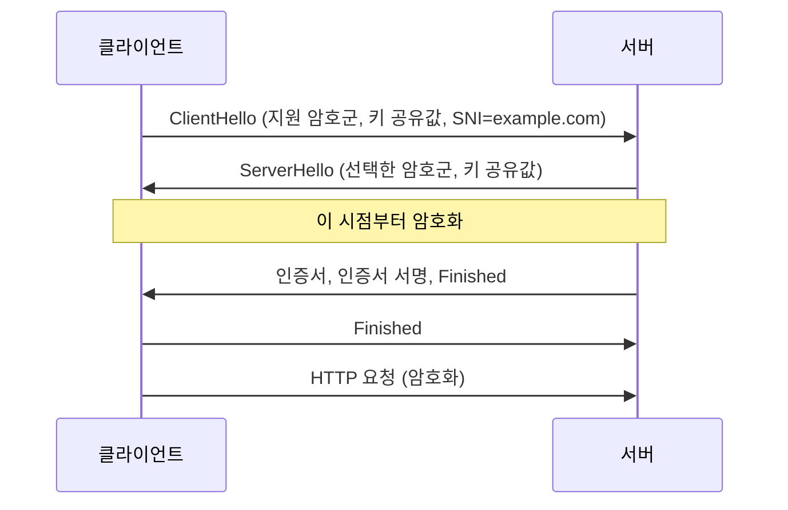

# TLS와 인증서

> HTTPS의 S. 연결을 암호화하고, 접속한 서버가 진짜인지 확인하는 방법

Nginx 설정과 Certbot 사용법은 [SSL 설정](../Infrastructure/nginx/ssl.md)을 참고합니다.

---

## TLS가 해 주는 것

| 기능 | 의미 |
| --- | --- |
| 기밀성 | 중간에서 내용을 볼 수 없음 |
| 무결성 | 중간에서 내용을 바꾸면 감지 |
| 서버 인증 | 인증서로 "이 서버가 정말 example.com인가" 확인 |

---

## TLS 1.3 핸드셰이크

TLS 1.2는 키 교환까지 2번 왕복(2-RTT)이 필요했고, TLS 1.3은 1번(1-RTT)입니다.



| 용어 | 의미 |
| --- | --- |
| SNI | ClientHello에 담는 접속 도메인 이름. 한 IP에서 여러 도메인 인증서를 구분 |
| ALPN | 같은 핸드셰이크에서 HTTP/2(`h2`)·HTTP/1.1 중 무엇을 쓸지 협상 |
| 0-RTT | 재접속 시 첫 메시지에 데이터를 실어 보냄. **재전송(replay) 공격에 취약**하므로 멱등한 요청에만 |
| 전방 비밀성 | 매 연결마다 임시 키를 써서, 서버 개인키가 나중에 유출돼도 과거 통신은 풀리지 않음 |

### 버전 정책

- **TLS 1.0, 1.1**: 폐기(RFC 8996). 끕니다.
- **TLS 1.2**: 호환용으로 유지.
- **TLS 1.3**: 기본. 2026-07에 RFC 9846이 RFC 8446을 대체했습니다(같은 TLS 1.3의 개정판).

```nginx
ssl_protocols TLSv1.2 TLSv1.3;
```

---

## 인증서 체인

```
루트 CA (브라우저·OS에 미리 설치)
  └─ 중간 CA (루트가 서명)
       └─ 서버 인증서 example.com (중간 CA가 서명)
```

- 서버는 **서버 인증서 + 중간 인증서**를 함께 보내야 합니다(`fullchain.pem`). 중간 인증서를 빠뜨리면 데스크톱 브라우저는 우연히 동작하고 모바일·curl·서버 간 호출에서만 실패하는 일이 흔합니다.
- 인증서의 이름은 **SAN(Subject Alternative Name)** 필드로 확인합니다. `*.example.com` 와일드카드는 한 단계 하위만 덮고 `example.com` 자체는 포함하지 않습니다.

---

## 인증서 유효 기간이 짧아지고 있다

CA/Browser Forum 기준 공개 TLS 인증서의 최대 유효 기간:

| 적용일 | 최대 유효 기간 | 도메인 검증 재사용 기간 |
| --- | --- | --- |
| 2026-03-15 | 200일 | 200일 |
| 2027-03-15 | 100일 | 100일 |
| 2029-03-15 | 47일 | 10일 |

Let's Encrypt 일정 (기본 `classic` 프로필):

| 시점 | 유효 기간 |
| --- | --- |
| 현재 | 90일 (선택 시 6일짜리 단기 인증서) |
| 2026-05-13 | `tlsserver` 프로필(선택)에서 45일 |
| 2027-02-10 | 기본 64일 |
| 2028-02-16 | 기본 45일 |

**해야 할 일**

- 갱신은 반드시 자동화합니다. 수동 갱신은 더 이상 현실적이지 않습니다.
- "60일마다 갱신" 같은 **고정 주기를 쓰지 않습니다**. ACME 클라이언트의 **ARI(ACME Renewal Information)** 지원을 켜거나, 유효 기간의 약 2/3 시점에 갱신합니다.
- 만료 알림 모니터링을 따로 둡니다.
- Let's Encrypt는 2025-08에 OCSP를 종료하고 폐기 정보를 CRL로만 제공합니다. `ssl_stapling` 설정은 Let's Encrypt 인증서에서 의미가 없습니다.

---

## 확인 명령

```bash
# 협상된 프로토콜·암호군
openssl s_client -connect example.com:443 -servername example.com </dev/null | grep -E 'Protocol|Cipher'

# 인증서 유효 기간, 이름(SAN)
echo | openssl s_client -connect example.com:443 -servername example.com 2>/dev/null \
  | openssl x509 -noout -dates -subject -ext subjectAltName

# 체인 전체 보기
openssl s_client -connect example.com:443 -servername example.com -showcerts </dev/null

# 특정 버전 강제 (TLS 1.1이 꺼졌는지 확인)
openssl s_client -connect example.com:443 -tls1_1 </dev/null
```

> `-servername`을 빠뜨리면 SNI가 없어 다른 도메인의 기본 인증서가 나올 수 있습니다.

---

## 흔한 오류

| 증상 | 원인 |
| --- | --- |
| `unable to get local issuer certificate` | 중간 인증서 누락 → `fullchain.pem` 사용 |
| `certificate has expired` | 자동 갱신 실패. 갱신 로그와 cron/타이머 확인 |
| `hostname mismatch` | SAN에 접속 이름이 없음. `www` 포함 여부 확인 |
| 브라우저는 되는데 앱(Node, Java)만 실패 | 중간 인증서 누락, 또는 사내 프록시 CA가 런타임 신뢰 저장소에 없음 |
| 인증서 발급 실패 | `CAA` 레코드가 해당 CA를 막고 있음 ([DNS](./dns.md)) |

## 🎯 체크리스트

- [ ] TLS 1.2, 1.3만 허용
- [ ] `fullchain.pem`으로 중간 인증서 포함
- [ ] 자동 갱신 + ARI 또는 유효 기간 비례 갱신
- [ ] 만료 모니터링
- [ ] HSTS 헤더 ([웹 공격과 방어](../Security/web-attacks.md#보안-응답-헤더))
- [ ] `CAA` 레코드로 사용 CA 제한

## 참고 자료

- [RFC 9846 TLS 1.3](https://www.rfc-editor.org/rfc/rfc9846.html) - 2026-07 발행, RFC 8446 대체
- [RFC 8996 Deprecating TLS 1.0 and TLS 1.1](https://www.rfc-editor.org/rfc/rfc8996.html)
- [CA/Browser Forum Baseline Requirements](https://cabforum.org/working-groups/server/baseline-requirements/requirements/) - 유효 기간과 검증 재사용 기간 일정(1.2.2 Relevant Dates)
- [Let's Encrypt: Decreasing Certificate Lifetimes to 45 Days](https://letsencrypt.org/2025/12/02/from-90-to-45) - 프로필별 일정, ARI 권장
- [Let's Encrypt 인증서 수명](https://letsencrypt.org/docs/cert-lifetimes/) - 90일 기본, 6일 선택
- [Let's Encrypt OCSP 종료 공지](https://community.letsencrypt.org/t/ending-ocsp-support-in-2025/229786)

확인일: 2026-10-22 (RFC 상태, 유효 기간 일정, Let's Encrypt 일정·OCSP 종료, `openssl` 명령은 example.com 대상으로 실행 확인. 일정은 6개월 후 재확인 대상)
