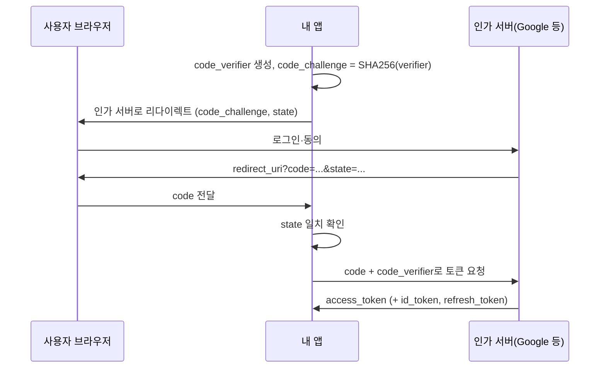

# 인증과 비밀번호 저장

> 비밀번호를 어떻게 받고, 어떻게 저장하고, 외부 로그인(OAuth/OIDC)을 어떻게 붙이는가

쿠키 속성은 [Cookie](./cookie.md), 토큰 구조와 갱신 흐름은 [JWT](./jwt.md)를 참고합니다.

---

## 인증 vs 인가

| 구분 | 질문 | 실패 시 응답 |
| --- | --- | --- |
| 인증(Authentication) | 누구인가? | `401 Unauthorized` |
| 인가(Authorization) | 이것을 해도 되는가? | `403 Forbidden` |

인증이 끝났다고 인가가 끝난 것은 아닙니다. 리소스마다 서버에서 소유자·역할을 확인합니다([OWASP A01](./owasp-top-10.md#a01-broken-access-control-접근-제어-실패)).

---

## 비밀번호 정책 (NIST SP 800-63B-4)

| 항목 | 기준 |
| --- | --- |
| 최소 길이 | 비밀번호만으로 로그인하면 **15자**, MFA의 한 요소로 쓰면 **8자** |
| 최대 길이 | 최소 **64자**까지 허용 |
| 조합 규칙 | 대문자·숫자·특수문자 섞기 같은 규칙을 **강제하지 않음** |
| 주기적 변경 | **요구하지 않음**. 유출 증거가 있을 때만 변경 |
| 차단 목록 | 흔한 비밀번호·유출 비밀번호 목록과 **전체 일치** 비교, 거부 시 이유를 알려 줌 |
| 힌트 | 로그인 전 사용자가 볼 수 있는 힌트 저장 금지 |

> 예전의 "8자 이상 + 특수문자 + 90일마다 변경"은 현재 기준과 반대입니다. 길이를 늘리고 유출 목록을 대조하는 쪽이 효과가 큽니다.

---

## 비밀번호 해시 선택 (OWASP Password Storage)

일반 해시(SHA-256 등)는 너무 빨라서 무차별 대입에 약합니다. 일부러 느리고 메모리를 많이 쓰는 **비밀번호 전용 해시**를 씁니다.

| 우선순위 | 알고리즘 | 최소 설정 | 언제 |
| --- | --- | --- | --- |
| 1 | **Argon2id** | m=19 MiB(19456 KiB), t=2, p=1 | 기본 선택 |
| 2 | scrypt | N=2^17(128 MiB), r=8, p=1 | Argon2id를 못 쓸 때 |
| 3 | bcrypt | cost ≥ 10, 입력 72바이트 제한 | 레거시 시스템 |
| 4 | PBKDF2 | HMAC-SHA-256 600,000회 / HMAC-SHA-512 220,000회 | FIPS-140 준수가 필요할 때 |

```typescript
import * as argon2 from "argon2";

// 가입: salt는 라이브러리가 생성해 해시 문자열에 함께 저장
const hash = await argon2.hash(password, {
  type: argon2.argon2id,
  memoryCost: 19456, // KiB
  timeCost: 2,
  parallelism: 1,
});

// 로그인
const ok = await argon2.verify(hash, password);

// 저장된 해시가 현재 설정보다 약하면 다시 해시
if (ok && argon2.needsRehash(hash, { memoryCost: 19456, timeCost: 2, parallelism: 1 })) {
  await saveHash(userId, await argon2.hash(password, { type: argon2.argon2id }));
}
```

> `argon2` 패키지의 기본값(t=3, m=64 MiB, p=4, Argon2id)은 위 최소 기준보다 강합니다. 서버 메모리가 넉넉하면 기본값을 그대로 써도 됩니다.

- **salt**: 비밀번호마다 다른 값. 최신 라이브러리는 자동 생성해 해시 문자열에 포함합니다.
- **pepper**: 모든 비밀번호에 공통인 비밀 값. DB가 아닌 시크릿 저장소·HSM에 따로 둡니다. 심층 방어용이며, 바꾸려면 사용자 전원이 비밀번호를 재설정해야 합니다.
- **설정 올리기**: 해시 문자열에 파라미터가 들어 있으므로, 로그인 성공 시 현재 기준보다 약하면 새 설정으로 다시 해시해 저장합니다.

---

## 세션 vs 토큰

| 구분 | 서버 세션 + 쿠키 | 자체 포함 토큰(JWT) |
| --- | --- | --- |
| 상태 | 서버(DB·Redis)에 세션 저장 | 토큰 안에 클레임 |
| 즉시 로그아웃·차단 | 세션 삭제로 바로 가능 | 만료까지 유효(차단 목록 필요) |
| 확장 | 세션 저장소 공유 필요 | 서명 검증만 하면 됨 |
| 잘 맞는 곳 | 같은 도메인의 웹 앱 | 여러 서비스·모바일 API |

1인·소규모 웹 서비스라면 **HttpOnly 세션 쿠키**가 가장 단순하고 안전한 기본값입니다. 토큰이 필요하면 짧은 액세스 토큰 + 회전하는 리프레시 토큰으로 갑니다.

---

## OAuth 2.0과 OIDC

| 용어 | 의미 |
| --- | --- |
| OAuth 2.0 | **인가** 위임. "이 앱이 내 캘린더를 읽어도 된다" |
| OIDC (OpenID Connect) | OAuth 위에 얹은 **인증**. ID 토큰으로 "누가 로그인했는지" 전달 |
| Authorization Code + PKCE | 현재 권장 흐름. 공개 클라이언트(SPA·모바일)는 PKCE 필수 |

### 권장 흐름



### OAuth 보안 BCP (RFC 9700) 요점

- **Implicit 흐름(`response_type=token`) 쓰지 않기** → Authorization Code 사용
- **Resource Owner Password 흐름 금지** (앱이 사용자 비밀번호를 직접 받는 방식)
- **공개 클라이언트는 PKCE 필수**, 기밀 클라이언트도 PKCE 권장
- **redirect_uri는 정확히 일치** 비교 (와일드카드·부분 일치 금지)
- 공개 클라이언트의 **리프레시 토큰은 회전**하거나 클라이언트에 묶기(sender-constrained)

---

## MFA

| 방식 | 강도 | 비고 |
| --- | --- | --- |
| 패스키(WebAuthn) | 높음 | 피싱 저항. 도메인에 묶여 가짜 사이트에서 동작하지 않음 |
| TOTP 앱 | 중간 | 오프라인 동작. 피싱 사이트에 코드 입력 가능 |
| SMS | 낮음 | SIM 스와핑 위험. 대안이 없을 때만 |

---

## 🎯 체크리스트

- [ ] 비밀번호 최소 15자(단일 요소), 최대 64자 이상 허용, 조합 규칙 없음
- [ ] 유출 비밀번호 목록 대조
- [ ] Argon2id(또는 scrypt/bcrypt)로 해시
- [ ] 로그인 시도 제한, 계정 잠금 대신 지연·CAPTCHA 고려
- [ ] 로그인 실패 메시지는 "아이디 또는 비밀번호가 올바르지 않습니다"로 통일
- [ ] 비밀번호 변경·재설정 시 기존 세션 무효화
- [ ] 외부 로그인은 Authorization Code + PKCE, `state` 검증

## 참고 자료

- [NIST SP 800-63B-4](https://pages.nist.gov/800-63-4/sp800-63b.html) - 비밀번호 길이, 조합 규칙, 변경 주기, 차단 목록, 힌트
- [OWASP Password Storage Cheat Sheet](https://cheatsheetseries.owasp.org/cheatsheets/Password_Storage_Cheat_Sheet.html) - 알고리즘 순서와 최소 파라미터, pepper
- [RFC 9700 OAuth 2.0 Security Best Current Practice](https://www.rfc-editor.org/rfc/rfc9700.html) - Implicit·Password 흐름, PKCE, redirect URI, 리프레시 토큰
- [node-argon2](https://github.com/ranisalt/node-argon2) - 옵션 이름과 기본값은 패키지 0.45.1의 타입 정의(`argon2.d.cts`)로 확인

확인일: 2026-10-22 (비밀번호 기준·해시 파라미터·OAuth BCP 항목·`argon2` 옵션. MFA 비교는 경험칙)
